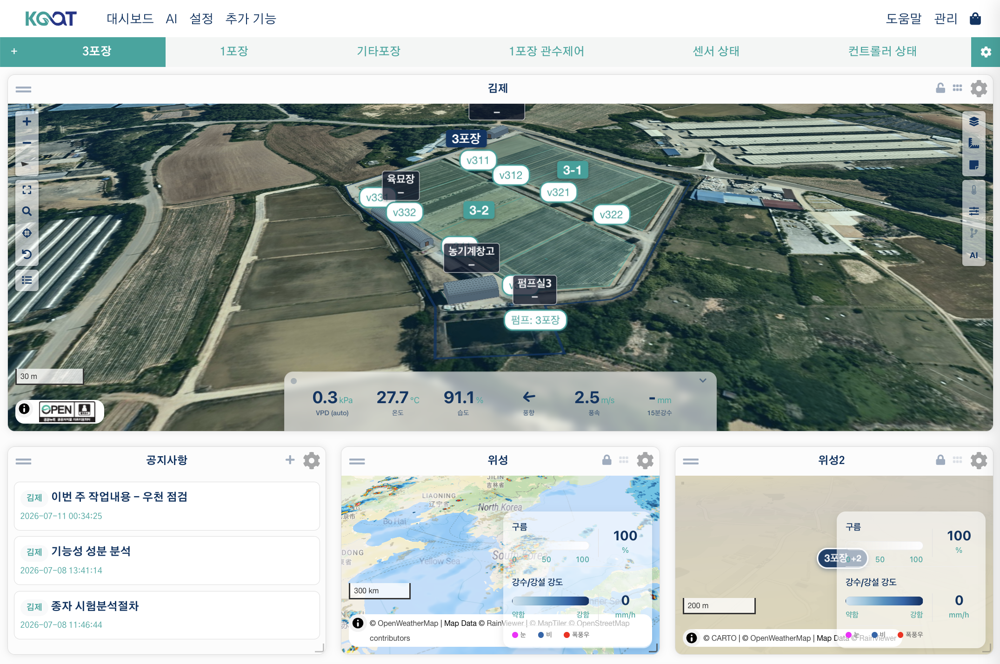

# AoT_map ウィジェット

`AoT_map` は、ハウス全体に散らばるセンサーやデバイスをひとつの地図上にまとめて表示し、その場から操作もできるダッシュボードウィジェットです。たとえば5棟のハウスに灌漑バルブが20台、温湿度センサーが10台散らばっているとしましょう — このウィジェットひとつで配置全体をひと目で把握でき、デバイスをクリックしてその場でオン/オフを切り替え、各地点の最新の実測値とAIアドバイスを確認できます。MapLibre GL上に構築されているため、3D地形、3D施設レンダリング、なめらかなズームに対応しています。

---

## ウィジェットを追加する { #adding-the-widget }

1. ダッシュボードで **ウィジェットを追加 → AoT マップ** を選択します。
2. 設定で表示する地図を選びます（空欄のままにすると、直近に編集された地図が使われます）。
3. **保存** をクリックします。

---

## 主な機能

### デバイスマーカー { #device-markers }

`/geo/design` のデバイスモード（**A**）で配置されたInput・Output・Functionデバイスは、地図上にマーカーとして表示されます。

- **マーカーの色**: デバイスの動作中／停止中／エラーの状態に応じて自動的に変わります。
- **重なりの処理**: 低いズームレベルでマーカーが重なると、件数を示すひとつのバッジにまとまります。ズームインすると個別のマーカーに戻ります。
- **デバイスアイコン**: デバイスの種類（温度センサー、リレー、ポンプなど）によってアイコンが変わります。
- **操作方式**: Outputのマーカーは通常、オン/オフの切り替えが開きます。対になった開閉アクチュエーター、または自分で位置を決めて0〜100%の位置を報告する値出力（Matterの窓カバリングなど）は、切り替えの代わりにClose/Stop/Openボタンと位置スライダーが開きます。

### ポップアップからその場で操作する { #control-right-from-the-popup }

マーカーをクリックすると、そのデバイスの種類に合ったウィンドウが開きます。

**Input（センサー）** — 測定値のラベルをクリックすると、過去24時間のチャート、すべての測定項目の現在値、ノートを書くためのショートカットを備えた詳細ウィンドウが開きます。これは、施設やゾーンのモーダルからセンサーを開いたときに表示される**まったく同じウィンドウ**です。

**Output / Function** — ゾーンや施設で使うのと同じ中央ウィンドウが開き、上から3つのブロックで構成されます。

1. **制御** — デバイス名とオン/オフの切り替え（**編集権限**を持つユーザーにのみ表示されます）。その下に稼働時間と次の予約があり、オン/オフの出力であれば **設定** ボタンも並びます。ウィンドウを開く目的はたいてい今すぐ操作することなので、このブロックが最上段にあります。
2. **履歴** — 直近の稼働履歴チャート。その判断を裏づける材料です。
3. **ノート一覧**

稼働時間は**2つの状態を1つの表示枠で共有**します。デバイスがオフの間は、最後に稼働していた時間を（薄く）表示し、オンになった瞬間、その同じ枠がライブの経過タイマー（太字）に変わります。ウィンドウが開いている間は、別のウィンドウやスケジュールが切り替えを行った場合でも、そのデバイスを追い続けます。

ポジションアクチュエーター（窓、カーテンなど）には切り替えの代わりにClose/Stop/Openボタンが表示されます。これは対になった開閉アクチュエーターだけでなく、自分で位置を決めて0〜100%の位置を報告する値出力（Matterの窓カバリングなど）も同じで、Closeは値0、Stopはオフ、Openは値100を送ります。さらにPWM出力は現在のパーセントと0〜100%のスライダーが表示されます。どちらにも **設定** ボタンはありません。

複合デバイスはそれ自体が稼働するものではないため、ウィンドウは**構成**から始まります — 中に収められたセンサーとデバイスの一覧で、履歴はありません。行をクリックすると、そのデバイス自身のウィンドウに移動します。

Facilityマーカーをクリックすると、3Dプレビューと環境データのサマリーが表示されます — 詳しくは下記の[3Dファシリティポップアップ](#3d-facility-popup)を参照してください。

### ゾーン／サイトをクリックする — デバイス一覧から操作する { #click-a-zonesite-control-from-a-device-list }

ZoneまたはSiteの図形をクリックすると、その中に配置されているすべてのセンサーと出力デバイスを一覧表示するポップアップが開きます。

- **センサー**: 2つ以上ある場合は、タブで切り替えて24時間チャートを確認できます。
- **出力デバイス一覧**: オン/オフの切り替え（**編集権限**が必要）でその場から操作でき、ドラッグして並べ替えられます。稼働時間はデバイスウィンドウと同じ規則に従い（オフ=最後の稼働時間、オン=ライブタイマー）、その横に次の予約が表示されます。デバイス名をクリックすると、上のチャート領域にそのデバイスの稼働履歴が描画されます。
- **ほかに影響する範囲**: 切り替えのすぐ下に、そのデバイスが他の区画も覆っている場合はその名前が表示され、オンにする前に何が一緒に動くかを読み取れます。
- **機能**: その範囲の機能がデバイス一覧の下に種類とともに並び、オン/オフのスイッチで有効・無効を切り替えられます。複合デバイスは名前をクリックするとそのデバイスのウィンドウが開きます。
- **設定（スケジュールオン）**: 各出力には **設定** ボタンがあります — [スケジュールオン](#scheduled-on)を参照してください。

ドラッグで決めた並び順は **ゾーン** の設定なので、そのゾーンを開く全員が同じ順序を見ます。サイトのウィンドウには保存される並び順はありません。

### 区画をクリックする — ここには何があるか { #plot }

デザインツールの[Plotモード](design-tool.md#plot)で描かれた区画は地図上に表示され、クリックするとその運用状況が開きます。ウィンドウには **現況 / 環境・制御 / 設定** の3つのタブがあります。

- **[現況] > リソース** — 2つの層があります。上は現在のステージが必要と宣言しているもので、下はこの区画に関わる灌漑装置が**今日**と**直近7日**にどれだけ稼働し、水がどれだけ出たか（推定）で、水量が出る装置が2つ以上あれば**合計**行が付きます。水量は設計流量（施設の配管図・露地地図のエミッター）× 稼働時間 × 区画の取り分であり、**流量計の実測ではありません**。その期間に稼働記録がない装置は0ではなく「記録なし」と示します。水量を出せない装置は行として出さず、表の**下の注記**がその名前と理由を示します — この区画の中にエミッターが描かれていないか、流量が不明かのどちらかです。同じ注記が、表全体について推定であることと区画の取り分がいくらかを一度だけ述べます。この区画にかかる領域にまだ装置が割り当てられていない場合は、**[現況]** がその事実も伝えます — 操作する手段がないという意味であり、一覧に載せる装置ではありません。期間ごとの詳細は[日誌](journal.md)を使ってください。 ポンプ・水源・タンクがそのバルブに水を送る場合、装置ごとに**設計値**(ノズル設計だけで見た水量)、mm に換算した深さ、ポンプや水源が出し切れなかったときの**供給制限**も表示されます。そうした供給部品のある地図では、稼働中の出力の水が通る配管と部品を同じ設備色で太く描きます。
- **[現況]** — **ステージ** カードに現在のステージ、経過日数、積算温度、現在のステージの指針が表示されます。さらに、プログラムとセンサーが対応していれば**GDD**（作期開始からの積算温度、[日誌を参照](journal.md#gdd)）と**DLI**（今日の光量と目標の対比、[日誌を参照](journal.md#dli)）を含む、当日の目標対比の実測値をリアルタイムで示す**環境**カードが表示されます。どちらかが計算できない場合は、何も表示しないのではなく、カードにその理由（プログラムがない、基準温度がない、実測日数が足りない）が表示されます。
- **[現況] > ステージ変更** — 計算上次のステージに入ったら、ここで変更を **確認** または **延期** します。確認済みの変更の記録（**ステージ記録**）と **直前を戻す** は **[設定] > プログラム** にあります。ステージごとの目標は **環境** カードの現在値の横に表示されます。[管理プログラム](programs.md#stage-events)を参照してください。
- **[設定] > ステージ日程** — 実際の日程を編集する場所です。プログラムの長さはあくまで参照値なので、ステージを**延期または前倒し**でき、この区画だけを自動的に進めるよう設定することもできます。[日程を編集する](programs.md#stage-schedule)を参照してください。

!!! note "目標はここでは読み取り専用です"
    このポップアップには各ステージの目標が表示されますが、編集はできません — [区画自身の目標を上書きする](programs.md#plot-override)には、地図からではなく[`/plots` ページ](programs.md#plots-page)または[AoT Plotウィジェット](plot-widget.md)を使います。

- **[設定] > 区画情報** — 面積と寸法。幅と長さが併記されます。面積だけでは「ここに何列入るか」に答えられないためです。
- **[設定] > 基本情報** — 対象、品種、区画名、開始日、終了予定日。**編集** で変更できます。
- **[環境・制御] の制御一覧** — この区画と領域が重なる装置を、重なりの大きい順に示し、それぞれがこの区画をどれだけ覆っているか、さらに他の区画にも及ぶ場合はその名前も併記します。ひとつの領域が複数の作物にかかり、ひとつの作物が2つの領域にまたがることもあるため、単一の装置が指定されることはなく、重なり合う範囲はそのまま示されます。割合は**その区画に対する割合**です（「自分の畝のどれだけが覆われているか」）。その装置が実際に何をするかはシステムには分かりません — 分かるのは2つの領域が重なっていることだけなので、画面は「潤す」ではなく「覆う」と記します。
- **[環境・制御] のセンサー** — 区画内のセンサー。ない場合、または中のセンサーが値を返さなくなった場合は、親ゾーンで最も近いセンサーを借り、距離をタグとして付けます。タグにマウスを乗せると、2つの理由のどちらかが表示されます。値を返さない区画内のセンサーは消えずに**データなし**のタグを付けて一覧に残り、値を返しているものが先に並びます — 開いた瞬間に空のチャートを見ないようにするためです。
- **[現況] > ノート** — 他の図形と同じ共有ノートブロックです。

!!! note "作物ごとの必要量は按分しません"
    水は物理的に重なり合う範囲で共有されるため、作物ごとの**必要量**を単純に合計すると誤った数字になります。このウィジェットは入力値を示すだけで、判断はユーザーに委ねられます。（実際に**出た**水の推定値は別の話で、上の **[現況] > リソース** にあります。）

区画のラベル（チップ）は、他のラベルと同じ **ズームアウト時にラベルを隠す — L1** のしきい値（デフォルト17）に従って表示されます — 地図にはすでに多くのラベルがあるため、常時表示にすると衝突してしまいます。区画の図形はレイヤーコントロールまたは **区画の図形** 設定から切り替えられ、どちらも同じ値を共有します。区画のラベルは **レイヤー → ラベル** で別に切り替えます。

### 代表測定値を選ぶ { #representative-measurement }

ゾーンまたは施設ウィンドウの **現況 → 環境** カードには、その中の実測値が横に並んで表示されます。**値をクリックすると、その測定値が代表測定値になります**。代表測定値は背景が塗りつぶされて表示されるため、どれが選ばれているか一目でわかります。もう一度クリックすると解除されます（**編集権限**が必要です）。

この選択は次の3か所で共有されます。

- 地図上の**施設チップ**の値
- **サイト**ウィンドウのゾーン／施設の行の値
- 環境カード自体（ハイライト）

何も選ばれていない場合の順序は、VPD > 温度 > 湿度 > CO₂ > 光 > 風速です。この選択は**ゾーンごと・施設ごと**に保存されるため、育苗施設では温度を、露地では土壌水分を表示するといった使い分けができます。選ばれたセンサーに最新の実測値がない間は、自動順序が一時的に代わりを務め、そのセンサーが再び値を報告し次第、選択された表示に戻ります。

### スケジュールオン { #scheduled-on }

オン/オフの出力にある **設定** ボタンをクリックすると、開始時刻と運転時間を選ぶウィンドウが開きます。ゾーンモーダル、施設モーダル、デバイスマーカーのポップアップのどこから開いても同じウィンドウです。

- 運転時間を `00:00` のままにすると、手動でオフにするまでデバイスはオンのままになります。
- 開始時刻が実質的に「今」であれば、即座にオンになり、運転時間が経過するとオフになります。
- 開始時刻が今日すでに過ぎている場合は、その場で動かすのではなく**翌日の同じ時刻**へずらされます。
- 開始時刻が未来の場合、**サーバー側のスケジューラーに登録されます**。ブラウザを閉じても予定どおり実行され、[Scheduler](../ai/scheduler.md)ページで確認・編集・キャンセルできます。
- 登録に失敗した場合（そのデバイスに対する権限がないなど）、現在のタブを開いたまま待機して実行する方式にフォールバックするかどうかを尋ねられます。この場合に限り、タブを閉じると実行されなくなります。

2つのダイヤルの下には、選んだ内容が1行で表示されます — いつオンになり、いつオフになり、どれだけ運転するか。その区間がこのデバイスにすでに入っているスケジュールと重なる場合は、その旨と**実際にオフになる時刻**が示されます。先に終わるタイマーでオフになるためです。その下には、このデバイスに入っているスケジュールが並び、個別にキャンセルできます。保存したあともウィンドウはそのまま残ります。

ポジションアクチュエーター（窓、カーテンなど）にはこのボタンはありません — 「XからYまでオン」という概念自体が成り立たないためです。

### リアルタイム更新

このウィジェットは、設定された間隔（デフォルト: 5秒）でデバイスの状態を自動的に更新します。マーカーの色と測定値のラベルはライブで更新され、ポップアップが開いている間も値は更新され続けます。

### 地図のツールボタン

地図の隅には、次のツールボタンが表示されます。

| ボタン | 機能 |
| :--- | :--- |
| +/− | ズームイン／ズームアウト |
| フルスクリーン | ウィジェットをフルスクリーン表示 |
| 検索 | 住所を検索してその場所に移動 |
| 現在地 | ブラウザのGPS位置に移動 |
| リセット | 最初に保存された位置とズームに戻す |
| 筆地一覧 | 登録済みのサイトまたはゾーンを選んで直接ジャンプ |
| 著作権（ⓘ） | 現在表示されているベース／オーバーレイ地図の帰属表示を表示します。地図の初回読み込み時、またはベース／オーバーレイを切り替えたときに自動的に開き、地図を操作する（ドラッグ、ズーム、タッチ）と折りたたまれます。 |

これとは別に、ウィジェットのタイトルバーには **地図をロック**（パン・ズームをロック）と **コントロールを非表示**（ツールボタンを非表示）のアイコンがあります。これらは設定フォームからではなく、タイトルバーから直接切り替えます。

---

## ウィジェット設定 { #widget-settings }

以下は設定パネルの並び順に従っています。折りたたみ可能なグループ（データ転送周期、デバイスフィルター、測定パネル、ラベルスタイル、図形一覧、3Dマップ）はクリックすると展開されます。

### 地図 { #map }

| オプション | 説明 |
| :--- | :--- |
| 地図を選択 | 表示する保存済みの地図です。空欄のままにすると、直近に編集された地図が使われます。 |
| ラベルを表示 | サイト／ゾーン／施設／デバイス／センサーのすべてのラベルのマスタースイッチです。どの種類を表示するかは、地図右側のツールにある **レイヤー → ラベル** で細かく調整します。 |
| データのみ表示（地図を非表示） | 地図の背景とオーバーレイを非表示にし、横の測定パネルだけを表示します。 |
| オーバーレイの不透明度を自動調整 | 既定でオンです。気象オーバーレイ（雲、降水／レーダー、風・気温の分布）を図形や3Dモデルの**下ではなく上**に描画し、その下にあるものが見えるように不透明度を自動的に下げます — ズームインするほどさらに下げ、複数を同時に表示した場合は重なり具合にも上限を設けます。雲のオーバーレイは、明るいベースマップの上でも白い雲が読み取れるように薄いグレー寄りに補正し、タイル自体がもともと半透明なオーバーレイは、ポリシーが意図した強さで見えるように補正します。オフにすると以前の順序に戻ります。気象レイヤーは図形の下に置かれ、各レイヤーに設定された不透明度がそのまま使われ、上記2つの補正も行われません。地表系のオーバーレイ（画像、土壌、境界）は、どちらの場合も図形の下に描画されます。 |
| 昼夜の表現 | 既定は **自動（太陽位置）** です。日が沈むとベースマップと地表系オーバーレイを暗くし彩度を下げ、日の出・日の入り前後は暖色をのせ、3Dモデルは太陽のある方向から照らします。あわせて測定ドックに気象の値（降水、風、雲量、視程、温度、リスク、観測時刻）を入れ、現地時刻の時計に昼夜アイコンを付けます。**常に昼**・**常に夜** は実際の時刻にかかわらず片方の照明に固定し、**オフ** はこれらすべてを無効にします。太陽位置は**地図の中心がある場所**を基準に算出し、気象の値はその場所について下記の取得元の設定に従って取得します。どちらも数分ごとに更新し、観測が30分より古い場合は遅延として示して気象オーバーレイを薄くします。 |
| 天気の演出 | 既定は **控えめ** です。気象レイヤーを1つも表示していなくても、観測値だけから現在の天気を地図上に描きます — 風向きに流れる雲の影（雲量による）、風の流線（風が強いときは琥珀色）、雨または雪（降水による。氷点近く以下なら雪）、霧のベール（視程による）。測っていない値は描きません。施設の上では薄くなり、ウィンドウを開いている施設の上では最も薄くなります。同じ種類の気象レイヤーがすでに表示されている場合、雲の影と風の流線は譲り、雨・雪と霧だけが残ります。**はっきり** はより強く描き、**オフ** は何も描きません。地図が画面外にあるときやそのタブが背面にあるときは停止し、システムが動きの抑制を求めている場合は静止画1枚として描きます。**昼夜の表現** の設定にかかわらず動作し、観測が30分より古い場合は演出が半分の濃さになります。 |
| 雷光 | 既定でオンです。気象の取得元が直近の落雷を伝えると、画面が短く明るくなることが時々起こります — 点滅の間隔は最低4秒空けます。**天気の演出**が**はっきり**だとより強く光り、**天気の演出**が**オフ**だと全く表示されません。オフにすると点滅を止められ、システムが動きの抑制を求めている場合もスキップされます。 |
| 気象レイヤーの自動表示 | 既定でオフです。降水、雲量、風がしきい値を超えると、このウィジェットに登録しておいた該当の気象レイヤー（降水、雲、風）を**画面上だけで**表示します — 種類ごとに1つで、その種類のレイヤーがすでに表示されている場合は追加しません。保存されたレイヤー選択は変更されず、自分でオフにしたレイヤーはページを再読み込みするまで再表示されません。しきい値はサーバー側で判定され、ここで設定する値ではありません。これも **昼夜の表現** の設定にかかわらず動作します。 |
| 気象演出の最小ズーム | 既定は11（0〜22）です。これより広くズームアウトすると、天気の演出と自動で表示した気象レイヤーが1ズーム分かけて徐々に消えます — 広い地域に1つの観測値を一様に敷くと、誤った絵になるためです。自分でオンにしたレイヤー、ドックの値、昼夜の補正には影響しません。0にするとどのズームでも表示します。 |
| 気温の色味 | 既定でオンです。測定ドックの温度の値を、寒いときは青、暑いときは赤に色付けし、同じ色のごく薄い色味をベースマップと地表系オーバーレイにのせます — 図形や3Dモデルの上には重なりません。色は気温が下記の標準の範囲を外れると現れ、低温・高温のリスクのしきい値で最も濃くなります。**昼夜の表現** が **オフ** 以外である必要があり、ドックの値の色にはさらに **測定値ドックで気象を優先** がオンである必要があります。 |
| 色味：標準の開始（°C） | 既定は10（−60〜70）です。この気温を下回ると寒色の色味が始まり、低温（霜）のリスクのしきい値で最も濃くなります。 |
| 色味：標準の上限（°C） | 既定は28（−60〜70）です。この気温を上回ると暖色の色味が始まり、高温のリスクのしきい値で最も濃くなります。上の値と同じかそれより低く設定すると、両方とも既定値に戻ります。 |
| 測定値ドックで気象を優先 | 既定でオンです。昼夜の表現オプションの気象の値を、測定ドックの左側に決まった順序で並べます。同じ項目（降雨、風速、風向、雲量、視程、温度）を自分のデバイスからも選んでいる場合、その値はこのまとまりの中に移り、位置ピンが付いて二重に並ぶことはありません。オフにすると、ドックは設定したとおりのままになります。**昼夜の表現** が **オフ** のときは効果がありません。 |
| 気象値の取得元の順序 | 既定は **現場デバイスを優先** です。気象の値は2か所から来ます。サイトに気象ステーションとして割り当てたデバイスと、この地図のレイヤーに登録した気象系の入力です（そのレイヤーをオフにしていても値は使われます。その入力の **気象データの取得元として使う** をオフにした場合は除きます）。どちらを先に読むかをここで選びます。項目ごとに、先に読んだ側に値がない、または古すぎる場合はもう一方を使います。現場デバイスが降水を1時間あたりではなく累積（mm）で測っている場合は、その累積の期間が単位または測定値の名前に書かれているときにのみ読み取られます（例: 単位 `mm_15min`、名前に `15分`）。書かれていない場合は、値がないものとして飛ばされます。どちらもない場合は気象の値自体がないため、気象のセルも天気の演出も描かれません。 |
| 気象値の最大経過時間（秒） | 既定は300（10〜86400）です。これより古い現場デバイスの値は飛ばされ、次の取得元が使われます。気象系の入力には、その入力に直接設定した許容時間があればその値がそのまま使われ、空欄のままの場合は、この値とその入力自身が申告する許容時間のうち長いほうが適用されます。 |
| リスク: 風速 (m/s) | 既定は10（0〜100）です。現在の風速がこの値に達すると気象のセルにリスクが表示され、1.4倍以上では重大として示されます。0にすると風のリスクは表示されません。 |
| リスク: 降水量 (mm/h) | 既定は5（0〜500）です。現在の降水量がこの値に達するとリスクが表示され、2倍以上では大雨として示されます。0にすると降水のリスクは表示されません。 |
| 弱い雨のしきい値 (mm/h) | 既定は0.1（0〜5）です。この量より少ない降水は、**天気の演出**では雨や雪がないものとして描かれます — 測定値そのものは変わらず、測定ドックに表示される数値にも影響しません。 |
| リスク: 低温 (°C) | 既定は2（−60〜60）です。現在の気温がこの値以下になると霜のリスクが表示され、0 °C以下では凍結として示されます。 |
| リスク: 高温 (°C) | 既定は33（−60〜70）です。現在の気温がこの値以上になると高温のリスクが表示され、この値より2 °C高いと重大として示されます。低温のリスクが優先されるため、どちらか一方のみが表示されます。 |
| AI アドバイスを表示 | この地図の施設／サイトに対する最新のAIアドバイスの要約を、地図上部にクリック可能なチップとして表示します（グローバルAIの設定が必要です）。 |
| 現地時刻を表示 | 地図の中心が置かれている**その場所の時刻**を示す3セルのドックを、地図上部中央に表示します。中央に現在時刻、左に直前に過ぎた太陽イベント、右に次の太陽イベントが表示されます。そのため昼間は「日の出・現在時刻・日の入り」、夜間は「日の入り・現在時刻・翌日の日の出」という並びになります。地図をパンすると、その場所のタイムゾーンに合わせて再計算されます。地図の現地の日付がブラウザの日付と異なる場合は、時計のセルにその日付も表示され、マウスを乗せるとタイムゾーン名が表示されます（その場所のタイムゾーンを解決できなかった場合は、農場のタイムゾーンを使っていることを伝えます）。太陽が昇らない・沈まない場所では、イベントの代わりに**白夜**または**極夜**と記したセルがもう1つ表示されます。左下の小さな円の上でホイールをスクロールする（スマートフォンでは縦にドラッグする）と時計のサイズを変更でき、そのサイズはウィジェットとともに保存されます。表示中は、住所検索バーとAIアドバイスのチップがその下に移動します。 |
| タイムスライダーを表示 | 既定でオンです。**現地時刻を表示** のドックの下にスライダーを追加し、別の時刻の地図を見られるようにします — 時間対応レイヤーのレーダーフレーム、予報または記録された気象の値、昼夜の照明がスライダーと一緒に動きます。**現地時刻を表示** がオンである必要があり、表示できる時間対応の提供元が一つもない場合はスライダー自体が表示されません。「現在」までドラッグして戻すと、ライブの値に戻ります。 |

!!! note
    **地図を選択** を別の地図に切り替えると、保存されていた位置とズームは自動的にリセットされ、新しい地図に合わせて再調整できるようになります。

### データ転送周期

| オプション | 説明 |
| :--- | :--- |
| ウィジェットの更新周期(秒) | ウィジェットを更新する頻度です。**0にすると自動更新が無効になります**（デフォルト: 5秒）。 |
| 入力値の更新周期(秒) | 測定パネルの入力測定値を更新する頻度です（デフォルト: 300秒）。 |
| 出力状態の更新周期(秒) | 地図上の出力のオン/オフ状態を更新する頻度です（デフォルト: 5秒）。 |

### デバイスフィルター { #device-filter }

| オプション | 説明 |
| :--- | :--- |
| 入力 / 出力 / 機能 | 地図から**非表示にする**デバイスの種類ごとの一覧です（除外リスト）。何も選ばれていない場合は、`/geo/design` に配置されたすべてのデバイスが表示されます — 特定のデバイスだけを隠したいときにのみ使用してください。 |

ウィジェットの設定画面で変更しても、AIがウィジェットを変更しても、フィルターは同じように適用されます。

### 測定パネル { #measurement-panel }

| オプション | 説明 |
| :--- | :--- |
| 測定パネルを表示 | 測定パネルを表示します。オフにすると、下で測定項目を選んでいてもパネル全体が非表示になります（選択は保持され、再びオンにすると戻ります）。 |
| 入力 / 出力 / 機能 | 横の測定パネルに表示する種類ごとの測定項目です。 |

選んだ内容はその場で保存され、ページを再読み込みしなくても新しい選択でパネルが描き直されます。

### ラベルスタイル

名前ラベル（サイト／ゾーン／施設）と、値のラベル（Inputセンサーの実測値）の**両方**に適用されます。そもそも表示されるかどうかは、上記の **ラベルを表示** マスタースイッチに従います。

| オプション | デフォルト | 説明 |
| :--- | :--- | :--- |
| ラベルの重なりを防止 | オン | 重なり合うラベルを自動的にクラスター化します。**より具体的なラベルが優先されます** — function > input > output > equipment > facility > zone > siteの順にスペースを占有し、譲る側は消えるのではなく `名前 +N` バッジとして示されます。 |
| ラベル文字サイズ | 1.0 | 地図上のすべてのラベルと値のラベルの文字サイズ（em）です。1.0〜3.0。 |
| ズームアウト時にラベルを隠す — L1 | 17 | このズームレベルより下では、output／input／function／equipment／sensor／plot／bay／noteのラベルと値のラベルが非表示になります。サイトラベルは地図の位置感覚を保つため常に表示されたままです。ゾーンと施設のラベルは、下記のより広いL2しきい値に従います。**0に設定すると常に表示されます。** |
| ズームアウト時にラベルとシェイプを隠す — L2 | 15.5 | L1よりも広い表示でも読み取れる必要があるもの — **ゾーンと施設のラベル**、および**ゾーン／区画／機器の図形** — のための、独立した第2のしきい値です。サイトの図形とデバイスマーカーは、ズームによって間引かれることはありません。稼働中の出力は、非表示状態でも通常はラベルと図形が表示されたままですが、このズームを下回るとウィンドウが開いている場合を除いて折りたたまれます。**0に設定すると常に表示されます。** |
| 施設中心ラベル | オフ | ズームレベルごとの表示ルールを、屋外中心（オフ、デフォルト）と施設中心（オン）の間で切り替えます。どのラベルが上に描かれるかという重なり順には影響せず、常に site > zone > facility > equipment > output > input > functionの順です。 |
| センサーマーカースタイル | 円形(整数値) | **円形(整数値)**（代表値を整数で示すコンパクトな円形マーカーで、測定バンドごとに色分け）または **テキストラベル**（単位付きの値）。 |
| センサーポップアップを有効化 | オン | 値のラベルをクリックすると、24時間チャート付きの詳細ウィンドウが開きます。 |
| ポップアップの初期タブ | 現況 | ゾーン・施設・区画のウィンドウを開いたときに最初に表示するタブ（**現況** / **環境・制御** / **概要**）。デバイスのウィンドウにはタブがありません。 |

!!! note
    どのラベルも、ホバーまたはクリックすると種類にかかわらず最前面に来ます。
    クリックしたラベルは、開いたウィンドウが閉じられるまで最前面のままです。

### 図形一覧

デザインツールで描いたポリゴンを、種類ごとに半透明のオーバーレイとして地図に表示するかどうかを切り替えます。

| オプション | 説明 |
| :--- | :--- |
| サイト形状 | サイト境界（設定されたテーマカラーを使用）。 |
| ゾーン形状 | ゾーン境界。 |
| 区画の図形 | 区画（どこに何があるか）。区画のラベルは **ズームアウト時にラベルを隠す — L1** のしきい値に従います。 |
| 施設形状 | 建物のフットプリント。 |
| 機器形状 | 配管などの機器の形状。 |
| デバイス形状 | デバイスが占める範囲。 |
| その他の描画図形 | 描画ツールで作成した自由形の図形。 |
| デバイス形状の不透明度 | 上記のデバイス形状の不透明度（0〜100）— 0が透明、100が完全に不透明です。 |

### 3Dマップ(ベクターモード) { #3d-map-vector-mode }

| オプション | 説明 |
| :--- | :--- |
| 3D地形を有効化 | 標高に基づく3D地形（ヒルシェード）レンダリングを有効にします。この行は、インストール版に同梱された地図エンジンが地形を描画できる場合にのみ表示されます。現在同梱されているバージョンは描画できないため、この行は表示されず、以前保存した値も適用されません。 |
| 施設レンダーモード | 3D施設（建物）モデルの描画方法です: **デフォルト (半透明)**／**単色 (不透明)**／**ワイヤーフレーム**／**パフォーマンス (モバイル)**（負荷を最小化）。 |
| ベクタースタイルURL | 独自のMapLibreスタイルJSONが必要な場合に指定します。空欄のままにするとGIS Input設定が使われます。 |

### 自動的に保存される値 { #values-saved-automatically }

これらは設定パネルには**ありません** — 地図を使っているうちにウィジェットが自動的に記憶します。自分で入力する必要はありません。

| 値 | 保存されるタイミング |
| :--- | :--- |
| 位置、ズーム、ピッチ、方位 | 地図をパン、ズーム、傾けたとき |
| アクティブなオーバーレイレイヤー／選択中のベースマップ | 地図のレイヤーピッカーを使ったとき |
| 種類ごとのラベル表示設定 | ツールバーのラベルボタンまたは **レイヤー → ラベル** のチェックボックスを使ったとき |
| 種類ごとの図形表示設定 | **レイヤー** の図形チェックボックスを使ったとき — 設定パネルの **図形一覧** と同じ値です |
| 地図のロック／コントロールの非表示 | それらのツールボタンを押したとき |
| 現地時刻の時計のサイズ・折りたたみ状態 | 時計のサイズを変えたり折りたたんだとき |
| 測定パネルの分割比・折りたたみ状態 | パネルの仕切りをドラッグしたり折りたたんだとき |
| AIアドバイスチップの非表示 | ツールバーの **AI** ボタンを押したとき |

---

## 凡例

地図の右下には凡例が自動的に表示されます — 設定項目はありません。現在有効なオーバーレイレイヤーの色とInput/Outputデバイスのアイコンを説明し、凡例の項目をクリックすると、そのレイヤーまたはデバイスの種類の表示・非表示を切り替えられます。

---

## 3Dファシリティポップアップ { #3d-facility-popup }

Facilityのマーカーまたはポリゴンをクリックすると、ポップアップに簡単な3Dプレビューと環境データのサマリーが表示されます。**現況**タブの環境カードには、[区画のもの](#plot)と同じ方法でGDDとDLIが含まれます — ただし、どの棟を見ているかにかかわらず対象は施設全体です。施設に区画が2つ以上ある場合、この2つの値はすべての合計ではなく最初の区画に従います。同じタブには、最後の灌水と近く迫っている気象リスクも表示され、露地と同じ予報を使います — ただし施設に Open-Meteo 時間別予報入力が連携されていて、そのファイルを受信してから2時間以内なら、そのファイル(制御が使うもの)を読みます。施設全体のビューには[AoT_facilityウィジェット](facility-widget.md)を使用してください。

---

## サイトの気象観測ステーション { #site-weather }

サイトのポップアップには **概要** タブがあり、その中に **気象台** セクションがあります。ここで、日射量と降水量についてどのサイト自身のデバイスを信頼するかをAoTに指定します — その値は、サイト内の区画やゾーンが自分で測定するのではなく借用する値です（[日誌](journal.md#dli)と[昼夜の目標](journal.md#daylight)を参照してください）。

- **未設定のままにすると**、AoTは各デバイスが測定している内容から自動的に情報源を推測します — これは、誰もこの設定を触っていない導入環境のための安全策であって、保証ではありません。サイトに日射センサーが2台ある場合や、そのうち一方が実験用の場合、ここで設定しない限りAoTにどちらを正とするか伝える方法はありません。
- **1台以上のデバイスにチェックを入れる**と、それらを明示的に指定したことになります。その指定は、これ以降自動推測より優先されます。
- **すべてのチェックを外すことは「オフ」ではなく「指定なし」を意味します。** サイトは自動推測に戻るだけで、気象値の表示が止まるわけではありません。

一覧の各行にはデバイス名と、その下にそのデバイスが測定している項目が表示されます。デバイスの多いサイトでは、この2行目が2台を見分ける唯一の手がかりになることがよくあります。何かをオン/オフするだけのデバイスは一覧から除かれ、AoTが自力で見つけたものが先に並びます。一覧の上の1行は、いまどの規則が効いているか — ここで指定したのか、自動的に見つけたのか、何も見つからなかったのか — を伝えます。選んだ内容は **適用** を押すと保存され、編集権限がない場合、一覧は読み取り専用になります。

### 予報の出典 { #site-forecast-source }

同じ項目の下の **予報の出典** は、このサイトの天気予報をどの予報入力から読むかを決めます。デジタルツイン、地図の時間スライダーの天気ドック・演出、AI の予報回答が **すべてこの一か所** を読みます — 三つが別々の予報を見ないためです。ツインタブの予報欄も同じ設定です。

- 値が未来の時刻の入力（時間別予報・日別予報）だけが候補になり、サイトに近い順に並びます。
- **近い日は時間別入力、その後は日別入力** でつなぎます。時間別入力が終わった後の時刻を見ると、天気ドックにその日の最高/最低気温・1日の降水量・降水確率が出ます。
- 予報が終わる時刻より先は他の出典で埋めず、**予報の提供範囲外** と表示します。凡例とドックの「予報」欄の説明に、いまの値がどの入力から来たかが出ます。
- **何も選ばなければ**、三つとも地図に登録した天気レイヤー（GIS レイヤー）を同じ代わりとして使います。

### 予報の補正 { #site-forecast-calibration }

上で予報の出典を選ぶと、この項目の下に **現場に合わせた予報** の行が表示され、AoTがその予報をサイトの気象台と比べて、値が常に高めまたは低めに偏る部分を静かに補正しているかどうかも表示されます。

- **自動**（デフォルト）は、サイトの気象台との約2週間の比較で補正した値が明らかに優れていると確認できるまで元の予報をそのまま使い、その後は項目ごとに自動で補正済みの値に切り替えます。
- **常にオン**は、その比較が終わる前でも補正を強制的にオンにします。
- **オフ**は常に元の予報を使います。

概要行には、いまどの項目が補正されているか、あるいはまだ比較中で元の予報をそのまま使っているかが表示されます。前回確認した後に補正がオンになったり元に戻ったりしたことがあれば、その回数と確認ボタンが一緒に表示されます。

**詳細を表示**を押すと項目別の内訳が開きます — 近い予報は気温・湿度・風速・日射量・降水、遠い予報は日別の最高・最低気温と降水量で、それぞれ補正済み／まだ比較中／補正不可（比較する気象台がない・予報の出典が未指定・オフ）と表示され、補正されている場合は誤差がどれだけ減ったかも出ます。その下には補正がオンになった、または元に戻った時点を記録した短い履歴があり、気象台は1点だが予報は区域平均なので多少の差が出ることがあるという説明が付きます。この機能は **実験的機能・参考用** と表示されます — 補正された値は予報を調整したものであって、保証ではありません。

---

## デジタルツインタブ { #twin-tab }

!!! warning "実験機能"
    デジタルツインは開発段階の**実験機能**です。予測は参考用であり、**機器の制御には一切使われません。** 動作やデータ形式は予告なく変わることがあります。

デジタルツインは、センサーの値と天気予報から先の状態（現時点では露地区画の土壌水分）を計算し、地図に塗って示す機能です。地図ウィジェットでは、サイト・区画・施設ウィンドウの **[ツイン]** タブで設定し、結果は地図の時間スライダーの一つのレイヤーとして見ます。**露地（サイト・区画）を先にサポート**しており、施設（ハウス）はまだ初期段階です。

### オンにする方法と設定の正本 { #twin-enable }

1. **設定 → 一般 → デジタルツイン(実験)** で機能そのものをオンにします（初期値はオフ）。オンにすると実験機能の確認ウィンドウが開きます。このスイッチをオンにして初めて、地図ウィンドウに **[ツイン]** タブが現れます。
2. ツインは本体とは**別のサービス**（`aot_twin`）として動くため、別にインストールして起動する必要があります。スペックの低い機器ではサービスが自分で停止し、スイッチがロックされます。
3. サービスの状態、実行時刻、すべてのサイトを一度にオンにするなどの全体設定は、**設定 → 一般** の **デジタルツイン設定** 項目の **[開く]** から行く画面にあります。
4. サイト・区画・施設ごとの詳細は、地図ウィンドウの **[ツイン]** タブで設定します。**この設定の正本は `twin_config` テーブル**で、ツインサービスはこれを読んで動きます。保存すると、サービスが1時間以内（または次の実行時）に反映します。

### サイトウィンドウの [ツイン] タブ { #twin-site-tab }

タブは上から **トグル → 要約 → 折りたたみ** の順です。

- **最上段**: 「このサイトでツインを実行」トグル（右側）。その下に状態の一行（準備完了、雨の入力元が必要、など）と要約の一行（区画数 · 予報区間 · 地図に塗られた区画数）があります。その下の実験の注意は短い一行で、**[詳細]** で全文を開きます。
- **[詳細を表示]** で折りたたみ部分が開きます。
    - **ツインが使用する入力元**: 雨・気温・基準蒸発散量（ET0）。選ばなければサイトの気象台から**継承した値**が使われ、一行下にその出どころが書かれます。別の機器を使うには **[手動で指定]** を押して選ぶか、**[適用]** で提案を受け入れます。手動で指定した行は **[継承に従う]** で戻せます。実際の観測ではない入力元 — 予報値・モデルから出た値・シミュレーター — だと判明すると自動的に同期から外され、その行に**「観測ではない」**と表示され、サイトの準備状況にも反映されます。
    - **雨の集計方法**: 雨の入力を日降水量にどうまとめるか（時間別平均の合計・日合計・その日の最後の値）を、倍率と一緒に決めます。
    - **予報**: 使っている予報区間（時間別 → 日別）と、予報の雨が確保できた日数（8日中）を一行で示します。予報の出典はここでは選ばず、[サイトウィンドウの予報の出典](#site-forecast-source)で一度だけ決めます。未選択ならその案内が出ます。
    - **土壌センサーのない区画: 観測なしで予測のみ(参考用)**: 後述の[センサーのない区画](#twin-sensorless)を参照してください。
    - **機器と効果チャンネル**: このサイトで環境に影響しうる機器をそれぞれ一行で要約し、所属する施設ごとにまとめて表示します。どの施設にも属さない出力は、**「施設の外」**という一つのグループでまとめて表示されます。施設のスロット（フィッティング）に結び付いた機器は、位置だけで種類と効果チャンネルが自動的に決まります。詳細表示では機器ごとに種類・つながるチャンネル・効果が反映されているか（反映・一部反映・未反映・種類不明）が出ます。**[手動で指定]** で機器をツインから外したり、種類が不明な機器（主に施設外の出力）の役割を選んだりできます。施設外の出力の効果は参考表示のみで、ツインには**まだ反映されません**。
    - **区画リスト**: 区画ごとに名前・状態のひとこと・含めるトグル。**[数値を表示]** で、使用中の土壌水分センサーと最近の一致度が一行ずつ出ます。止まっている区画には、原因とすべきことが一文で付きます（例: 植付日がない、雨の入力元がない、または選んだ入力元が観測ではないと判明した）。
- 変更は **[保存]** を押して初めて反映されます。編集権限がなければ読み取り専用です。

### 区画ウィンドウの [ツイン] タブ { #twin-plot-tab }

- **この区画を含める** トグルで、この区画をツインの対象に入れたり外したりします。サイトのツインがオフなら、先にサイトのタブでオンにするよう案内が出ます。
- **ツインが使用する入力元** はサイトと同じ読み取り行です。土壌水分・地温センサーは、図形から**区画の中、近く、ゾーン全体**の順に自動で継承され（出どころと距離をmで表示）、雨・気温・ET0 はサイトの値に従います。この区画だけ変えるには、**[手動で指定]** で編集状態に入り、**[変更]** するか **[この区画ではなし]** を選びます。図形を直すと継承値も追従します。実際の観測ではない入力元 — 予報値・モデル値・シミュレーター — だと判明すると自動的に同期から外され**「観測ではない」**と表示され、別の入力元を選ぶまでこの区画は観測なし（参考用）で動きます。
- **土壌センサーがないとき** は「圃場の値に従う / 観測なしで予測のみ / 計算しない」から選びます。
- **最近の一致度**: 最終実行日、1日誤差、80 %の予測帯が実測を含んだ割合などを示します。
- **開発テスト** の下の **同化開始日** は、空欄なら植付日から始まります。過去のセンサー値にモデルがどれだけ追従するかを試すときだけ、より早い日付を入れてください。
- 施設の区画、終了した作期、まだ植えていない区画はツインの対象外で、その旨だけが表示されます。

### センサーのない区画 { #twin-sensorless }

土壌水分センサーのない区画でも**観測なしで予測のみ**を動かせます（サイトタブのトグル、初期値はオン）。このときモデルは植付日から雨と天気だけで水収支を回します。土壌センサーが観測ではないもの — 予報値・モデル値・シミュレーター — だと判明した場合も同じ扱いです: その区画は同期から外され、別のセンサーを選ぶまで観測なしで動きます。センサーで照合できないため予測幅は広く、**参考用**です。地図はこうした区画を**点線の枠**で区別し、凡例に「観測なし - 参考用」と書きます。オフにすると、センサーのない区画は計算されません。センサーをつなぐとそのセンサーと同期し、一致度が蓄積されます。植付日と雨の入力元は、センサーがなくても必要です。

### 施設（ハウス）の [ツイン] タブ { #twin-facility-tab }

施設ウィンドウにも **[ツイン]** タブがあります。施設のオンは**サイトの設定とは独立**で、初期値はオフです。

- **室内センサー**（気温・湿度・CO₂）と**外気センサー**（気温・湿度・日射・風速・CO₂）を選びます。提案があれば **[適用]** で受け入れます。
- **機器と効果チャンネル**: 施設のスロット（フィッティング）の一つに結び付いた機器は、位置だけで種類 — ヒーター・クーラー・窓の開度・ミスト噴霧器など — と効果チャンネルが自動的に決まり、チャンネルを手で選ぶ必要がありません。一覧には機器ごとに種類・つながるチャンネル・効果が反映されているか（反映・一部反映・未反映・種類不明）が出て、**[数値を表示]** を押すとその機器の定格と、どの記録（実測の状態・稼働ログ・推定の命令ログ）で代用しているかがさらに出ます。**[手動で指定]** で機器をツインから外したり、種類が不明な機器の役割を選んだりできます。
- **[機器の状態を手動で配線]** を押すと、この施設の自動連携をオフにし、暖房・冷房・換気の開度・ミスト・CO₂施用・遮光・保温カーテンのそれぞれについて、機器が実際に行ったこと（開度または稼働、%）を記録するチャンネルを一つずつ選び直す方式に戻ります。値の範囲が%でなければ、最小値・最大値を入れて0〜100 %に合わせます。
- 必要なセンサーを選び、自動連携か手動配線のどちらかで機器の状態がそろうまでは、作れない旨の案内が出ます。

### 区画グラフ { #twin-chart }

区画ウィンドウの **[ツイン]** タブを開くと、まずグラフが表示されます。最上部の **1行の結論** が、今後7日のうちリスクが最初に高まる日をやさしい言葉で伝えます。霜、水不足、過湿の順に見て、可能性が50 % を超えると「…ごろ水が足りなくなりそうです」、20〜50 % なら「…ごろ水が足りなくなるかもしれません」、すべて20 % 未満なら「この先1週間は土の水分は問題なさそうです」と表示します。予想を作れないときは理由を表示します。

- **基本の2段**は土壌水分と雨です。過去の値は実線・濃い棒、先の日は点線・薄い帯・薄い棒です。日付を押すと細い縦線と1行の説明が出て、地図の時間ドックも同じ日に動きます。
- **機器の稼働レーン**: かん水などの効果チャンネルごとに段が増え、過去の稼働（濃い＝実際の記録、薄い＝稼働時間からの推定、枠線＝命令のみ、点線の枠＝仮定）と今後の計画（斜線）を表示します。予想に反映されない機器は黙って除かず、**効果未反映**・**一部反映**と表示します。
- **[詳細]** を押すと、表示期間（2週間・1か月・先のみ）、**気温も表示**、**センサーに合わせた過去の値を表示**、**機器ごとに表示**、予想が信頼できるか（参考用など）が開きます。右下の **[設定]** は出典を選ぶ画面に移ります。

**[もしも...]**: 仮定を1つ作り、基本の予想の上に点線で重ねて確認します。かん水（日・量(mm)・何時間かけて）、雨が降らなければ、雨が2倍なら、3 °C 暑ければ、から選んで **[試す]** を押すと計算します。作った仮定は非表示・再計算・残す・削除ができ、基本の予想が更新されると「古くなりました」と表示されます。残さなかった仮定の曲線は約30日後に消え、区画ごとに20件まで置けます。仮定はグラフ上だけで使われ、機器の制御には使われません。

### 地図の土壌水分予測レイヤー { #twin-map-layer }

ツインがオンのサイトの区画は、地図の時間スライダー（時間ドック）に **土壌水分予測（ツイン）** レイヤーとして現れます。今日から約1週間先まで日単位でスライダーを動かすと、各区画が根圏土壌水分の中央値の色で塗られ、凡例に色のスケールが出ます。

- **斜線** は信頼度が低い（先の日）か、予測幅が広いことを表します。
- **点線の枠** は観測なしで予測のみの区画です。
- 発行が期限切れ、センサーと同期していない、設定が合わないなどで塗れない区画は塗らず、凡例に理由が書かれます。
- 凡例には「実験」バッジが付き、結果は参考用です。

### データ保管 { #twin-data-retention }

**設定 → 一般** のデジタルツインの項目に **データ保管(日)** の欄が1つあります（既定730日、30〜3650日）。予報とデジタルツインの記録（予報の発行分・分析履歴）を残す期間で、**センサーの測定値は削除されません。** デーモンが1日1回（システム時刻の3時以降）点検して保管期間を適用し、期限切れの「もしも」の曲線を整理し、保存容量が足りないときやデータが多く溜まったときはこの欄の下に表示します。区画を削除しても、その区画のツイン結果は保管期間が終わるまで残り、削除画面が今あわせて消すかどうかをもう一度確認します。

---

## ひとつのダッシュボードに複数の地図を置く

同じダッシュボードに複数の `AoT_map` ウィジェットを追加し、それぞれ異なる地図を表示することができます — たとえばサイト全体の俯瞰図と、特定の1棟だけを拡大表示するビューを並べて置く、といった使い方です。

---

## 関連ページ

- [Design Tool（デザインツール）](design-tool.md) — デバイスや図形を配置する場所
- [Facility Widget（施設ウィジェット）](facility-widget.md) — 専用の3D施設ウィジェット
- [GIS Layers（GISレイヤー）](layers.md) — オーバーレイレイヤーの登録
- [Journals（日誌）](journal.md) — 同じGDD/DLI/灌漑データから作られるスナップショット文書
- [AoT Plot Widget（AoT_plotウィジェット）](plot-widget.md) — ひとつの区画を表示し続けるダッシュボードウィジェット。このポップアップにはない目標編集機能があります
