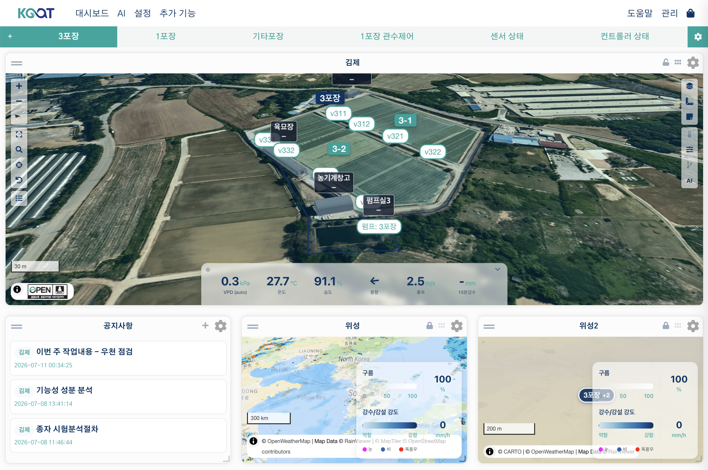

# AoT_map 위젯

`AoT_map`은 여러 동·구역에 흩어진 센서와 장치를 지도 한 장 위에서 보고 바로 제어하는 대시보드 위젯입니다. 예를 들어 온실 5동에 관수 밸브 20개, 온습도 센서 10개가 설치되어 있다면, 이 위젯 하나로 전체 배치를 한눈에 보고, 색이 다른 장치를 클릭해 바로 켜고 끄고, 각 지점의 최근 측정값과 AI 조언까지 확인할 수 있습니다. MapLibre GL 기반이라 3D 지형·시설 렌더링과 부드러운 확대/축소를 지원합니다.

---

## 위젯 추가하기 { #adding-the-widget }

1. 대시보드에서 **위젯 추가 → AoT 지도**를 선택합니다.
2. 설정에서 표시할 지도를 선택합니다(비워두면 가장 최근에 수정한 지도를 사용).
3. **저장**을 클릭합니다.

---

## 주요 기능

### 장치 마커 { #device-markers }

`/geo/design`에서 **장치(Device)** 모드로 배치한 입력·출력·함수 장치가 지도 위에 마커로 표시됩니다.

- **마커 색상**: 장치의 활성/비활성/오류 상태에 따라 자동으로 바뀝니다.
- **마커 겹침 정리**: 확대 수준이 낮아 마커가 겹치면 개수 배지가 있는 그룹으로 합쳐 표시하고, 확대하면 다시 개별 마커로 펼쳐집니다.
- **장치 아이콘**: 장치 종류(온도 센서·릴레이·펌프 등)에 따라 다른 아이콘을 사용합니다.
- **제어 방식**: 출력 마커는 기본적으로 켜기/끄기 토글이 열립니다. 짝지은 개폐 액추에이터, 또는 스스로 위치를 잡고 0~100 % 개폐율을 보고하는 값 출력(Matter 창문 커버링 등)은 토글 대신 닫기/정지/열기 버튼과 위치 슬라이더가 열립니다.

### 팝업으로 바로 제어하기 { #control-right-from-the-popup }

마커를 클릭하면 장치 종류에 맞는 창이 열립니다.

**입력(센서)** — 값 키를 클릭하면 상세 창이 열립니다. 최근 24시간 그래프와
측정 항목별 현재값이 함께 나오며, 노트도 바로 작성할 수 있습니다. 이 창은
시설·구역 모달에서 센서를 열었을 때와 **같은 창**입니다.

**출력·함수** — 구역·시설과 같은 중앙 창이 열리며, 위에서부터 세 덩이입니다.

1. **제어** — 장치 이름과 On/Off 토글(**편집 권한**이 있는 사용자에게만 표시),
   그 아래에 작동 시간과 다음 예약, on/off 출력이면 **설정** 버튼까지.
   창을 여는 목적이 대개 지금 조작하는 것이라 이 덩이가 맨 위입니다.
2. **이력** — 최근 가동 기록 그래프. 그 판단을 뒷받침하는 자리입니다.
3. **노트**

작동 시간은 **한 칸이 두 상태를 번갈아** 씁니다. 꺼져 있으면 마지막으로 작동한
시간(흐린 글씨), 켜는 순간 그 자리가 곧바로 흐르는 타이머로 바뀝니다(진한 글씨).
다른 창이나 예약으로 켜고 꺼도 이 창이 열려 있는 동안 계속 따라옵니다.

개폐율 장치(창문·커튼 등)는 토글 대신 닫기/정지/열기 버튼이 나오는데, 짝지은 개폐 액추에이터뿐 아니라 스스로 위치를 잡고 0~100 % 개폐율을 보고하는 값 출력(Matter 창문 커버링 등)도 같습니다. 닫기는 값 0, 정지는 끔, 열기는 값 100을 보냅니다. 그리고 PWM 출력은 현재 퍼센트와 0~100% 슬라이더가 나옵니다. 둘 다 **설정** 버튼은 없습니다.

복합장치는 자기가 돌아가는 장치가 아니라, 창이 **구성**으로 열립니다 — 안에 든 센서·장치 목록이며 이력은 없습니다. 줄을 누르면 그 장치의 창으로 내려갑니다.

시설(Facility) 마커를 클릭하면 3D 미리보기와 환경 데이터 요약을 볼 수 있습니다 — 자세한 내용은 [3D 시설 팝업](#3d-facility-popup)을 참고하세요.

### 구역/대지 클릭 — 장치 목록으로 제어 { #click-a-zonesite-control-from-a-device-list }

구역(Zone)이나 대지(Site) 도형을 클릭하면, 그 안에 배치된 센서·출력 장치를 한 번에 보는 팝업이 열립니다.

- **센서**: 여러 개면 탭으로 전환하며 최근 24시간 차트를 볼 수 있습니다.
- **출력 장치 목록**: On/Off 토글로 즉시 제어(**편집 권한** 필요), 드래그로 순서 변경.
  작동 시간은 장치 창과 같은 규칙으로 표시되고(꺼짐=마지막 작동 / 켜짐=흐르는 타이머), 그 옆에 다음 예약이 함께 나옵니다.
  장치 이름을 클릭하면 위 그래프 자리에 그 장치의 가동 이력이 그려집니다.
- **함께 영향받는 것**: 토글 바로 아래에, 그 장치가 다른 구획까지 덮으면 그 이름을 적습니다 — 켜기 전에 무엇이 함께 움직이는지 읽을 수 있습니다.
- **함수**: 그 안의 함수를 장치 목록 아래에 종류와 함께 늘어놓고, On/Off 스위치로 켜고 끕니다. 복합장치는 이름을 누르면 그 장치의 창으로 내려갑니다.
- **설정(예약 켜기)**: 출력마다 있는 **설정** 버튼 — 아래 [예약 켜기](#scheduled-on) 참고.

드래그로 정한 순서는 **구역**의 속성이라, 그 구역을 여는 모든 사람이 같은 순서를 봅니다. 대지 창에는 저장되는 순서가 없습니다.

### 구획 클릭 — 무엇이 있나 { #plot }

디자인 도구의 [구획 모드](design-tool.ko.md#plot)에서 그린 구획을 지도에 표시하고, 클릭하면 그 운영 정보를 봅니다. 창에는 **현황 / 환경·제어 / 설정** 세 탭이 있습니다.

- **[현황] > 자원** — 두 층입니다. 위는 지금 단계가 요구한다고 선언한 것이고, 아래는 이 구획에 닿는 관수 장치가 **오늘**과 **최근 7일** 동안 얼마나 돌았고 물이 얼마나 나갔는지(추정)이며, 물량이 나오는 장치가 둘 이상이면 **합계** 줄이 붙습니다. 물량은 설계 유량(시설의 배관 도면 · 노지 지도의 토출구) × 가동시간 × 구획 몫이라 **유량계 실측이 아닙니다**. 그 기간에 작동 기록이 없는 장치는 0 대신 "기록 없음"으로 적습니다. 물량을 낼 수 없는 장치는 아예 줄로 내지 않고, 표 **아래 안내**가 그 이름과 이유를 말합니다 — 이 구획 안에 그려진 토출구가 없거나, 유량을 모르거나 둘 중 하나입니다. 같은 안내가 표 전체에 대해 추정이라는 것과 구획 몫이 얼마인지도 한 번만 말합니다. 이 구획에 걸친 영역에 아직 장치가 배정되지 않았으면 **[현황]**이 그 사실도 알립니다 — 손댈 수단이 없다는 뜻이지 목록에 올릴 장치가 아닙니다. 같은 값을 기간별로 자세히 보려면 [일지](journal.ko.md)를 쓰세요. 펌프·수원·탱크가 그 밸브에 물을 대면 장치마다 **설계값**(노즐 설계만으로 본 물량), mm 로 환산한 깊이, 펌프나 수원이 전부 못 줬을 때의 **공급 한계** 도 함께 보입니다. 그런 공급 부품이 있는 지도에서는 켜진 출력의 물이 지나는 배관과 부품을 같은 설비 색으로 굵게 그립니다.
- **[현황]** — **단계** 카드에 현재 단계와 경과 일수, 적산온도, 지금 단계의 지침이 나옵니다. 그 아래 **환경** 카드에는 프로그램·센서가 뒷받침하면 **적산온도(GDD)**(작기 시작부터의 누적치, [일지 참고](journal.ko.md#gdd))와 **DLI**(오늘 값 대 목표, [일지 참고](journal.ko.md#dli))도 함께 뜹니다. 둘 중 하나라도 계산할 수 없으면 그냥 비는 대신 사유(프로그램 없음·기준온도 없음·자료 부족)를 말합니다.
- **[현황] > 단계 전환** — 계산상 다음 단계에 들어섰으면 여기서 전환을 **확인**하거나 **연기**합니다. 확인된 전환의 기록(**단계 기록**)과 **마지막 되돌리기**는 **[설정] > 프로그램**에 있습니다. 단계별 목표는 **환경** 카드의 현재값 옆에 함께 표시됩니다. [관리 프로그램](programs.ko.md#stage-events)을 참고하세요.
- **[설정] > 단계 일정** — 실제 일정을 고치는 곳입니다. 프로그램 기간은 참고일 뿐이라 단계를 **연기하거나 앞당길** 수 있고, 이 구획만 자동 전환으로 둘 수도 있습니다. [단계 일정 고치기](programs.ko.md#stage-schedule)를 참고하세요.

!!! 참고 "목표는 여기서 읽기 전용입니다"
    이 팝업은 각 단계의 목표를 보여주기만 하고 고치지는 않습니다 — [구획 자신의 목표 override](programs.ko.md#plot-override)는 [`/plots` 페이지](programs.ko.md#plots-page)나 [AoT 구획 위젯](plot-widget.ko.md)에서 하며, 지도에서는 할 수 없습니다.

- **[설정] > 구획 정보** — 면적과 치수. 가로·세로를 함께 보여줍니다. 면적만으로는 "몇 줄 심을 수 있나"에 답할 수 없기 때문입니다.
- **[설정] > 기본 정보** — 대상·품종·구획 이름·시작일·예상 종료일. **편집**으로 고칠 수 있습니다.
- **[환경·제어]의 제어 목록** — 이 구획과 영역이 겹치는 장치를 많이 겹치는 순서로 보여주고, 각각 이 구획을 얼마나 덮는지, 다른 구획까지 덮으면 그 이름도 함께 적습니다. 영역 하나가 여러 작물에 걸치고 한 작물이 두 영역에 걸치기도 하므로, 장치를 하나로 정하지 않고 겹치는 면적을 그대로 보여줍니다. 비율은 **구획 면적 대비**입니다("내 두둑이 얼마나 덮이는가"). 그 장치가 실제로 무엇을 하는지는 시스템이 모릅니다 — 아는 것은 두 영역이 겹친다는 것뿐이라, 화면은 "적신다"가 아니라 "덮는다"로 적습니다.
- **[환경·제어]의 센서** — 구획 안의 센서를 보여줍니다. 없거나, 있어도 값을 주지 않으면 상위 구역에서 가장 가까운 센서를 빌려 오고 거리를 꼬리표로 답니다. 꼬리표에 마우스를 올리면 둘 중 어느 쪽인지 나옵니다. 값을 주지 않는 구획 안 센서는 사라지지 않고 **값 없음** 꼬리표를 단 채 목록에 남으며, 값을 주는 센서가 앞에 옵니다 — 열자마자 빈 차트를 보지 않게 하기 위함입니다.
- **[현황] > 노트** — 다른 도형과 같은 공용 노트 블록입니다.

!!! 참고 "작물별 요구량은 배분하지 않습니다"
    겹친 영역에서 물은 물리적으로 공유되므로 작물별 **요구량**을 더하면 틀린 숫자가 나옵니다. 근거만 보여주고 판단은 사람이 합니다. (실제로 **나간** 물의 추정치는 다른 이야기이고, 위 **[현황] > 자원**에 있습니다.)

구획 라벨(칩)은 다른 라벨과 같이 **축소 시 라벨 숨기기 L1** 기준(기본 17)보다 확대했을 때 나타납니다 — 라벨이 이미 많은 화면이라 항상 띄우면 겹칩니다. 구획 도형은 레이어 컨트롤이나 설정의 **구획 도형** 옵션으로 끄고 켤 수 있으며 두 곳은 같은 값을 공유합니다. 구획 라벨은 **레이어 → 라벨**에서 따로 끕니다.

### 대표 측정 정하기 { #representative-measurement }

구역·시설 창의 **[현황] → 환경** 카드에는 그 안의 센서 값이 나란히 표시됩니다.
여기서 **값을 클릭하면 그 측정이 대표가 되고**, 배경이 칠해져 어느 것이 대표인지
남습니다. 다시 누르면 지정이 풀립니다(**편집 권한** 필요).

지정한 대표 측정은 다음 세 곳이 함께 씁니다.

- 지도 위의 **시설 칩**에 뜨는 값
- **대지** 창의 구역·시설 줄에 뜨는 값
- 그 창의 환경 카드(배경 표시)

지정하지 않으면 VPD > 온도 > 습도 > CO₂ > 조도 > 풍속 순으로 자동 선택됩니다.
지정은 **구역·시설마다 따로** 저장되므로, 육묘장은 온도·노지는 토양수분처럼
자리마다 다르게 둘 수 있습니다. 지정한 센서가 값을 내지 못하는 동안에는 자동
선택으로 잠시 물러났다가, 센서가 돌아오면 지정이 그대로 살아납니다.

### 예약 켜기 { #scheduled-on }

on/off 출력 장치의 **설정** 버튼을 누르면 시작 시각과 작동 시간을 지정하는 창이 열립니다.
구역 모달 · 시설 모달 · 장치 마커 팝업 어디서 열어도 같은 창입니다.

- 작동 시간을 `00:00`으로 두면 수동으로 끌 때까지 계속 켜져 있습니다.
- 시작 시각이 사실상 "지금"이면 즉시 켜고, 작동 시간이 끝나면 자동으로 끕니다.
- 시작 시각이 오늘 이미 지난 시각이면 그 자리에서 켜지 않고 **내일 같은 시각**으로 밀립니다.
- 시작 시각이 미래면 **서버 스케줄러에 등록**됩니다. 브라우저를 닫아도 예정대로
  실행되며, [작업 예약](../ai/scheduler.md) 페이지에서 확인·수정·취소할 수 있습니다.
- 서버 등록에 실패하면(예: 그 장치에 대한 권한이 없음) 현재 탭이 대기했다가 실행하는
  방식으로 대신 진행할지 물어봅니다. 이 경우에만 탭을 닫으면 실행되지 않습니다.

두 휠 아래에는 고른 값이 무엇을 뜻하는지 한 줄로 나옵니다 — 언제 켜지고, 언제 꺼지고, 얼마나 도는지. 그 구간이 이 장치에 이미 걸린 예약과 겹치면 그 사실과 함께 **실제로 꺼지는 시각**을 적습니다. 먼저 끝나는 타이머에 함께 꺼지기 때문입니다. 그 아래에는 이 장치에 걸려 있는 예약이 나열되어 하나씩 취소할 수 있고, 저장한 뒤에도 창은 그대로 남습니다.

개방률을 다루는 장치(창문·커튼 등)에는 이 버튼이 없습니다 — "언제부터 언제까지 켬"이라는
의미가 성립하지 않기 때문입니다.

### 실시간 갱신

위젯은 설정된 주기(기본 5초)마다 장치 상태를 자동으로 새로고침합니다. 마커 색상과 측정값 라벨이 실시간으로 업데이트되며, 팝업이 열려 있어도 값이 계속 갱신됩니다.

### 지도 위 도구 버튼

지도 좌측 또는 우측 모서리에 다음 도구 버튼이 표시됩니다.

| 버튼 | 기능 |
| :--- | :--- |
| +/- | 확대/축소 |
| 전체화면 | 위젯을 전체화면으로 표시 |
| 검색 | **위치 시트**를 열고 주소 검색칸에 초점을 둡니다(아래 [위치 시트](#location-sheet)). |
| 내 위치 | **위치 시트**를 열고 브라우저 GPS로 현재 위치를 잽니다. |
| 초기화 | 처음 저장된 위치·확대 수준으로 되돌리기 |
| 대지 목록 | 등록된 대지·구역 목록에서 선택해 바로 이동 |
| 저작권(ⓘ) | 현재 표시 중인 배경/오버레이 지도의 출처 표기를 보여줍니다. 지도를 처음 열거나 배경·오버레이를 바꿀 때 자동으로 펼쳐지고, 지도를 직접 조작하면(드래그·확대·터치) 접힙니다. |

이 외에 위젯 제목 표시줄에는 **지도 잠금**(이동·확대 잠금)과 **컨트롤 숨기기**(도구 버튼 숨기기) 아이콘이 있습니다. 이 둘은 설정 화면이 아니라 위젯 제목 표시줄에서 바로 켜고 끄는 토글입니다.

### 위치 시트 { #location-sheet }

**검색**과 **내 위치** 버튼은 지도 위에 따로 검색창을 띄우는 대신 하나의 **위치 시트**를 엽니다. 시트는 지도를 가리지 않는 도킹 패널이며, 주소 검색·지도 중심·직접 찍기·즐겨찾기·최근을 한 곳에 모았습니다. 시트를 닫으면 지도에 찍힌 표식도 꺼집니다.

- **주소 검색**: 맨 위 카드입니다. 주소를 입력하고 검색(또는 Enter)하면 결과 목록이 나오고, 결과를 누르면 지도가 그 자리로 이동하며 "고른 자리"가 됩니다. 결과 줄 오른쪽 별을 누르면 바로 즐겨찾기에 담습니다. 위도·경도를 붙여 넣으면 검색 없이 그 자리가 결과가 됩니다.
- **고른 자리**: **내 위치**(기기 GPS), **지도 중심**(위젯에서 보이는 영역의 중심), **지도에서 직접 찍기**(안내에 따라 다음에 지도를 누른 곳) 세 길로도 자리를 정합니다. 고른 자리 아래에 주소와, 그 자리가 속한 구획·가까운 장치가 표시됩니다. GPS 오차가 크면 **오차 큼** 경고가 뜨며, 이때는 직접 찍는 쪽이 더 정확합니다.
- **버튼**: 모두 글자 없는 **아이콘 알약**입니다. 이름은 마우스를 올리면 뜨는 툴팁으로, 터치 화면에서는 길게 눌러 봅니다. 고른 자리 카드에는 **즐겨찾기에 담기**와 **여기에 노트**(노트 기능이 켜진 경우) 버튼이 있습니다.
- **즐겨찾기**: 담은 자리를 누르면 그 자리로 이동합니다. 오른쪽 **편집**을 누르면 이름 바꾸기, 순서 위·아래, **나만 / 모두 공유**(담은 사람만 바꿈), **빼기**가 펼쳐집니다. 즐겨찾기를 담고 고치는 데는 설정 편집 권한이 필요합니다.
- **최근**: 검색해서 고른 자리 최대 5개를 이 브라우저에만 기억합니다(즐겨찾기에 있는 자리는 제외).
- 화면 연동(AI가 화면을 보게 하는 설정)이 허용돼 있으면 고른 자리에 **AI가 이 위치를 봅니다** 표시가 붙습니다.

---

## 설정 옵션 { #widget-settings }

설정 창의 구성 순서와 같습니다. 접힘 항목(데이터 전송 주기 · 장치 필터 · 측정값 패널 ·
라벨 스타일 · 도형 · 3D 지도)은 눌러서 펼칩니다.

### 지도 { #map }

| 옵션 | 설명 |
| :--- | :--- |
| 지도 선택 | 표시할 저장된 지도를 선택합니다. 비워두면 가장 최근에 수정한 지도를 사용합니다. |
| 라벨 표시 | 대지·구역·시설·장치·센서 라벨 전체를 켜고 끄는 마스터 스위치입니다. 종류별 세부 표시는 지도 우측 도구의 **레이어 → 라벨**에서 따로 조정합니다. |
| 데이터값만 표시 (지도 숨김) | 지도 배경과 오버레이를 감추고 옆의 측정값 패널만 보여줍니다. |
| 오버레이 투명도 자동 조정 | 기본으로 켜져 있습니다. 기상 오버레이(구름·강수/레이더·바람·기온 분포)를 도형과 3D 모형 **아래가 아니라 위**에 그리면서, 아래가 가려지지 않도록 불투명도를 자동으로 낮춥니다 — 확대할수록 더 낮추고, 여러 개를 함께 켜면 겹쳐 쌓이는 정도에도 상한을 둡니다. 구름 오버레이는 밝은 기본 지도 위에서도 흰 구름이 읽히도록 옅은 회색 쪽으로 보정하고, 타일 자체가 이미 반투명한 오버레이는 정책이 의도한 세기로 보이도록 되돌려 줍니다. 끄면 예전 순서로 돌아갑니다 — 기상 레이어가 도형 아래에 놓이고, 각 레이어에 설정해 둔 투명도를 그대로 사용하며, 위 두 보정도 하지 않습니다. 바닥 계열 오버레이(영상·토양·경계)는 어느 쪽이든 도형 아래에 그립니다. |
| 주야 표현 | 기본값은 **자동 (태양 위치 기준)** 입니다. 해가 지면 기본 지도와 바닥 오버레이를 어둡게 하고 채도를 낮추며, 일출·일몰 무렵에는 따뜻한 색조를 얹고, 3D 모형은 해가 있는 방향에서 비춥니다. 측정값 독에 기상 값(강수·바람·운량·시정·온도·위험·관측 시각)을 함께 채우고, 현지 시각 시계에 주야 아이콘을 붙입니다. **항상 낮**·**항상 밤**은 실제 시각과 무관하게 한쪽 조명으로 고정하고, **끄기**는 이 모든 것을 끕니다. 태양 위치는 **지도 중심이 있는 곳** 기준으로 계산하고, 기상 값은 그 자리에서 아래의 출처 설정을 따라 받습니다. 둘 다 몇 분마다 새로 받으며, 관측이 30분보다 오래되면 지연으로 표시하고 기상 오버레이를 옅게 합니다. |
| 날씨 연출 | 기본값은 **은은하게** 입니다. 기상 레이어를 하나도 켜지 않아도 관측값만으로 지금 날씨를 지도 위에 그립니다 — 바람 방향으로 흐르는 구름 그림자(운량 기준), 바람 흐름선(바람이 세면 호박색), 빗줄기·눈(강수 기준, 영하에 가까우면 눈), 안개 베일(시정 기준). 재지 않는 값은 그리지 않습니다. 시설 위에서는 옅어지고, 창을 열어 둔 시설 위에서는 가장 옅습니다. 같은 종류의 기상 레이어가 이미 켜져 있으면 구름 그림자와 바람 흐름선은 비켜서고 빗줄기·눈과 안개만 남습니다. **뚜렷하게**는 더 강하게 그리고, **끄기**는 아무것도 그리지 않습니다. 지도가 화면 밖에 있거나 그 탭이 뒤에 있으면 멈추고, 시스템이 움직임 줄이기를 요청하면 정지 그림 한 장으로 그립니다. **주야 표현** 설정과 무관하게 동작하며, 관측이 30분보다 오래되면 연출이 절반으로 옅어집니다. |
| 번개 섬광 | 기본으로 켜져 있습니다. 기상 출처가 최근 낙뢰를 알려오면 화면이 짧게 밝아지기를 가끔 반복합니다 — 번쩍임 사이는 최소 4초를 둡니다. **날씨 연출**이 **뚜렷하게**면 더 강하게 번쩍이고, **날씨 연출**이 **끄기**면 전혀 나타나지 않습니다. 끄면 번쩍임을 막을 수 있고, 시스템이 움직임 줄이기를 요청해도 건너뜁니다. |
| 기상 레이어 자동 켜기 | 기본으로 꺼져 있습니다. 강수·운량·바람이 문턱을 넘으면 이 위젯에 등록해 둔 해당 기상 레이어(강수·구름·바람)를 **화면에서만** 켭니다 — 종류마다 하나씩이고, 그 종류의 레이어가 이미 켜져 있으면 더 켜지 않습니다. 저장된 레이어 선택은 바뀌지 않으며, 사용자가 직접 끈 레이어는 페이지를 새로 불러올 때까지 다시 켜지 않습니다. 문턱은 서버에서 정하며 여기서 설정하는 값이 아닙니다. 이것도 **주야 표현** 설정과 무관하게 동작합니다. |
| 날씨 연출 최소 줌 | 기본값 11(0~22). 이보다 더 축소하면 날씨 연출과 자동으로 켠 기상 레이어가 1줌 구간에 걸쳐 서서히 사라집니다 — 넓은 지역에 관측값 하나를 고르게 깔면 틀린 그림이 되기 때문입니다. 사용자가 직접 켠 레이어, 독의 기상 값, 주야 보정은 영향을 받지 않습니다. 0으로 두면 확대 수준과 관계없이 표시합니다. |
| 온도 색조 | 기본으로 켜져 있습니다. 측정값 독의 온도 값을 추우면 파랑, 더우면 빨강으로 칠하고, 같은 색의 아주 옅은 색조를 기본 지도와 바닥 오버레이에 얹습니다 — 도형과 3D 모형 위로는 올라가지 않습니다. 색은 기온이 아래의 보통 구간을 벗어나면 나타나고, 저온·고온 위험 문턱에서 가장 진합니다. **주야 표현**이 **끄기**가 아니어야 하며, 독의 값 색은 **측정값 독에서 기상 먼저**도 켜져 있어야 합니다. |
| 색조: 보통 시작 (°C) | 기본값 10(−60~70). 이 온도보다 낮아지면 차가운 색조가 시작되고, 저온(서리) 위험 문턱에서 가장 진합니다. |
| 색조: 보통 끝 (°C) | 기본값 28(−60~70). 이 온도보다 높아지면 더운 색조가 시작되고, 고온 위험 문턱에서 가장 진합니다. 위의 값과 같거나 그보다 낮게 두면 둘 다 기본값으로 되돌아갑니다. |
| 측정값 독에서 기상 먼저 | 기본으로 켜져 있습니다. 주야 표현 옵션의 기상 값을 측정값 독 왼쪽에 정해진 순서로 놓습니다. 같은 항목(강우·풍속·풍향·운량·시정·온도)을 자기 장치에서도 골라 두었다면 그 값이 묶음 안으로 들어가 위치 핀을 달고, 같은 항목이 두 번 나오지 않습니다. 끄면 독은 설정한 그대로만 보입니다. **주야 표현**이 **끄기**면 아무 효과가 없습니다. |
| 기상 값 출처 순서 | 기본값은 **현장 장치 먼저** 입니다. 기상 값은 두 곳에서 옵니다 — 대지에 기상대로 지정해 둔 장치, 그리고 이 지도의 레이어에 등록한 기상 입력(그 레이어를 꺼 두어도 값은 씁니다. 해당 입력의 **기상 데이터 출처로 사용**을 끄면 빠집니다). 둘 중 어느 쪽을 먼저 읽을지 고릅니다. 항목마다 먼저 읽은 쪽에 값이 없거나 너무 오래됐으면 다른 쪽을 씁니다. 현장 장치가 강수를 시간당이 아니라 누적(mm)으로 재는 경우에는 그 누적 구간이 단위나 측정값 이름에 적혀 있을 때만 읽습니다(예: 단위 `mm_15min`, 이름에 `15분`). 적혀 있지 않으면 값이 없는 것처럼 건너뜁니다. 둘 다 없으면 기상 값 자체가 없으므로 기상 칸도 날씨 연출도 그리지 않습니다. |
| 기상 값 최대 경과 시간 (초) | 기본값 300(10~86400). 이보다 오래된 현장 장치 값은 건너뛰고 다음 출처를 씁니다. 기상 입력에는 그 입력에 직접 정해 둔 허용 시간이 있으면 그 값을 그대로 쓰고, 비워 두었으면 이 값과 그 입력이 스스로 말하는 허용 시간 중 긴 쪽이 적용됩니다. |
| 위험: 풍속 (m/s) | 기본값 10(0~100). 현재 풍속이 이 값에 이르면 기상 칸에 위험이 뜨고, 1.4배 이상이면 심각으로 표시합니다. 0으로 두면 바람 위험을 표시하지 않습니다. |
| 위험: 강수 (mm/h) | 기본값 5(0~500). 현재 강수가 이 값에 이르면 위험이 뜨고, 2배 이상이면 호우로 표시합니다. 0으로 두면 강수 위험을 표시하지 않습니다. |
| 약한 비 문턱 (mm/h) | 기본값 0.1(0~5). 이보다 적은 강수는 **날씨 연출**에서 비·눈이 없는 것으로 그립니다 — 측정값 자체는 바뀌지 않고, 측정값 독에 보이는 수치도 영향받지 않습니다. |
| 위험: 저온 (°C) | 기본값 2(−60~60). 현재 기온이 이 값 이하로 내려가면 서리 위험이 뜨고, 0 °C 이하면 결빙으로 표시합니다. |
| 위험: 고온 (°C) | 기본값 33(−60~70). 현재 기온이 이 값 이상으로 오르면 폭염 위험이 뜨고, 이 값보다 2 °C 높으면 심각으로 표시합니다. 저온 위험이 먼저라서 둘 중 하나만 표시됩니다. |
| AI 권고 | 이 지도가 속한 시설·대지에 대한 최신 AI 조언 요약을 지도 상단에 클릭 가능한 칩으로 표시합니다(전역 AI가 설정되어 있어야 합니다). |
| 현지 시각 표시 | 지도 상단 가운데에 **지도 중심이 있는 곳**의 시각을 세 칸으로 띄웁니다 — 가운데가 현재 시각, 왼쪽이 직전 사건, 오른쪽이 다음 사건입니다. 그래서 낮에는 `일출 · 지금 · 일몰`, 밤에는 `일몰 · 지금 · 내일 일출`로 보입니다. 지도를 옮기면 그 위치의 시간대로 다시 계산합니다. 지도의 현지 날짜가 브라우저의 날짜와 다르면 시계 칸에 그 날짜도 함께 적고, 마우스를 올리면 시간대 이름이 나옵니다(그 위치의 시간대를 찾지 못했으면 농장 시간대를 쓰고 있다고 알립니다). 해가 뜨거나 지지 않는 곳에서는 사건 대신 **백야**·**극야**를 적은 칸이 하나 더 나옵니다. 왼쪽 아래 작은 원 위에서 휠을 굴리면(폰은 세로로 끌면) 시계 크기가 바뀌고, 그 크기는 위젯에 저장됩니다. 켜져 있는 동안 주소 검색바와 AI 조언 칩은 그 아래로 내려갑니다. |
| 시간 슬라이더 표시 | 기본으로 켜져 있습니다. **현지 시각 표시** 독 아래에 슬라이더를 추가해 다른 시각의 지도를 볼 수 있게 합니다 — 시간 지원 레이어의 레이더 프레임, 예보·기록된 기상 값, 주야 조명이 함께 움직입니다. **현지 시각 표시**가 켜져 있어야 하고, 보여줄 시간 지원 제공자가 하나도 없으면 슬라이더 자체가 나타나지 않습니다. 다시 "지금"으로 끌어오면 실시간 값으로 돌아갑니다. |

!!! 참고
    **지도 선택**을 다른 지도로 바꾸면 위치·확대 수준이 자동으로 초기화됩니다(새 지도 기준으로 다시 맞추기 위함).

### 데이터 전송 주기

| 옵션 | 설명 |
| :--- | :--- |
| 위젯의 갱신 주기 (초) | 위젯을 다시 불러오는 간격. **0으로 두면 자동 새로고침을 끕니다.** (기본 5초) |
| 입력 값 갱신 주기 (초) | 측정값 패널의 입력 측정값을 새로 고치는 간격. (기본 300초) |
| 출력 상태 갱신 주기 (초) | 지도 위 출력의 On/Off 상태를 새로 고치는 간격. (기본 5초) |

### 장치 필터 { #device-filter }

| 옵션 | 설명 |
| :--- | :--- |
| 입력 / 출력 / 함수 | 지도에서 **숨길** 장치를 종류별로 선택합니다(제외 목록). 아무것도 선택하지 않으면 `/geo/design`에 배치된 모든 장치가 표시됩니다 — 특정 장치만 지도에서 감추고 싶을 때만 사용하세요. |

위젯 설정 창에서 바꾸든 AI 가 위젯을 바꾸든 필터는 같은 방식으로 적용됩니다.

### 측정값 패널 { #measurement-panel }

| 옵션 | 설명 |
| :--- | :--- |
| 측정값 패널 표시 | 측정값 패널을 띄웁니다. 끄면 아래에서 측정값을 골라 두었어도 패널 전체를 숨깁니다(고른 항목은 그대로 남아 다시 켜면 돌아옵니다). |
| 입력 / 출력 / 함수 | 지도 옆 데이터 패널에 표시할 측정값을 종류별로 선택합니다. |

고르는 즉시 저장되고, 페이지를 새로 고치지 않아도 패널이 새 선택으로 다시 그려집니다.

### 라벨 스타일

이름 라벨(대지·구역·시설)과 측정값 키(입력 센서 값)에 **모두** 적용됩니다.
표시 여부 자체는 위 **라벨 표시** 마스터 스위치를 따릅니다.

| 옵션 | 기본값 | 설명 |
| :--- | :--- | :--- |
| 라벨 충돌 방지 | 켜짐 | 켜면 겹치는 라벨을 자동으로 묶습니다. 이때 **구체적인 대상이 남습니다** — 함수 > 입력 > 출력 > 장비 > 시설 > 구역 > 대지 순으로 자리를 잡고, 밀려난 라벨은 `이름 +N` 배지로 표시되어 조용히 사라지지 않습니다. |
| 레이블 글자 크기 | 1.0 | 지도의 모든 라벨과 측정값 키의 글자 크기(em). 1.0~3.0. |
| 축소 시 라벨 숨기기 L1 | 17 | 이 확대 수준보다 축소하면 출력·입력·함수·장비·센서·구획·동·노트 라벨과 값 키를 숨깁니다. 대지 라벨은 위치를 가늠할 수 있도록 항상 표시됩니다. 구역·시설 라벨은 아래의 더 넓은 L2 기준을 따릅니다. **0으로 두면 숨기지 않습니다.** |
| 축소 시 라벨·도형 숨기기 L2 | 15.5 | L1보다 넓은 화면에서도 읽혀야 하는 것들을 위한 별도 기준입니다 — **구역·시설 라벨**과 **구역·구획·장비 도형**. 대지 도형과 장치 마커는 확대 수준으로 접히지 않습니다. 작동 중인 출력은 숨겨진 상태에서도 라벨과 도형이 보이지만, 이 확대 수준보다 축소하면 그 창이 열려 있지 않은 한 함께 접힙니다. **0으로 두면 숨기지 않습니다.** |
| 시설 중심 라벨 | 꺼짐 | 꺼짐(기본값)은 야외 중심, 켜짐은 시설 중심으로 라벨의 줌 단계별 노출 규칙을 바꿉니다. 쌓임 순서(어느 라벨이 위로 오는지)는 이 값과 무관하게 항상 대지 > 구역 > 시설 > 장비 > 출력 > 입력 > 함수입니다. |
| 센서 마커 스타일 | 원형 (정수 값) | **원형 (정수 값)**(대표 측정값을 정수로 표시, 측정 구간 색상 적용) 또는 **텍스트 라벨**(값과 단위를 함께 표시). |
| 센서 팝업 사용 | 켜짐 | 켜면 값 키를 클릭했을 때 최근 24시간 그래프가 있는 상세 창이 열립니다. |
| 팝업 기본 탭 | 현황 | 구역·시설·구획 창을 열 때 처음 보일 탭(**현황** / **환경·제어** / **개요**). 장치 창에는 탭이 없습니다. |

!!! 참고
    마우스를 올리거나 클릭한 라벨은 종류와 무관하게 항상 맨 앞으로 올라옵니다.
    클릭으로 연 라벨은 그 창이 닫힐 때까지 앞에 고정됩니다.

### 도형

디자인 도구에서 그린 폴리곤을 지도 위에 반투명 오버레이로 표시할지 종류별로 켜고 끕니다.

| 옵션 | 설명 |
| :--- | :--- |
| 대지 도형 | 대지 경계선(설정된 테마 색상). |
| 구역 도형 | 구역 경계선. |
| 구획 도형 | 구획(어디에 무엇이 있는가). 구획 라벨은 **축소 시 라벨 숨기기 L1** 기준을 따릅니다. |
| 시설 도형 | 건물 외곽선. |
| 설비 도형 | 배관 등 장비의 도형. |
| 장치 도형 | 장치가 차지하는 영역 도형. |
| 기타 그리기 도형 | 그리기 도구로 만든 자유 도형. |
| 장치 도형 투명도 | 위 장치 도형의 불투명도(0~100). 0은 투명, 100은 완전 불투명. |

### 3D 지도(벡터 모드) { #3d-map-vector-mode }

| 옵션 | 설명 |
| :--- | :--- |
| 시설 렌더 모드 | 시설(건물) 3D 모델을 그리는 방식: **기본 (반투명)** / **단색 (불투명)** / **와이어프레임** / **성능 (모바일)**(모바일용, 부하 최소화). |
| 벡터 스타일 URL | 커스텀 MapLibre 스타일 JSON을 쓰고 싶을 때만 입력합니다. 비워두면 GIS 입력 설정을 따릅니다. |

### 자동으로 저장되는 값 { #values-saved-automatically }

아래는 설정 창에 없는, **지도를 조작하면 알아서 기억되는 값**입니다. 직접 입력하지 않습니다.

| 값 | 언제 저장되나 |
| :--- | :--- |
| 위치·확대 수준·피치·베어링 | 지도를 이동·확대·기울일 때 |
| 활성 오버레이 레이어 / 선택된 기본 지도 | 지도의 레이어 선택기를 조작할 때 |
| 라벨 종류별 표시 여부 | 도구 막대의 라벨 버튼이나 **레이어 → 라벨** 체크박스를 누를 때 |
| 도형 종류별 표시 여부 | **레이어**의 도형 체크박스를 누를 때 — 설정 창의 **도형**과 같은 값입니다 |
| 지도 잠금 / 컨트롤 숨김 | 해당 도구 버튼을 누를 때 |
| 현지 시각 시계 크기·접힘 여부 | 시계 크기를 바꾸거나 접을 때 |
| 측정값 패널 분할 비율·접힘 여부 | 패널 경계를 끌거나 접을 때 |
| AI 조언 칩 숨김 | 도구 막대의 **AI** 버튼을 누를 때 |

---

## 범례(Legend)

지도 우측 하단에 범례가 자동으로 표시됩니다. 별도 설정 없이 현재 켜져 있는 오버레이 레이어의 색상과 입력/출력 장치 아이콘을 설명하며, 범례 항목을 클릭하면 해당 레이어·장치 표시를 켜고 끌 수 있습니다.

---

## 3D 시설 팝업 { #3d-facility-popup }

시설(Facility) 마커나 폴리곤을 클릭하면 간단한 3D 미리보기와 환경 데이터 요약이 팝업으로 표시됩니다. **[현황]** 탭의 환경 카드에는 [구획과 마찬가지로](#plot) 적산온도(GDD)·DLI도 함께 뜹니다 — 특정 동이 아니라 시설 전체 기준입니다. 시설에 구획이 둘 이상이면 이 두 값은 전부를 합한 값이 아니라 첫 번째 구획을 따릅니다. 같은 탭에는 마지막 관수와 곧 닥칠 기상 위험도 함께 나오며, 노지와 같은 예보를 씁니다 — 다만 시설에 Open-Meteo 시간별 예보 입력이 연결돼 있고 그 파일을 받은 지 2시간 이내면 그 파일(제어가 쓰는 것)을 읽습니다. 전체 화면으로 자세히 보려면 [AoT_facility 위젯](facility-widget.md)을 사용하세요.

---

## 대지 기상대 지정 { #site-weather }

대지 창의 **[개요]** 탭에는 **기상대** 항목이 있습니다. 일사량·강우량은 대지 전체에 하나 있는 기상대가 재는 값이므로, 그 대지 안 구획·구역이 이 값을 빌려 쓸 때 어느 장치를 기준으로 삼을지 여기서 정합니다([일지](journal.ko.md#dli), [주야 목표](journal.ko.md#daylight) 참고).

- **아무것도 지정하지 않으면** 각 장치가 재는 측정값 이름으로 AoT가 자동으로 추론합니다 — 아무도 손대지 않은 설치에서 값이 나오게 하는 안전망일 뿐 정답은 아닙니다. 일사계가 둘이거나 실험용 센서가 섞여 있으면 어느 쪽이 맞는지 이 설정 없이는 바로잡을 수 없습니다.
- **하나 이상 체크**하면 그 장치로 명시적으로 지정되고, 이후 자동 추론보다 우선합니다.
- **전부 해제하는 것은 "끄기"가 아니라 "지정 안 함"**입니다. 자동 추론으로 돌아갈 뿐, 기상 값 자체가 안 나오게 되지는 않습니다.

목록의 각 줄에는 장치 이름과, 그 아래에 그 장치가 재는 항목이 함께 적힙니다. 장치가 많은 대지에서는 이 둘째 줄이 두 장치를 가르는 유일한 단서인 경우가 많습니다. 무언가를 켜고 끄기만 하는 장치는 목록에서 빠지고, AoT가 스스로 찾은 것이 먼저 나옵니다. 목록 위의 한 줄은 지금 어느 규칙이 쓰이고 있는지 — 여기서 지정했는지, 자동으로 찾았는지, 아무것도 못 찾았는지 — 를 말합니다. 고른 내용은 **[적용]**을 눌러야 저장되며, 편집 권한이 없으면 목록은 읽기 전용입니다.

### 예보 출처 { #site-forecast-source }

같은 항목 아래 **예보 출처**는 이 대지의 날씨 예보를 어느 예보 입력에서 읽을지 정합니다. 디지털트윈, 지도 시간 슬라이더의 날씨 독·연출, AI 예보 답이 **모두 이 한 곳**을 읽습니다 — 셋이 서로 다른 예보를 보지 않게 하기 위해서입니다. 트윈 탭의 예보 칸도 같은 설정입니다.

- 값이 미래 시각인 입력(시간별 예보·일별 예보)만 후보로 나오고, 대지에서 가까운 순입니다.
- **가까운 날은 시간별 입력, 그 뒤는 일별 입력**으로 이어 붙입니다. 시간별 입력이 끝난 뒤의 시각을 보면 날씨 독에 그 날의 최고/최저 기온·하루 강수·강수확률이 나옵니다.
- 예보가 끝나는 시각 너머는 다른 출처로 메우지 않고 **'예보 제공 범위 밖'**으로 적습니다. 범례와 독의 '예보' 칸 제목에 지금 값이 어느 입력에서 왔는지 나옵니다.
- **아무것도 고르지 않으면** 셋 모두 지도에 등록된 날씨 레이어(GIS 레이어)를 같은 폴백으로 씁니다.

### 예보 보정 { #site-forecast-calibration }

위에서 예보 출처를 고르면 이 항목 아래에 **현장에 맞춘 예보** 줄이 생기고,  AoT가 그 예보를 대지의 기상대와 맞춰 보고 값이 늘 높거나 낮은 쪽으로 치우치는 부분을 조용히 바로잡고 있는지도 함께 나옵니다.

- **자동**(기본값)은 대지의 기상대와 약 2주 정도 비교해 보정한 값이 뚜렷하게 더 낫다는 것이 확인될 때까지 원본 예보를 그대로 쓰고, 그 뒤로는 항목별로 스스로 보정된 값으로 바꿉니다.
- **항상 켬**은 그 비교가 끝나기 전에도 보정을 강제로 켭니다.
- **끔**은 항상 원본 예보를 씁니다.

요약 줄에는 지금 어느 항목이 보정돼 있는지, 아니면 아직 비교 중이라 원본 예보를 그대로 쓰고 있는지가 나옵니다. 마지막으로 본 뒤로 보정이 켜지거나 되돌려진 적이 있으면 몇 번 그랬는지와 함께 확인 버튼이 나옵니다.

**자세히 보기**를 누르면 항목별 내역이 펼쳐집니다 — 가까운 예보는 기온·습도·풍속·일사량·강우, 먼 예보는 일별 최고·최저 기온과 강수량이며, 각각 보정됨 / 아직 비교 중 / 보정 불가(비교할 기상대 없음·예보 출처 미지정·꺼짐)로 표시되고 보정됐을 때는 오차가 얼마나 줄었는지도 나옵니다. 그 아래에는 보정이 켜지거나 되돌려진 시점을 적은 짧은 이력이 있고, 기상대는 한 점인데 예보는 구역 평균이라 어느 정도 차이가 날 수 있다는 설명이 붙습니다. 이 기능은 **실험적 기능·참고용**으로 표시됩니다 — 보정된 값은 예보를 다듬은 것일 뿐 보장은 아닙니다.

---

## 디지털트윈 탭 { #twin-tab }

!!! warning "실험 기능"
    디지털트윈은 개발 단계의 **실험 기능**입니다. 예측은 참고용이며 **장치 제어에는 절대 쓰이지 않습니다.** 동작과 데이터 형식은 예고 없이 바뀔 수 있습니다.

디지털트윈은 센서 값과 날씨 예보로 앞날의 상태(지금은 노지 구획의 토양수분)를 계산해 지도에 칠하는 기능입니다. 지도 위젯에서는 대지·구획·시설 창의 **[트윈]** 탭으로 설정하고, 결과는 지도 시간 슬라이더의 한 레이어로 봅니다. **노지(대지·구획)가 먼저 지원**되며, 시설(온실)은 아직 초기 단계입니다.

### 켜기와 설정의 정본 { #twin-enable }

1. **설정 → 일반 → 디지털트윈(실험)**에서 기능 자체를 켭니다(기본 꺼짐). 켤 때 실험 기능 확인 창이 뜹니다. 이 토글을 켜야 지도 창에 **[트윈]** 탭이 나타납니다.
2. 트윈은 본체와 **별도 서비스**(`aot_twin`)로 돌아갑니다. 서비스는 기본 설치에 들어 있어 대기하고, 토글이 이를 구동합니다. 토글 아래에 상태가 잠김·꺼짐·시작 중·실행 중·응답 없음으로 보이며, 켠 뒤 '시작 중'은 최대 1분이고 화면이 스스로 바뀝니다. 사양이 낮은 기기(라즈베리파이 Zero·1·2·3, 기기 메모리 3.5 GB 미만)에서는 서비스가 스스로 멈추고 토글이 잠깁니다.
3. 서비스 상태, 실행 시각, 모든 대지에 한 번에 켜기 같은 전체 설정은 **설정 → 일반**의 **디지털트윈 설정** 항목에서 **[열기]**로 가는 화면에 있습니다.
4. 대지·구획·시설별 세부 설정은 지도 창의 **[트윈]** 탭에서 합니다. **이 설정의 정본은 `twin_config` 표**이며 트윈 서비스는 이 표를 읽어 실행합니다. 저장하면 서비스가 한 시간 안(또는 다음 실행 때)에 반영합니다.

### 대지 창의 [트윈] 탭 { #twin-site-tab }

탭은 위에서 아래로 **토글 → 요약 → 접힘** 순서입니다.

- **맨 위 한 줄**: 「이 대지에서 트윈 켜기」 토글(오른쪽). 바로 아래에 상태 한 줄(준비됨, 비 출처 필요 등)과 요약 한 줄(구획 수 · 예보 구간 · 지도에 칠해진 구획 수)이 있습니다. 그 아래 실험 경고는 짧은 한 줄이고 **[상세 정보]**로 전문을 펼칩니다.
- **[세부 보기]**를 누르면 접힌 부분이 열립니다.
    - **트윈이 쓰는 출처**: 비 · 기온 · 기준 증발산량(ET0). 따로 고르지 않으면 대지 기상대에서 **물려받은 값**이 쓰이고, 어디서 왔는지가 한 줄 아래에 적힙니다. 다른 장치를 쓰려면 **[직접 지정]**을 누르고 값을 고르거나 **[적용]**으로 제안을 받아들입니다. 직접 지정한 줄은 **[상속 따르기]**로 되돌립니다. 실제 관측이 아닌 출처 — 예보값 · 모델에서 나온 값 · 시뮬레이터 — 로 밝혀지면 자동으로 동기화에서 빠지고, 그 줄에 **「관측이 아님」**이 표시되며 대지의 준비 상태에도 반영됩니다.
    - **비 묶는 법**: 비 입력을 시간별 평균 합 · 일 합계 · 그날의 마지막 값 중 어떻게 일 강수로 묶을지, 배율과 함께 정합니다.
    - **예보**: 쓰는 예보 구간(시간별 → 일별)과 예보 비가 확보된 날수(8일 중)를 한 줄로 보입니다. 예보 출처는 여기서 고르지 않고 [대지 창의 예보 출처](#site-forecast-source)에서 한 번만 정합니다. 고른 것이 없으면 안내 문구가 나옵니다.
    - **토양센서 없는 구획: 관측 없이 예측만(참고용)**: 아래 [센서 없는 구획](#twin-sensorless)을 보세요.
    - **장치 → 효과 채널**: 이 대지에서 환경에 영향을 줄 수 있는 장치마다 한 줄 요약을 속한 시설별로 묶어 보이고, 어느 시설에도 속하지 않은 출력은 **「시설 밖」** 묶음 하나로 더 보입니다. 시설의 자리(피팅)에 묶인 장치는 위치만으로 종류와 효과 채널이 자동으로 정해지고, 상세 보기에는 장치마다 종류 · 연결된 채널 · 효과가 반영됐는지(반영됨 · 일부 반영 · 미반영 · 종류 모름)가 나옵니다. **[직접 지정]**으로 장치를 트윈에서 빼거나, 종류를 모르는 장치(주로 시설 밖 출력)의 역할을 고릅니다. 시설 밖 출력의 효과는 참고로만 보일 뿐 트윈에는 **아직 반영되지 않습니다.**
    - **구획 목록**: 구획마다 이름 · 상태 한 마디 · 포함 토글. **[수치 보기]**를 누르면 쓰는 토양수분 센서와 최근 일치도가 한 줄씩 나옵니다. 막힌 구획에는 원인과 할 일이 한 문장으로 따라붙습니다(예: 심은 날짜가 없다, 비 출처가 없다, 또는 고른 출처가 관측이 아닌 것으로 밝혀졌다).
- 바꾸고 나면 **[저장]**을 눌러야 반영됩니다. 편집 권한이 없으면 읽기 전용입니다.

### 구획 창의 [트윈] 탭 { #twin-plot-tab }

- **이 구획 포함** 토글로 이 구획을 트윈 대상에 넣거나 뺍니다. 대지의 트윈이 꺼져 있으면 먼저 대지 탭에서 켜라는 안내가 나옵니다.
- **트윈이 쓰는 출처**는 대지와 같은 읽는 줄입니다. 토양수분 · 지온 센서는 **구획 안, 가까운 곳, 구역 전체** 순으로 도형에서 자동으로 물려받고(어디서 왔고 몇 m인지 표시), 비 · 기온 · ET0는 대지 값을 따릅니다. 이 구획만 다르게 하려면 **[직접 지정]**으로 편집 상태에 들어가 **[변경]**하거나 **[이 구획에서는 없음]**을 고릅니다. 도형을 고치면 상속값은 따라 바뀝니다. 실제 관측이 아닌 출처 — 예보값 · 모델값 · 시뮬레이터 — 로 밝혀지면 자동으로 동기화에서 빠지고 **「관측이 아님」**으로 표시되며, 다른 출처를 고르기 전까지 이 구획은 관측 없이(참고용) 돕니다.
- **토양센서가 없을 때**는 「대지 값 따르기 / 관측 없이 예측만 / 계산하지 않음」 중에서 고릅니다.
- **최근 일치도**: 마지막 실행일, 하루 오차, 80 % 예측 띠가 실제를 감쌌던 비율 등을 보입니다.
- **개발 테스트** 아래의 **동화 시작일**은 비워 두면 심은 날부터 시작합니다. 과거 센서 값을 모델이 얼마나 따라가는지 시험할 때만 더 이른 날짜를 넣으세요.
- 시설 구획, 끝난 작기, 아직 심지 않은 구획은 트윈 대상이 아니라는 안내만 나옵니다.

### 센서 없는 구획 { #twin-sensorless }

토양수분 센서가 없는 구획도 **관측 없이 예측만** 돌릴 수 있습니다(대지 탭의 토글, 기본 켜짐). 이때 모델은 심은 날부터 비와 날씨만으로 물 수지를 굴립니다. 토양센서가 관측이 아닌 것 — 예보값 · 모델값 · 시뮬레이터 — 으로 밝혀진 경우도 같게 다룹니다: 그 구획은 동기화에서 빠지고 다른 센서를 고르기 전까지 관측 없이 돕니다. 센서로 맞춰 보지 못하므로 예측 폭이 넓고 **참고용**입니다. 지도는 이런 구획을 **점선 테두리**로 구분하고 범례에 「관측 없음 — 참고용」이라고 적습니다. 끄면 센서 없는 구획은 계산하지 않습니다. 센서를 연결하면 그 센서와 동기화되며 일치도가 쌓입니다. 심은 날짜와 비 출처는 센서가 없어도 필요합니다.

### 시설(온실)의 [트윈] 탭 { #twin-facility-tab }

시설 창에도 **[트윈]** 탭이 있습니다. 시설의 켜기는 **대지 설정과 독립**이며 기본 꺼짐입니다.

- **실내 센서**(기온 · 습도 · CO₂)와 **외기 센서**(기온 · 습도 · 일사 · 풍속 · CO₂)를 고릅니다. 제안이 있으면 **[적용]**으로 받습니다.
- **장치 → 효과 채널**: 시설의 자리(피팅) 중 하나에 묶인 장치는 위치만으로 종류 — 난방기 · 냉방기 · 창 개도 · 안개 분무기 등 — 와 효과 채널이 자동으로 정해지므로 채널을 손으로 고를 필요가 없습니다. 목록에는 장치마다 종류 · 연결된 채널 · 효과가 반영됐는지(반영됨 · 일부 반영 · 미반영 · 종류 모름)가 나오고, **[수치 보기]**를 누르면 그 장치의 정격과 어느 기록(실측 상태 · 가동 기록 · 명령 기록 추정)을 대신 쓰는지가 더 나옵니다. **[직접 지정]**으로 장치를 트윈에서 빼거나, 종류를 모르는 장치의 역할을 고릅니다.
- **[장치 상태 손배선]**을 누르면 이 시설의 자동 연결을 끄고, 난방 · 냉방 · 환기 개도 · 안개 · CO₂ 주입 · 차광 · 보온 커튼 각각에 대해 장치가 실제로 한 일(개도 또는 가동, %)을 기록하는 채널을 하나씩 다시 고르는 방식으로 돌아갑니다. 값 범위가 퍼센트가 아니면 최솟값 · 최댓값을 적어 0~100 %로 맞춥니다.
- 필요한 센서를 고르고, 자동 연결이나 손배선 중 하나로 장치 상태가 갖춰지기 전에는 만들 수 없다는 안내가 나옵니다.

### 구획 그래프 { #twin-chart }

구획 창의 **[트윈]** 탭을 열면 먼저 그래프가 나옵니다. 맨 위 **한 줄 결론**이 앞 7일 중 위험이 처음 짙어지는 날을 쉬운 말로 알려 줍니다. 서리 → 물 부족 → 과습 순으로 보며, 가능성이 50 % 를 넘으면 「…쯤 물이 모자랄 것 같아요」, 20~50 % 면 「…쯤 물이 모자랄 수도 있어요」, 모두 20 % 미만이면 「앞으로 일주일은 흙 속 물이 알맞아 보여요」라고 말합니다. 예상을 만들 수 없으면 그 이유를 적습니다.

- **기본 두 칸**은 토양수분과 비입니다. 지난 값은 실선·진한 막대, 앞날은 점선·옅은 띠·옅은 막대입니다. 날짜를 누르면 세로선과 한 줄 설명이 나오고 지도 시간 독이 같은 날로 움직입니다.
- **장치 작동 레인**: 관수 같은 효과 채널마다 한 칸이 더 생겨, 지난 작동(진한 것은 실제 기록, 옅은 것은 가동 시간으로 짐작한 값, 윤곽은 명령만 내린 것, 점선 윤곽은 가정)과 앞으로의 계획(빗금)을 보입니다. 예상에 반영되지 않는 장치는 조용히 빼지 않고 **효과 미반영**·**일부 반영**으로 알립니다.
- **[상세 정보]**를 누르면 보는 기간(2주 · 한 달 · 앞으로만), **기온도 같이 보기**, **센서에 맞춰 본 지난 값 보기**, **장치별로 보기**, 예상이 믿을 만한지(잘 맞아요 · 참고용 등)가 펼쳐집니다. 아래 오른쪽 **[설정]**은 출처를 고르는 화면으로 갑니다.

**[만약에...]**: 가정을 하나 만들어 기본 예상 위에 점선으로 겹쳐 봅니다. 물 주기(날짜 · 양(mm) · 몇 시간에 걸쳐), 비가 오지 않으면, 비가 두 배로 오면, 3 °C 더 더우면 중에서 고른 뒤 **[해 보기]**를 누르면 계산해 줍니다. 만든 가정은 목록에서 **숨기기** · **다시 계산** · **남겨 두기** · **삭제**를 할 수 있고, 기본 예상이 새로 나오면 「낡았어요」로 표시됩니다. 남겨 두지 않은 가정의 곡선은 약 30일 뒤 지워지고, 구획당 20개까지 둘 수 있습니다. 가정은 그래프 위에서만 보일 뿐 장치 제어에는 쓰이지 않습니다.

### 지도의 토양수분 예측 레이어 { #twin-map-layer }

트윈이 켜진 대지의 구획은 지도 시간 슬라이더(시간 독)에 **토양수분 예측(트윈)** 레이어로 나타납니다. 오늘부터 약 일주일 앞까지 날 단위로 슬라이더를 움직이면 구획이 뿌리층 토양수분의 중앙값 색으로 칠해지고, 범례에 색 눈금이 나옵니다.

- **빗금**은 신뢰가 낮은 먼 날이거나 예측 폭이 넓다는 뜻입니다.
- **점선 테두리**는 관측 없이 예측만 하는 구획입니다.
- 발행이 만료됐거나, 센서와 동기화되지 않았거나, 설정이 맞지 않아 칠하지 못하는 구획은 칠하지 않고 범례에 이유를 적습니다.
- 범례에 「실험」 배지가 붙으며, 계산 결과는 참고용입니다.

### 데이터 보관 { #twin-data-retention }

**설정 → 일반**의 디지털트윈 항목에 **데이터 보관 (일)** 한 칸이 있습니다(기본 730일, 30~3650일). 예보와 디지털트윈 기록(예보 발표본 · 분석 이력)을 남겨 두는 기간이며 **센서 측정값은 지우지 않습니다.** 데몬이 하루 한 번(시스템 시간 03시 이후) 점검해 보관 기간을 적용하고, 기간이 지난 만약에 곡선을 정리하며, 저장 공간이 모자라거나 데이터가 많이 쌓이면 이 칸 아래에 알려 줍니다. 구획을 삭제할 때 그 구획의 트윈 결과는 보관 기간이 끝날 때까지 남고, 삭제 화면이 지금 함께 지울지 한 번 더 묻습니다.

---

## 여러 지도를 한 대시보드에

같은 대시보드에 `AoT_map` 위젯을 여러 개 추가하고 각각 다른 지도를 표시할 수 있습니다. 예를 들어 전체 대지를 보여주는 개요용 지도와, 특정 동만 확대한 지도를 나란히 배치할 수 있습니다.

---

## 관련 페이지

- [디자인 도구](design-tool.md) — 장치·도형 배치
- [시설 위젯](facility-widget.md) — 3D 시설 전용 위젯
- [GIS 레이어](layers.md) — 오버레이 레이어 등록
- [일지](journal.ko.md) — 같은 GDD·DLI·관수량 자료로 만드는 스냅샷 문서
- [AoT 구획 위젯](plot-widget.ko.md) — 구획 하나를 계속 보는 대시보드 위젯, 이 팝업엔 없는 목표 편집 기능이 있습니다
