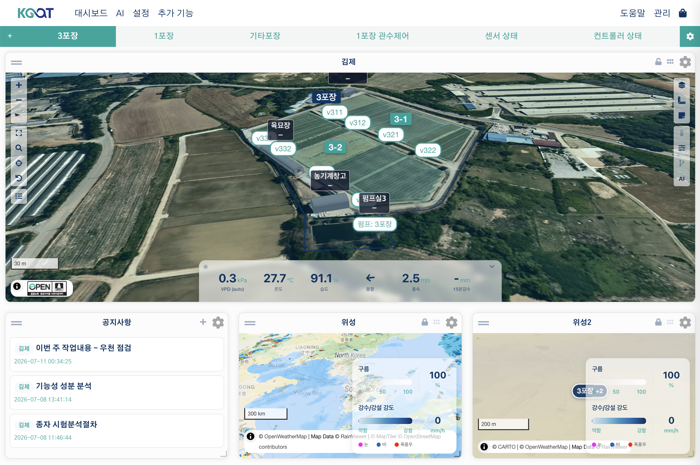

# AoT_map Widget

`AoT_map` is a dashboard widget that shows the sensors and devices scattered across your greenhouses on a single map, and lets you control them right there. Say you have 20 irrigation valves and 10 temperature/humidity sensors spread across 5 greenhouse bays — this one widget lets you see the whole layout at a glance, click a device to turn it on or off immediately, and check each location's latest readings and AI advice. It's built on MapLibre GL, so it supports 3D terrain, 3D facility rendering, and smooth zooming.

---

## Adding the Widget { #adding-the-widget }

1. On the dashboard, select **Add Widget → AoT Map**.
2. In the settings, choose the map to display (leave empty to use the most recently modified map).
3. Click **Save**.

---

## Key Features

### Device Markers { #device-markers }

Input, Output, and Function devices placed in **Device** mode in `/geo/design` appear as markers on the map.

- **Marker color**: Changes automatically based on the device's active/inactive/error state.
- **Overlap handling**: When markers overlap at a low zoom level, they collapse into a single badge showing the count; zooming in spreads them back out into individual markers.
- **Device icons**: Icons vary by device type (temperature sensor, relay, pump, and so on).
- **Control type**: An output marker opens an On/Off toggle by default. A paired open/close actuator, or a value output that positions itself and reports its own 0–100 % position (such as a Matter window covering), opens the Close/Stop/Open buttons with a position slider instead.

### Control Right From the Popup { #control-right-from-the-popup }

Clicking a marker opens the window that fits the device type.

**Input (sensor)** — clicking a value key opens a detail window with a 24-hour
chart, the current reading of every measurement, and a shortcut to write a note.
It is the **same window** you get when opening a sensor from a facility or zone
modal.

**Output / function** — opens the same centre window zones and facilities use,
in three blocks from the top:

1. **Control** — the device name and an On/Off toggle (shown only to users with
   **edit** permission), with the run time and the next scheduled run below it,
   and for an on/off output a **Settings** button as well. It comes first
   because operating the device is usually why the window was opened.
2. **History** — the recent run chart, which is what backs that decision up.
3. **Notes**

The run time is **one slot shared by two states**. While the device is off it
shows how long it last ran (dimmed); the moment it turns on that same slot
becomes a live running timer (bold). It keeps following the device while the
window stays open, even if another window or a schedule switches it.

Position actuators (windows, curtains, …) get Close/Stop/Open buttons in place of the toggle — this covers paired open/close actuators and also a value output that positions itself and reports its own 0–100 % position (such as a Matter window covering); Close sends 0, Stop sends off, Open sends 100 — and a PWM output shows its current percentage with a 0–100% slider. Neither gets the **Settings** button.

A composite device runs nothing of its own, so its window opens with **Contents** — the sensors and devices held inside it — and no history. Click a line to drop into that device's own window.

Clicking a Facility marker shows a 3D preview and an environment-data summary — see [3D Facility Popup](#3d-facility-popup) below.

### Click a Zone/Site — Control From a Device List { #click-a-zonesite-control-from-a-device-list }

Clicking a Zone or Site shape opens a popup listing every sensor and output device placed inside it.

- **Sensors**: If there's more than one, switch between them with tabs to see a 24-hour chart.
- **Output device list**: On/Off toggle for immediate control (requires **edit** permission), drag to reorder.
  Run times follow the same rule as the device window (off = last run, on = live timer), with the next scheduled run beside them.
  Click a device's name and its run history is drawn in the chart area above.
- **What else it affects**: Right under the toggle, a device that also covers other plots names them, so what a switch-on touches is readable before you press it.
- **Functions**: Functions in the area are listed below the device list, each with its type and an On/Off switch that activates or deactivates it. A composite device opens its own window when you click its name.
- **Settings (schedule on)**: Each output has a **Settings** button — see [Scheduled On](#scheduled-on).

The order you drag the devices into belongs to the **zone**, so everyone who opens that zone sees the same order. A Site window has no stored order of its own.

### Clicking a Plot — What Is Here { #plot }

Plots drawn in the design tool's [Plot mode](design-tool.md#plot) appear on the map; clicking one opens its operational view. The window has three tabs: **Overview / Environment & Control / Settings**.

- **[Overview] > Resources** — two layers: what the current stage declares it needs, and under it, for each irrigation device that reaches this plot, how long it ran **today** and over the **last 7 days** and how much water that is (estimated), with a **Total** row once more than one device has a volume. The volume is designed flow (a facility's piping layout, or the emitters drawn on an outdoor map) x run time x the plot's share, so it is **not a flow-meter reading**. A device with no run in the window says so rather than showing 0. A device whose volume cannot be worked out gets no row at all — the note **below the table** names it and says which reason applies: no emitter is mapped inside this plot, or the flow rate is unknown. That same note says once, for the table as a whole, that the figures are estimates and what the plot's share is. If an area lying over this plot has no device assigned to it yet, **[Overview]** says so too — that is a missing means of control, not a device to list. For the same figures broken down by period, use the [Journal](journal.md). Where a pump, water source or tank supplies the valve, each device also shows its **Design** volume (by nozzle design alone), the depth in mm and **Supply limited** when the pump or source could not give the full flow. On a map with such supply parts, the pipes and parts a running output's water passes are drawn thicker in the same equipment colour.
- **[Overview]** — a **Program stages** card with the current stage, days elapsed, accumulated heat and the current stage's guidance, plus a live **Environment** card with day-of-target readings including **GDD** (accumulated heat since the season started, [see Journals](journal.md#gdd)) and **DLI** (today's light vs. target, [see Journals](journal.md#dli)) where the program and sensors support them. If either can't be calculated, the card says why (no program, no base temperature, not enough measured days) instead of just showing nothing.
- **[Overview] > Stage change** — when the calculation says the next stage has begun, **Confirm** or **Postpone** it here. The record of confirmed changes (**Stage log**) and **Undo last** are under **[Settings] > Program**. Stage targets are shown next to the current readings in the **Environment** card. See [Management Programs](programs.md#stage-events).
- **[Settings] > Stage schedule** — where the real schedule is edited. Programme lengths are only a reference, so stages can be **postponed or pulled forward**, and this one plot can be set to advance automatically. See [Editing the schedule](programs.md#stage-schedule).

!!! note "Targets are read-only here"
    This popup shows each stage's targets but does not edit them — [overriding a plot's own target](programs.md#plot-override) is done from the [`/plots` page](programs.md#plots-page) or the [AoT Plot widget](plot-widget.md), not from the map.

- **[Settings] > Plot information** — area and dimensions; width and length are shown together, because area alone cannot answer "how many rows fit here?".
- **[Settings] > Basics** — subject, variety, plot name, start date and expected end; change them with **Edit**.
- **[Environment & Control], control list** — the devices whose area overlaps this plot, most overlap first, each showing how much of the plot it covers and, where it reaches other plots as well, their names. One area covers several crops and one crop may straddle two areas, so no single device is designated; the overlapping areas are shown as they are. Percentages are **relative to the plot** ("how much of my bed is covered"). What the device actually does is not something the system knows — only that the two areas overlap — so the screen says "covers", not "waters".
- **[Environment & Control], sensors** — sensors inside the plot. If there are none, or the ones inside have stopped reporting, the closest sensor in the parent zone is borrowed and tagged with its distance; the tag's tooltip says which of the two reasons applies. A sensor inside the plot that is not reporting keeps its place with a **no data** tag instead of disappearing, and the ones that are reporting come first so the tab that opens is not an empty chart.
- **[Overview] > Notes** — the same shared notes block as other shapes.

!!! note "Per-crop requirements are not apportioned"
    Water is physically shared across overlapping areas, so summing per-crop **requirements** produces a wrong number. The widget shows the inputs and leaves the judgement to you. (How much water actually went out is a different question, answered under **[Overview] > Resources** above.)

Plot labels (chips) follow the same **Hide Labels When Zoomed Out — L1** threshold as other labels (default 17) — the map already carries many labels, so always-on labels would collide. Plot shapes are toggled from the layer control or the **Plot Shape** setting (both share the same value); plot labels are turned off separately under **Layers → Labels**.

### Choosing the Representative Measurement { #representative-measurement }

The **Overview → Environment** card of a zone or facility window lists the readings inside
it side by side. **Click a value and that measurement becomes the representative
one**; it keeps a filled background so you can see which one is chosen. Click it
again to clear (requires **edit** permission).

The choice is shared by three places:

- the value on the **facility chip** on the map
- the value on the zone/facility row of the **site** window
- the Environment card itself (the highlight)

With nothing chosen, the order is VPD > temperature > humidity > CO₂ > light >
wind speed. The choice is stored **per zone and per facility**, so a nursery can
show temperature while an open field shows soil moisture. While the chosen sensor
has no fresh reading the automatic order takes over temporarily; the choice comes
back as soon as the sensor reports again.

### Scheduled On { #scheduled-on }

The **Settings** button on an on/off output opens a window for picking a start
time and a run time. It is the same window whether you open it from a zone modal, a
facility modal, or a device marker popup.

- Leaving the run time at `00:00` keeps the device on until you turn it off manually.
- If the start time is effectively "now", it turns on immediately and switches off once the run time is up.
- If the start time already went by earlier today, it is moved to the same time tomorrow rather than firing on the spot.
- If the start time is in the future, it is **registered with the server scheduler**.
  It runs as planned even if you close the browser, and you can review, edit, or
  cancel it on the [Scheduler](../ai/scheduler.md) page.
- If registering fails (for example, you do not have permission for that device), you are asked
  whether to fall back to having the current tab wait and fire instead. Only in
  that case does closing the tab prevent it from running.

Under the two dials, a line states what you picked — when it turns on, when it turns off, and how long it runs. If that stretch overlaps a schedule already on the device, the line says so and names the time it will actually switch off, because whichever timer ends first turns it off. Below that the window lists the schedules already on this device so you can cancel one, and it stays open after you save.

Position actuators (windows, curtains, …) do not get this button — "on from X until Y" has no meaning for them.

### Real-Time Refresh

The widget automatically refreshes device state at a configured interval (default: 5 seconds). Marker colors and measurement labels update live, and values keep refreshing even while a popup is open.

### Map Tool Buttons

The following tool buttons appear in a corner of the map:

| Button | Function |
| :--- | :--- |
| +/− | Zoom in / out |
| Fullscreen | Display the widget in fullscreen |
| Search | Search an address and fly to it |
| My Location | Move to your browser's GPS position |
| Reset | Return to the originally saved position and zoom |
| Site List | Pick a registered site or zone and jump straight to it |
| Copyright (ⓘ) | Shows the attribution for the currently displayed base/overlay maps. Opens automatically when the map first loads or when you switch the base/overlay, and collapses when you interact with the map (drag, zoom, touch). |

Separately, the widget's title bar has **Lock Map** (locks panning/zooming) and **Hide Controls** (hides the tool buttons) icons. These are toggled directly from the title bar, not from the settings form.

---

## Widget Settings { #widget-settings }

These follow the order of the settings panel. The collapsible groups (Data
Transfer Period, Device Filter, Measurement Panel, Label Style, Shapes, 3D Map)
expand when clicked.

### Map { #map }

| Option | Description |
| :--- | :--- |
| Select Map | The saved map to display. Leave empty to use the most recently modified map. |
| Show Labels | The master switch for all site/zone/facility/device/sensor labels. Fine-tune which types show up under **Layers → Labels** in the map's right-hand tools. |
| Display Data Only (Hide Map) | Hides the map background and overlays, showing only the side measurement panel. |
| Auto-adjust Overlay Opacity | On by default. Weather overlays (cloud, precipitation/radar, wind and temperature fields) are drawn **above** the shapes and 3D models rather than underneath, and their opacity is lowered automatically so what is beneath stays visible — lowered further as you zoom in, and capped as a group when several are on at once. A cloud overlay is also toned towards light grey so white cloud stays readable over a bright base map, and an overlay whose own tiles are already semi-transparent is compensated so it shows at the strength the policy intends. Turn it off to go back to the previous order: weather layers sit below the shapes, use each layer's own opacity as set for that layer, and get neither of those corrections. Ground-type overlays (imagery, soil, boundaries) stay below the shapes either way. |
| Day / Night Appearance | **Auto (by sun position)** by default. After dark the base map and ground overlays are dimmed and desaturated, around sunrise and sunset they take a warm tint, and 3D models are lit from the sun's direction. It also fills the measurement dock with weather values (precipitation, wind, cloud cover, visibility, temperature, risk and the time of observation) and puts a day/night icon in the local-time clock. **Always day** and **Always night** hold the lighting at one of the two whatever the real time is; **Off** turns all of this off. Sun position is worked out for wherever the map is centred, and the weather values are taken there from the sources set below; both are refreshed every few minutes, and an observation older than 30 minutes is marked as delayed and the weather overlays fade. |
| Weather Effects | **Subtle** by default. Draws the weather right now over the map from the observed values alone, even when no weather layer is on — cloud shadows drifting with the wind (by cloud cover), wind streaks (amber when the wind is strong), rain or snow (by precipitation; snow when it is around freezing or colder) and a fog veil (by visibility). Whatever is not measured is simply not drawn. The effects are fainter over facilities, and faintest over a facility whose window you have open. If a weather layer of the same kind is already on, the cloud shadow and wind streaks step aside and only rain/snow and fog remain. **Vivid** draws them more strongly, **Off** draws nothing. They pause while the map is off-screen or its tab is in the background, and are drawn as a single still frame if your system asks for reduced motion. This works whatever **Day / Night Appearance** is set to; a delayed observation (older than 30 minutes) halves the effects. |
| Lightning Flash | On by default. When a weather source reports recent lightning, the screen brightens briefly now and then, kept at least 4 seconds apart — stronger when **Weather Effects** is set to **Vivid**, and not shown at all while **Weather Effects** is **Off**. Turn it off to avoid the flashing; it is also skipped when reduced motion is requested. |
| Show Weather Layers Automatically | Off by default. When precipitation, cloud cover or wind passes its threshold, the matching weather layer you registered in this widget (precipitation, cloud or wind) is turned on **on screen only** — one layer per kind, and none for a kind that already has a layer on. Your saved layer selection is not changed, and a layer you turn off yourself is not turned back on until the page is reloaded. The thresholds are decided on the server and are not settings here. This also works whatever **Day / Night Appearance** is set to. |
| Weather Effects Minimum Zoom | 11 by default (0–22). Zoomed out further than this, the weather effects and the layers turned on automatically fade away over one zoom level, because one observation spread evenly over a wide area is misleading. Layers you turned on yourself, the dock values and the day/night correction are not affected. Set 0 to show them at every zoom. |
| Temperature Tint | On by default. Colours the temperature value in the measurement dock blue when it is cold and red when it is hot, and lays a very faint tint of the same colour over the base map and the ground overlays — never over the shapes or the 3D models. The colour appears once the temperature leaves the neutral range set below, and is strongest at the low- and high-temperature risk thresholds. It needs **Day / Night Appearance** to be anything other than **Off**, and the colouring in the dock also needs **Weather First in Measurement Dock**. |
| Tint: Neutral From (°C) | 10 by default (−60–70). Below this temperature the cold tint starts; it is strongest at the low-temperature (frost) risk threshold. |
| Tint: Neutral Up To (°C) | 28 by default (−60–70). Above this temperature the hot tint starts; it is strongest at the high-temperature risk threshold. Set it to the same value as the one above or lower, and both fall back to their defaults. |
| Weather First in Measurement Dock | On by default. Puts the weather values from the day/night option at the left of the measurement dock, in a fixed order. If you also picked a matching value from one of your own devices (rain, wind speed or direction, cloud cover, visibility, temperature), that value moves into the group and carries a location pin instead of being listed twice. Turn it off to keep the dock exactly as you configured it. It has no effect while **Day / Night Appearance** is **Off**. |
| Weather Value Source Order | **Field devices first** by default. The weather values come from two places: the weather stations you assigned to the site, and the weather inputs registered in this map's layers (used even while their layer is off, unless **Use as weather data source** is turned off on that input). This picks which of the two is read first; for each value the other one is used when the first has none or its reading is too old. A field device that totals rainfall (mm) rather than reporting it per hour is only read when the period it covers is written in its unit or measurement name (for example a unit of `mm_15min`, or a name containing `15min`); without that, the reading is skipped as if it were missing. With neither in place there are no weather values at all, so no weather cells and no weather effects are drawn. |
| Weather Value Max Age (Seconds) | 300 by default (10–86400). A field device reading older than this is passed over and the next source is used. For a weather input, an allowed age set on that input itself is used as it stands; where that is left blank, whichever is longer applies — this value or the age that input declares for itself. |
| Risk: Wind Speed (m/s) | 10 by default (0–100). A risk appears in the weather cells once the current wind speed reaches this value, and is marked severe at 1.4 times it or more. Set 0 to never show a wind risk. |
| Risk: Precipitation (mm/h) | 5 by default (0–500). A risk appears once the current precipitation reaches this value, and is shown as heavy rain at twice it or more. Set 0 to never show a precipitation risk. |
| Light Rain Threshold (mm/h) | 0.1 by default (0–5). Precipitation below this amount is drawn as no rain or snow in **Weather Effects** — the measured value itself is not changed, and the figure shown in the measurement dock is unaffected. |
| Risk: Low Temperature (°C) | 2 by default (−60–60). A frost risk appears once the current temperature falls to this value or below, and is shown as a freeze at 0 °C or below. |
| Risk: High Temperature (°C) | 33 by default (−60–70). A heat risk appears once the current temperature reaches this value or above, and is marked severe 2 °C above it. A low-temperature risk takes precedence, so only one of the two is ever shown. |
| Show AI Advice | Shows the latest AI advice summary for this map's facility/site as a clickable chip at the top of the map (requires the global AI to be configured). |
| Show Local Time | Shows a three-cell dock at the top-centre of the map with the time **for wherever the map is centred** — the current time in the middle, the sun event that just passed on the left, and the next one on the right. So it reads `sunrise · now · sunset` during the day and `sunset · now · tomorrow's sunrise` at night. Pan the map and it recomputes for that location's timezone. When the map's local date differs from your browser's, the clock also carries that date, and hovering it names the timezone (or says the location's timezone could not be resolved and the farm timezone is being used). Where the sun does not rise or set, an extra cell reads **Midnight sun** or **Polar night** in place of the events. Scroll the wheel over the small circle at its bottom-left (drag vertically on a phone) to resize the clock; the size is saved with the widget. While it is on, the address search bar and AI advice chips move below it. |
| Show Time Slider | On by default. Adds a slider under the **Show Local Time** dock to look at the map at another time — radar frames of time-enabled layers, forecast or recorded weather values, and day/night lighting all move with it. Needs **Show Local Time** to be on, and the slider does not appear if there is nothing time-aware to show. Drag it back to "Now" to return to live values. |

!!! note
    Switching **Select Map** to a different map automatically resets the stored position and zoom, so they can be re-fit to the new map.

### Data Transfer Period

| Option | Description |
| :--- | :--- |
| Widget Refresh Period (Seconds) | How often the widget refreshes. **Set to 0 to disable auto-refresh.** (Default: 5s) |
| Input Value Refresh Period (Seconds) | How often input measurement values in the panel are refreshed. (Default: 300s) |
| Output Status Refresh Period (Seconds) | How often output on/off status is refreshed on the map. (Default: 5s) |

### Device Filter { #device-filter }

| Option | Description |
| :--- | :--- |
| Input / Output / Function | Choose which devices of each type to **hide** from the map (an exclude list). If none are selected, every device placed in `/geo/design` is shown — only use this to hide specific devices. |

The filter is applied the same way whether you change it in the widget settings or an AI changes the widget for you.

### Measurement Panel { #measurement-panel }

| Option | Description |
| :--- | :--- |
| Show Measurement Panel | Shows the measurement panel. Turn it off to hide the panel entirely even if measurements are selected below (the selection is kept and comes back when you turn it on again). |
| Input / Output / Function | Choose which measurements of each type are shown in the side data panel. |

What you pick is saved as you pick it, and the panel redraws with the new selection without a page reload.

### Label Style

Applies to **both** name labels (site/zone/facility) and value keys (input sensor
readings). Whether they show at all still follows the **Show Labels** master
switch above.

| Option | Default | Description |
| :--- | :--- | :--- |
| Prevent Label Collision | On | Clusters overlapping labels automatically. **The more specific label survives** — function > input > output > equipment > facility > zone > site claim space in that order, and whatever yields is surfaced as a `name +N` badge rather than disappearing silently. |
| Label Text Size | 1.0 | Font size (em) of every map label and value key. 1.0–3.0. |
| Hide Labels When Zoomed Out — L1 | 17 | Below this zoom level, output / input / function / equipment / sensor / plot / bay / note labels and value keys are hidden. Site labels always stay visible so the map keeps its bearings. Zone and facility labels use the wider L2 threshold below. **Set 0 to never hide.** |
| Hide Labels & Shapes When Zoomed Out — L2 | 15.5 | A second, independent threshold for the things that need to stay readable at a wider view than L1: **zone and facility labels**, and **zone / plot / equipment shapes**. Site shapes and device markers are never culled by zoom. A running output normally keeps its label and shape visible even when hidden — but below this zoom it folds away too, unless its window is open. **Set 0 to never hide.** |
| Facility-centric Labels | Off | Switches the per-zoom exposure rules between outdoor-centric (off, default) and facility-centric (on). Stacking order — which label draws on top — is unaffected and is always site > zone > facility > equipment > output > input > function. |
| Sensor Marker Style | Circle (integer value) | **Circle (integer value)** (a compact round marker showing the representative value as an integer, colored by measurement band) or **Text label** (value with unit). |
| Enable Sensor Popup | On | Clicking a value key opens a detail window with a 24-hour chart. |
| Popup Default Tab | Overview | Which tab opens first in the zone, facility and plot windows (**Overview** / **Environment & Control** / **About**). The device window has no tabs. |

!!! note
    Hovering or clicking any label brings it to the very front, whatever its type.
    A label you clicked stays in front until the window it opened is closed.

### Shapes

Toggles, by type, whether the polygons you drew in the design tool are shown as translucent overlays on the map.

| Option | Description |
| :--- | :--- |
| Site Shape | Site boundaries (using the configured theme color). |
| Zone Shape | Zone boundaries. |
| Plot Shape | Plots (what is where). Plot labels follow the **Hide Labels When Zoomed Out — L1** threshold. |
| Facility Shape | Building footprints. |
| Equipment Shape | Shapes for equipment such as pipes. |
| Device Shape | The area a device occupies. |
| Other Drawn Shapes | Freeform shapes made with the drawing tools. |
| Device Shape Opacity | Opacity of the device shapes above (0–100) — 0 is transparent, 100 is fully opaque. |

### 3D Map (Vector Mode) { #3d-map-vector-mode }

| Option | Description |
| :--- | :--- |
| Enable 3D Terrain | Turns on elevation-based 3D terrain (hillshade) rendering. The row appears only when the map engine shipped with your installation can render terrain; the version shipped today cannot, so it is hidden here and a value saved earlier has no effect. |
| Facility Render Mode | How 3D facility (building) models are drawn: **Default (transparent)** / **Solid (opaque)** / **Wireframe** / **Performance (mobile)** (minimizes load). |
| Vector Style URL | A custom MapLibre style JSON, if you need one. Leave empty to use the GIS input setting. |

### Values Saved Automatically { #values-saved-automatically }

These are **not** in the settings panel — the widget remembers them as you use
the map. You never type them in.

| Value | Saved when |
| :--- | :--- |
| Position, zoom, pitch, bearing | You pan, zoom, or tilt the map |
| Active overlay layers / selected base map | You use the map's layer picker |
| Per-type label visibility | You use the toolbar label buttons or the **Layers → Labels** checkboxes |
| Per-type shape visibility | You use the shape checkboxes in **Layers** — the same values as **Shapes** in the settings panel |
| Map lock / hidden controls | You press those tool buttons |
| Local-time clock size, folded or not | You resize or fold the clock |
| Measurement panel split, folded or not | You drag its divider or fold it |
| AI advice chips hidden | You press the toolbar **AI** button |

---

## Legend

A legend is displayed automatically in the bottom-right of the map — there's no setting to configure it. It explains the colors of whichever overlay layers are currently active and the Input/Output device icons; clicking a legend entry toggles that layer or device type on or off.

---

## 3D Facility Popup { #3d-facility-popup }

Clicking a Facility marker or polygon shows a brief 3D preview and an environment-data summary in a popup. The **Overview** pane's environment card includes GDD and DLI the same way a [plot's does](#plot) — for the facility as a whole, regardless of which bay you're looking at. When the facility holds more than one plot, those two figures follow its first plot rather than totalling all of them. The same pane also carries the last irrigation run and any weather hazard coming up, read from the same forecast outdoor areas use — unless the facility has an Open-Meteo hourly forecast input linked whose file was received within the last 2 hours, in which case that file (the one control uses) is read. For the full facility view, use the [AoT_facility widget](facility-widget.md).

---

## Site Weather Station { #site-weather }

A site's popup has an **About** pane, and in it a **Weather station** section for telling AoT which of the site's own devices to trust for sunlight and rainfall — values a plot or zone inside that site borrows rather than measuring itself (see [Journals](journal.md#dli) and [day/night targets](journal.md#daylight)).

- **Left unset**, AoT infers a source automatically from what each device measures — a safety net for installations where nobody has touched this setting, not a guarantee. If the site has two solar sensors, or one of them is experimental, there is no way to tell AoT which one is authoritative without setting it here.
- **Checking one or more devices** designates them explicitly; that designation now overrides the automatic guess.
- **Unchecking everything is "not designated," not "off."** It returns the site to automatic inference — it does not stop weather values from showing.

Each row names a device and, under the name, what that device measures; on a site with many devices that second line is often the only way to tell two of them apart. Devices that only switch something are left out, and the ones AoT found on its own are listed first. A line above the list says which rule is in force right now — set here, found automatically, or nothing found at all. Your choices take effect when you press **Apply**, and without edit permission the list is read-only.

### Forecast source { #site-forecast-source }

**Forecast source**, under the same heading, chooses which forecast inputs this site's weather forecast comes from. The digital twin, the weather dock and effects of the map's time slider, and the AI's forecast answers **all read this one place**, so the three never show different forecasts. The forecast field on the Twin tab is the same setting.

- Only inputs whose values are for future times (hourly or daily forecasts) are offered, nearest to the site first.
- **Near days come from the hourly input, later days from the daily input.** When you look at a time after the hourly input ends, the weather dock shows that day's high/low temperature, daily rain and chance of rain.
- Past the end of the forecast nothing is filled in from another source; the dock says **Beyond the forecast range**. The legend and the dock's Forecast cell tell you which input the values come from.
- **If nothing is chosen**, all three fall back to the same thing: the weather layer (GIS layer) registered on the map.

### Forecast adjustment { #site-forecast-calibration }

Once a forecast source is chosen above, a **Forecast tuned to this site** row appears in this panel, showing how AoT is comparing that forecast against the site's weather station and quietly correcting it where it tends to run too high, too low, and so on.

- **Automatic** (default) keeps using the original forecast until roughly two weeks of comparison with the site's weather station show the adjusted version is clearly better, then switches on its own, variable by variable.
- **Always on** forces the adjustment on even before that comparison is in.
- **Off** always uses the original forecast.

A summary line says which variables are currently adjusted, or that the original forecast is still in use while AoT keeps comparing. If the adjustment has switched on or reverted since you last looked, a line counts how many times, with a button to acknowledge it.

**Show details** expands a breakdown per variable — temperature, humidity, wind speed, solar radiation and rain for the near-term forecast; daily high, daily low and rain for the far-term forecast — each marked adjusted, still comparing, or not adjustable (no weather station to compare against, no forecast source chosen, or switched off), with the error reduction shown when adjusted. Below that, a short history logs each time an adjustment turned on or reverted, and a note explains that a weather station is one point while a forecast is an area average, so some mismatch is expected. This is marked **experimental, for reference** — treat the adjusted numbers as a refinement of the forecast, not a guarantee.

---

## Digital Twin Tab { #twin-tab }

!!! warning "Experimental feature"
    The digital twin is an **experimental feature** still in development. Predictions are for reference and are **never used to control devices.** Behavior and data formats may change without notice.

The digital twin computes the state of things to come from your sensor readings and the weather forecast (for now, the soil water of field plots) and paints it on the map. In the map widget you set it up in the **Twin** tab of a site, plot, or facility window, and you see the result as a layer of the map's time slider. **Open-field sites and plots are supported first**; facilities (greenhouses) are at an early stage.

### Turning it on, and where settings live { #twin-enable }

1. Turn the feature itself on under **Settings → General → Digital Twin (Experimental)** (off by default). A confirmation about the experimental status appears. Only with this switch on does the **Twin** tab appear in the map windows.
2. The twin runs as a **separate service** (`aot_twin`) from the main program, so it has to be installed and running on its own. On a low-spec device the service stops itself and the switch is locked.
3. Overall settings — service status, run times, turning on every site at once — are on the screen opened with **Open** next to **Digital Twin Settings** in **Settings → General**.
4. Per-site, per-plot, and per-facility details are set in the **Twin** tab of the map window. **The source of truth for these settings is the `twin_config` table**; the twin service reads it to run. After you save, the service picks the change up within an hour, or at its next run.

### The Site Window's Twin Tab { #twin-site-tab }

The tab is laid out top to bottom as **toggle → summary → fold**.

- **Top line**: the "Run the twin for this site" toggle (on the right). Just below are one status line (ready, a rain source is needed, and so on) and one summary line (number of plots · forecast span · plots painted on the map). The experimental notice under it is one short line; **Details** opens the full text.
- **Show details** opens the folded part.
    - **Sources in use**: rain, air temperature, and reference evapotranspiration (ET0). Unless you pick otherwise, the **inherited value** from the site's weather station is used, and a line below says where it came from. To use another device, press **Set manually** and pick one, or accept a suggestion with **Apply**. Return a manual line to inheritance with **Follow inheritance**. A source that turns out not to be an actual observation — a forecast value, a value derived from a model, or a simulator — is automatically left out of synchronization; the line is marked **Not an observation** and the site's readiness reflects it.
    - **Rain aggregation**: how the rain input is turned into daily rain (hourly mean summed, daily sum, or last value of the day), together with a scale factor.
    - **Forecast**: one line showing the forecast span in use (hourly → daily) and how many of 8 days have forecast rain. The forecast source is not chosen here; it is chosen once in the [site window's Forecast source](#site-forecast-source). If none is chosen, a hint says so.
    - **Plots without a soil sensor: predict without observation (reference only)**: see [Plots Without a Sensor](#twin-sensorless) below.
    - **Devices and effect channels**: a summary line for every device in this site that can affect its environment, grouped by the facility it belongs to, with one more group, **Outside facilities**, for outputs that are not part of any facility. A device bound to a facility slot gets its kind and effect channel automatically from its position; the detail view lists each device's kind, the channel it feeds, and whether the effect is reflected, partly reflected, not reflected, or of unknown kind. Use **Set manually** to leave a device out of the twin or, for a device of unknown kind (mainly outputs outside a facility), to choose its role. Effects of outputs outside a facility are shown for reference only — they are **not yet applied** to the twin.
    - **Plot list**: per plot, the name, a one-word status, and an include toggle. **Show numbers** adds the soil water sensor in use and the recent agreement, one fact per line. A blocked plot also gets one sentence on the cause and what to do (for example, no planting date, no rain source, or a chosen source that turns out not to be an observation).
- Changes take effect only after **Save**. Without edit permission the tab is read-only.

### The Plot Window's Twin Tab { #twin-plot-tab }

- The **Include this plot** toggle adds or removes the plot from the twin. If the site's twin is off, a hint tells you to turn it on in the site's tab first.
- **Sources in use** are read-only lines like the site's. Soil water and soil temperature sensors are inherited automatically from the shapes, in the order **inside the plot, nearby, whole zone** (with where from and the distance in meters); rain, air temperature, and ET0 follow the site. To make this plot differ, press **Set manually** to enter editing, then **Change** or choose **None for this plot**. Inherited values follow when you change the shapes. A source that turns out not to be an actual observation — a forecast value, a model value, or a simulator — is automatically left out of synchronization and marked **Not an observation**; the plot then runs without observation (reference only) until a different source is set.
- **Without a soil sensor** offers Follow site / Predict without observation / Do not compute.
- **Recent agreement** shows the last run date, the one-day error, and how often the 80 % band contained the actual value.
- Under **Development test**, the **Assimilation start date** starts at the planting date when left empty. Enter an earlier date only to test how well the model follows past sensor data.
- Facility plots, finished crops, and plots not yet planted are not twin targets; the tab says so.

### Plots Without a Sensor { #twin-sensorless }

A plot without a soil water sensor can still run **prediction without observation** (a toggle in the site tab, on by default). The model then runs a water balance from the planting date on rain and weather alone. A soil sensor that turns out not to be an observation — forecast, model-derived, or simulated — is treated the same way: the plot is excluded from synchronization and runs without observation until a different sensor is set. Since nothing checks it against a sensor, the spread is wide and the result is **for reference only**. The map marks such plots with a **dotted outline** and the legend reads "No observation - reference only". With the toggle off, plots without a sensor are not computed. Once you connect a sensor, the plot synchronizes to it and its agreement builds up. A planting date and a rain source are still needed without a sensor.

### The Facility (Greenhouse) Twin Tab { #twin-facility-tab }

The facility window also has a **Twin** tab. Turning a facility on is **independent of the site setting** and off by default.

- Choose **indoor sensors** (temperature, humidity, CO₂) and **outdoor sensors** (temperature, humidity, solar radiation, wind speed, CO₂). Accept a suggestion with **Apply**.
- **Devices and effect channels**: a device bound to one of the facility's slots (a fitting) gets its kind — heater, cooler, window opening, fogger, and so on — and its effect channel automatically from its position, with no manual channel picking needed. The list shows, device by device, the kind, the channel it feeds, and whether the effect is reflected, partly reflected, not reflected, or of unknown kind; **Show numbers** adds the device's ratings and which log (measured state, running log, or command log) stands in for it. Use **Set manually** to leave a device out of the twin or to choose the role of a device of unknown kind.
- **Set device states by hand** turns the automatic link off for this facility and returns to choosing, one by one for heating, cooling, ventilation opening, fogging, CO₂ injection, shade screen, and thermal curtain, the channel that records what the device actually did (opening or running, in percent). If the values are not in percent, enter the minimum and maximum to map them to 0-100 %.
- Until the needed sensors are chosen and either the automatic device link or a hand-wired state is in place, a hint says the twin cannot be built.

### The Plot Chart { #twin-chart }

Opening a plot window's **[Twin]** tab shows a chart first. A **one-line conclusion** at the top names the first day in the next 7 where a risk becomes likely, in plain words. It checks frost, then water shortage, then waterlogging: above 50 % it says "Water looks likely to run short around…", at 20–50 % "Water may run short around…", and if all are under 20 % "Soil water looks fine for the next week". If no forecast can be made, it says why.

- **The two default rows** are soil water and rain. Past values are solid lines and dark bars; the days ahead are dotted lines, a pale band and pale bars. Tapping a day draws a thin vertical line with a one-line readout, and the map time dock moves to the same day.
- **Device lanes**: each effect channel, such as watering, gets one more row showing what ran (dark = recorded, light = estimated from run time, outline = command only, dotted outline = assumed) and what is planned (hatched). Devices the forecast does not count are not silently dropped; they are marked **Effect not included** or **Partly included**.
- **[Details]** opens the period (2 weeks, A month, Ahead only), **Show temperature too**, **Show the past fitted to the sensor**, **Show each device**, and whether the forecast is reliable (Matching well, Reference only, and so on). **[Settings]** at the lower right goes to the source settings.

**[What if...]**: build one assumption and see it overlaid as a dotted line on the base forecast. Choose watering (day, amount in mm, over how many hours), If it does not rain, Twice the rain or 3 °C hotter, then press **[Try it]**. Each what-if can be hidden, calculated again, kept or deleted, and is marked out of date when the base forecast changes. A what-if you do not keep has its curve removed after about 30 days, and each plot can hold up to 20. What-ifs appear only on the chart and are never used to control devices.

### The Soil Water Forecast Layer on the Map { #twin-map-layer }

Plots of a site whose twin is on appear in the map's time slider (the time dock) as a **Soil moisture forecast (twin)** layer. Moving the slider day by day from today to about a week ahead paints each plot with the median root-zone soil water, and the legend shows the color scale.

- **Hatching** means low confidence (a far day) or a wide spread.
- A **dotted outline** marks a plot predicted without observation.
- Plots that cannot be painted, because the publication expired, the twin is not synchronized with the sensors, or the setup does not fit, are left unpainted and the legend gives the reason.
- The legend carries an "Experimental" badge, and the result is for reference only.

### Data Retention { #twin-data-retention }

In **Settings → General**, the Digital Twin group has one field, **Data Retention (days)** (default 730, range 30–3650). It sets how long forecast and Digital Twin records (forecast issues and analysis history) are kept; **sensor readings are never deleted.** The daemon checks once a day (after 03:00 system time), applies the retention, clears expired what-if curves, and reports under the field when storage is running low or a lot of data has piled up. When you delete a plot, its twin results are kept until the retention ends, and the delete screen asks once more whether to erase them now as well.

---

## Multiple Maps on One Dashboard

You can add multiple `AoT_map` widgets to the same dashboard, each showing a different map — for example, an overview map of the whole site alongside a zoomed-in view of one specific bay.

---

## Related Pages

- [Design Tool](design-tool.md) — Placing devices and shapes
- [Facility Widget](facility-widget.md) — The dedicated 3D facility widget
- [GIS Layers](layers.md) — Registering overlay layers
- [Journals](journal.md) — Snapshot documents built from the same GDD/DLI/irrigation data
- [AoT Plot Widget](plot-widget.md) — Dashboard widget for keeping one plot in view, with target editing this popup doesn't have
