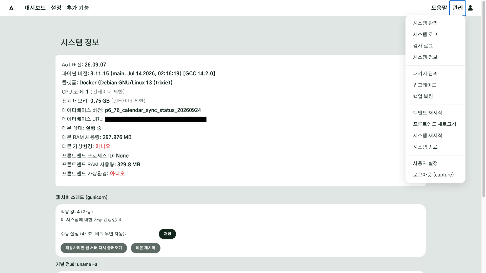
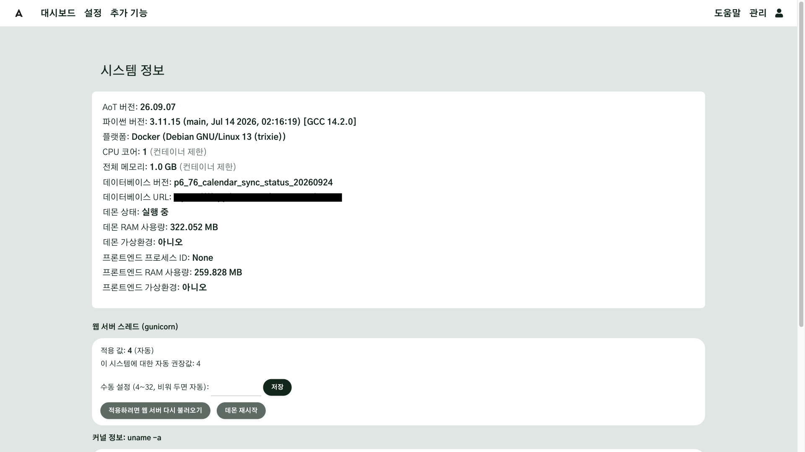

# 설치

AoT 를 Docker 로 설치하고, 첫 관리자 계정을 만들고, 제대로 작동하는지 확인합니다. Docker 는 일반 PC·서버·
64비트 라즈베리 파이에서 같은 방법으로 설치할 수 있으므로 이 가이드는 Docker 설치를 기본으로 설명합니다. 라즈베리 파이에
직접 설치하는 방법은 [5단계](#step-5)에 따로 적었습니다.

이 가이드에서는 AoT 를 설치하는 PC·서버·라즈베리 파이를 모두 **컴퓨터**라고 부릅니다.

!!! note "Docker 란"
    Docker 는 프로그램을 실행에 필요한 것들과 함께 묶어(컨테이너) 어느 컴퓨터에서나 같은 방법으로 실행할 수 있게 해 주는
    무료 도구입니다. AoT 도 이 묶음(이미지)으로 배포됩니다. 설치는 [docs.docker.com/get-docker](https://docs.docker.com/get-docker/) 에서 합니다.

    - macOS·Windows: **Docker Desktop** 을 내려받아 설치한 뒤 실행합니다.
    - 리눅스·라즈베리 파이: **Docker Engine** 을 설치합니다. 가장 간단한 방법은 `curl -fsSL https://get.docker.com | sh` 입니다.

    설치 뒤 터미널에서 `docker compose version` 이 버전을 보여 주면 준비가 끝난 것입니다.

## 이 장을 마치면 { #goal }

- Docker 로 AoT 를 설치하고 첫 관리자 계정을 만든다
- 설치가 제대로 됐는지 직접 확인한다

## 준비 { #prepare }

- 64비트 리눅스·macOS·Windows 컴퓨터 한 대(일반 PC·서버, 또는 64비트 OS 를 올린 라즈베리 파이 4·5)
  - 32비트 OS 에는 Docker 로 설치할 수 없습니다. [5단계](#step-5)의 직접 설치 방법을 따르십시오.
- [Docker](https://docs.docker.com/get-docker/) 와 Compose v2
- 인터넷 연결(설치 이미지를 내려받는 데 필요합니다)
- 그 컴퓨터에서 명령을 입력할 터미널

## 절차 { #steps }

### 1. 내려받고 설정 파일 만들기 { #step-1 }

```bash
git clone https://github.com/AoT-inc/AoT.git /opt/AoT
cd /opt/AoT
cp docker/.env.prod.example docker/.env
```

`docker/.env` 를 열어 아래 네 줄만 확인합니다. 나머지는 처음에는 그대로 둡니다.

| 항목 | 넣을 값 | 뜻 |
|---|---|---|
| `AOT_IMAGE_TAG` | [릴리스](https://github.com/AoT-inc/AoT/releases)의 정확한 버전(예: `26.09.07`) | 설치할 버전. `latest` 대신 버전을 적어 두면 언제 무엇이 바뀌었는지 알 수 있습니다 |
| `AOT_PORT` | `8084` | 브라우저로 접속할 포트. 다른 프로그램이 이미 쓰는 포트라면 바꿉니다 |
| `TZ` | 현장의 시간대(예: `Asia/Seoul`) | 처음 설치할 때 **시스템 시간대**의 기본값. 그 뒤로는 화면의 시스템 시간대 설정을 따릅니다 |
| `HARDWARE_PROFILE` | 라즈베리 파이·소형 컴퓨터 `LOW`, 일반 PC·서버 `HIGH` | AI 기능이 컴퓨터 자원을 얼마나 쓸지 정합니다. 제어 기능은 두 값 모두 같습니다 |

### 2. 실행하기 { #step-2 }

```bash
docker compose -f docker/docker-compose.prod.yml up -d
```

처음에는 이미지를 받느라 몇 분 걸립니다. 설치가 완료되면 컨테이너 네 개가 실행 중이어야 합니다.

```bash
docker compose -f docker/docker-compose.prod.yml ps
```

| 컨테이너 | 하는 일 |
|---|---|
| `aot-app` | 웹 화면 |
| `aot_daemon` | 센서 읽기·장치 제어(AoT 의 본체) |
| `aot_mcp` | AI 연결 창구 |
| `influxdb` | 측정값 저장소 |

!!! danger "`docker compose down -v` 를 치지 마십시오"
    `-v` 는 설정·측정값이 든 저장 공간(볼륨)까지 지웁니다. 멈출 때는 `down` 만, 다시 실행할 때는 `up -d` 만 씁니다.

### 3. 첫 관리자 계정 만들기 { #step-3 }

1. 브라우저로 `http://<컴퓨터 IP>:8084` 를 엽니다. 같은 컴퓨터라면 `http://localhost:8084` 입니다.
2. 첫 화면에서 **로그인**을 누릅니다. 관리자가 아직 없으므로 안내 화면이 먼저 나옵니다. 내용을 읽고 **확인했습니다**를 누릅니다.
3. **관리자 생성** 화면에서 사용자명, 이메일, 비밀번호를 입력하고 **관리자 계정 생성**을 누릅니다.
   - 사용자명: 영문·숫자 3~64자
   - 비밀번호: 8자 이상, 흔한 비밀번호는 거부됩니다
4. 로그인 화면에서 방금 만든 계정으로 로그인합니다. 처음 보이는 화면은 **실시간 측정**입니다. 아직 센서가 없으므로 비어 있습니다.


### 4. 제대로 작동하는지 확인하기 { #step-4 }

- **화면 왼쪽 위 로고**: 배경색이 바뀌지 않으면 정상입니다. 빨간색이면 제어 본체(데몬)가 멈춘 것이고,
  회색이면 웹 화면과 연결이 끊긴 것입니다.
- **관리 → 시스템 정보**: 데몬 상태가 "실행 중"인지, 데이터베이스 버전에 경고가 없는지 확인합니다. 디스크 사용량도 여기서 봅니다.
- 문제가 있으면 로그를 봅니다.
  ```bash
  docker compose -f docker/docker-compose.prod.yml logs -f aot-app aot_daemon
  ```
  화면에서는 관리 → **시스템 로그**에서 같은 기록을 볼 수 있습니다.





### 5. 라즈베리 파이에 직접 설치하기(선택) { #step-5 }

라즈베리 파이의 GPIO·I2C 에 센서나 릴레이를 직접 연결해 쓰려면 직접 설치를 씁니다. Docker 설치는
컴퓨터의 GPIO·I2C·1-Wire 를 컨테이너 안으로 넘기지 않기 때문입니다. 직접 설치는 32비트·64비트 OS 에서 모두
가능하지만, 측정값 저장소(InfluxDB)를 쓰려면 64비트 OS 를 권장합니다.

```bash
curl -L https://aot-inc.github.io/AoT/install | bash
```

- 데비안 계열 OS 에서, root 가 아닌 사용자로 실행합니다. `/opt/AoT` 가 이미 있으면 멈춥니다.
- 설치가 끝나면 `https://<파이 IP>` 를 엽니다. 직접 설치한 AoT 는 스스로 만든(자체 서명) 인증서를 쓰므로
  브라우저가 "연결이 비공개로 설정되어 있지 않습니다" 같은 경고를 보여 줍니다. 주소가 내 파이의 주소가 맞으면 아래처럼 경고를 넘기고 들어갑니다.
  - Chrome·Edge: **고급** → **<파이 IP>(으)로 이동(안전하지 않음)**
  - Safari: **세부사항 보기** → **이 웹 사이트 방문**
  - 일부 브라우저·앱 안의 창은 이 경고를 넘길 수 없어 열리지 않습니다. 그때는 위 브라우저를 쓰십시오.
- 관리자 계정 만들기부터는 [3단계](#step-3)와 같습니다.

!!! warning "직접 설치는 MQTT 브로커를 함께 설치합니다"
    직접 설치는 컴퓨터에 MQTT 브로커(1883 포트)도 함께 설치합니다. 처음에는 **같은 컴퓨터에서 오는 연결만** 받습니다.
    외부 게이트웨이처럼 다른 기기가 이 브로커에 접속해야 하면, 설치 명령을 실행하기 전에 같은 터미널에서
    `export AOT_MQTT_LISTEN_ALL=1` 을 실행합니다. 이때 브로커는 같은 네트워크 전체에 **로그인 없이** 열리므로, 믿을 수 있는
    네트워크에서만 쓰거나 브로커에 로그인을 설정하십시오. 예전 버전으로 설치한 컴퓨터는 이미 네트워크 전체에 열려 있을 수 있습니다.
    업그레이드는 이 설정을 바꾸지 않고 경고만 보여 줍니다([MQTT 브로커](../index.md#mqtt-broker-security)).

## 확인 { #check }

브라우저로 로그인이 되고, 로고 배경이 빨간색·회색이 아니고, 시스템 정보에 데몬이 "실행 중"으로 나오면 설치가 끝난 것입니다.

## 현장 A { #site-a }

현장 A 는 여러 구역과 시설을 컴퓨터 한 대로 관리하고 AI 연결도 쓰므로, 현장 사무실의 소형 PC 에 Docker 로
설치하고 `HARDWARE_PROFILE=HIGH` 로 설정합니다. LoRaWAN 센서 값은 ChirpStack(LoRaWAN 네트워크 서버)을 거쳐 네트워크로 들어오므로
GPIO 가 필요 없습니다.

## 현장 B { #site-b }

현장 B 는 기존 설비의 값을 MQTT 로 받아 오므로 역시 GPIO 가 필요 없습니다. 온실 옆 제어실에 64비트
라즈베리 파이를 두고 Docker 로 설치하며, `HARDWARE_PROFILE=LOW` 로 설정합니다.

## 안 될 때 { #trouble }

| 증상 | 확인할 것 |
|---|---|
| `up -d` 에서 포트가 이미 쓰인다는 오류 | `docker/.env` 의 `AOT_PORT` 를 다른 번호로 바꿉니다 |
| 이미지를 받지 못한다 | 컴퓨터가 amd64 또는 arm64 인지, 인터넷(`ghcr.io`)에 접속할 수 있는지 |
| 브라우저가 열리지 않는다 | `docker compose ... ps` 로 `aot-app` 이 실행 중인지, 컴퓨터 IP 와 포트가 맞는지 |
| 로고가 빨갛다 | `aot_daemon` 로그를 봅니다. 처음 시작하는 중이면 1~2분 기다립니다 |
| `https://<파이 IP>` 가 경고 화면에서 멈추거나 열리지 않는다 | 자체 서명 인증서 경고입니다. [5단계](#step-5)대로 넘어가십시오 |
| macOS·Windows 에서 데이터베이스 오류 | compose 파일에 정해진 저장 공간(볼륨) 설정을 바꾸지 마십시오. 볼륨 대신 컴퓨터의 폴더를 직접 연결하면 데이터베이스가 손상됩니다 |

## 더 알아보기 { #more }

- [Docker로 설치](../index.md#install-with-docker)
- [Docker 배포판 업그레이드](../Upgrade-Backup-Restore.md#docker)
- [시스템 정보](../System-Information.md)
- [문제 해결](../Troubleshooting.md)
