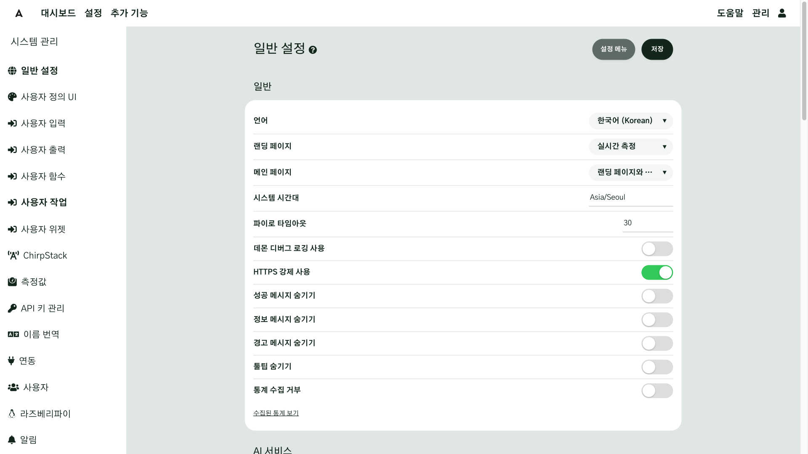
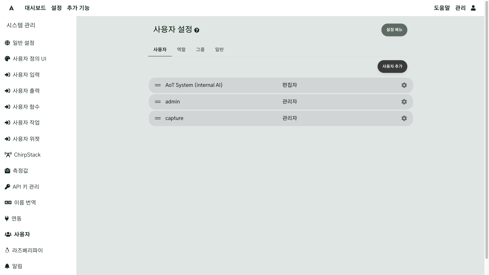
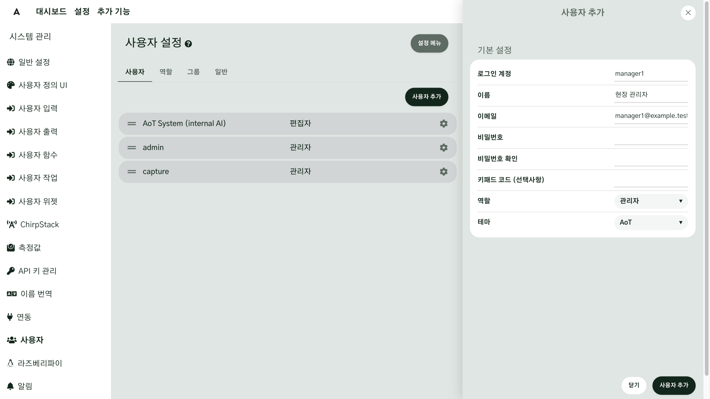
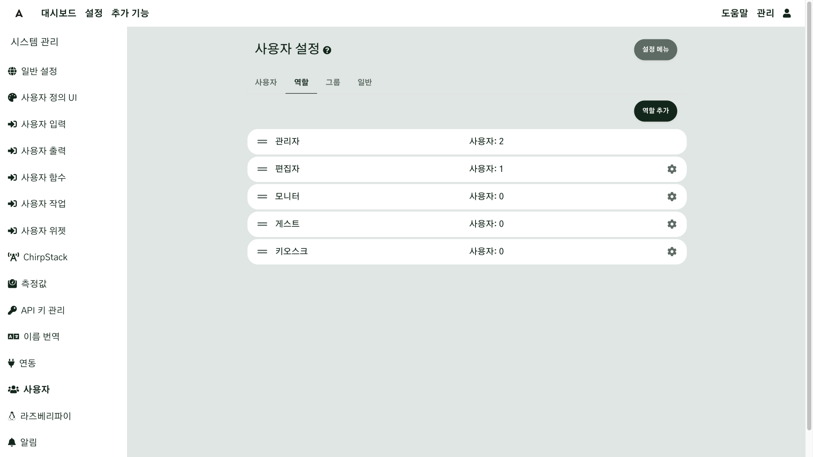
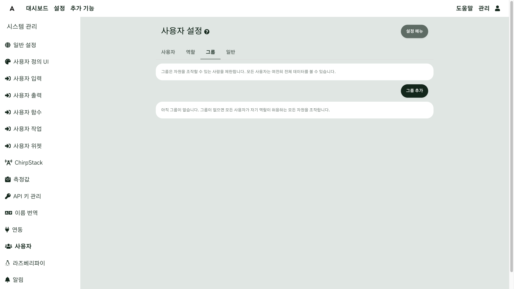
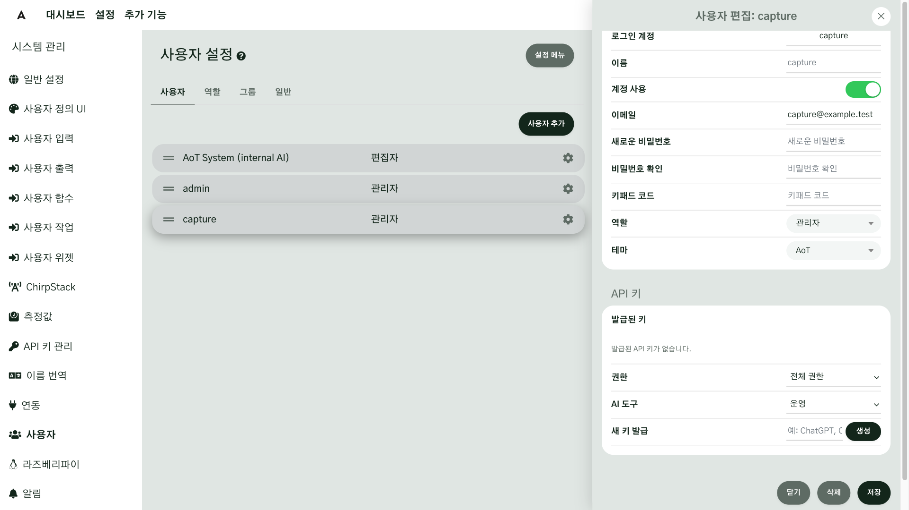

# 주요 설정

설치한 직후에 정해 두어야 나중에 헷갈리지 않는 설정이 몇 가지 있습니다. 이 장에서는 **첫날 할 것**과
**나중에 해도 되는 것**을 나눕니다. 설정은 대부분 관리 → **시스템 관리**에 모여 있습니다.

## 이 장을 마치면 { #goal }

- 첫날 반드시 해야 할 설정을 순서대로 마친다
- 함께 쓸 사람에게 알맞은 권한으로 계정을 만든다

## 준비 { #prepare }

- 설치하고 관리자로 로그인한 AoT ([설치](g01-install.md#check))
- 현장의 시간대(예: `Asia/Seoul`)
- 함께 쓸 사람 목록과 각자 할 일(설정까지 하는 사람, 보기만 하는 사람)

## 절차 { #steps }

### 1. 시간대와 언어 { #step-1 }

관리 → 시스템 관리 → **일반 설정**에서:

- **언어**: **브라우저 기본값**이면 각자 브라우저 언어를 따릅니다. 사람마다 다르게 쓰려면 관리 → **사용자 설정**에서 각자 정합니다.
- **랜딩 페이지**: 로그인 뒤 처음 보일 화면입니다(처음에는 실시간 측정). 대시보드를 꾸민 뒤 대시보드로 바꾸면 편합니다.
- **메인 페이지**: 화면 왼쪽 위 로고를 눌렀을 때 보일 화면입니다(처음에는 **랜딩 페이지와 동일**).
- **시스템 시간대**: 현장의 시간대를 입력합니다(`Asia/Seoul` 처럼 지역/도시 형식).
  장치·구역에 시간대를 따로 정하지 않았을 때 이 값을 씁니다.

시스템 시간대에는 설치할 때 정한 `TZ` 값이 미리 들어 있습니다. 현장 시간대와 같으면 그대로 두고, 다르면 바꾼 뒤 화면 위의 **저장**을 누릅니다.

!!! note "시간이 여러 곳에서 정해지는 이유"
    AoT 는 장치가 여러 시간대에 흩어져 있어도 올바르게 동작하도록, 장치 → 구역·대지 → 시스템 시간대 순서로 시간대를
    찾아 시각을 정합니다. 한 현장만 쓴다면 시스템 시간대 하나만 맞게 설정하면 됩니다. 일출·일몰 시각은 지도에 그린 현장 위치로
    계산하므로 [지도 구성](g04-map.md)도 함께 하십시오.

### 2. 사용자 만들기 { #step-2 }

관리 → 시스템 관리 → **사용자**를 누르면 **사용자 설정** 화면이 열립니다(탭: **사용자**·**역할**·**그룹**·**일반**).
**사용자** 탭에서 **사용자 추가**를 누르고 로그인 계정, 이름, 이메일, 비밀번호를 입력하고 역할을 고릅니다.
로그인 계정은 나중에 바꿀 수 없습니다.

| 역할 | 할 수 있는 일 | 누구에게 |
|---|---|---|
| 관리자 | 모든 것. 사용자 관리와 모든 그룹 접근 포함 | 시스템 담당자 1~2명 |
| 편집자 | 사용자 관리를 뺀 모든 것(장치 조작·설정 변경 포함) | 현장 관리자 |
| 모니터 | 보기와 AI 질문 | 점검자, 상황만 보는 사람 |
| 게스트 | 아무것도 할 수 없음 | 쓰지 않음 |
| 키오스크 | 카메라·통계 보기 | 벽걸이 화면 등 |

목록에 처음부터 있는 **AoT System (internal AI)** 은 AI 기능이 쓰는 내부 계정입니다. 이 계정으로는 로그인할 수 없으니
그대로 두십시오.

관리자 계정을 여럿이 함께 쓰지 마십시오. 사람마다 계정을 만들어야 **관리 → 감사 로그**에 누가 무엇을
했는지 남습니다.

### 3. 그룹으로 조작 범위 나누기(필요할 때) { #step-3 }

현장이 여러 곳이고 사람마다 맡은 현장이 다르면 **그룹**을 씁니다. 그룹은 **조작**할 수 있는 범위를 좁히고,
보는 것은 막지 않습니다. 대시보드·지도·시설마다 설정에서 그룹을 지정하면, 그때부터 그 그룹에 속한 사람만
조작할 수 있습니다. 한 현장만 쓴다면 건너뛰어도 됩니다.

### 4. 로그인 보호 { #step-4 }

- 비밀번호를 5번 틀리면 10분 동안 계정이 잠깁니다. 따로 설정할 것은 없습니다.
- 외부에서 접속할 수 있게 할 계획이라면([네트워크 연결](g03-network.md)) 모든 계정에 긴 비밀번호를 쓰십시오.
- 2단계 인증(TOTP)은 현재 화면에서 켤 수 없고 관리자가 데이터베이스에서 설정해야 합니다([2단계 인증](../Security.md#totp)).

<!-- 확인 필요: task_d73e498f 로 설정 화면이 생기면 이 절을 절차로 바꾼다 -->

### 5. 나중에 해도 되는 것 { #step-5 }

| 설정 | 언제 |
|---|---|
| 알림 설정(메일 서버) | [이메일 알림](g08-email.md)을 할 때 |
| 사용자 API 키 | AI 도구를 연결할 때. 관리 → 시스템 관리 → 사용자 → 사용자의 톱니바퀴를 눌러 **사용자 편집** → **API 키** 절의 **새 키 발급** 줄에 이름을 입력하고 **생성**을 누름 |
| 외부 서비스 키(날씨·지도·LoRaWAN) | 그 기능을 쓸 때. 관리 → 시스템 관리 → **API 키 관리** |
| 사이트 이름 표시 | 사용자 정의 UI → 브랜드 텍스트 |
| 측정 단위 추가·변환 | 기본 단위로 부족할 때. 관리 → 시스템 관리 → 측정값 |
| 업데이트 확인·통계 수집 | 기본값(업데이트 확인 켬)으로 충분합니다. 외부 연결을 막아 둔 현장이라면 일반 설정에서 끕니다 |

**사용자 API 키**와 **API 키 관리**는 다른 것입니다. 사용자 API 키는 AI 도구가 AoT 에 접속할 때 쓰는 키이고,
API 키 관리에 넣는 키는 AoT 가 외부 서비스(날씨·지도·ChirpStack)에 접속할 때 쓰는 키입니다.

## 확인 { #check }

- 실시간 측정이나 시스템 로그에 찍힌 시각이 현장 시각과 맞으면 시간대가 맞은 것입니다.
- 새로 만든 계정으로 로그인해, 역할에 따라 메뉴가 알맞게 보이거나 막히는지 확인합니다(예: 모니터 역할로는 출력을 켤 수 없어야 합니다).

## 현장 A { #site-a }

현장 A 는 관리 기관 담당자와 현장 작업자가 함께 씁니다.

- 관리자 1명(시스템 담당), 편집자 2명(현장 관리자), 모니터 여러 명(점검·방문자)
- 현장이 하나이므로 그룹은 쓰지 않습니다.

## 현장 B { #site-b }

현장 B 는 운영자 한두 명이 씁니다. 관리자 1명과 편집자 1명이면 충분합니다. 온실 옆 벽걸이 화면에는
조작 권한이 없는 모니터 계정으로 로그인해 대시보드를 표시합니다.

<!-- 확인 필요: Kiosk 역할로 대시보드가 보이는지 2단계에서 확인 -->

## 안 될 때 { #trouble }

| 증상 | 확인할 것 |
|---|---|
| 시각이 몇 시간씩 어긋난다 | 시스템 시간대, 그리고 관리 → 사용자 설정 → 시간대(개인 표시용) |
| 새 사용자를 만들 때 비밀번호가 거부된다 | 8자 이상인지, 흔한 비밀번호가 아닌지 |
| 계정이 잠겼다 | 10분 뒤 다시 시도하거나 관리자가 사용자 화면에서 잠금을 풉니다 |
| 어떤 사람이 특정 대시보드만 조작하지 못한다 | 그 대시보드에 그룹이 지정되어 있습니다([3단계](#step-3)) |

## 더 알아보기 { #more }

- [일반 설정](../Configuration-Settings.md#general-settings)
- [사용자·역할·그룹](../Configuration-Settings.md#users)
- [시간과 시간대](../time-handling.md)
- [보안](../Security.md)
