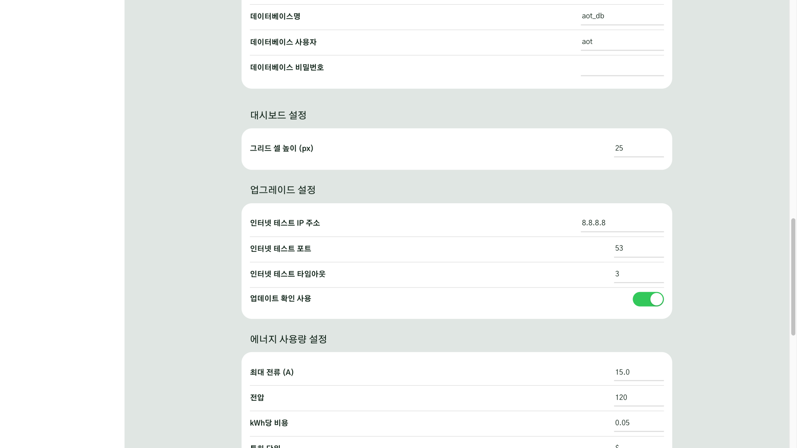
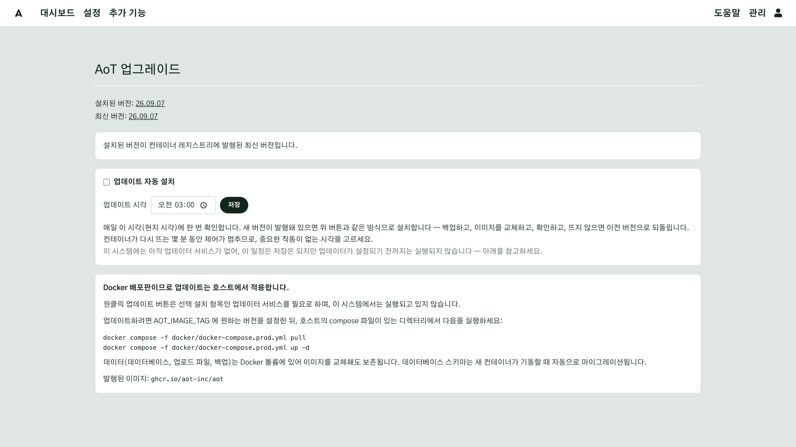

# 네트워크 연결

현장에 둔 AoT 에 사무실이나 집에서 접속하려면, 인터넷을 거쳐 현장의 AoT 컴퓨터까지 연결되는 **접속 경로**가
있어야 합니다. 그런데 현장 인터넷은 대개 통신사 LTE 라우터나 건물 공유기를 거치고, 이런 네트워크는 **바깥에서
안으로 들어오는 연결을 막습니다.** 공유기에 포트를 열어(포트포워딩) 해결할 수도 있지만,
공인 IP 가 없거나 바뀌는 경우가 많고, 열어 둔 포트는 인터넷 전체에 노출됩니다.

이 장에서는 반대 방향으로 연결합니다. **AoT 컴퓨터가 먼저 바깥으로 연결을 열어 두고**, 사용자는
그 연결을 통해 접속합니다. 공유기 설정은 바꾸지 않습니다. 이런 연결을 제공하는 서비스 두 가지를 다룹니다.

- **Tailscale**: 내 기기들(AoT 컴퓨터·노트북·휴대폰)을 인터넷을 통해 하나의 사설망처럼 묶어 주는
  서비스입니다. 같은 계정으로 로그인한 기기끼리만 서로 보입니다.
- **Cloudflare Tunnel**: AoT 컴퓨터에서 Cloudflare 로 연결을 열어 두고, 내 도메인 주소(예: `aot.example.com`)로
  접속한 방문자를 그 연결로 전달하는 서비스입니다. 접속하는 사람은 브라우저만 있으면 됩니다.

두 서비스 모두 무료 요금제로 시작할 수 있습니다. 끝으로 AoT 가 외부로 여는 연결을 모두 정리해,
현장 방화벽 담당자에게 전달할 허용 목록을 만듭니다.

## 이 장을 마치면 { #goal }

- 현장 공유기에 포트를 열지 않고 외부에서 AoT 에 접속한다
- AoT 가 외부로 여는 연결을 파악해 방화벽 허용 목록으로 정리한다

## 준비 { #prepare }

- Docker 로 설치해 현장 네트워크에서 `http://<컴퓨터 IP>:8084` 로 열리는 AoT ([설치](g01-install.md#check))
- AoT 컴퓨터에 접속해 명령을 입력할 수 있는 터미널
- 접속에 쓸 기기(노트북·휴대폰)
- 선택한 방법에 따라: Tailscale 계정, 또는 Cloudflare 계정과 Cloudflare 에 연결된 도메인 하나

## 절차 { #steps }

### 1. 방법 고르기 { #step-1 }

| | 방법 A: Tailscale | 방법 B: Cloudflare Tunnel |
|---|---|---|
| 누가 접속하나 | 관리자 몇 명 | 여러 사람, 처음 오는 사람 |
| 접속하는 기기에 | Tailscale 앱 설치 | 브라우저만 |
| 주소 | 사설 주소(`http://<컴퓨터 이름>:8084`) | 내 도메인(`https://aot.example.com`) |
| 도메인 | 필요 없음 | 필요 |
| 웹 암호화 | Tailscale 터널이 암호화 | Cloudflare 가 HTTPS 제공 |
| AoT 설정 변경 | 없음 | `AOT_BEHIND_TLS=1` 필요 |

처음이라면 **방법 A** 를 권합니다. 설정이 적고, AoT 화면이 인터넷에 공개되지 않습니다.
둘을 함께 써도 됩니다(관리자는 A, 방문 점검자는 B).

### 2. 방법 A: Tailscale 로 접속하기 { #step-2 }

1. AoT 컴퓨터(컨테이너가 아니라 **컴퓨터 자체**)에 Tailscale 을 설치하고 로그인합니다.
   ```bash
   curl -fsSL https://tailscale.com/install.sh | sh
   sudo tailscale up
   ```
   화면에 나온 주소를 브라우저로 열어 로그인하면 컴퓨터가 내 Tailscale 네트워크에 추가됩니다.
2. 접속할 노트북·휴대폰에 Tailscale 앱을 설치하고 **같은 계정**으로 로그인합니다.
3. Tailscale 관리 화면(Machines)에서 AoT 컴퓨터의 이름을 확인합니다.
4. 접속할 기기에서 `http://<컴퓨터 이름>:8084` 를 엽니다.

AoT 설정은 바꿀 것이 없습니다. `AOT_BEHIND_TLS` 는 **설정하지 않습니다.**

### 3. 방법 B: Cloudflare Tunnel 로 접속하기 { #step-3 }

1. Cloudflare 대시보드의 Zero Trust → Networks → Tunnels 에서 터널을 새로 만들고,
   커넥터 설치 방법으로 **Docker** 를 고릅니다. 나온 토큰을 복사합니다.
2. AoT 컴퓨터에서 커넥터를 실행합니다. `--network host` 로 실행하면 커넥터가 컴퓨터의 8084 포트에 바로 접속합니다.
   ```bash
   docker run -d --name cloudflared --restart unless-stopped --network host \
     cloudflare/cloudflared:latest tunnel --no-autoupdate run --token <토큰>
   ```
3. 터널의 Public Hostname 에 주소(예: `aot.example.com`)를 추가하고, 서비스는
   `HTTP` · `localhost:8084` 로 지정합니다.
4. `docker/.env` 에 한 줄을 추가하고 AoT 를 다시 시작합니다.
   ```bash
   AOT_BEHIND_TLS=1
   ```
   ```bash
   docker compose -f docker/docker-compose.prod.yml up -d
   ```
   <!-- 검증 필요: 이 값이 컨테이너까지 전달되도록 고치는 작업(task_899c1ce4) 반영 뒤 2단계 실증에서 확인 -->
5. **Cloudflare Access 로 앞문을 하나 더 둡니다.** Zero Trust → Access → Applications 에서
   같은 주소를 등록하고, 허용할 이메일 주소만 정책에 추가합니다. 그러면 AoT 로그인 화면이
   나오기 전에 Cloudflare 가 이메일 인증을 먼저 요구합니다.

!!! warning "`AOT_BEHIND_TLS=1` 을 켜면 현장에서도 HTTPS 주소로 들어와야 합니다"
    이 값을 켜면 로그인 쿠키가 HTTPS 연결에서만 전달됩니다. 현장 네트워크에서 `http://<컴퓨터 IP>:8084`
    로 접속하면 로그인이 되지 않습니다. 현장에서도 `https://aot.example.com` 을 쓰거나,
    현장에서는 방법 A 를 함께 쓰십시오. 자세한 이유는
    [리버스 프록시 뒤에서의 쿠키](../Security.md#behind-tls)에 있습니다.

### 4. 바깥으로 나가는 연결 허용 목록 만들기 { #step-4 }

현장 방화벽이 바깥으로 나가는 연결까지 막는 곳(관공서·학교·공장 네트워크)이라면, 아래 표에서
**쓰는 기능의 줄만** 골라 담당자에게 전달합니다. AoT 로 들어오는 연결은 열어 달라고 요청할
필요가 없습니다.

**AoT 컴퓨터의 운영체제**

| 용도 | 목적지 | 포트 | 막히면 |
|---|---|---|---|
| 시간 맞추기(NTP) | 운영체제가 쓰는 NTP 서버 | UDP 123 | 컴퓨터 시계가 틀어져 예약·기록 시각이 어긋남 |
| 설치·업데이트 이미지 | `ghcr.io` | TCP 443 | 설치·업데이트 불가(실행 중인 시스템은 그대로 동작) |
| Tailscale(방법 A) | Tailscale 조정 서버·중계 서버 | UDP 41641, TCP 443 | 원격 접속 불가 |
| Cloudflare Tunnel(방법 B) | Cloudflare 터널 서버 | TCP·UDP 7844 | 원격 접속 불가 |

**AoT 가 스스로 여는 연결 — 설정하지 않아도 여는 것**

| 용도 | 목적지 | 포트 | 막히면 |
|---|---|---|---|
| 새 버전 확인(48시간마다) | `ghcr.io` | TCP 443 | "새 버전" 알림만 나오지 않음. 설정에서 끌 수 있음 |
| 인터넷 연결 검사(직접 설치한 AoT 에서 관리 → 업그레이드 화면을 열 때. Docker 설치는 하지 않음) | `8.8.8.8` (일반 설정의 **업그레이드 설정** → **인터넷 테스트 IP 주소**·**인터넷 테스트 포트**에서 바꿀 수 있음) | TCP 53 | 그 화면에 인터넷 연결이 없다고 나옴 |

**AoT 가 여는 연결 — 그 기능을 설정했을 때만**

| 기능 | 목적지(예) | 포트 | 막히면 |
|---|---|---|---|
| 이메일 알림 | 설정한 SMTP 서버(예: `smtp.gmail.com`) | TCP 465 또는 587 | 알림 메일이 안 감 |
| 날씨 입력 | `api.open-meteo.com`, `apihub.kma.go.kr`, `apis.data.go.kr`, `api.openweathermap.org` 등 추가한 입력의 서버 | TCP 443 | 그 입력만 값이 끊김 |
| MQTT 장치 | 설정한 브로커 | TCP 1883 또는 8883 | 그 장치의 값·제어가 끊김 |
| LoRaWAN(ChirpStack) | 설정한 ChirpStack 서버 | TCP 8080(API), 1883(MQTT) | 장치 목록·다운링크 제어 불가 |
| PLC(Modbus TCP) | 설정한 PLC | TCP 502 | 그 장치가 끊김 |
| 지도 위 겹침 레이어·주소·지번 검색 | 추가한 레이어의 서버(`api.vworld.kr`, `nominatim.openstreetmap.org` 등) | TCP 443 | 겹침 레이어가 비고 검색이 안 됨 |
| AI 연결 | 고른 AI 서비스(`api.anthropic.com`, `api.openai.com`, `generativelanguage.googleapis.com` 등) | TCP 443 | AI 대화·요약이 안 됨 |
| 구글 캘린더 연동 | `accounts.google.com`, `oauth2.googleapis.com`, `www.googleapis.com` | TCP 443 | 캘린더 동기화 안 됨 |
| 다른 AoT 서버 연결 | 등록한 AoT 주소 | TCP 443 | 원격 장치 값이 안 옴 |
| 웹훅 액션·카메라 | 입력한 주소 | 그 주소의 포트 | 해당 기능만 실패 |
| 모듈 의존성 설치 | `pypi.org`, `files.pythonhosted.org` | TCP 443 | 의존성이 필요한 입력·출력을 추가할 수 없음 |

**화면을 보는 사람의 브라우저** — 아래 항목은 AoT 컴퓨터가 아니라 **접속한 기기**가 직접 내려받습니다.
보는 사람의 네트워크(사무실 방화벽 등)에서 막히면 그 사람의 화면에서만 빠집니다.

| 용도 | 목적지 | 막히면 |
|---|---|---|
| 배경 지도 타일 | 고른 배경 지도 서버(OpenStreetMap, VWorld, Esri 등) | 지도 바탕이 빈 화면 |
| 글꼴·일부 화면 효과 | `fonts.googleapis.com`, `cdnjs.cloudflare.com` | 기본 글꼴로 보이고 일부 아이콘·효과가 빠짐 |

!!! level-3 "엔지니어"
    AoT 컨테이너가 바깥으로 공개하는 포트는 웹 화면(`AOT_PORT`, 기본 8084) 하나입니다.
    MCP(5700)와 InfluxDB(8087)는 기본값이 `127.0.0.1` 에만 열립니다. 원격 AI 클라이언트가
    Tailscale 을 통해 MCP 에 접속해야 하면 `docker/.env` 의 `AOT_MCP_BIND` 를 컴퓨터의 Tailscale 주소로
    지정하십시오. `0.0.0.0` 으로 열지 마십시오.



## 확인 { #check }

외부에서 로그인 화면이 열리고, 로그인한 뒤 다른 메뉴로 옮겨도 로그인이 유지되면 설정이 끝난 것입니다.

1. 휴대폰의 와이파이를 끄고 LTE 로 방법 A 또는 B 의 주소를 엽니다.
2. 로그인한 뒤 대시보드 → 설정 → 대시보드 순으로 이동해 봅니다. 중간에 로그인 화면으로
   돌아가지 않아야 합니다.
3. 관리 → 업그레이드 화면을 열어 **설치된 버전**과 함께 **최신 버전**이 나오는지 봅니다. AoT 가 인터넷에 접속하지 못하면
   최신 버전 대신 이미지 목록을 읽지 못했다는 안내가 나옵니다.



## 현장 A { #site-a }

현장 A 는 노지와 시설이 함께 있고, 센서 값이 세 가지 방식으로 들어오므로, 허용 목록에도
세 줄이 들어갑니다.

- LoRaWAN 센서 → ChirpStack 서버의 API(8080)와 MQTT(1883)
- 날씨 입력 → `api.open-meteo.com`, 기상청 API 서버
- 시설 안 MQTT 센서 → 해당 브로커(1883)

관리자는 방법 A 로 접속하고, 방문 점검자에게는 방법 B 주소를 알려 줍니다.

## 현장 B { #site-b }

현장 B 는 기존 시설 제어 설비에 AoT 를 연결한 곳입니다. 센서 값은 기존 설비의 MQTT 브로커에서
받아 옵니다. 그래서 브로커가 같은 건물 네트워크 안에 있으면 방화벽 허용 목록에 넣을 줄이 거의 없습니다
(NTP·이미지 저장소·원격 접속용 한두 줄). 원격 접속은 방법 A 하나로 충분합니다.

## 안 될 때 { #trouble }

| 증상 | 확인할 것 |
|---|---|
| 로그인하자마자 다시 로그인 화면이 나온다 | HTTPS 주소로 들어왔는데 `AOT_BEHIND_TLS` 가 꺼져 있거나, `http://` 로 들어왔는데 켜져 있는 경우입니다. 접속 방법과 설정을 맞추십시오 |
| Tailscale 주소가 안 열린다 | 접속하는 기기와 AoT 컴퓨터가 같은 Tailscale 계정인지, 두 기기 모두 Tailscale 이 "연결됨"인지 확인하십시오 |
| Cloudflare 주소에서 502 오류 | Public Hostname 의 서비스가 `localhost:8084` 인지, 커넥터를 `--network host` 로 실행했는지 확인하십시오 |
| 지도 바탕만 비어 있다 | AoT 가 아니라 **보는 사람의 네트워크**이 타일 서버를 막고 있을 가능성이 큽니다. 다른 네트워크(휴대폰 LTE)에서 열어 비교하십시오 |
| 알림 메일만 안 간다 | 통신사·건물 네트워크가 메일 포트(25·465·587)를 막는 경우가 많습니다. 587 로 바꿔 보고, 안 되면 담당자에게 SMTP 서버 주소와 포트를 허용 목록에 넣어 달라고 하십시오 |

## 더 알아보기 { #more }

- [리버스 프록시 뒤에서의 쿠키](../Security.md#behind-tls)
- [일반 설정 — HTTPS 강제](../Configuration-Settings.md#general-settings)
- [알림 설정(SMTP)](../Configuration-Settings.md#alert-settings)
- [LoRaWAN (ChirpStack) 연결](../LoRaWAN-ChirpStack.md#connection)
