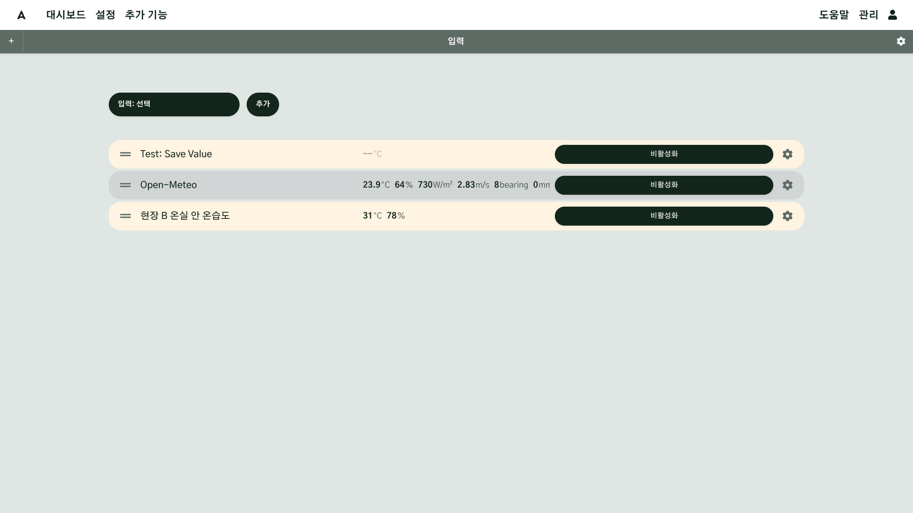
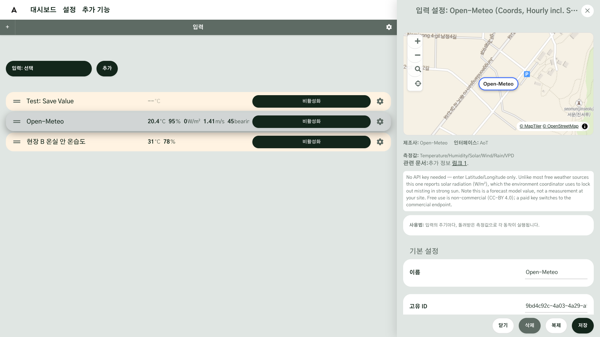
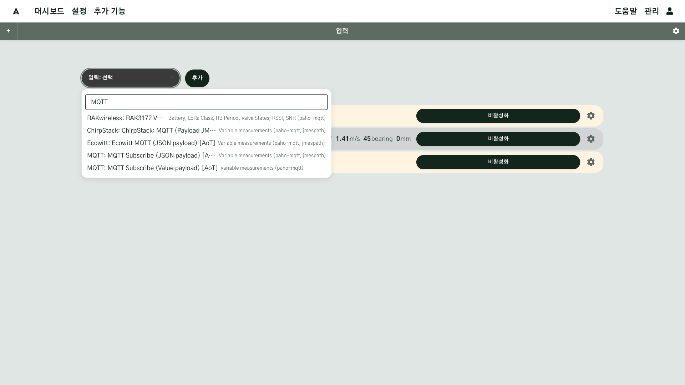
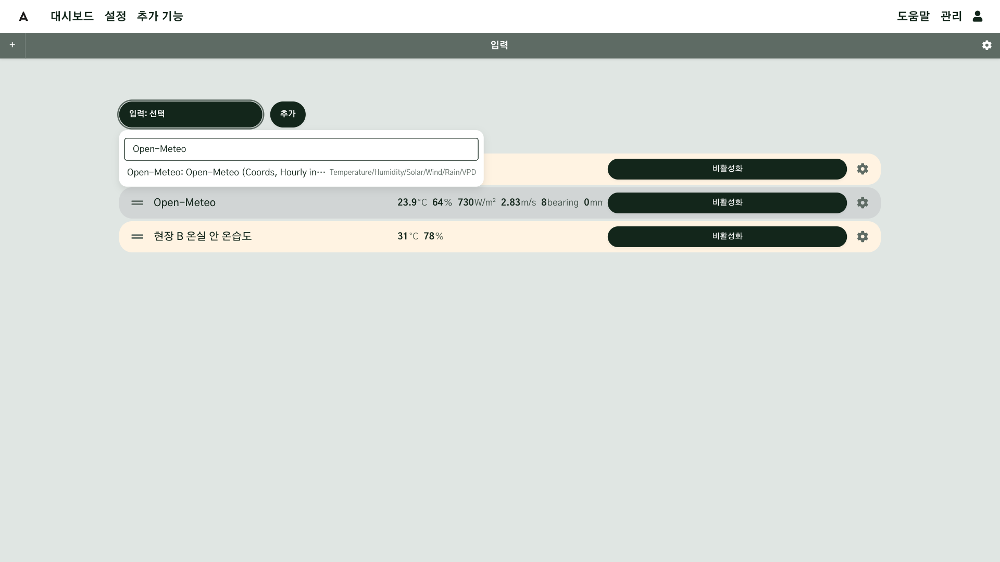
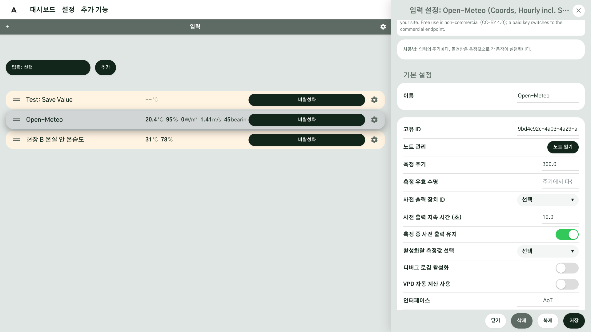
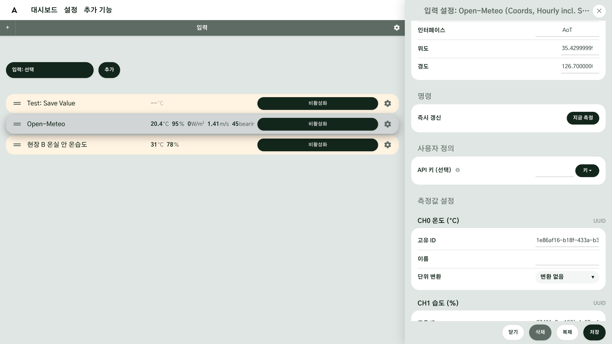
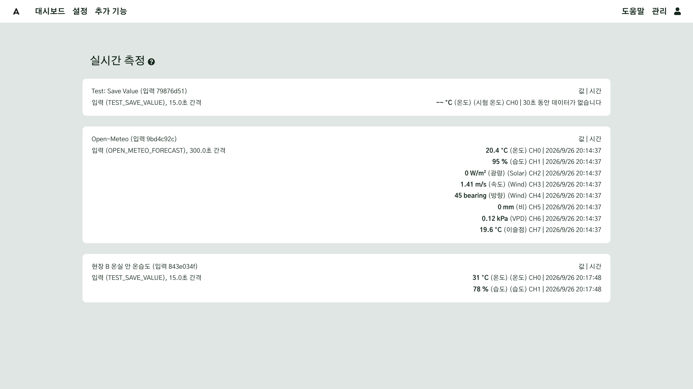
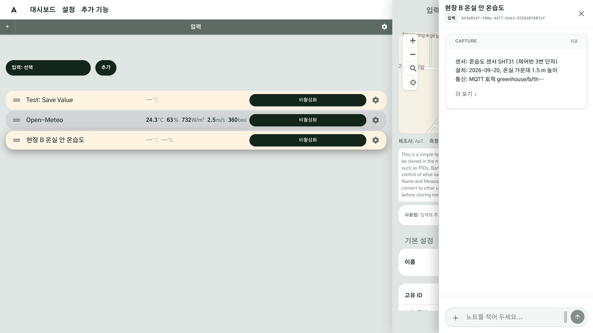

# 첫 번째 데이터

설치할 때 비어 있던 화면에, 이제 첫 번째 데이터를 띄웁니다. 센서가 없어도 인터넷의 무료 날씨 데이터로 시작할 수 있습니다.
이 장은 현장 A 를 기준으로 설명합니다. 현장 A 는 종자를 채종하기 위한 농장으로, 약 3만㎡ 의 대지가 1구역과 2구역으로 나뉘어 있고 관리사무소·온실·창고·펌프실 같은 시설이 있습니다. 이 현장에 **입력**이라는 기능으로 기상 정보와 센서 데이터를 가져옵니다.
현장 A 의 노지에는 온도와 습도, 토양 수분을 재는 무선 센서가 있고, 바깥 날씨는 인터넷에서 받아 옵니다. 연결 방식은 다르지만 AoT 에서는 모두 입력입니다. 고르고, 설정하고, 켜면 값이 들어오는 순서도 같습니다.
이 장에서 입력·출력·함수 화면에 공통인 **카드와 설정 창** 다루는 법, 그리고 **외부 API** 를 쓰는 법을 한 번 익힙니다.

## 이 장을 마치면 { #goal }

- 날씨 입력으로 첫 번째 데이터를 띄운다
- 카드와 설정 창을 다룰 줄 안다
- 키가 필요한 API 도 같은 순서로 붙일 수 있다는 것을 안다
- 내 현장 센서는 어떤 입력으로 붙일지 안다
- 가상 센서로 센서 입력을 설정하고 값을 저장해 본다
- 입력마다 노트를 남길 줄 안다

## 준비 { #prepare }

- 로그인할 수 있는 AoT([설치](g03-install.md))
- 인터넷 연결

## 절차 { #steps }

### 1. 입력은 두 갈래 { #step-1 }

값을 받아 오는 길은 크게 두 가지입니다. 현장에 설치한 센서에서 받거나, 인터넷에서 API 로 받습니다. 둘 다 입력에서 추가할 수 있고, 선택하고 설정하고 켜는 방법은 같습니다.

| 갈래 | 예 | 필요한 것 |
|---|---|---|
| 현장 센서 | 온습도 센서, 토양 수분 센서, 기상대 | 센서의 연결 방식에 맞는 입력(무선 LoRaWAN, 통신 MQTT, 제어반 PLC, 직접 연결)과 설치업체에게 받을 정보 |
| 인터넷의 API | 날씨(Open-Meteo, 기상청 등) | 위치, 필요하면 가입과 키 |

### 2. API 는 무엇인가 { #step-2 }

API 는 다른 곳이 가진 데이터를 받아 오는 창구입니다. 관공서 민원 창구와 비슷합니다. 내가 맡겨 둔 것이 없어도, 정해진 서류를 내면 필요한 것을 떼어 줍니다.
예를 들어 AoT 가 날씨 서비스를 제공하는 기상청 API 에 현재 위치의 지금 날씨를 요청하면, 기온과 습도, 바람 같은 값이 돌아옵니다. AoT 는 이 값을 받아 와서 원하는 방식으로 저장해 줍니다.

**왜 쓸까요?** 날씨 예보나 지도처럼 개인이 모으기 어려운 데이터를 국가나 국제기관이 누구나 쓸 수 있게 열어 두었기 때문입니다. 기상청의 날씨, 나라에서 만든 지도(국가 공간정보), 공공데이터포털의 여러 자료가 그런 곳입니다. 민원 창구처럼 무료인 곳이 많지만 수수료가 드는 곳도 있고, 사용 조건도 API 를 제공하는 곳마다 다르니 먼저 설명을 확인하세요.

**키는 창구에 내미는 신분증입니다.** 어떤 API 는 가입하고 받은 키를 내밀어야 쓸 수 있습니다. 키는 그 창구에만 내미는 신분증이니, AoT 의 API 키 칸에만 넣고 다른 사람에게도 AI 에게도 보여 주지 마세요.

### 3. 입력 화면 — 카드와 설정 창 { #step-3 }

**설정 → 입력**을 엽니다. 입력·출력·함수 화면은 모양이 같습니다.

- 추가한 입력은 막대 모양의 **카드**로 놓입니다. 카드에는 이름과 고유 번호(UUID) 같은 핵심 정보가 있습니다.
- 카드 왼쪽의 **손잡이**(두 줄)를 끌면 카드 순서를 바꿉니다.
- 카드 오른쪽의 **활성화** 버튼은 입력을 켭니다. 켜져 있으면 **비활성화** 로 바뀌고, 값이 들어오면 카드에 값이 표시됩니다.
- 카드 오른쪽의 **톱니**를 누르면 **설정 창**이 열립니다. 설정 창은 지도, 이 장치에 대한 설명, **기본 설정**, 그리고 장치 특징에 맞는 세부 설정으로 나뉩니다. 맨 아래에는 **닫기**·**삭제**·**복제**·**저장** 버튼이 있습니다.

**탭 이름 바꾸기.** 입력·출력·함수·대시보드 화면 위쪽에는 탭이 있습니다. 입력이 많아지면 탭을 추가해 나누어 둘 수 있습니다.

1. 탭 줄 왼쪽 끝의 **+** 버튼을 누르면 탭이 하나 추가됩니다.
2. 이름을 바꿀 탭을 고른 상태에서 탭 줄 오른쪽 끝의 **톱니**를 누르면 **탭 설정** 창이 열립니다.
3. **탭 이름** 칸에 새 이름을 적고 **저장**을 누릅니다. 여기서는 입력 화면의 탭 이름을 "현장 A" 로 바꿉니다.

입력의 카드와 설정 창은 출력·함수·지도 입력(GIS 입력)·AI 에이전트 같은 다른 설정 화면에서도 비슷한 모양으로 나옵니다. 여기서 한 번 익혀 두면 다른 종류의 장치도 쉽게 다룰 수 있습니다.

새 입력은 **입력 선택** 버튼으로 추가합니다. 누르면 AoT 가 지원하는 입력이 모두 나오고, 목록마다 짧은 설명이 있으니 내 센서나 서비스에 맞는 것을 읽고 고르면 됩니다.

### 4. API 붙이는 순서 { #step-4 }

API 를 붙이는 방법은 어디나 비슷합니다. 자전거를 한 번 익히면 어떤 자전거든 타듯이, API 도 한 번 익히면 대부분 같은 순서입니다.

1. 입력 선택 목록에서 설명을 읽고 원하는 API 를 고릅니다(무엇을 골라야 할지 모르면 AI 에게 "이런 값을 받고 싶다"고 물어보세요)
2. 설명에 있는 링크를 따라가 그 API 의 안내를 확인합니다
3. 필요하면 가입하고 키를 받습니다
4. 키를 AoT 에 넣고 저장합니다([6단계](#step-6))

### 5. 날씨 입력으로 첫 번째 데이터 띄우기 { #step-5 }

먼저 현장 A 의 바깥 날씨를 받으려고, 키가 필요 없는 **Open-Meteo** 날씨 입력을 추가합니다. Open-Meteo 는 여러 나라 기상청의 예보를 모아 열어 둔 곳입니다.

1. **설정 → 입력**을 엽니다. 화면 맨 위의 **입력 선택** 버튼(처음에는 **입력: 선택** 으로 보입니다)을 눌러 목록을 열고, 검색해서 `Open-Meteo: Open-Meteo (Coords, Hourly incl. Solar)` 를 고른 뒤 **추가**를 누릅니다. 새 Open-Meteo 입력 카드가 생깁니다.
2. 새 카드의 톱니로 설정 창을 엽니다.
3. **위치**를 먼저 정합니다. 설정 창의 작은 지도를 현장으로 옮기고, 클릭해서 위치를 지정합니다. 지도 왼쪽의 **레이블을 현재 지도 중심으로 이동**(과녁 모양)을 눌러도 됩니다.
   지도 바탕을 아직 등록하지 않았으면 현장을 찾기 어려울 수 있습니다. 위치가 맞는지는 [지도](g06-map.md) 장에서 다시 확인합니다.
   여러 개의 장치 위치를 설정할 때는 지도 페이지에서 동시에 처리할 수 있습니다.
4. **측정 주기**를 300(초, 5분) 이상으로 둡니다. 측정 주기는 API 의 설명이나 장치가 제공하는 시간에 맞추는 것이 좋습니다. Open-Meteo 는 날씨가 자주 바뀌지 않고, 너무 자주 받으면 무료 사용 한도에 걸립니다.
5. 설정 창 맨 아래의 **저장**을 누르고, 카드의 **활성화** 버튼을 눌러 켭니다.
6. 설정 창의 **명령** 항목에서 **지금 측정**을 누르면 정해진 주기를 기다리지 않고 바로 한 번 받습니다.
7. **실시간 측정**(로그인하면 처음 나오는 화면, 메뉴는 **추가 기능 → 실시간 측정**)에 기온·습도·일사·바람·비 값이 뜨면, 첫 번째 데이터가 들어온 것입니다.

**Open-Meteo 이용 조건**: 무료 사용은 비상업 용도입니다(구독·광고가 없는 개인·비영리 사이트나 앱, 개인 홈 자동화 등).
사업자가 자기 운영에 쓰는 경우는 이용 조건에 따로 적혀 있지 않으니, 애매하면 Open-Meteo 에 문의하세요.
무료 한도는 하루 1만 회·시간당 5천 회·분당 600회이고, 데이터는 CC BY 4.0 입니다([이용 조건](https://open-meteo.com/en/terms)).

### 6. 키가 필요한 API { #step-6 }

기상청처럼 키가 필요한 API 도 같은 순서입니다. [4단계](#step-4)의 순서대로 가입하고 키를 받은 뒤, 받은 키는 API 키 관리에 넣어 두고 입력을 만들 때 골라 씁니다.

1. **관리 → 시스템 관리 → API 키 관리 → 새 API 키 추가**에서 이름(예: "기상청 API 허브")과 키를 저장합니다.
2. 입력의 설정 창에서 API 키 칸 옆 **Key** 버튼으로 저장한 키를 고릅니다.

고른 키는 입력 칸에 글자 그대로 복사됩니다. 나중에 키를 바꾸면 그 키를 쓰는 입력마다 다시 골라야 합니다. 키는 다른 사람에게도, AI 에게도 보여 주지 않습니다.

| 날씨 입력 | 키 | 받는 곳 |
|---|---|---|
| Open-Meteo | 필요 없음 | — |
| 기상청 고해상도 500m, 기상청 지점 데이터 | 필요 | [기상청 API 허브](https://apihub.kma.go.kr/) 가입 → 쓸 API 신청 → 마이페이지의 인증키 |
| 기상청 단기예보 | 필요 | [공공데이터포털](https://www.data.go.kr/)에서 "기상청 단기예보 조회서비스" 활용 신청 → 일반 인증키 |

### 7. 현장 센서는 { #step-7 }

정확한 현장 데이터를 얻으려면 현장에 센서를 설치하고 데이터를 수집해야 합니다. 이때 센서의 거리와 상황에 맞는 통신 방식을 고르는 것이 중요합니다.
현장 A 에서 센서 값을 재는 곳은 가까운 곳도 90m, 가장 먼 곳은 240m 정도 떨어져 있습니다.

현장 A 의 노지 센서(대기 온습도·토양 수분)는 이렇게 값이 들어옵니다.

| 순서 | 무엇이 | 하는 일 |
|---|---|---|
| 1 | 센서 | 값을 잽니다 |
| 2 | 무선 통신(LoRaWAN) | 센서의 값을 무선으로 보냅니다 |
| 3 | 데이터 통신(MQTT) | 통신으로 받은 데이터를 MQTT 방식으로 처리합니다 |
| 4 | AoT 의 입력 | 그 값을 입력으로 받습니다 |

무선 장치들은 대부분 데이터를 중계하는 장치를 거칩니다. 이 장치가 데이터를 MQTT 방식으로 바꿔 주면 AoT 에서 값을 처리할 수 있습니다.
이 장치도 컴퓨터처럼 늘 켜져 있어야 값이 끊기지 않습니다. 센서의 종류나 연결 방식 같은 세부 사항은 이 장에서 다루지 않습니다.

현장에 설치한 센서는 연결 방식에 맞는 입력을 고릅니다. 방식마다 제조사나 설치업체에게 받아 둘 정보가 다르니, 자세한 것은 매뉴얼에서 확인하세요.

| 연결 방식 | 받아 둘 정보(예) | 자세히 |
|---|---|---|
| 무선(LoRaWAN) | 네트워크 서버 주소, 장치 번호, 키 | [LoRaWAN](../LoRaWAN-ChirpStack.md) |
| 통신(MQTT) | 브로커 주소, 토픽, 값의 형식 | [입력](../Inputs.md) |
| 제어반(PLC) | 통신 방식, 주소, 값의 위치 | [PLC](../PLC-Modbus.md) |
| 직접 연결 | 센서 종류, 연결한 핀 | 엔지니어 문서 |

### 8. 가상 센서로 설정 연습하기 { #step-8 }

이 가이드에서는 실제 센서 대신 **가상 센서**로 센서 입력을 설정하는 방법을 익힙니다. 가상 센서는 내가 적은 값을 측정값으로 저장해 주는 테스트용 입력입니다.
현장 A 에 센서가 둘 있다고 보고, 같은 방법으로 두 개를 만듭니다.

1. **설정 → 입력**에서 **입력 선택** 목록을 열고 `AoT: 테스트 입력: 원하는 측정값 저장` 을 골라 **추가**를 누릅니다. 목록에서 "테스트" 로 검색하면 찾기 쉽습니다. 한 번 더 눌러 두 개를 추가합니다.
2. 새 카드의 톱니로 설정 창을 엽니다.
3. **기본 설정**의 **이름** 칸에 구분할 수 있는 이름을 적습니다. 예: "현장 A 센서 1", "현장 A 센서 2".
4. 설정 창 아래쪽 **측정값 설정**의 **측정값 선택 (필수)** 에서 채널(CH0)의 이름을 적고, **측정 단위**를 목록에서 고릅니다. 목록은 `온도: 섭씨 (°C)` 처럼 측정값과 단위가 함께 나옵니다. 온도나 습도 같은 것을 고르거나 적으면 됩니다.
   채널을 더 쓰려면 **기본 설정**의 **채널 수**를 늘립니다.
5. 설정 창 맨 아래의 **저장**을 누르고, 카드의 **활성화** 버튼을 눌러 켭니다. 채널의 이름이나 측정 단위가 비어 있으면 "모든 측정값에는 이름과 단위/측정 항목이 설정되어 있어야 합니다" 라는 안내가 나오며 켜지지 않습니다.
6. 설정 창의 **명령** 항목에서 **값** 칸에 저장할 숫자를 적고(처음 값은 10.0), **측정값 저장** 줄의 **실행**을 누릅니다. 잠시 뒤에 그 값이 측정값으로 저장됩니다. **채널** 칸은 값을 저장할 채널 번호입니다(처음 값은 0).
7. **실시간 측정**이나 입력 카드에서 저장한 값을 확인합니다.

입력을 켜야 값을 저장할 수 있으므로, 6번 전에 반드시 **활성화**부터 하세요.

시스템으로 들어온 측정값은 시계열 데이터베이스인 InfluxDB 에 저장됩니다. 설치할 때 본 네 개의 컨테이너 중 `influxdb` 가 이 일을 합니다.
저장된 값은 위젯, 함수, API 같은 시스템 여러 곳에서 조회해 씁니다.

### 9. 입력마다 노트 남기기 { #step-9 }

입력·출력·함수의 설정 창에는 **노트**가 있습니다. **기본 설정**의 **노트 관리** 줄에서 **노트 열기** 버튼을 누르면 노트 창이 열립니다.
장비의 제원이나 설정 코드, 설치 날짜 같은 것을 적어 두면 나중에 장비를 바꾸거나 문제를 찾을 때 다시 찾아보지 않아도 됩니다.

노트는 MCP 로 연결한 AI 도 조회할 수 있습니다. 그래서 센서나 API 로는 기록할 수 없는 중요한 맥락 데이터가 됩니다. AI 를 연결하는 방법은 AI 장에서 다룹니다.

## 확인 { #check }

- 실시간 측정에 날씨 값이 보인다
- 입력 카드를 옮기고, 톱니로 설정 창을 열 수 있다
- 가상 센서에 값을 저장하고, 카드나 실시간 측정에서 그 값을 볼 수 있다

## 현장 A { #site-a }

현장 A 는 노지의 온습도·토양 수분 센서(무선)와 바깥 날씨(날씨 API)를 모두 입력으로 받습니다. 연결 방식이 달라도 입력 화면에서 같은 카드로 다룹니다. 입력 화면의 탭 이름은 "현장 A" 로 바꿔 두고, 센서 설정은 가상 센서 두 개("현장 A 센서 1", "현장 A 센서 2")로 연습합니다.

## 현장 B { #site-b }

현장 B 는 [시설](g07-facility.md) 장부터 다룹니다. 현장 B 의 온실 안 온습도 5곳과 바깥 기상대 값은 기존 제어 설비가 보내 주며, 통신(MQTT) 입력으로 받습니다.

## 안 될 때 { #trouble }

값이 안 들어오면 네 가지를 살펴보세요. 켜 두지 않았거나, 위치를 넣지 않았거나, 주기가 너무 짧거나, 키가 틀린 경우입니다.

| 증상 | 원인 | 해결 |
|---|---|---|
| 입력을 만들었는데 아무 일도 없다 | 켜지 않음(활성화하지 않음) | 입력 카드의 **활성화** 버튼을 누릅니다 |
| 가상 센서가 활성화되지 않는다 | 채널의 이름이나 측정 단위가 비어 있음 | 설정 창에서 채널 이름과 측정 단위를 고르고 저장한 뒤 다시 활성화 |
| 날씨 값이 들어오지 않는다 | 위치를 정하지 않음 | 설정 창에서 위치를 정하고 저장. 시스템 로그(데몬)에 "Latitude/Longitude required" 가 남습니다 |
| 값이 한동안 오다 끊긴다 | 주기가 너무 짧아 무료 한도를 넘음 | 측정 주기를 300초 이상으로 |
| 키가 필요한 입력에서 값이 안 온다 | 키가 틀렸거나, 아직 쓸 수 있게 되지 않음 | 키를 다시 고르기. 새 키는 쓸 수 있게 되기까지 시간이 걸릴 수 있음 |

## 더 알아보기 { #more }

- 다음 장: [대시보드](g05-dashboard.md) — 이 데이터를 대시보드에 놓아 보겠습니다
- [입력](../Inputs.md)
- [실시간 측정](../Data-Viewing.md)

---

## 도우미 AI 에게 { #for-ai }

- 값을 받아 오는 것은 모두 "입력"입니다. 사용자가 "센서"라고 해도 화면에서는 입력입니다.
- 새 입력은 켜지 않으면 동작하지 않습니다. 값이 없으면 먼저 활성화와 위치(날씨)를 확인하게 하세요.
- 키·비밀번호를 사용자에게 요구하지 마세요. 키는 사용자가 API 키 관리에 직접 넣습니다.
