# 지도 구성

AoT 는 센서와 장치가 **어디에** 있는지 알면 더 많은 일을 할 수 있습니다. 구역별로 값을 모아 보여 주고,
온실 한 동의 창과 센서를 묶어 환경을 제어하고, 구획마다 무엇을 언제 시작했는지 기록합니다.
이 장에서는 현장을 지도에 옮깁니다. 지도를 쓰지 않아도 AoT 는 동작하지만, 여러 구역이나 시설이 있는
현장이라면 지도를 먼저 그려 두어야 뒤의 장을 따라 하기 쉽습니다.

지도에 그리는 것은 네 가지입니다.

| 그리는 것 | 뜻 | 예 |
|---|---|---|
| 대지 | 현장 전체의 경계 | 현장 A 전체 |
| 구역 | 대지 안을 나눈 땅 | 노지 3-1, 3-2 |
| 시설 | 건물·온실. 크기와 구조를 입력해 만든다 | 단동 온실, 6동 연동 온실 |
| 구획 | 구역이나 시설 안에서 한 대상을 기르거나 관리하는 자리 | 3-1 의 콩 구획, 온실 안 상추 3베드 |

**지도 하나에 관리하는 대지와 시설을 모두 넣어도 됩니다.** 대지마다 지도를 따로 만들 필요는 없습니다.
지도를 나눌지는 관리 편의에 따라 정하면 되며, 나누면 좋은 경우는 [5단계](#step-5)에 적었습니다.

## 이 장을 마치면 { #goal }

- 배경 지도(MapTiler)를 등록해 지도 화면에 바탕이 보이게 한다
- 현장 경계·구역·시설을 지도에 그린다
- 노지 구역과 시설을 구분하고, 그 안에 구획을 만든다

## 준비 { #prepare }

- 첫 설정을 마친 AoT ([주요 설정](g02-settings.md#check))
- 현장 위치(주소나 대략적인 좌표), 구역을 나누는 기준, 시설의 크기(폭·길이·높이·동 수)
- 이메일 주소 하나: 배경 지도(MapTiler) 계정을 만들 때 씁니다
- 지번(필지) 경계를 그대로 가져오려면 VWorld 키(선택)

## 절차 { #steps }

처음 설치한 AoT 에는 **지도가 하나도 없습니다.** 지도 화면을 열어도 나라 경계 정도만 보이는 빈 바탕이
나옵니다. 그래서 먼저 배경 지도를 가져올 곳(**GIS 입력**)을 등록합니다.

현재 AoT 에 벡터 지도를 제공하는 곳은 **MapTiler** 입니다. 지도 화면(지도 디자인, 대시보드 지도 위젯, 일지 지도)은
처음 열 때 켜져 있는 MapTiler 지도를 바탕으로 보여 주고, 지도의 **레이어** 버튼에서 다른 바탕으로 바꿀 수 있습니다.
그래서 MapTiler 키를 받아 MapTiler Vector 입력을 하나 만드는 것이 첫 단계입니다.

### 1. MapTiler 키 받기 { #step-1 }

MapTiler 키 발급 화면은 [2단계](#step-2)의 입력 설정 창에 있는 **API 키** 링크로도 열 수 있습니다.

1. [cloud.maptiler.com](https://cloud.maptiler.com/) 에서 계정을 만듭니다(이메일 가입, 무료 요금제로 시작할 수 있습니다).
2. 로그인한 뒤 **API keys** 화면([cloud.maptiler.com/account/keys](https://cloud.maptiler.com/account/keys/))을 엽니다.
   기본 키가 하나 만들어져 있습니다. 새로 만들려면 **New key** 를 누르고 이름(예: "AoT 현장 A")을 정합니다.
3. 키 문자열을 복사해 둡니다.
4. 키 설정의 허용 주소(Allowed HTTP origins)에 AoT 에 접속하는 주소를 넣어 두면, 키가 유출되어도 다른 사이트에서
   쓸 수 없습니다. 현장 내부 주소(`http://192.168.x.x:8084`)와 외부 접속 주소([네트워크 연결](g03-network.md)에서
   만든 주소)를 **모두** 넣으십시오. 목록에 없는 주소로 접속하면 그 주소에서는 지도가 나오지 않습니다.

!!! note "무료 요금제의 사용량"
    MapTiler 무료 요금제에는 달마다 쓸 수 있는 양이 정해져 있습니다. 한 현장을 몇 사람이 보는 정도라면
    대개 충분하지만, 사용량을 넘으면 그달에는 지도 바탕이 나오지 않습니다. 사용량은 MapTiler 계정 화면에서 볼 수 있습니다.

### 2. GIS 입력에 MapTiler 지도 추가하기 { #step-2 }

1. AoT 에서 설정 → **지리 정보 입력**을 엽니다(화면 제목: GIS 입력 관리자). 처음에는 목록이 비어 있습니다.
2. **GIS 서비스 선택** 목록에서 `GL: MapTiler Vector` 를 고르고 **추가**를 누릅니다.
3. 새로 생긴 카드의 톱니바퀴를 눌러 **입력 설정: GL: MapTiler Vector** 창을 엽니다.
   - **MapTiler API 키**: 1단계에서 복사한 키
   - **지도 채널 설정**: 채널(도로·실외·위성·하이브리드·해양·지형)마다 **상태** 스위치가 있습니다. 쓸 바탕을 켭니다.
     여러 개를 켜 두면 지도의 **레이어** 버튼에서 골라 바꿀 수 있고, 처음 열 때는 켜진 채널 가운데 첫 번째가 나옵니다.
     일반 지도는 **도로**, 위성 영상에 길·지명을 겹쳐 보려면 **하이브리드**가 알맞습니다.
   - **이름 표시 언어**: `ko`(한국어 지명). 비워 두거나 `auto` 면 브라우저 언어를 따릅니다.

<!-- 확인 필요: task_3156866a — 지금은 이름 표시 언어가 지도에 적용되지 않음(ko 로 둬도 영어 지명) -->
   - **저장**을 누릅니다.
4. 카드의 **활성화**를 누릅니다. 새로 추가한 GIS 입력은 **꺼진 상태로 만들어지므로** 이 단계를 빼먹기 쉽습니다.

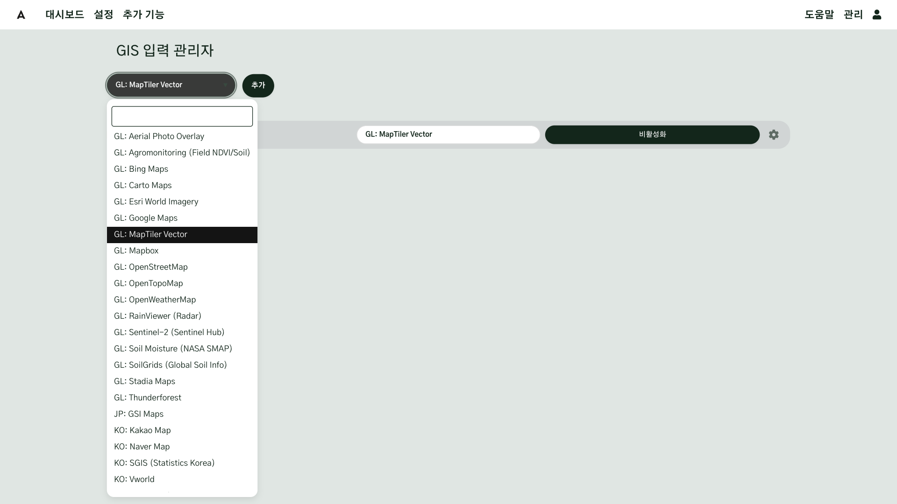

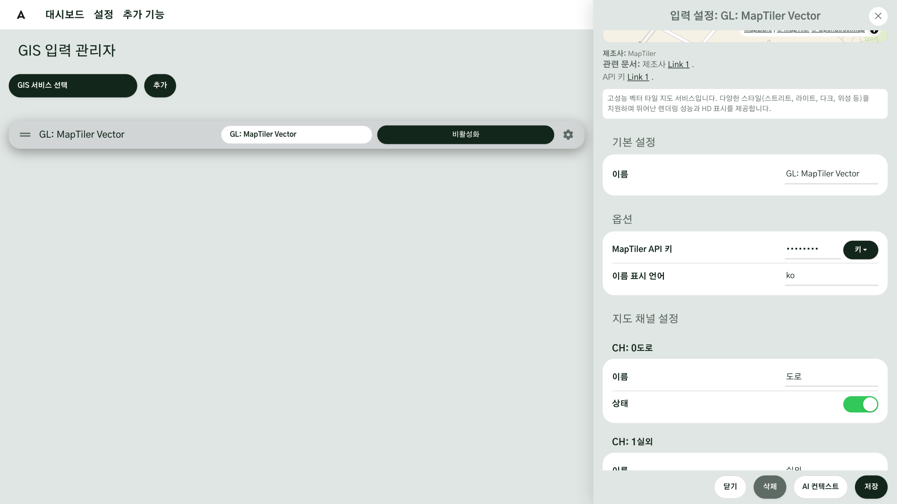

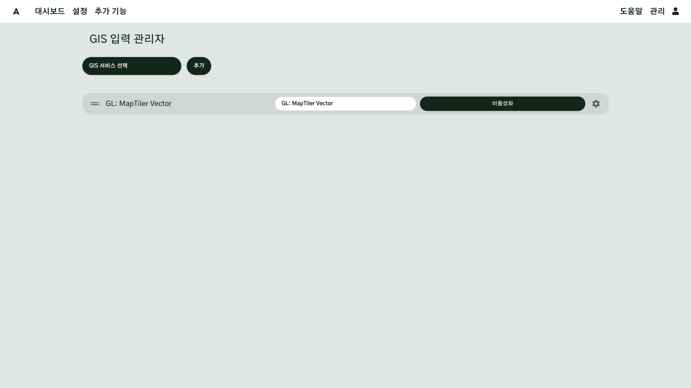

### 3. 다른 지도 겹치기(선택) { #step-3 }

같은 **GIS 서비스 선택** 목록에서 필요한 지도를 더 추가하고 **활성화**하면, 지도 화면의 **레이어** 버튼 목록에 나타납니다.
레이어 창의 **기본 지도**는 한 번에 하나만 고르고, **오버레이**는 바탕 위에 여러 개를 겹쳐 켤 수 있습니다.
마지막으로 고른 바탕은 기억되어 다음에 열 때도 그대로 나옵니다.

| 지도 | 키 | 쓰임 |
|---|---|---|
| Esri World Imagery | 필요 없음 | 다른 위성 영상과 비교할 때 |
| OpenStreetMap | 필요 없음 | 도로 지도 |
| VWorld | 필요([vworld.kr](https://www.vworld.kr/) 에서 발급) | 국내 항공사진·지적도, 주소로 필지 경계 가져오기 |

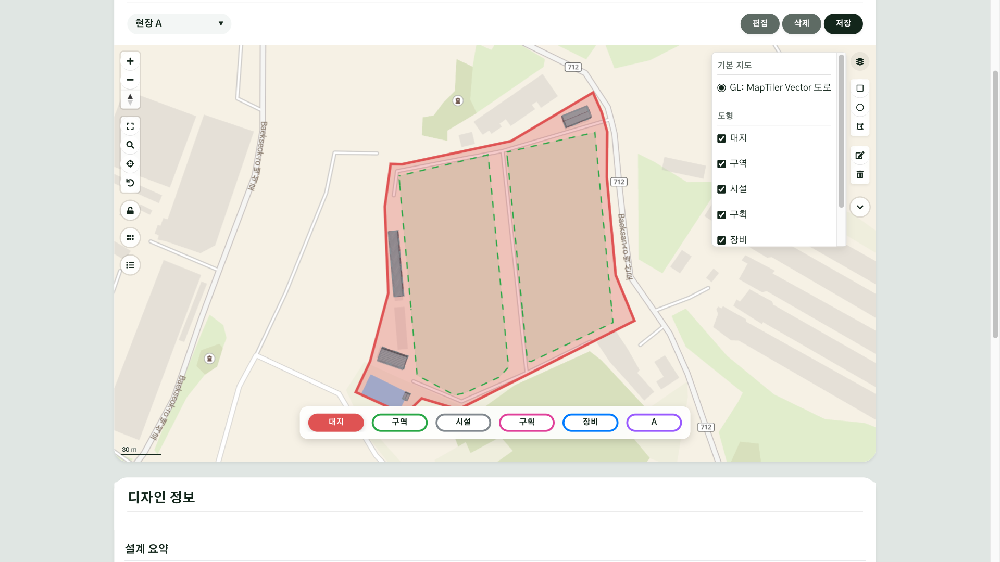

### 4. 시작 위치 정하기 { #step-4 }

1. 설정 → **지도**를 엽니다(화면 제목: 공간 디자인 스튜디오).
2. 오른쪽 위 **설정** 버튼 → **기본 시작 위치**에서 위도·경도·줌을 입력하거나, 지도를 현장으로 옮긴 뒤
   **위치 가져오기**를 누르고 **저장**합니다.

시작 위치는 **새로 만드는 지도**에만 쓰입니다. 이미 있는 지도는 마지막으로 보던 자리에서 열립니다.

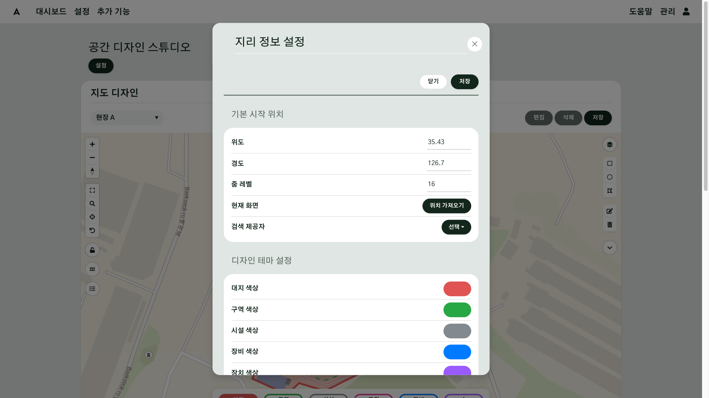

### 5. 지도 만들기와 나누기 { #step-5 }

지도 화면을 처음 열면 **My design** 이라는 지도가 하나 만들어져 있습니다. **편집**을 눌러 **지도 설정** 창의
**이름**을 알아보기 쉬운 이름으로 바꿉니다. 이 지도 하나에 관리하는 대지와 시설을 모두 그려도 됩니다.

지도가 하나라면 대지 사이를 **대지 목록**으로 이동합니다. 지도 왼쪽 도구의 **대지 목록**을 누르면 대지 이름이
나오고, 이름을 누르면 지도가 그 대지로 이동합니다. 대시보드의 지도 위젯에도 같은 버튼이 있습니다
([대시보드 구성](g10-dashboard.md#step-5)).

지도를 나누면 좋은 경우는 이렇습니다.

| 경우 | 지도를 나누면 |
|---|---|
| 사람마다 조작할 수 있는 현장이 달라야 할 때 | **지도 설정**의 **그룹 선택**으로 그 지도를 조작할 수 있는 그룹을 정합니다. 데이터는 모두에게 보이고, 도형 저장·삭제 같은 조작만 그 그룹으로 제한됩니다 |
| 현장 하나의 지도만 따로 내보내거나 가져와야 할 때 | 지도 화면 아래 **데이터 처리**의 **지도 내보내기** / **지도 가져오기**가 지도 단위로 동작합니다 |
| 대시보드에 현장별 지도를 따로 두고 싶을 때 | 지도 위젯은 지도 하나를 보여 줍니다 |

지도를 더 만들려면 **지도 선택** 상자에서 **새 지도 생성**을 고릅니다. 새 지도는 "New Design Map" 이라는 이름으로 바로
저장되고, [4단계](#step-4)의 시작 위치에서 열립니다. **편집** 버튼을 눌러 이름을 바꾸십시오.

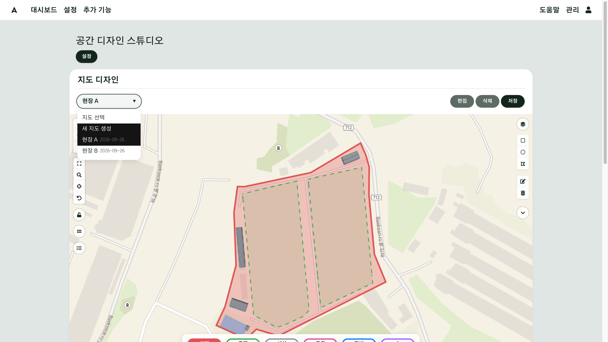

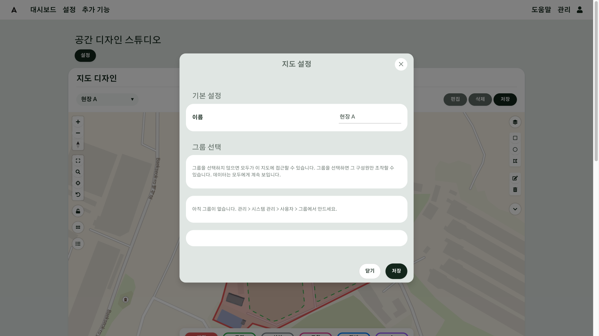

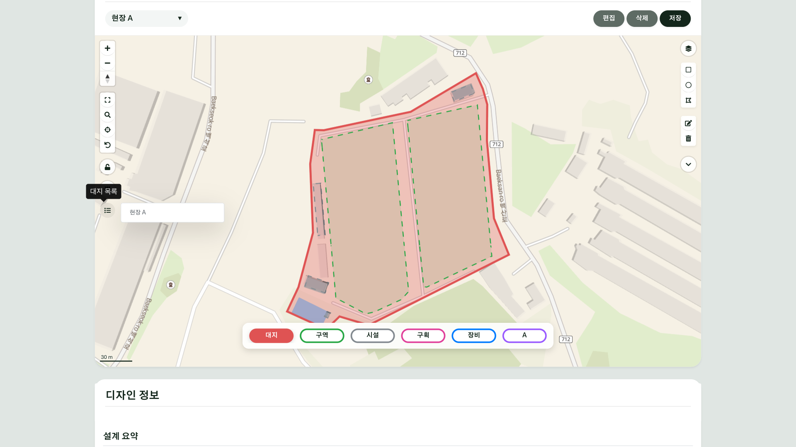

### 6. 대지 그리기 { #step-6 }

1. 지도 아래쪽 가장자리의 탭 줄(대지·구역·시설·구획·장비·A)에서 **대지**를 고릅니다.
2. 오른쪽 그리기 도구에서 **다각형**을 고르고, 현장 경계의 꼭짓점을 차례로 누릅니다.
   **마우스 오른쪽 버튼**을 누르면 마지막 점이 처음 점과 이어지며 도형이 완성됩니다(점을 세 개 이상 찍었다면 두 번 클릭이나 Esc 로도 마칠 수 있습니다).
   그리는 중에 잘못 찍은 점은 Backspace 로 지웁니다. 사각형·원 도구도 있습니다.
3. 도형 가운데의 이름 글자를 **두 번 누르면** 이름 입력 창이 열립니다. 현장 이름을 입력하고 **저장**합니다.
   새로 그린 대지의 이름은 처음에 "새 대지" 입니다.

**모양 고치기**: 오른쪽 도구의 **레이어 편집**을 누르고 도형을 고르면 꼭짓점과 변의 가운데에 점이 나타납니다.
꼭짓점은 끌어서 옮기고, **변 가운데 점을 누르거나 끌면 그 자리에 새 꼭짓점이 생겨** 원하는 모양을 만들 수 있습니다.
다 고쳤으면 **저장**, 되돌리려면 **취소**를 누릅니다. 편집 중에는 자동으로 저장되지 않습니다.

**주소로 대지 가져오기(대한민국)**: VWorld 지도를 GIS 입력에 등록하고 켜 두었다면([3단계](#step-3)), 대지 서랍의
**주소로 추가 → 검색**으로 필지 경계를 그대로 대지로 만들 수 있습니다.

- **주소 입력** 탭: 주소를 여러 줄 입력할 수 있습니다(**+ 주소 추가** 또는 Enter). **검색**을 누르면 찾은 필지가 지도에 표시됩니다.
- **CSV 일괄** 탭: 첫 열에 주소를 한 줄씩 적은 CSV 파일(UTF-8, 제목 줄 없음)을 **CSV 파일 선택** → **업로드 및 처리**로 한꺼번에 찾습니다.
- 검색 결과가 나오면 아래에 **인접 필지 통합**, **대지 이름**, **대지로 저장**이 나타납니다. **인접 필지 통합**을 켜면 찾은 필지를 **모두 합쳐 대지 하나**로 만들고, 끄면 필지마다 대지가 하나씩 생깁니다.
- **대지 이름**을 확인하고 **대지로 저장**을 누릅니다. 같은 지도에 이미 있는 필지는 건너뜁니다.

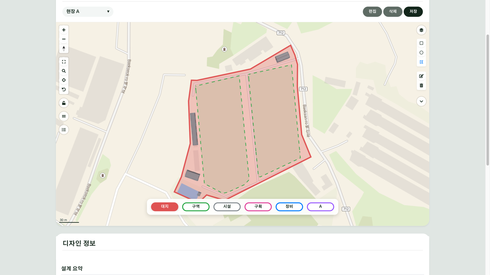

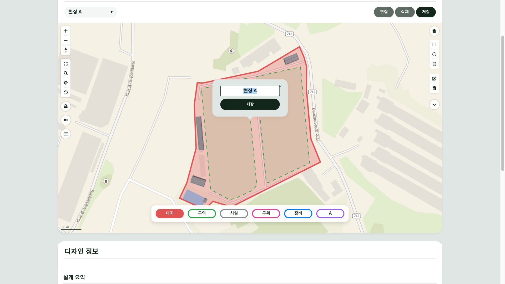

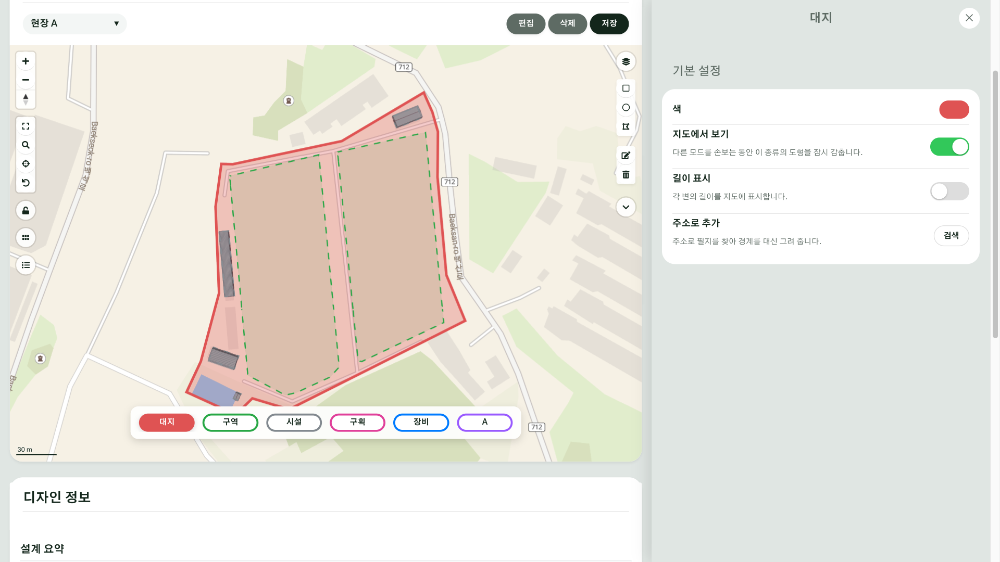

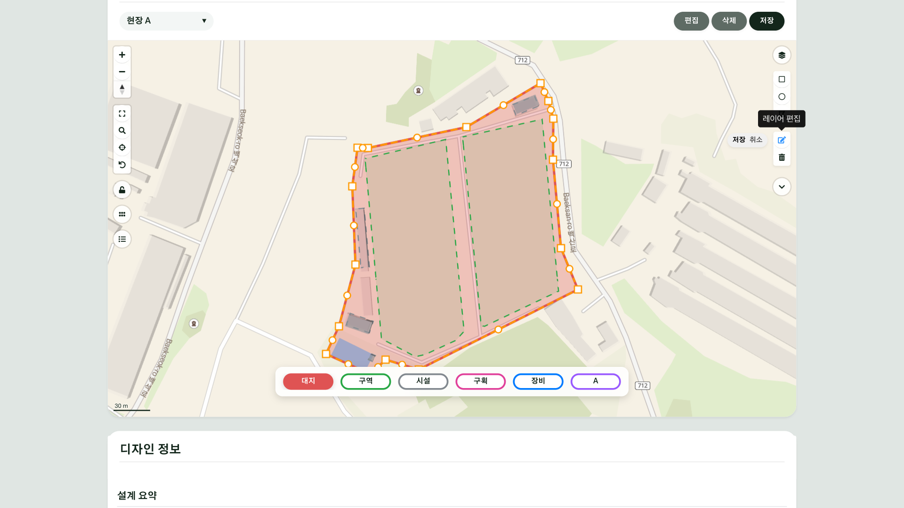

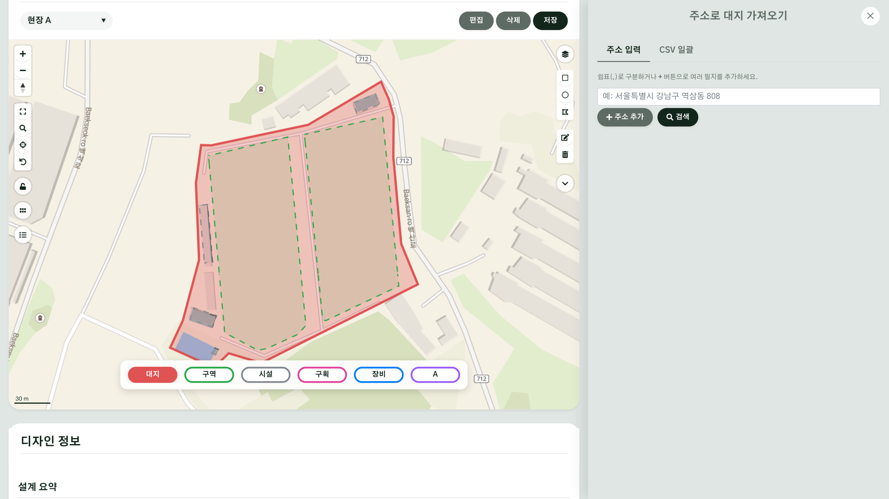

### 7. 구역 나누기 { #step-7 }

**구역** 탭에서 대지와 같은 방법으로 구역을 그리고 이름을 붙입니다.

- 구역은 **대지 안쪽에** 그립니다. 어느 대지에 속하는지는 AoT 가 도형 위치로 판단합니다.
- 구역끼리 **겹치지 않게** 그립니다. 겹친 자리에 놓인 센서·구획은 둘 중 **더 작은 구역**에 속하는 것으로
  처리되는데, 그리는 사람이 의도한 것과 다를 수 있습니다.
- 센서도 장치도 구획도 두지 않을 땅은 굳이 구역으로 나누지 않아도 됩니다.

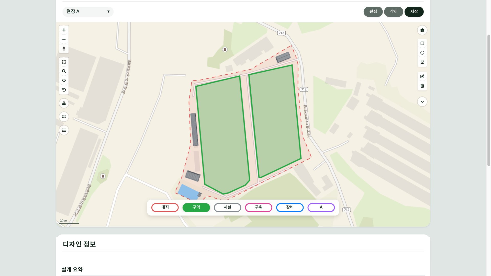

### 8. 시설 만들기 { #step-8 }

온실·축사·창고처럼 구조가 있는 건물은 선으로 그리지 않고 **시설 화면**에서 만듭니다.

1. 설정 → **시설**을 엽니다. 위쪽 단계 막대가 기본 정보 · 위치·구조 · 외피 · 설비 배치 · 연결 · 구획 · 검토 순서로 나옵니다.
2. **기본 정보**: **+ 새 시설** → 이름, 프리셋, 경간(폭), 처마 높이, 용마루 높이, 길이, 지붕 유형을 입력합니다.
3. **위치·구조**: 지도와 대지를 고릅니다. 여러 동이 붙은 온실이면 구조를 **연동**으로 하고 동 수를 입력합니다.
   **지도에 배치**를 누르고 지도에서 시설 가운데 자리를 누른 뒤, 끌어서 맞추고 회전 각도를 조정합니다.
   대지가 하나도 없는 지도에서는 **지도에 배치** 버튼이 나오지 않습니다. 대지를 먼저 그리십시오([6단계](#step-6)).
4. **시설 저장**을 누릅니다.

!!! note "지도 화면의 시설 탭에서 그리지 마십시오"
    지도 화면에서 시설 모양을 선으로 그리면 크기·구조 정보가 없는 도형만 남고, 눌러도 시설이
    열리지 않습니다. 시설은 항상 시설 화면에서 만드십시오.

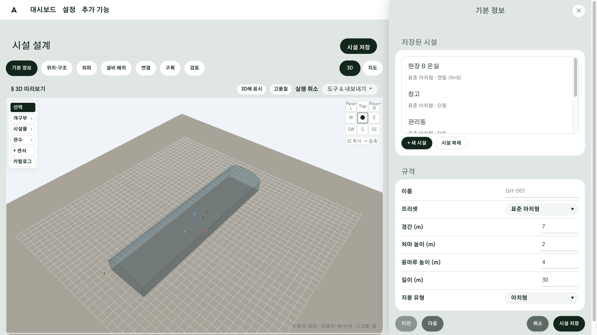

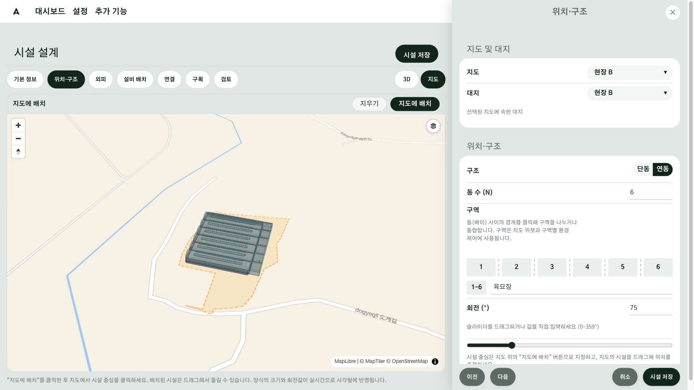

### 9. 구획 만들기 { #step-9 }

**노지 구획**: 지도 화면의 **구획** 탭에서 사각형이나 다각형으로 그리면 **새 구획** 창이 열립니다.
종류, 품목, 품종, 구획 이름, 프로그램, 시작일, 예상 종료일을 입력하고 저장합니다. 한 구역을 같은 크기로
여러 개 나누려면 **구획으로 나누기**를 씁니다.

**시설 구획**: 시설 화면의 **구획** 단계에는 **위치·구조**에서 나눈 구역마다 칸이 있습니다. 구획을 둘 구역 칸의
**구획 추가**를 누르고 종류·품목 등을 입력한 뒤, 면적 대신 **몫**(그 구역에서 차지하는 비율, %)을 입력하고 **저장**합니다.
시설을 먼저 저장해야 이 단계가 열립니다.

!!! note "예상 종료일이 지나면 구획을 끝내십시오"
    구획은 사람이 끝낼 때까지 "진행 중"으로 남습니다. 끝난 구획을 그대로 두면 그 구획의 단계 목표를
    쓰는 환경 제어가 지난 목표를 계속 따를 수 있습니다.

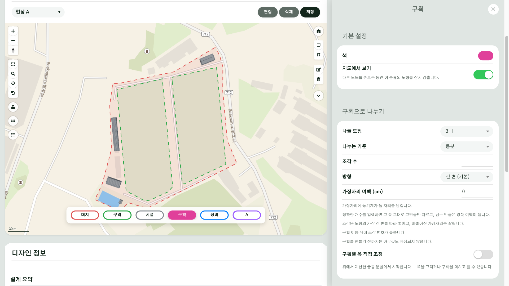

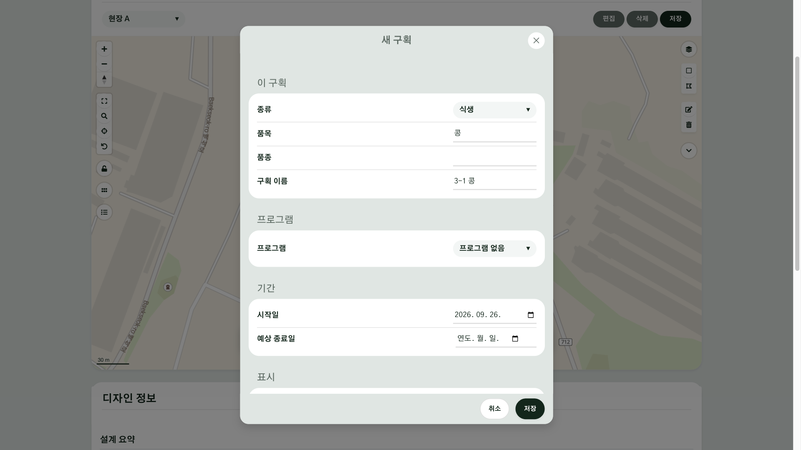

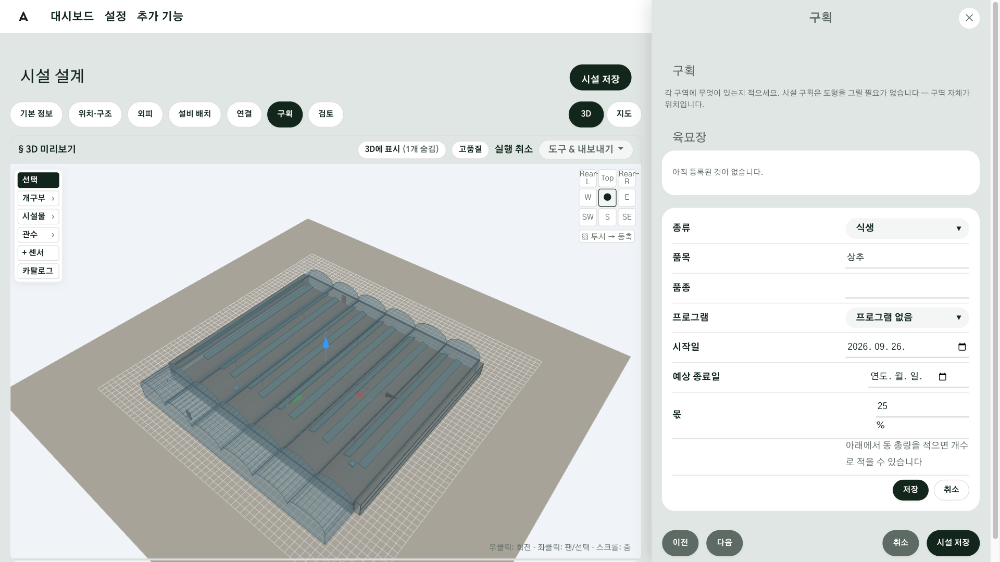

## 확인 { #check }

지도 화면에서 **대지 안에 구역이, 구역 안에 구획이** 보이고, 시설을 누르면 시설 정보가 열리면 지도 구성이 끝난 것입니다.

- 지도 디자인·대시보드 지도 위젯 모두에 켜 둔 지도 바탕이 보이는지 확인합니다.
- 지도 아래 **디자인 정보** 카드에 대지 수·구역 수가 그린 만큼 나오는지 봅니다.
- 이름이 "새 대지", "새 구역" 처럼 처음 이름 그대로 남은 도형이 없는지 봅니다.
- 구역 넓이를 더한 값이 대지 넓이보다 크면 어딘가 겹쳐 있습니다. 겹친 곳을 고치십시오.

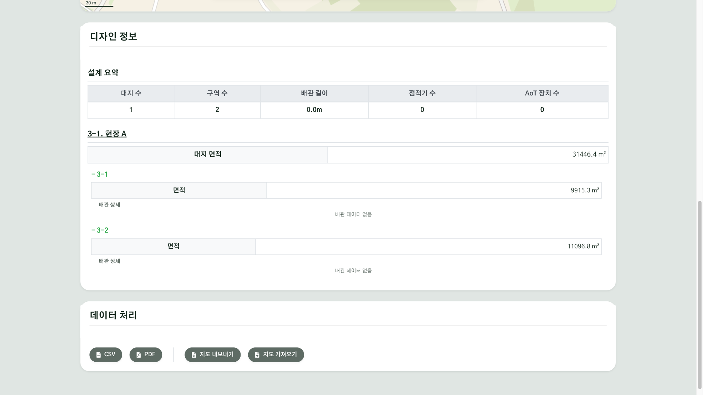

## 현장 A { #site-a }

현장 A 는 노지와 시설이 함께 있는 약 3만㎡ 의 대지입니다.

| 그리는 것 | 내용 |
|---|---|
| 대지 | 현장 A 전체 |
| 구역 | 노지 3-1(약 1만㎡), 3-2(약 1.2만㎡) |
| 시설 | 단동 온실 1동(339㎡), 펌프실, 관리동, 창고 |
| 구획 | 3-1 콩, 3-2 검정콩, 온실 안 상추(12베드 중 3베드) |

센서도 구획도 없는 나머지 땅은 구역으로 나누지 않았습니다.

## 현장 B { #site-b }

현장 B 는 시설 하나가 현장의 전부입니다.

| 그리는 것 | 내용 |
|---|---|
| 대지 | 온실이 선 부지 |
| 구역 | 없음 |
| 시설 | 6동 연동 온실 1개(1,596㎡, 환기창 642㎡) |
| 구획 | 온실의 절반을 쓰는 구획 1개 |

노지가 없으므로 구역을 그리지 않고, 시설 화면에서 동 수·폭·길이를 정확히 입력하는 데 집중합니다.
환경 제어는 이 치수로 창 면적과 온실 부피를 계산합니다.

## 안 될 때 { #trouble }

| 증상 | 확인할 것 |
|---|---|
| 지도에 나라 경계만 보인다 | MapTiler Vector 입력이 없거나, 추가만 하고 **활성화**하지 않았습니다([2단계](#step-2)) |
| 지도 바탕이 회색·빈칸이다 | MapTiler 키가 틀렸거나, 키의 허용 주소에 지금 접속한 주소가 빠졌거나, 이달 사용량을 넘었습니다([1단계](#step-1)) |
| 그린 도형이 새로고침하면 사라진다 | 선이 교차하는 도형입니다. 다시 그리십시오 |
| 시설을 눌러도 열리지 않는다 | 지도 화면에서 선으로 그린 시설입니다. 지우고 시설 화면에서 다시 만드십시오 |
| 시설 구획 단계가 비어 있다 | 시설을 먼저 저장하십시오 |
| 대지 목록·시설의 대지 선택에 "새 대지" 가 여러 개 보인다 | 대지 이름을 바꾸지 않았습니다. 라벨을 두 번 눌러 바꿉니다([6단계](#step-6)) |
| 다각형이 끝나지 않는다 | 처음 점을 다시 눌러도 닫히지 않습니다. 마우스 오른쪽 버튼(또는 두 번 클릭, Esc)으로 마칩니다 |
| 주소로 가져오기가 안 된다 | VWorld 입력이 등록·활성화되어 있고 키가 맞는지 봅니다 |

## 더 알아보기 { #more }

- [GIS 시작하기](../geo/getting-started.md)
- [지도 디자인 도구](../geo/design-tool.md)
- [시설 관리](../geo/facility.md)
- [구획](../geo/plots.md)
- [GIS 레이어](../geo/layers.md)
- [GIS 설정](../geo/settings.md)
