# 센서 연결

센서 값이 AoT 로 들어오게 하는 장입니다. 센서마다 값을 보내는 방식이 다르므로 먼저 방식을 고르고,
값이 들어오는 것을 확인한 뒤, 센서를 지도와 시설에 연결합니다.

## 이 장을 마치면 { #goal }

- 내 센서에 맞는 연결 방식을 고른다
- 센서 값이 들어오는 것을 확인하고 지도와 시설에 연결한다

## 준비 { #prepare }

- 지도를 구성한 AoT ([지도 구성](g04-map.md#check)). 지도를 쓰지 않는다면 [7단계](#step-7)만 건너뜁니다
- 센서가 값을 보내는 방식과 접속 정보(아래 1단계 표 참고)
- 실제 센서 없이 먼저 해 보려면: 따로 준비할 것이 없습니다. 시험 입력을 씁니다([6단계](#step-6))

## 절차 { #steps }

### 1. 연결 방식 고르기 { #step-1 }

| 센서가 값을 보내는 방식 | AoT 에서 추가할 곳 | 필요한 것 |
|---|---|---|
| LoRaWAN 무선 센서 | 관리 → 시스템 관리 → **ChirpStack** 에서 한꺼번에 등록 | ChirpStack 서버 주소, API 키 |
| MQTT 로 값을 보내는 기기·기존 설비 | 설정 → **입력** | 브로커 주소·포트, 토픽, 메시지 안에서 값의 위치 |
| 날씨(바깥 기상) API | 설정 → **입력** | Open-Meteo 는 키 없음, 기상청은 무료 키 |
| PLC(Modbus TCP) | 설정 → **입력**(`Modbus TCP (PLC)`) | PLC 주소, 레지스터 주소 |
| 라즈베리 파이에 선으로 연결한 센서(I2C·UART·1-Wire·SPI·GPIO) | 설정 → **입력** | 센서 모델명, 연결 방식, 주소·포트. **직접 설치**한 AoT 에서만 |

센서는 모두 **입력**으로 추가합니다. PLC 나 LoRaWAN 컨트롤러처럼 값을 읽으면서 장치도 움직이는 기기라면,
값은 이 장에서 입력으로, 제어는 [출력 연결](g06-outputs.md)에서 출력으로 따로 추가합니다.

설정 → **입력**의 추가 목록은 `제조사: 이름 [인터페이스]` 형식이고, **이름 또는 측정값으로 검색**
칸에 "MQTT", "온도"처럼 입력해 찾을 수 있습니다.

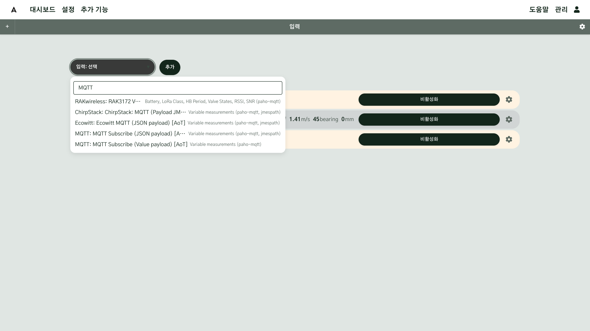

### 2. LoRaWAN 센서 등록하기 { #step-2 }

1. 관리 → 시스템 관리 → **API 키 관리**에서 ChirpStack 에서 받은 API 키를 저장합니다.
2. 같은 메뉴의 **ChirpStack** 을 누르면 **ChirpStack 장치** 화면이 열립니다. **ChirpStack 연결**에 서버 주소와
   MQTT 브로커 주소·포트를 입력하고, **API 토큰** 목록에서 방금 저장한 키를 고른 뒤 **저장**합니다.
   목록 옆 **API 키 관리** 버튼을 누르면 키를 저장하는 화면으로 이동합니다.
3. **장치 온보딩**에서 등록할 센서를 고르고 **입력 등록**을 켭니다. **채널** 칸에 받을 값의 이름을 한 줄에
   하나씩 적습니다(센서 제조사 문서에 나온 값 이름을 씁니다). **선택한 장치 등록**을 누릅니다.
4. 만들어진 입력의 **측정 유효 수명**을 센서가 값을 보내는 간격의 두세 배로 설정합니다.
   15분마다 보내는 센서면 2,700초 정도입니다.

!!! note "측정 유효 수명이 왜 필요한가"
    LoRaWAN·MQTT 센서는 AoT 가 요청하지 않아도 스스로 값을 보냅니다. 그래서 값이 끊겨도 연결에는 문제가 없어
    보입니다. 측정 유효 수명은 "이 시간 동안 새 값이 없으면 끊긴 것으로 본다"는 기준입니다.

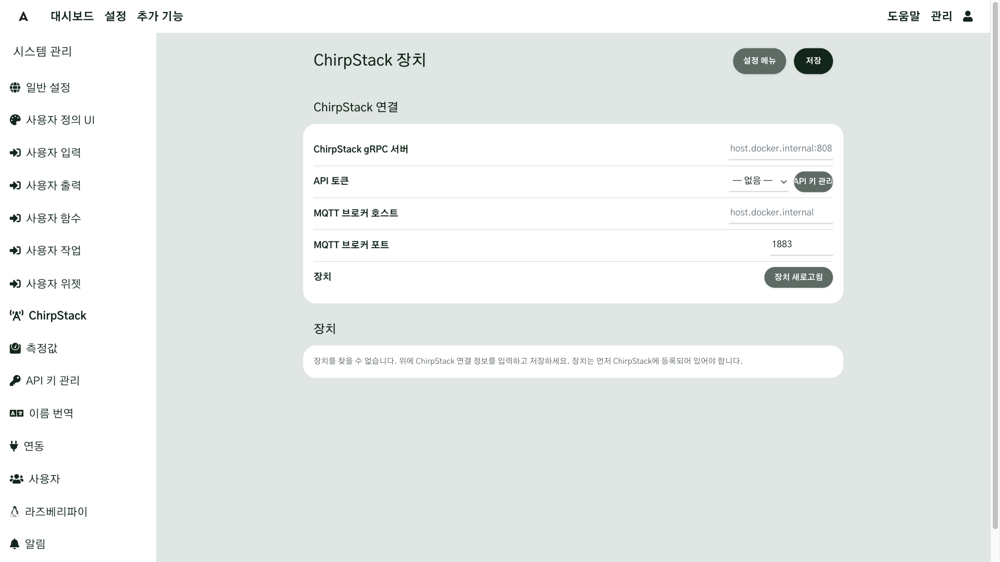

### 3. MQTT 센서 연결하기 { #step-3 }

1. 설정 → **입력**에서 `MQTT Subscribe (JSON payload)` 를 추가합니다. 값이 숫자 하나만 오면
   `MQTT Subscribe (Value payload)` 를 고릅니다.
2. **호스트**, **포트**, **토픽**을 입력합니다. 브로커에 로그인이 필요하면 **로그인 사용**을, 암호화 연결이면
   **TLS 사용**을 켭니다.
3. 채널마다 **JMESPath 표현식** 칸에 값의 위치를 적습니다. 받는 메시지가 `{"sensors":[{"temperature":24.8}]}` 이면
   `sensors[0].temperature` 입니다.
4. 채널마다 **측정 단위**를 실제 값에 맞게 고릅니다. 예를 들어 25 안팎의 값이 들어오는 온도 센서라면 ℃ 입니다.
5. **측정 유효 수명**을 센서가 값을 보내는 간격의 두세 배로 설정합니다([2단계](#step-2)의 설명과 같습니다).

!!! warning "단위는 값에 맞추십시오 — 변환을 켜서 맞추지 마십시오"
    MQTT 입력은 받은 숫자를 그대로 저장하고, 고른 단위를 이름표로 붙일 뿐입니다. ℃ 값을 받으면서
    단위를 ℉ 로 골라 두면 화면에 "25 ℉" 로 나옵니다. 이때 ℉→℃ 변환을 추가하면 값이 −3.9 로 바뀌어
    제어가 잘못됩니다. **단위 자체를 ℃ 로 바꾸는 것**이 맞습니다.

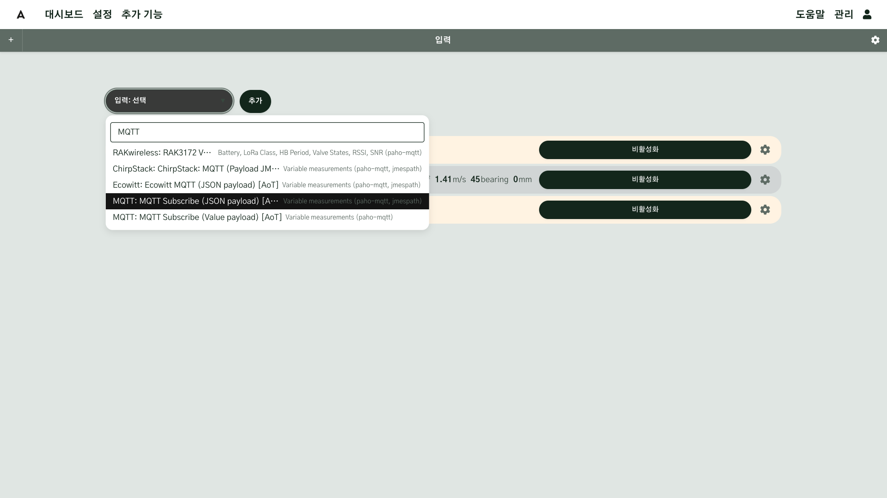

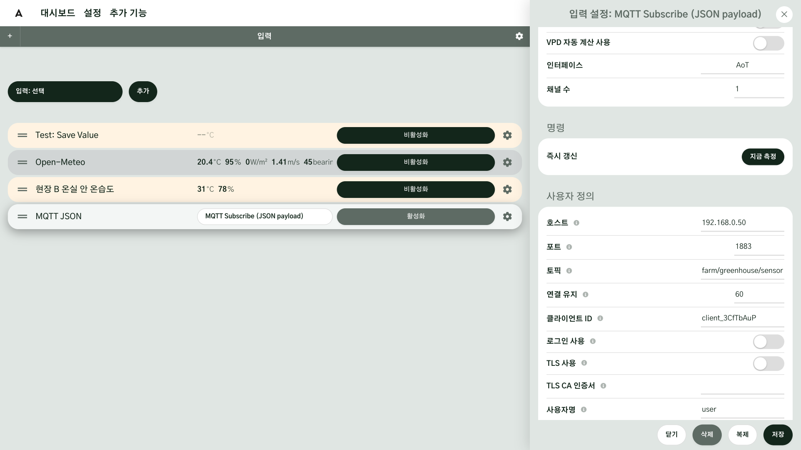

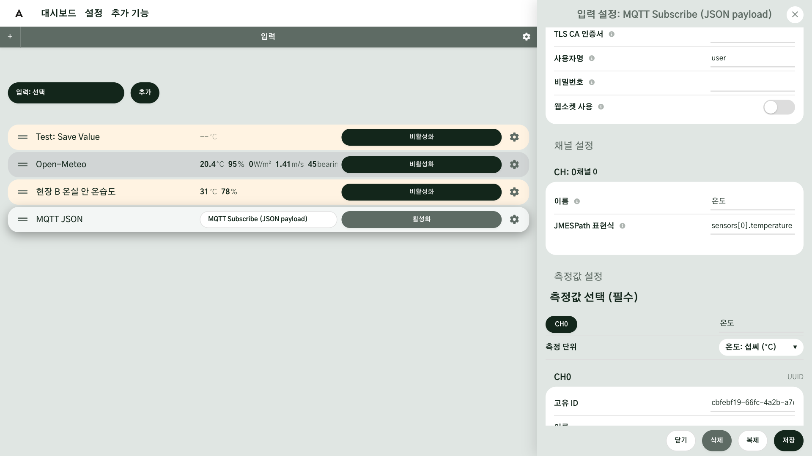

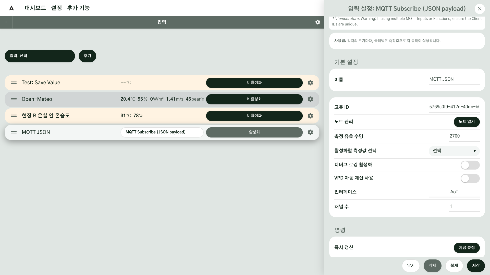

### 4. 날씨 API 입력 추가하기 { #step-4 }

바깥 기온·습도·바람·비는 환기와 관수 판단에 쓰입니다. 현장에 기상 센서가 없으면 인터넷의 날씨 정보를
입력으로 받아 옵니다. 대부분 **입력을 지도에 놓은 자리**의 날씨를 가져오므로, 추가한 뒤 [7단계](#step-7)에서
현장 위에 놓으십시오.

| 목록 이름 | 제공하는 값 | 키 | 위치를 정하는 법 |
|---|---|---|---|
| `Open-Meteo: Open-Meteo (Coords, Hourly incl. Solar)` | 기온, 습도, 일사, 바람, 비, VPD | 필요 없음 | 지도 위치(또는 위도·경도) |
| `KMA: 기상청 고해상도 500m` | 기온, 습도, 바람, 기압, 비, 눈, 이슬점 | 기상청 API 허브 키 | 지도 위치 |
| `KMA: 기상청 지점 데이터` | 기온, 습도, 기압, 바람 | 기상청 API 허브 키 | **기상 관측소** 번호 |
| `KMA: KMA 단기예보` | 예보 기온·최저·최고, 강수확률, 하늘 상태 등 | **공공데이터포털** 키 | nx·ny 격자 좌표 |
| `NASA: NASA POWER (Coords, Daily incl. ET0)` | 증발산량(ET0), 일사 등 하루 값(1~2주 늦게 나옴) | 필요 없음 | 지도 위치 |
| `OpenWeather: OpenWeatherMap (Lat/Lon, Current/Future)` | 기온, 습도, 기압, 바람 | OpenWeather 키 | 지도 위치 |

**위치 정하기**: 날씨 입력을 추가한 뒤 톱니바퀴로 입력 설정을 열면 맨 위에 작은 지도가 있습니다. 지도를 현장으로
옮기고 지도 왼쪽의 **레이블을 현재 지도 중심으로 이동** 버튼(과녁 모양)을 누른 뒤 **저장**합니다. 위치가 없으면
시스템 로그에 "Latitude/Longitude required" 가 남고 값이 들어오지 않습니다.

<!-- 확인 필요: task_15a43692 반영 뒤 새 입력이 지도 기본 위치를 자동으로 받으면 이 단락을 줄인다 -->

처음이라면 **Open-Meteo 하나**로 시작하십시오. 키가 필요 없어 바로 쓸 수 있습니다. 추가 → 위치 정하기 → **측정 주기** 300 → 저장 →
**활성화** 순서로 진행하고, 입력 설정의 **지금 측정**을 누르면 실시간 측정에 기온·습도·일사·바람·비 값이 바로 나옵니다. 국내 현장에서 현장에 더 가까운 지점의 값이 필요하면
기상청 고해상도 500m 를 추가합니다.

**기상청 키 받기**

- 고해상도 500m·지점 데이터: [기상청 API 허브](https://apihub.kma.go.kr/)에 가입하고, 쓸 API 를 신청한 뒤
  마이페이지에서 인증키(authKey)를 복사합니다.
- 단기예보: [공공데이터포털](https://www.data.go.kr/)에서 "기상청 단기예보 조회서비스"를 활용 신청하고
  일반 인증키를 복사합니다. 새 키는 쓸 수 있게 되기까지 시간이 걸릴 수 있습니다.

**키를 AoT 에 넣기**

1. 관리 → 시스템 관리 → **API 키 관리** → **새 API 키 추가**에서 이름(예: "기상청 API 허브")과 키를 저장합니다.
2. 날씨 입력의 설정에서 API 키 칸 옆 **Key** 버튼으로 저장한 키를 고릅니다.

고른 키는 입력 칸에 **글자 그대로 복사**됩니다. 나중에 키를 바꾸면 그 키를 쓰는 입력마다 다시 골라야 합니다.

!!! note "주기를 늘리십시오"
    날씨 입력의 주기 기본값은 15초입니다. 날씨 정보는 몇 분에서 한 시간 단위로 바뀌므로, **측정 주기**를
    300초(5분) 이상으로 늘리십시오. 기상청 API 는 하루 호출 횟수에 한도가 있고, Open-Meteo 무료 사용은
    비상업 용도로 한정됩니다.

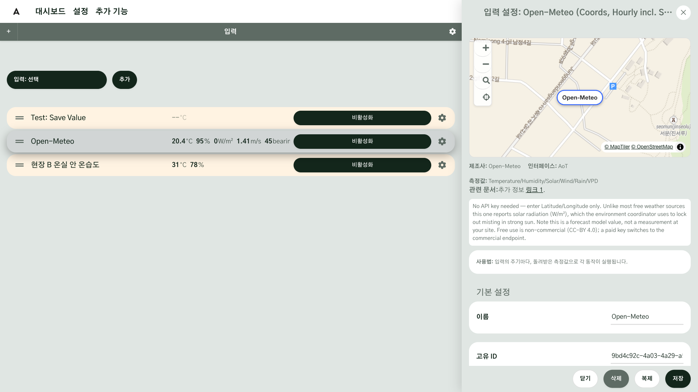

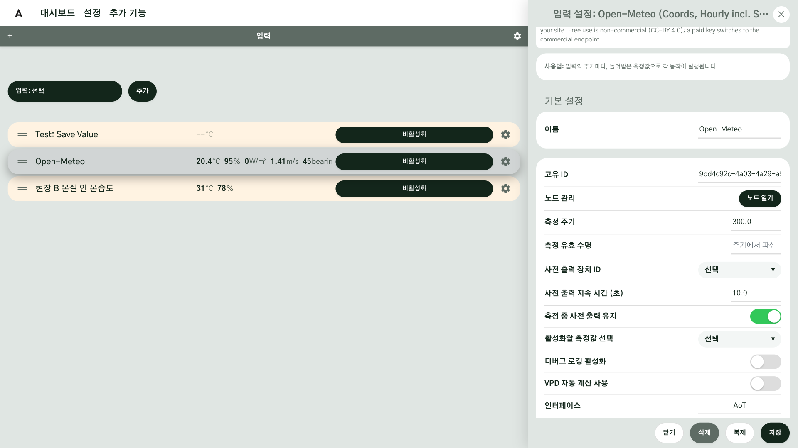

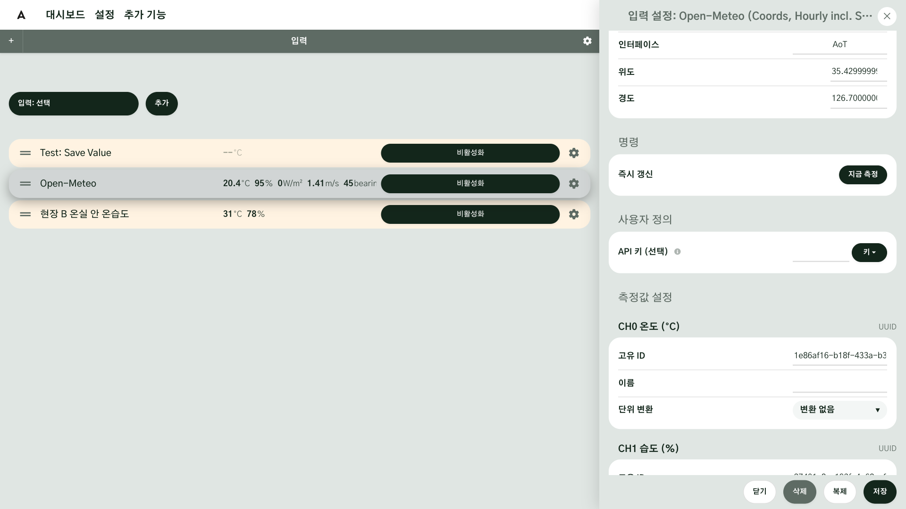

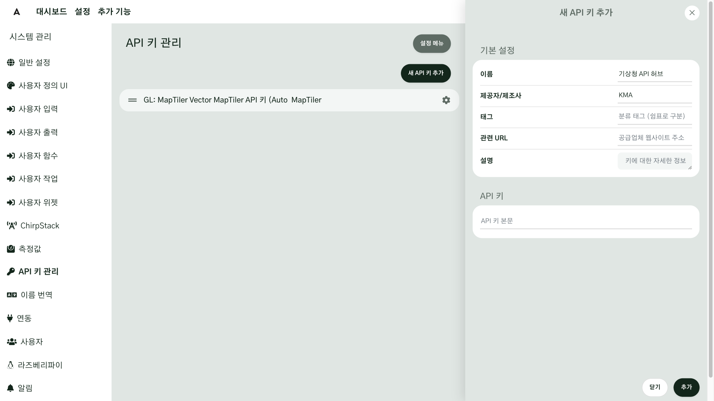

### 5. 라즈베리 파이 유선 센서 연결하기 { #step-5 }

온습도·CO2·토양 센서를 라즈베리 파이 핀에 선으로 연결해 쓰는 방법입니다.

!!! warning "Docker 설치에서는 쓸 수 없습니다"
    Docker 로 설치한 AoT 는 라즈베리 파이의 GPIO·I2C·UART·1-Wire 를 쓰지 못합니다. 유선 센서를 쓰려면
    [직접 설치](g01-install.md#step-5) 방법으로 설치하십시오.

**1) 파이에서 인터페이스 켜기**

파이 터미널에서 `sudo raspi-config` → Interface Options 에서 쓰는 인터페이스를 켜고 재부팅합니다.

| 인터페이스 | 켜는 것 | 주의 |
|---|---|---|
| I2C | I2C | |
| UART | Serial Port: 로그인 셸 **No**, 시리얼 하드웨어 **Yes** | 로그인 셸을 켜 두면 센서 값이 섞입니다 |
| 1-Wire | 1-Wire | 기본 핀은 GPIO4 |
| SPI | SPI | |

AoT 의 관리 → 시스템 관리 → **라즈베리파이** 화면에도 같은 버튼이 있지만, 지금은 raspi-config 를 쓰십시오.

<!-- 26-09-25 실제 파이(26.09.02)에서 확인: 설정 화면은 켜진 I2C 도 '비활성화'로 표시, 버튼 폼 이름 불일치(form-name=Pi vs 라우트 PiSettings). 고쳐지면 화면 절차로 바꾼다 -->

**2) 센서 추가하기**

설정 → **입력** 목록에서 센서 모델을 찾습니다. 이름 끝의 대괄호 안이 연결 방식입니다.

| 연결 방식 | 목록 이름 예 | 채울 칸 |
|---|---|---|
| I2C | `BOSCH: BME280 [I2C]`, `Sensirion: SHT31-D [I2C]`, `Sensirion: SCD30 [I2C]`, `ROHM: BH1750 [I2C]` | **I2C 주소**, **I2C 버스**(보통 1) |
| UART | `Winsen: MH-Z19B [UART]`, `CO2Meter: K30 [UART]`, `Atlas Scientific: Atlas pH [UART]` | 보드 속도(센서 설명서 값) |
| 1-Wire | `MAXIM: DS18B20 [1WIRE]` | **1-와이어 장치 ID**(목록에서 고름) |
| ADC(아날로그 센서) | `Texas Instruments: ADS1115 [I2C]` | I2C 주소, 채널 |
| GPIO | `AOSONG: DHT22 [GPIO]` | **핀: GPIO**(BCM 번호) |

- **I2C 주소 찾기**: 관리 → **시스템 정보** 아래쪽에 I2C 버스마다 연결된 주소표가 나옵니다(`i2cdetect` 결과).
  파이 터미널에서 `i2cdetect -y 1` 로도 볼 수 있습니다. 주소가 정해진 센서는 목록에서 고르기만 하면 됩니다.
- **1-Wire 장치 ID**: 센서를 제대로 연결했으면 목록에 `28-` 로 시작하는 ID 가 나옵니다. "찾을 수 없음"이면 배선과 1-Wire 켜기를 확인합니다.
- **UART 포트**: 지금은 `/dev/ttyAMA0`(파이의 기본 UART)로 정해져 있습니다. USB 변환기(`/dev/ttyUSB0`)는 아직 고를 수 없습니다.
- **처음 추가할 때** 센서에 필요한 프로그램이 없으면 **종속성 설치** 창이 나타납니다. **설치**를 누르고
  "Component installation complete" 가 나올 때까지 기다린 뒤 센서를 다시 추가합니다. 인터넷이 필요합니다.
- DHT22 처럼 pigpio 가 필요한 센서는 파이에서 pigpiod 가 실행 중이어야 합니다.

<!-- 26-09-25 26.09.02 코드 확인: UART.html 은 'uart' 를 찾고 입력 모듈은 'uart_location' 을 선언 → 칸이 안 보임. 실제 파이에서 입력 추가로 화면 확인은 하지 않음(운영 게이트웨이) -->

**3) 확인**

**활성화**를 누르고 입력 설정의 **지금 측정**으로 값이 나오는지 확인합니다. 값이 없으면 관리 → 시스템 로그 → 데몬에서
그 입력의 오류를 봅니다(주소가 틀렸다, 장치를 열 수 없다 등).

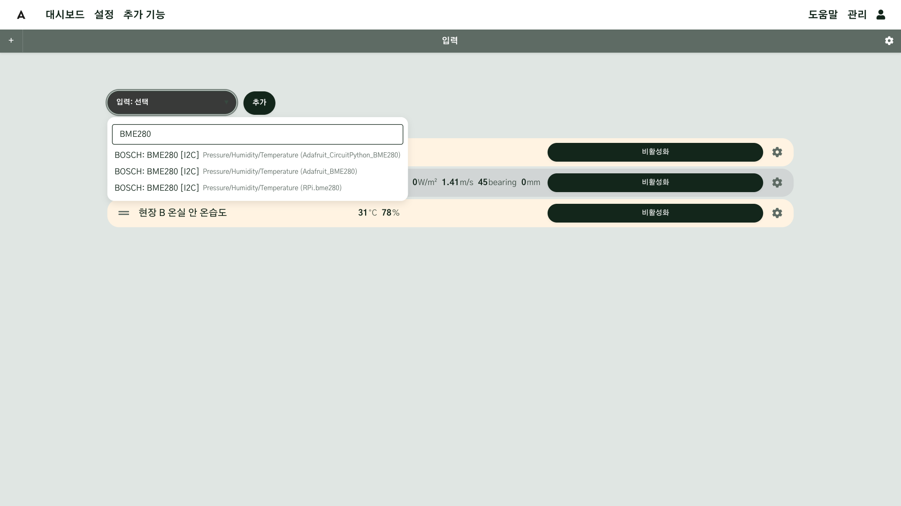

### 6. 센서 없이 연습하기 { #step-6 }

**AoT: 테스트 입력: 원하는 측정값 저장**을 추가합니다. 목록에 **Test: Save Value** 라는 입력이 생깁니다.

1. 카드의 톱니바퀴를 눌러 입력 설정을 엽니다. 값이 여럿 필요하면 **채널 수**를 늘리고 저장합니다(예: 온도·습도 = 2).
2. 아래쪽 **측정값 선택 (필수)**에서 채널마다 **측정 단위**(예: 온도: 섭씨 (°C))를 고르고, 그 아래 **이름**(예: 시험 온도)을
   입력한 뒤 **저장**합니다. 이름이나 단위가 빠지면 활성화할 때 오류가 납니다.
3. 카드의 **활성화**를 누릅니다.
4. 입력 설정의 **명령** 절에서 **채널**과 **값**을 입력하고 **측정값 저장** 옆의 **실행**을 누르면, 그 값이 측정값으로 들어갑니다.
5. 추가 기능 → **실시간 측정**에 방금 입력한 값(예: `25 °C`)과 시각이 나오면 제대로 된 것입니다.

시험 입력은 스스로 값을 만들지 않으므로, 값을 입력하고 **측정 주기의 두 배**(기본 30초)가 지나면 실시간 측정에
"N초 동안 데이터가 없습니다" 와 `--` 가 나옵니다. 고장이 아닙니다. 이 특성은 [이메일 알림](g08-email.md)에서
"센서가 끊겼을 때" 알림을 시험할 때 활용합니다.

이 입력으로 [함수](g07-functions.md)와 [이메일 알림](g08-email.md)까지 실제 센서 없이 시험할 수 있습니다.

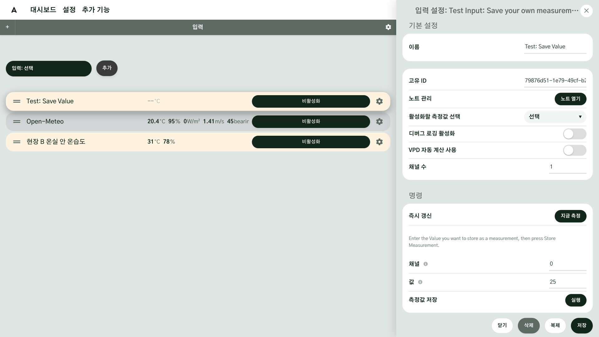

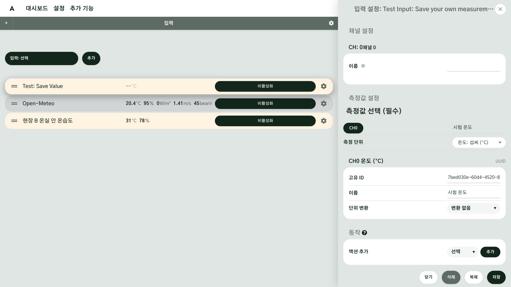

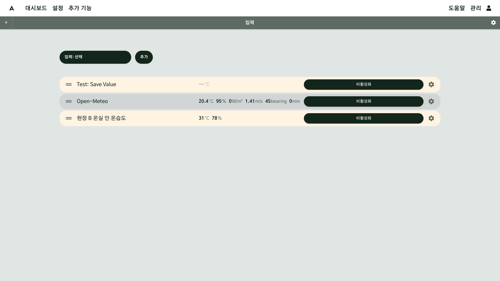

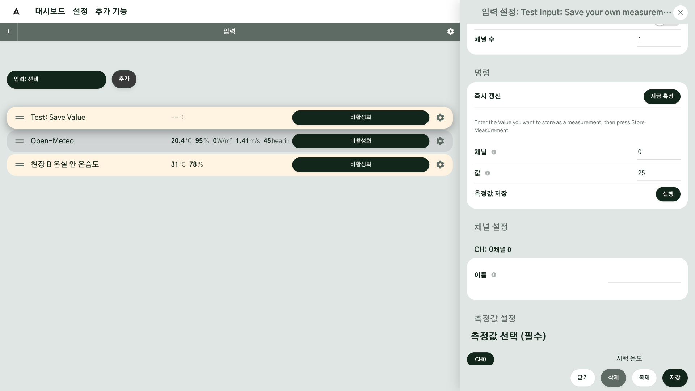

### 7. 지도와 시설에 연결하기 { #step-7 }

센서를 어디에 두었는지 AoT 에 알려 주는 단계입니다. 두 가지가 있고, **용도가 다릅니다.**

| 연결 | 하는 곳 | 쓰이는 곳 |
|---|---|---|
| 지도에 놓기 | 설정 → 지도 → 장치 모드(**A** 탭) → 선택 목록 **열기** → 열린 창에서 켜기 → 끌어서 제자리에 | 구역별 값 요약, 지도 표시, 날씨 입력의 위치 |
| 시설 센서 자리 | 설정 → **시설** → 시설 고르기 → **설비 배치** → 유형 **센서** → **+ 추가** → **채널 선택**에서 쓸 값 체크 → 이름, 실내/실외 → **시설 저장** | **시설 환경 제어** |

센서 자리 하나에 입력의 여러 값(온도·습도, 또는 날씨 입력의 온도·습도·풍속·강우)을 함께 체크할 수 있습니다.
실외 자리에는 **메인 센서/백업 센서**를 고르는 칸이 더 있습니다.

!!! warning "시설 안 센서는 시설 센서 자리에 꼭 연결하십시오"
    환경 제어는 **시설 센서 자리에 연결된 센서만** 읽습니다. 지도에만 놓아 둔 센서는 화면에는 보여도
    제어에는 쓰이지 않습니다.

지도에서 켠 센서는 **지금 보고 있는 화면 가운데**에 나타납니다. 그 자리가 구역 밖이면 어느 구역에도
속하지 않으므로, 반드시 제자리로 끌어다 놓습니다.

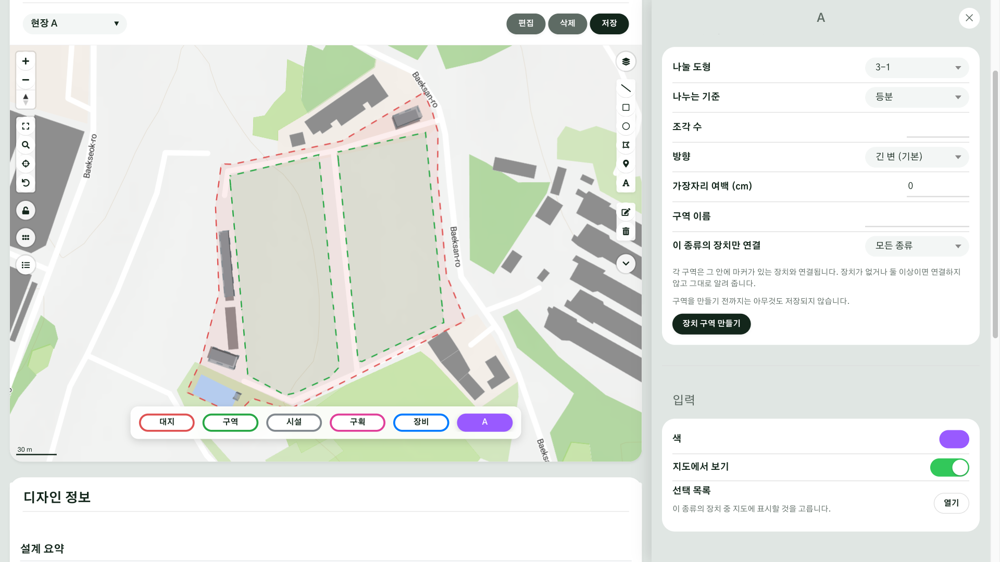

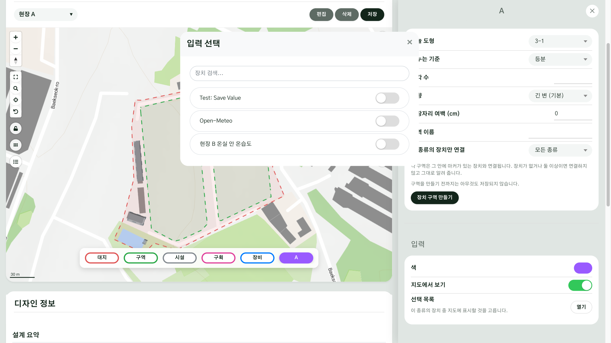

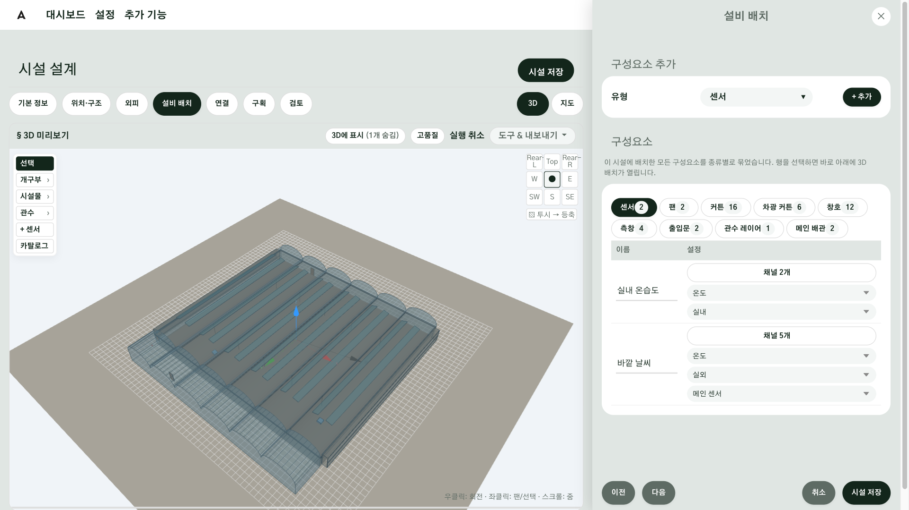

## 확인 { #check }

추가 기능 → **실시간 측정**에서 각 센서의 값과 시각이 보이고, 시각이 계속 갱신되면 연결이 끝난 것입니다.

- 입력 카드에 `--` 대신 값이 나오는지 봅니다. 바로 확인하려면 입력 설정의 **지금 측정**을 누릅니다.
- 지도에서 구역을 눌렀을 때 그 구역의 센서 값이 나오는지 봅니다.
- 시설 화면의 센서 자리에 실내·실외 센서가 모두 채워졌는지 봅니다.

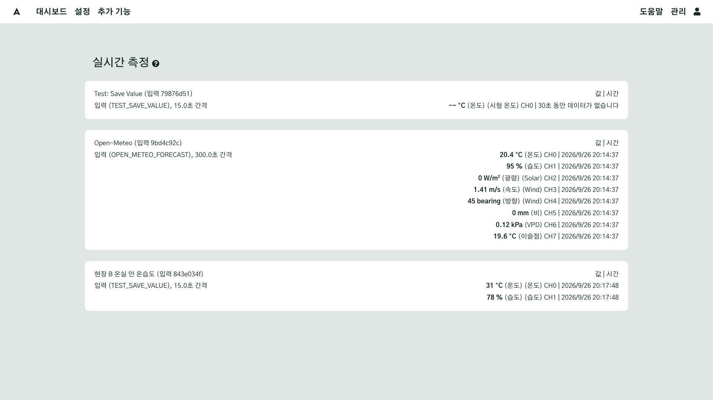

## 현장 A { #site-a }

현장 A 에는 연결 방식 세 가지가 모두 있습니다.

| 센서 | 방식 | 연결 |
|---|---|---|
| 노지 온습도(3-1, 3-2 에 2개씩) | LoRaWAN | 지도에서 각 구역에 |
| 토양 수분·온도(3-1, 3-2 에 1개씩) | LoRaWAN | 지도에서 각 구역에 |
| 바깥 날씨 | Open-Meteo, 기상청 | 지도에서 대지 위에 |
| 온실 안 온습도 | MQTT | 시설 센서 자리(실내, 메인) |

날씨 입력은 온실 **바깥**의 값입니다. 시설 센서 자리에 연결한다면 "실외"로 연결해야 합니다.
실내 자리에 연결하면 환경 제어가 바깥 날씨를 온실 안 온도로 잘못 알고 움직입니다.

## 현장 B { #site-b }

현장 B 는 기존 설비가 모으던 값을 MQTT 로 받아 옵니다.

| 센서 | 방식 | 연결 |
|---|---|---|
| 온실 안 온습도 5곳 | MQTT | 시설 센서 자리(실내). 한 곳을 메인, 나머지를 백업으로 |
| 바깥 기상대(풍속·풍향·일사·강우) | MQTT | 시설 센서 자리(실외) |

바람과 비 값은 환경 제어가 창을 닫는 근거가 됩니다. 기상대 값이 끊기면 창이 더 열리지 않으므로,
기상대 입력의 측정 유효 수명을 꼭 설정하십시오.

## 안 될 때 { #trouble }

| 증상 | 확인할 것 |
|---|---|
| 입력 카드가 계속 `--` | 입력을 **활성화**했는지, 브로커·서버 주소와 포트가 맞는지. MQTT 라면 토픽 철자와 값의 위치 |
| 실시간 측정에 "N초 동안 데이터가 없습니다" | 센서가 값을 보내는 간격보다 측정 유효 수명이 짧거나, 센서가 실제로 끊겼습니다 |
| 온도가 이상하게 크거나 작다 | 단위를 확인하십시오([3단계](#step-3) 경고) |
| 구역 요약에 "센서를 찾을 수 없음" | 센서를 지도에 놓지 않았거나 구역 밖에 놓았습니다 |
| 환경 제어가 실내 값을 못 읽는다 | 시설 센서 자리에 연결하지 않았습니다([7단계](#step-7)) |

## 더 알아보기 { #more }

- [입력](../Inputs.md)
- [LoRaWAN (ChirpStack)](../LoRaWAN-ChirpStack.md)
- [PLC (Modbus TCP)](../PLC-Modbus.md)
- [지원 입력 목록](../Supported-Inputs.md)
- [인터페이스 설정](../Interfaces.md)
- [I2C 멀티플렉서](../I2C-Multiplexers.md)
- [ADC(아날로그-디지털 변환기)](../Analog-To-Digital-Converters.md)
- [실시간 측정](../Data-Viewing.md#live-measurements)
