# 출력 연결

밸브·펌프·팬·분무기처럼 AoT 가 켜고 끄는 것을 **출력**이라고 부릅니다. 이 장에서는 출력을
등록하고, 직접 켜고 꺼 보고, 창이나 커튼처럼 "열기"와 "닫기" 두 줄로 움직이는 설비를
하나로 묶습니다. 그리고 전원이 나갔다 들어왔을 때 각 출력이 어떤 상태로 돌아오는지 정합니다.

## 이 장을 마치면 { #goal }

- 밸브·펌프·분무기 같은 장치를 출력으로 등록하고 직접 켜고 끈다
- 열기/닫기 두 줄로 움직이는 창·커튼을 출력 하나로 묶는다
- 정전·재부팅 뒤 장치가 어떤 상태가 되는지 정하고 확인한다

## 준비 { #prepare }

- 센서까지 연결된 AoT ([센서 연결](g05-sensors.md#check))
- 연결할 장치의 정보: 무엇으로 켜고 끄는지(릴레이, LoRaWAN 밸브 컨트롤러, PLC, MQTT 로 명령을 받는 기기),
  창·커튼이면 끝에서 끝까지 움직이는 데 걸리는 시간(초)
- 실제 장치 없이 먼저 해 보려면: 따로 준비할 것이 없습니다. 가상 출력을 씁니다([1단계](#step-1))

!!! warning "처음 연결할 때는 사람이 장비 옆에 있을 때 하십시오"
    출력을 저장하거나 AoT 를 다시 시작하면 설정한 시작 상태대로 장비에 명령이 나갈 수 있습니다.
    펌프·밸브·창이 실제로 움직여도 괜찮은 시간에, 장비를 직접 지켜볼 수 있는 사람이 있을 때 연결하십시오.

## 절차 { #steps }

### 1. 출력 추가하기 { #step-1 }

설정 → **출력** 화면 위쪽 목록에서 종류를 고르고 **추가**를 누릅니다. 무엇으로 켜고 끄느냐에 따라
고를 종류가 다릅니다.

| 무엇으로 켜고 끄나 | 고를 종류(목록의 이름 끝부분) | 꼭 입력할 값 |
|---|---|---|
| 라즈베리 파이 핀에 연결한 릴레이 | `Raspberry Pi GPIO` ([2단계](#step-2)) | 핀 번호, 켜짐 상태(HIGH/LOW) |
| LoRaWAN 밸브 컨트롤러 | `ChirpStack gRPC` | API Key, DevEUI |
| PLC(Modbus TCP) | `Modbus TCP Coil (PLC)` | 호스트, 포트, 단위 ID, 코일 주소 |
| MQTT 로 명령을 받는 기기 | `MQTT Publish` | 호스트명, 포트, Topic, 켜기·끄기 페이로드 |
| **장비 없이 연습** | `Virtual Single-Channel` | 없음 |

LoRaWAN 밸브 컨트롤러나 PLC 처럼 값도 보내고 명령도 받는 기기도, 제어 기능은 여기서 **출력**으로
추가합니다. 같은 기기의 측정값은 [센서 연결](g05-sensors.md)에서 입력으로 따로 추가합니다.

이름은 **현장에서 부르는 이름 그대로** 짓습니다(예: "3-1 밸브 1", "측창 좌"). 목록·지도·알림 메일에
모두 이 이름이 나옵니다. "Name", "Output 1" 같은 기본 이름을 그대로 두지 마십시오.

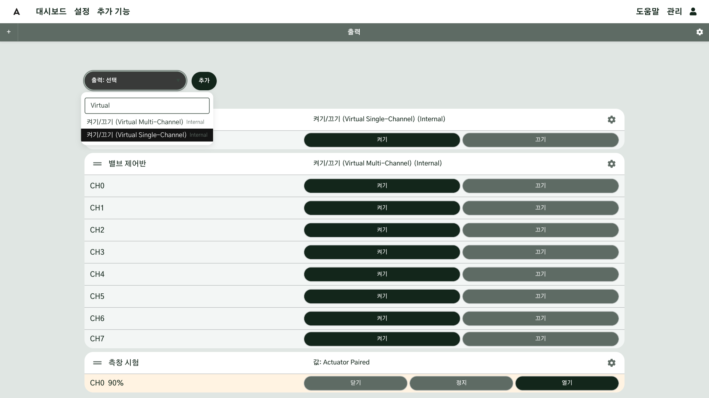

### 2. 라즈베리 파이 GPIO·I2C 로 연결하기 { #step-2 }

릴레이 보드를 라즈베리 파이에 선으로 연결해 밸브·팬·펌프를 켜고 끄는 방법입니다.

!!! warning "Docker 설치에서는 쓸 수 없습니다"
    Docker 로 설치한 AoT 는 파이의 GPIO·I2C 를 쓰지 못합니다. [직접 설치](g01-install.md#step-5) 방법으로 설치하십시오.
    I2C 를 쓰려면 [센서 연결 5단계](g05-sensors.md#step-5)처럼 raspi-config 에서 I2C 를 먼저 켭니다.

**GPIO 핀에 릴레이를 바로 연결할 때**

| 파이 | 목록 이름 | 채울 칸 |
|---|---|---|
| 라즈베리 파이 4 이하 | `Raspberry Pi GPIO (Pi <= 4) [GPIO]` | **핀: GPIO**(BCM 번호), **켜짐 상태** |
| 라즈베리 파이 5 | `Raspberry Pi GPIO (Pi 5) [GPIO]` | 같음 |

- **핀 번호는 BCM 번호**입니다. 보드의 물리 핀 번호(1~40)가 아닙니다. 예: 물리 11번 핀 = GPIO17.
- **켜짐 상태**: 릴레이 보드가 LOW 신호에 켜지는 종류(시중 릴레이 모듈에 흔함)라면 **LOW** 로 바꿉니다. 잘못
  두면 "끄기"를 눌렀을 때 켜집니다. 처음 연결했다면 **끄기**를 눌러 릴레이가 꺼지는지부터 확인하십시오.
- 밝기·속도를 조절하는 PWM 출력은 `PWM: Raspberry Pi GPIO (Pi <= 4) [GPIO]` 를 씁니다. pigpio 라이브러리를
  쓰는 항목을 권합니다(목록의 회색 설명으로 구분). 라즈베리 파이 5 용 PWM 출력은 아직 없습니다.

**I2C 릴레이·확장 보드를 쓸 때**

핀이 부족하면 I2C 보드로 채널을 늘립니다. **I2C 주소**와 **I2C 버스**를 입력하고, 채널마다 이름·켜짐 상태·시작/종료 상태를 정합니다.

| 보드 | 목록 이름에 들어가는 말 | 기본 주소 |
|---|---|---|
| 8채널 확장 칩 | `PCF8574 8-Channel` | 0x20~0x27 |
| 16채널 확장 칩 | `MCP23017 16-Channel`, `PCF8575 16-Channel` | 0x20~0x27 |
| 릴레이 HAT·보드 | `Grove Multichannel Relay`, `Sequent Microsystems 8-Relay HAT`, `Sparkfun Relay Board` | 보드 설명서 |
| PWM 16채널 | `PCA9685 16-Channel` | 0x40~ |

주소는 관리 → **시스템 정보**의 I2C 주소표에서 확인합니다.

**피해야 할 핀**

| 핀(BCM) | 이미 쓰는 곳 |
|---|---|
| GPIO2, GPIO3 | I2C |
| GPIO14, GPIO15 | UART |
| GPIO4 | 1-Wire(켰을 때) |
| GPIO7~11 | SPI(켰을 때) |

!!! note "전원을 켜는 순간의 딸깍임"
    파이가 부팅하는 동안에는 AoT 가 아직 핀을 제어하지 않으므로, 핀의 전압이 정해지지 않거나 잠깐 HIGH 가 되어 릴레이가 딸깍일 수
    있습니다. 이 순간에 켜지면 안 되는 장비(펌프 등)는 풀다운 저항을 달거나, 부팅 중에 LOW 로 유지되는 핀을 고르십시오.
    [시작 상태](#step-5)는 AoT 가 시작된 뒤에야 적용됩니다.

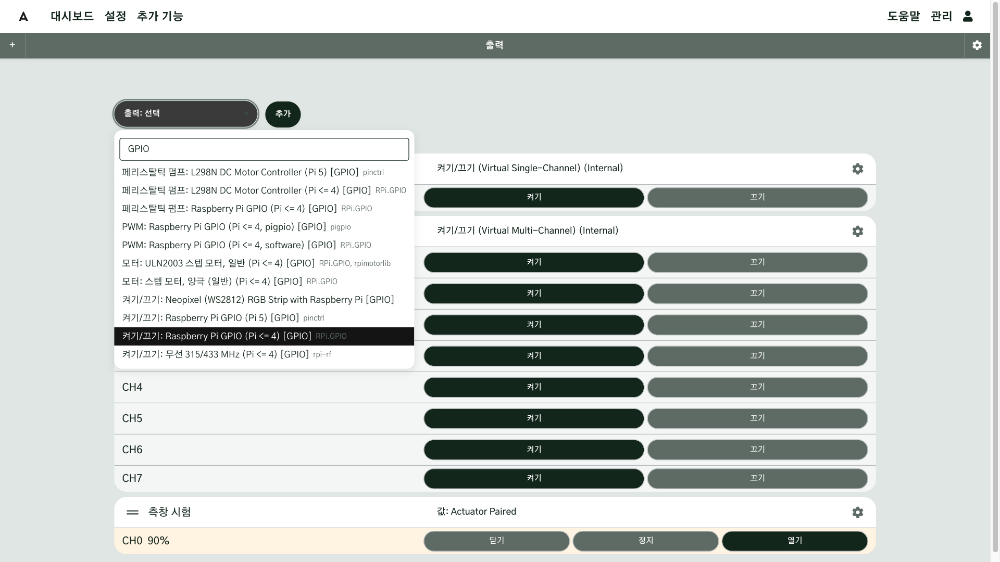

### 3. 직접 켜고 끄기 { #step-3 }

출력 카드의 채널 줄에 있는 **켜기**·**끄기** 버튼을 눌러 봅니다. 현재 상태에 해당하는 버튼이 진한 색으로 채워집니다.
몇 초만 켜려면 카드의 톱니바퀴로 출력 설정을 열고 **지속시간**에 초 단위 시간을 입력한 뒤 **보내기**를 누릅니다.

명령을 받았다는 확인을 보내 주는 장치(LoRaWAN 밸브 등)는 채널 줄에 상태 글자가 함께 나옵니다.

| 표시 | 뜻 |
|---|---|
| 확인 중… | 명령을 보냈고 장치의 확인을 기다리는 중 |
| 응답 없음 | 정해진 시간 안에 확인이 오지 않음. 카드는 이전 상태로 돌아감 |
| 연결 없음 | 장치와 통신이 안 됨 |

LoRaWAN 장치는 "확인 중…"이 몇 초에서 길게는 몇 분 이어질 수 있습니다. 명령이 대기열에 쌓여
하나씩 차례로 나가고(최소 1.5초 간격), 장치 종류에 따라서는 장치가 다음에 먼저 신호를 보낼 때까지 기다려야
하기 때문입니다. 밸브 여러 개를 한꺼번에 움직이면 그만큼 늦어집니다. 자세한 동작은
[다운링크: 장치 제어](../LoRaWAN-ChirpStack.md#downlink)에 있습니다.

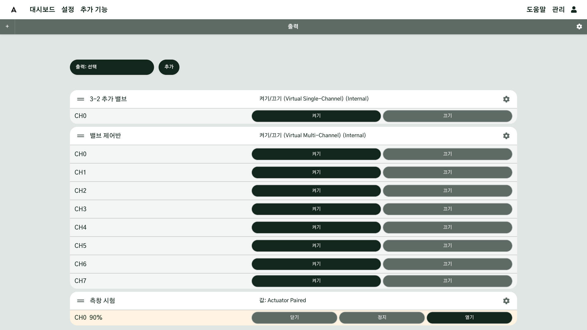

### 4. 열기/닫기 설비를 하나로 묶기 { #step-4 }

측창·천창·보온커튼·차광커튼은 보통 모터 하나에 "열기" 릴레이와 "닫기" 릴레이가 따로 있습니다.
AoT 에서는 이 둘을 각각 출력으로 먼저 등록한 뒤([1단계](#step-1)), 둘을 묶는 출력을 하나 더 만듭니다.

1. 설정 → **출력**에서 `Actuator Paired` 를 추가합니다.
   여러 창이 모터 전원 한 줄을 나눠 쓰는 설비라면 `Actuator Paired (Shared Bus)` 를 고릅니다.
2. **액추에이터 종류**를 고릅니다: 측면 환기창, 지붕 환기창, 보온 커튼, 차광 커튼, 볼 밸브.
3. **출력: 열기**, **출력: 닫기**에 1단계에서 만든 두 출력을 고릅니다.
4. **열기 이동 시간 (초)**, **닫기 이동 시간 (초)**에 끝에서 끝까지 걸리는 시간을 입력합니다.
   AoT 는 이 시간으로 지금 몇 % 열렸는지 계산합니다. 모르면 비워 두고 6단계에서 측정합니다.
5. 저장한 뒤 카드의 **닫기**를 눌러 완전히 닫힌 상태(0%)에서 시작합니다.

묶은 출력의 카드에는 **닫기 / 정지 / 열기** 버튼과 현재 열림 %가 나옵니다. 방향을 바꿀 때는
반대쪽 릴레이를 먼저 끄고 잠시 기다린 뒤(**역방향 일시정지**, 기본 5초) 움직입니다.

!!! warning "묶은 뒤에는 묶은 출력으로만 움직이십시오"
    묶는 데 쓴 "열기"·"닫기" 출력을 직접 켜더라도 AoT 가 반대쪽 릴레이를 먼저 끄므로 두 릴레이가 함께 켜지지는 않습니다. 하지만 직접 움직이면
    AoT 가 기억하는 **열림 %** 가 실제와 달라집니다. 창·커튼은 항상 묶은 출력으로만 움직이고, 모터 회로에
    전기적인 연동 장치(인터록)가 있는지도 설비 담당자에게 확인하십시오.

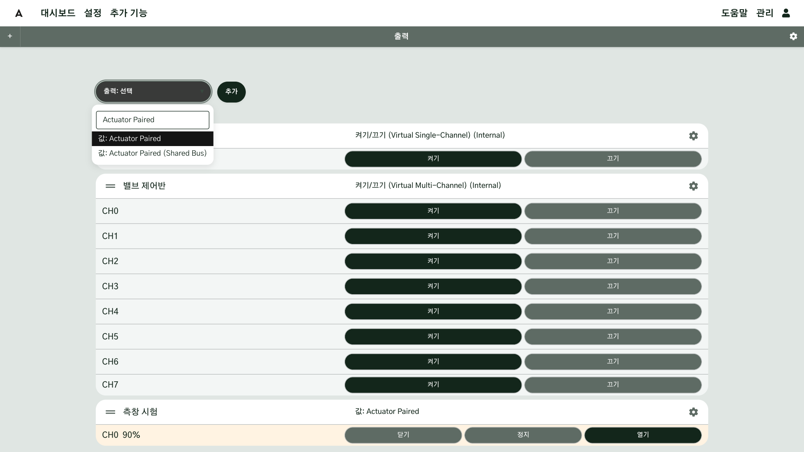

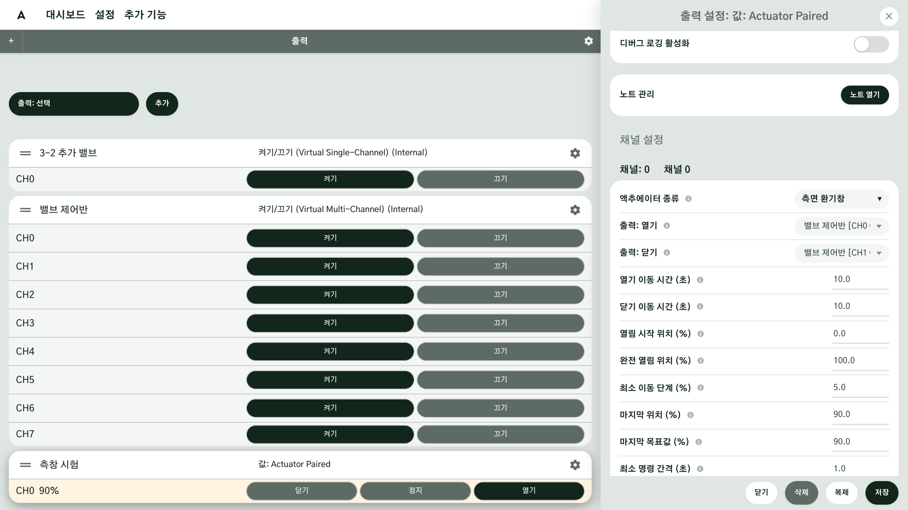

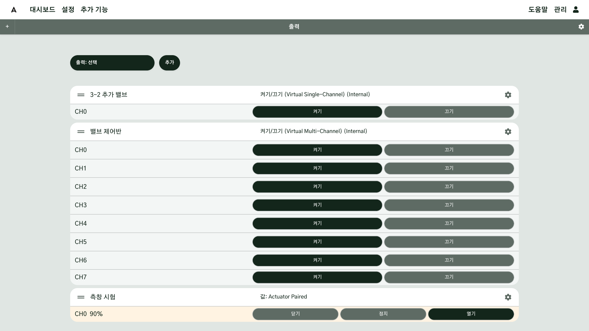

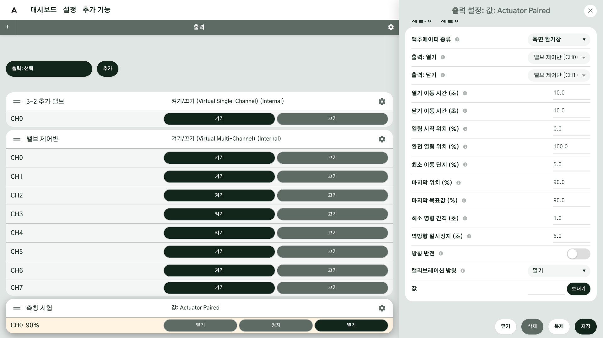

### 5. 정전·재부팅 뒤 상태 정하기 { #step-5 }

각 출력의 채널 설정에 **시작 상태**와 **종료 상태**가 있습니다. AoT 가 켜질 때와 꺼질 때 그 출력을
어떻게 둘지 정하는 값입니다.

| 장치 | 권장 시작 상태 | 이유 |
|---|---|---|
| 밸브·펌프·분무기 | 끔(Off) | 전기가 돌아왔을 때 물이 저절로 나가지 않게 |
| PLC 코일 | 아무것도 하지 않음 또는 끔 | PLC 가 자체 프로그램으로 유지하는 상태를 AoT 가 바꾸지 않게 |
| 열기/닫기로 묶은 창·커튼 | (설정 없음) | 묶은 출력은 시작 상태가 없고 **마지막 위치**만 기억합니다 |

!!! note "움직이던 중에 전원이 나가면"
    창이 움직이던 중에 AoT 가 꺼지면, 다시 켜졌을 때 기억한 위치가 실제와 다를 수 있습니다.
    재시작 뒤에는 **닫기**를 한 번 눌러 0% 에서 다시 맞추십시오.

!!! level-2 "관계자"
    AoT 가 다시 시작하는 짧은 순간이나 컨트롤러 전원이 들어오는 순간에 릴레이가 잠깐 딸깍이는
    장비가 있습니다. 이 동작은 AoT 설정이 아니라 릴레이 보드·컨트롤러의 특성입니다. 설치 전에
    전원을 껐다 켜 보며 확인하고, 문제가 되면 하드웨어에서 막으십시오.

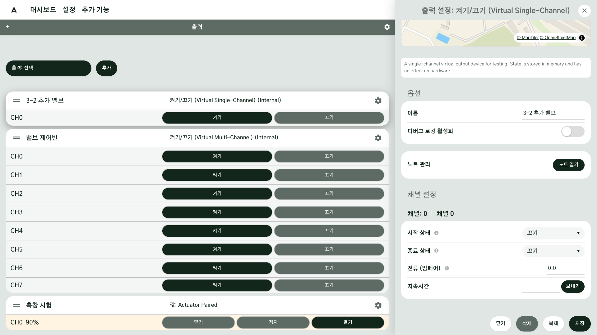

### 6. 이동 시간 재기 (창·커튼) { #step-6 }

이동 시간을 모르면 묶은 출력 설정 아래쪽 **명령**에서 **▶ 캘리브레이션 시작**의 **실행**을 누르고, 창이 끝까지
가면 **■ 정지 및 저장**의 **실행**을 누릅니다. 걸린 시간이 이동 시간으로 저장됩니다. 열기와 닫기가 다르게
걸리면 **캘리브레이션 방향**을 바꿔 한 번 더 잽니다.

이미 아는 값이라면 **열기 이동 시간 (초)**와 **닫기 이동 시간 (초)**에 직접 입력하고 **저장**합니다.
한쪽만 입력하면 다른 쪽에도 같은 값이 적용됩니다.

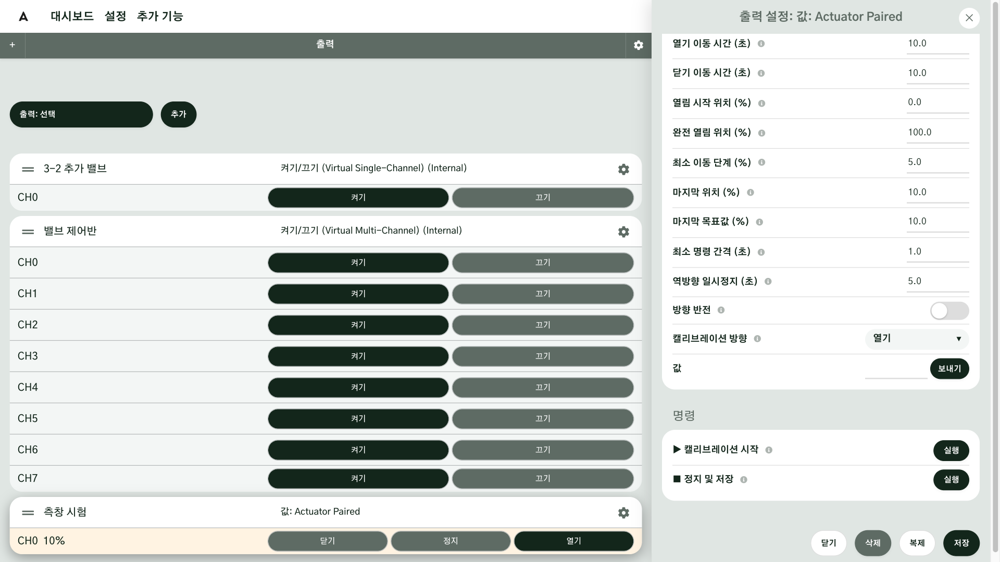

### 7. 지도와 시설에 연결하기 { #step-7 }

출력을 지도에 놓으면 AoT 가 그 장치가 어느 구역·시설에 있는지 알 수 있습니다. 환경 제어 함수는 이 연결을 보고
어떤 창·커튼을 움직일지 고릅니다.

- 노지 밸브: 지도 디자인 화면의 장치 모드에서 출력을 골라 표시한 뒤 제자리로 끌어다 놓습니다
  ([지도 디자인 도구](../geo/design-tool.md)).
- 시설 안 창·커튼·분무기: 설정 → **시설** → 시설 고르기 → **설비 배치**의 구성요소에서 측창·창호·커튼 같은
  묶음을 누르고, 각 칸의 장치 목록에서 출력을 고른 뒤 **시설 저장**을 누릅니다. "2개 연동"이라고 적힌 칸은
  한쪽만 골라도 짝이 되는 칸에 같은 출력이 함께 연결됩니다([시설 관리](../geo/facility.md)).

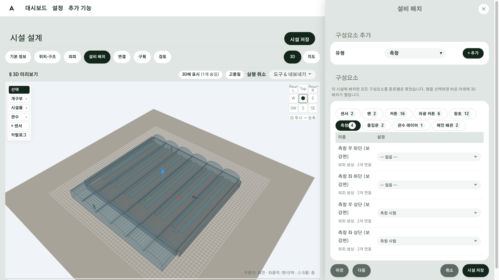

### 8. 참고: 설정 → 장치 메뉴 { #step-8 }

설정 메뉴에는 **장치**라는 항목이 따로 있습니다. 컨트롤러·PLC 처럼 스스로 동작하면서 입력과 출력을 함께
다루는 기기를 한 단위로 묶기 위한 기능으로, **아직 다듬는 중입니다.** 이 가이드에서는 쓰지 않습니다.
기기의 측정값은 입력으로, 제어는 출력으로 추가하십시오. 기능이 갖춰지면 이 절을 보완합니다.

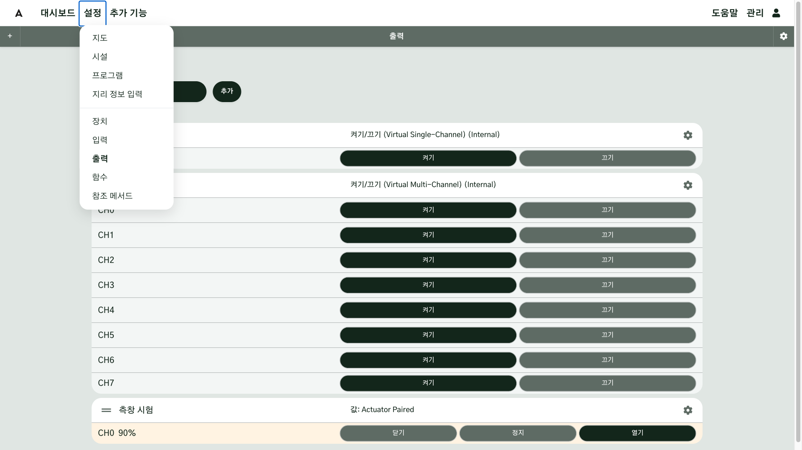

## 확인 { #check }

각 출력을 직접 켜고 껐을 때 **장비가 실제로 움직이고, 카드가 "활성/비활성"으로 바뀌면** 연결이 끝난 것입니다.

- 밸브·펌프: 켜기 → 물이 나오는지 눈으로 확인 → 끄기
- 묶은 창: 닫기(0%) → 열기 50% → 절반쯤 열렸는지 확인 → 닫기
- AoT 를 다시 시작한 뒤 모든 출력이 정한 시작 상태로 돌아오는지 확인

## 현장 A { #site-a }

현장 A 에는 노지 밸브와 시설 창이 함께 있습니다.

- **노지 밸브 8개**(3-1 구역 4개, 3-2 구역 4개)와 펌프 2대. 밸브는 LoRaWAN 밸브 컨트롤러로
  켜고 끕니다. 한 번에 여러 개를 열면 명령이 차례로 나가 마지막 밸브가 몇 초 늦게 열립니다.
  이름은 구역과 순서가 드러나게 짓습니다(예: "v311" 대신 "3-1 밸브 1").
- **시설(단동 온실) 측창 좌·우**. 각각 열기/닫기 출력을 `Actuator Paired (Shared Bus)` 로 묶었습니다.
  두 창이 모터 전원 한 줄을 나눠 쓰기 때문입니다.
- **분무기 1대**: 켜기/끄기 출력.

## 현장 B { #site-b }

현장 B 는 원래 있던 시설 제어 설비에 AoT 를 연결한 곳입니다. 기존 제어반의 "열기"·"닫기" 릴레이를
그대로 쓰고, AoT 에서는 아래처럼 묶기만 했습니다.

| 설비 | 기존 릴레이 | AoT 에서 |
|---|---|---|
| 측창 | 열기 1줄, 닫기 1줄 | `Actuator Paired`, 종류 = 측면 환기창 |
| 천창 | 열기 1줄, 닫기 1줄 | `Actuator Paired`, 종류 = 지붕 환기창 |
| 보온커튼 | 열기 1줄, 닫기 1줄 | `Actuator Paired`, 종류 = 보온 커튼 |
| 분무기 | 켜기 1줄 | 켜기/끄기 출력 |

기존 설비를 쓸 때는 **이동 시간을 반드시 다시 재십시오.** 오래된 모터는 명판 값보다 느린 경우가 많고,
열기와 닫기의 시간이 다른 경우도 흔합니다.

## 안 될 때 { #trouble }

| 증상 | 확인할 것 |
|---|---|
| 카드가 "응답 없음"으로 돌아간다 | 장치 전원·통신. LoRaWAN 이라면 게이트웨이와 장치 사이의 신호, ChirpStack 에서 장치가 최근에 신호를 보냈는지 |
| 묶은 창이 움직이지 않는다 | **출력: 열기/닫기**를 다시 골라 저장하십시오. 출력을 복제해 만든 경우 이 칸이 비어 있습니다 |
| 창이 끝까지 가지 않거나 모터가 너무 오래 움직인다 | 이동 시간이 실제와 다릅니다. [6단계](#step-6)로 다시 재십시오 |
| 표시된 % 와 실제 열림이 다르다 | 닫기로 0% 를 맞춘 뒤 다시 시도하십시오 |
| 재시작하자 밸브가 열렸다 | 그 출력의 시작 상태가 켬(On)으로 되어 있습니다 |

## 더 알아보기 { #more }

- [출력](../Outputs.md)
- [지원 출력 목록](../Supported-Outputs.md)
- [인터페이스 설정](../Interfaces.md)
- [LoRaWAN 다운링크](../LoRaWAN-ChirpStack.md#downlink)
- [다운링크 간격](../LoRaWAN-ChirpStack.md#pacing)
