# 함수

센서 값이 들어오고 장치가 명령을 받을 수 있게 되었으면, 둘을 잇는 규칙을 만듭니다. AoT 에서는 이 규칙을
**함수**라고 부릅니다. "매일 아침 6시에 밸브를 차례로 연다", "온실이 더우면 창을 연다",
"센서 값이 끊기면 알린다" 같은 것이 모두 함수입니다.

## 이 장을 마치면 { #goal }

- 목적에 맞는 함수 종류를 고른다
- 노지 순차 관수와 시설 환경 제어를 함수로 만들고, 실제 장치를 움직이지 않고 먼저 시험한다

## 준비 { #prepare }

- 센서와 장치가 연결된 AoT ([센서 연결](g05-sensors.md#check), [출력 연결](g06-outputs.md#check))
- 시설 환경 제어를 하려면: 시설과 그 안의 구획, 시설 센서 자리(실내·실외)가 채워져 있어야 합니다
- 처음 시험할 때 쓸 가상 출력([출력 연결 1단계](g06-outputs.md#step-1))

## 절차 { #steps }

### 1. 함수 종류 고르기 { #step-1 }

설정 → **함수**에서 종류를 고르고 **추가**를 누릅니다.
새 함수는 **꺼진 상태**로 만들어지므로, 설정을 마친 뒤 **활성화**를 눌러야 동작합니다.

| 하고 싶은 일 | 고를 종류 | 쓰지 않는 경우 |
|---|---|---|
| 밸브 여러 개를 정해진 순서로, 요일·시간대별로 | **시퀀스** | 온도·습도 같은 목표를 유지할 때 |
| 온실 한 동의 창·커튼·분무를 함께 움직여 환경 유지 | **통합 환경 제어** | 같은 노즐로 관수까지 할 때 |
| 값 하나를 목표값에 맞춤(히터 하나, 팬 하나) | **PID 컨트롤러** | 장치 여러 개가 함께 움직여야 할 때 |
| 조건이 맞으면 무엇인가 실행(알림, 다른 함수 켜기·끄기) | **조건부 컨트롤러** | 단순히 시각에 맞춰 할 일 |
| 정해진 시각·간격·일출/일몰에 실행 | **트리거** 묶음의 시간 트리거 | 조건에 따라 달라질 때 |
| 특정 날짜에 한 번 할 일 | 추가 기능 → **스케줄** | 매일 반복하는 제어 |

하나의 장치를 **두 함수가 동시에** 움직이지 않게 하십시오. 예를 들어 같은 창을 환경 제어와
시간 트리거가 함께 움직이면 서로 명령을 덮어씁니다.

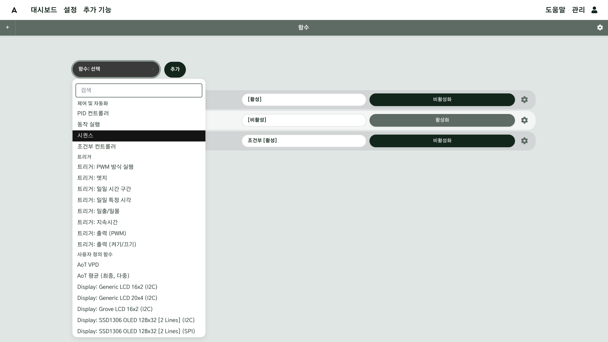

### 2. 순차 관수 만들기 (시퀀스) { #step-2 }

1. **시퀀스**를 추가하고, 톱니바퀴로 설정 창을 열어 **이름**을 정합니다(예: "3-1·3-2 순차 관수").
2. **동작 → 액션 추가**에서 **출력: 켜기/끄기/지속시간**을 고르고 **추가**를 누릅니다.
   펌프 하나와 밸브마다 하나씩 추가합니다.
3. 행마다 설정합니다. **출력**을 고르고, **상태**가 **켜기**인지 확인합니다.
   상태가 비어 있거나 끄기이면 오류 없이 저장되지만, 그 단계는 장치를 켜지 않고 끄기만 합니다.
   - 펌프: **동작 모드 = 전체**. 밸브가 열린 뒤 펌프가 켜지고, 밸브가 닫히기 전에 펌프가 멈추도록
     **지연 시작**과 **조기 정지**를 몇 초씩 설정합니다.
   - 밸브: **단일**, **기본 동작 시간 (초)**. 함께 열 밸브는 같은 **그룹** 이름을 적습니다.
   - 행마다 오른쪽의 **저장**을 눌러 그 행을 저장합니다.
4. **시간 설정**에서 시작 시간·종료 시간과 **주기 (초)** 를 정하고, 창 아래쪽 **저장**을 누릅니다. 주기는 "한 바퀴를 다시 시작하는 간격"입니다.
   새 시퀀스의 주기 기본값은 60초이므로 **활성화 전에 반드시 바꾸십시오.**
5. 요일마다 다르게 하려면 대시보드에 **시퀀스 컨트롤러** 위젯을 두고, 위젯에서 **요일별**을 골라 요일마다
   시간대를 정합니다(함수 설정 창에는 요일 칸이 없습니다).

!!! warning "한 바퀴 시간과 주기를 맞추십시오"
    한 바퀴(모든 밸브의 동작 시간 합)가 주기보다 길면 한 바퀴를 마치기 전에 처음부터 다시 시작합니다.
    주기가 너무 짧으면 하루에 수십 번 반복됩니다. 예: 06~16시에 주기 300초면 하루 120번입니다.
    **밸브 동작 시간 합 < 주기 < 시간대 길이** 가 되게 정하십시오.

흙이 젖어 있을 때 관수를 건너뛰려면 두 가지 방법이 있습니다.

- 조건부 컨트롤러로 토양 수분을 보고 이 시퀀스를 **비활성화/활성화**합니다(비활성화하면 진행 중이던 한 바퀴가 바로 멈춥니다).
- 밸브 행의 **동적 동작 시간 참조**에 측정값을 지정해, 그 값을 동작 시간(초)으로 씁니다.

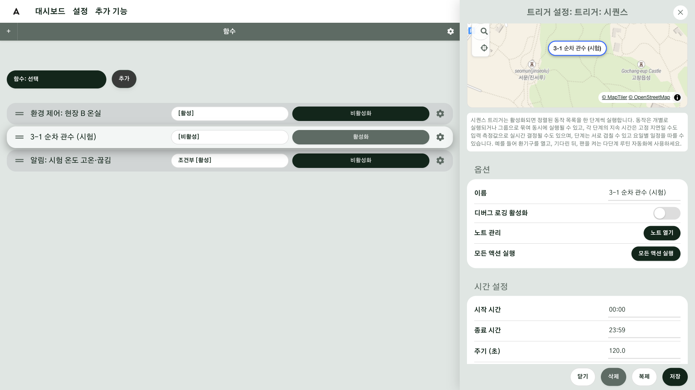

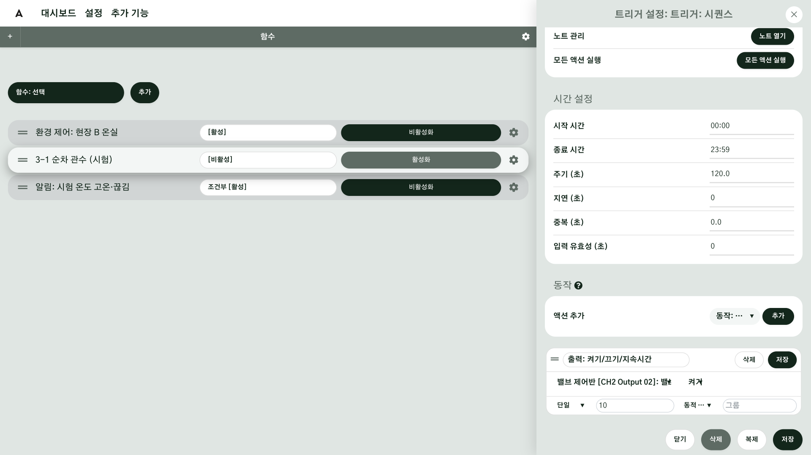

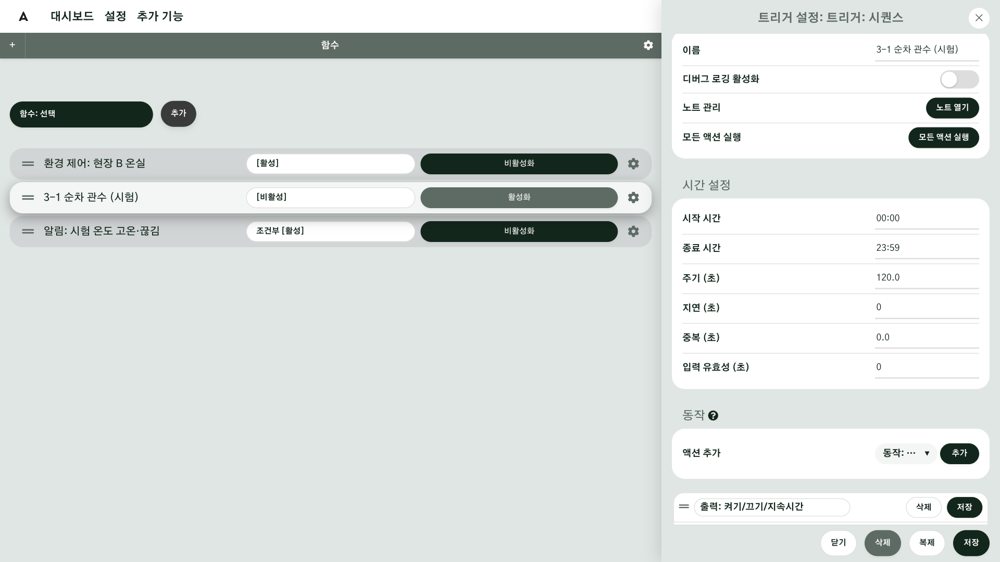

### 3. 시설 환경 제어 만들기 (통합 환경 제어) { #step-3 }

시작하기 전에 시설에 실내·실외 센서 자리([센서 연결 7단계](g05-sensors.md#step-7))와 창·커튼 같은 장치
([출력 연결 7단계](g06-outputs.md#step-7))를 연결해 두십시오. 환경 제어는 이 연결만 보고 움직입니다.

1. **통합 환경 제어**를 추가합니다(추가 목록의 "사용자 정의 함수" 묶음에 있습니다).
   톱니바퀴로 설정을 열고 이름을 시설이 드러나게 바꿉니다(예: "환경 제어: 현장 B 온실").
2. **연동 시설**에서 온실을 고릅니다. 실내·실외 센서는 그 시설의 센서 자리에서, 창·커튼·분무기는
   시설에 연결된 장치에서 자동으로 찾습니다. 온실의 일부 동만 맡기려면 **동 범위**를 고릅니다.
3. **온도 범위**와 **습도 범위**에 절대 넘으면 안 되는 한계를 입력합니다(기본 12–32 ℃, 40–85 %).
4. 제어 기준은 기본이 **VPD**(수증기압 차. 습도와 온도를 함께 봄)입니다. 온도를 먼저 맞추려면 **고급**을 켜고
   **제어 기준**을 **온도 우선**으로 바꿉니다.
5. 목표는 시설 안 **구획의 현재 단계**에서 가져옵니다. 구획이 없으면 3번의 범위 안에서만 움직입니다.
6. **저장**한 뒤 목록에서 **활성화**를 누릅니다.

활성화한 뒤 설정을 다시 열면 **현재** 줄에 지금 값과 목표(예: "습도 78→62.5 · 온도 31→22 · 개구부 86%"),
**조절 가능** 줄에 이 온실에서 움직일 수 있는 방향(예: "온도 내리기만 · 습도 내리기만")이 나옵니다.
**자동 제어 대상 장치**에는 제어기가 찾은 장치가 켜기 토글과 함께 나옵니다. 어떤 장치를 자동 제어에서
빼려면 그 토글을 끕니다. 대시보드의 **함수 상태** 위젯으로도 볼 수 있습니다.

!!! warning "켜져 있는 동안 바꾼 설정은 적용되지 않습니다"
    환경 제어가 활성화된 상태에서는 설정을 바꿔도 적용되지 않습니다. **비활성화 → 설정 변경 → 저장 → 활성화** 순서로 하십시오.

!!! note "센서 값이 끊기면 어떻게 움직이나"
    센서 주기의 두 배(적어도 5분) 동안 새 값이 없으면 끊긴 것으로 봅니다. 실내 온습도가 끊기면 그 값을
    쓰는 판단을 멈추고 장치를 **그 자리에 둡니다**. 바깥 비·바람 값이
    끊기면, 마지막 값이 비나 강풍이었으면 창을 닫힌 채로 두고, 아니면 더 열지 않습니다.
    그래서 센서가 끊기면 제어가 멈춘 것처럼 보일 수 있습니다. [모니터링](g09-monitoring.md)에서 끊긴 센서를 찾으십시오.

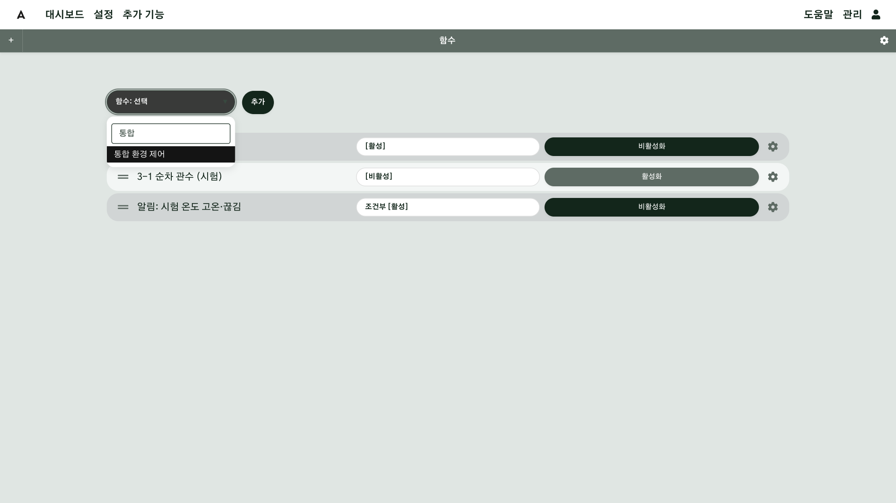

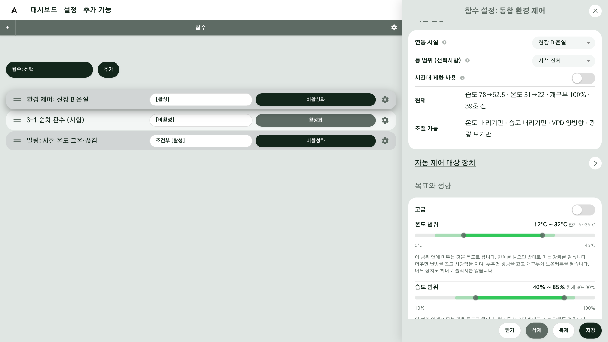

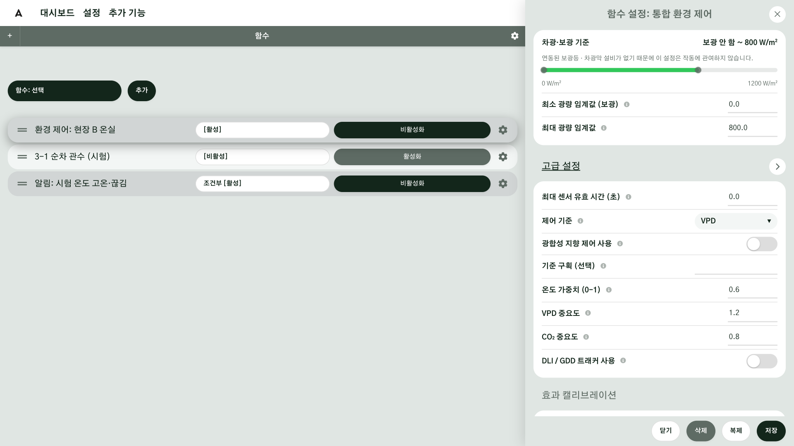

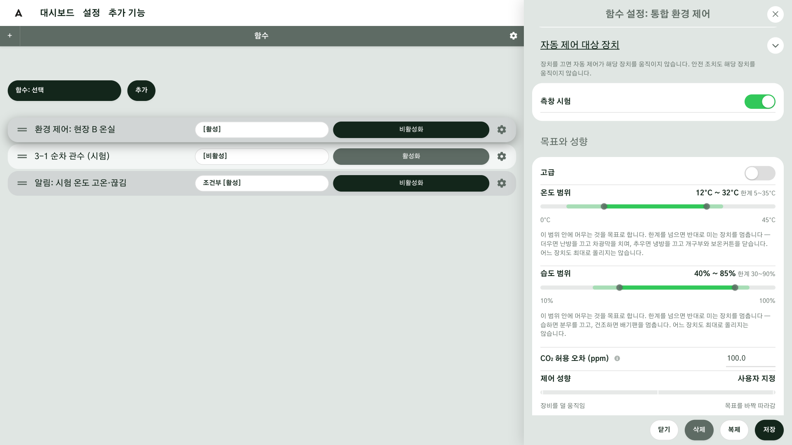

### 4. 실제 장치를 움직이지 않고 시험하기 { #step-4 }

1. 처음에는 함수가 **가상 출력**을 움직이게 만듭니다. 시퀀스라면 밸브 행의 출력을 가상 출력으로,
   환경 제어라면 가상 출력으로 만든 창을 시험용 시설에 연결합니다.
2. [시험 입력](g05-sensors.md#step-6)으로 온도·습도 값을 입력해 조건을 만들어 봅니다.
3. 가상 출력의 카드와 함수 상태를 보고 기대한 대로 켜지고 꺼지는지 확인합니다.
4. 확인되면 출력을 실제 장치로 바꾸고, **사람이 장비 옆에 있을 때** 활성화합니다.

!!! warning "시퀀스에서 \"모든 액션 실행\"을 누르지 마십시오"
    이 버튼은 액션을 차례로가 아니라 **한꺼번에** 실행합니다. 시퀀스에서는 모든 밸브와 펌프가 동시에
    켜질 수 있습니다.

<!-- 확인 필요: task_86d05999 결과에 따라 위 경고를 고친다 -->

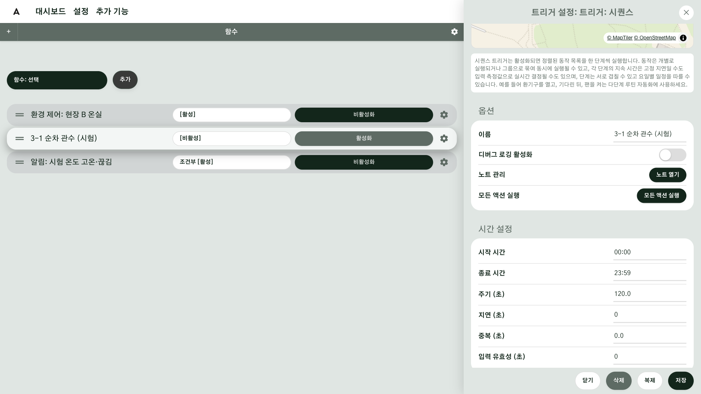

### 5. 기록 보기 { #step-5 }

관리 → **시스템 로그**를 누르면 **로그 뷰** 화면이 열립니다. 여기서 함수의 기록을 봅니다. 함수 설정의 **디버그 로깅 활성화**를 끄면 중요한 기록만
남으므로, 시험하는 동안에는 켜 두고 끝나면 끕니다.

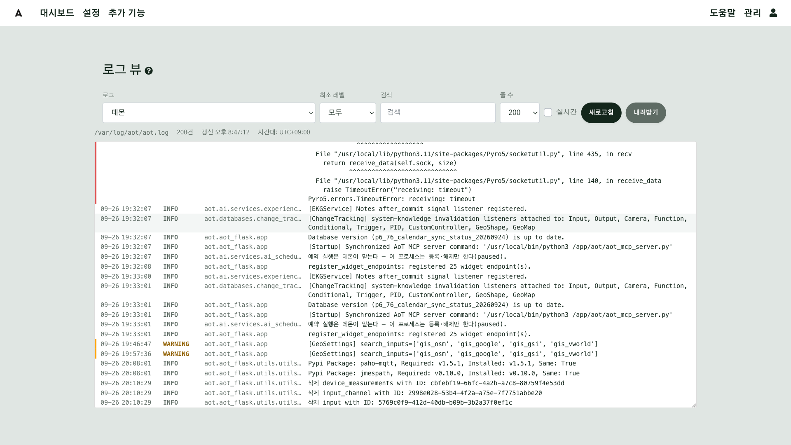

## 확인 { #check }

함수를 활성화한 뒤 **정한 시각이나 조건에서 장치가 기대한 순서로 움직이고, 함수 상태에 그 판단이 보이면** 함수 설정이 끝난 것입니다.

- 시퀀스: 첫 번째 시간대에 밸브가 순서대로 열리고 닫히는지, 펌프가 밸브보다 늦게 켜지고 먼저 꺼지는지
- 환경 제어: **자동 제어 대상 장치**에 창·커튼·분무기가 모두 나오는지, **현재** 줄에 지금 값과 목표가 함께 보이는지
- 같은 장치를 움직이는 함수가 둘 이상 켜져 있지 않은지

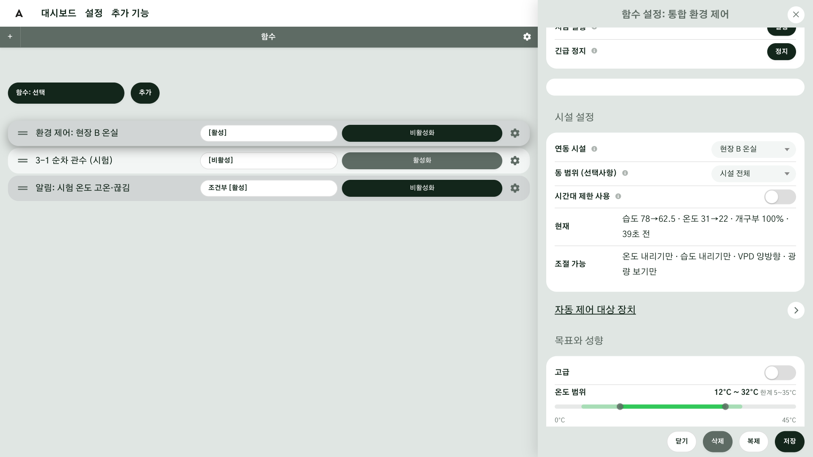

## 현장 A { #site-a }

현장 A 에는 두 종류의 함수가 있습니다.

- **노지 순차 관수**(트리거: 시퀀스): 06~16시, 3-1 과 3-2 의 밸브 8개를 요일별로 차례로 엽니다.
  펌프가 밸브 사이에서 멈추지 않도록 **동작 모드 = 전체**로 설정합니다. 저녁 16~20시에 3-2 에만 한 시간씩
  더 관수하는 시퀀스를 따로 하나 더 만듭니다.
- **온실 환경 제어**(통합 환경 제어): 단동 온실의 측창 좌·우와 분무기를 VPD 기준으로 움직입니다.
  목표는 온실 안 상추 구획의 단계에서 가져옵니다. 상추를 수확해 구획이 끝나면 **구획도 끝내야**
  제어가 지난 목표를 따르지 않습니다([지도 구성 9단계](g04-map.md#step-9)).

## 현장 B { #site-b }

현장 B 는 통합 환경 제어 하나가 온실 전체를 맡습니다.

- 연동 시설: 6동 연동 온실
- 움직이는 장치: 측창, 천창, 보온커튼(모두 열기/닫기를 묶은 출력), 분무기
- 목표: 토마토 구획의 개화기 단계(VPD 1.0 kPa), 안전 범위 9~36 ℃
- 바깥 값: 기상대의 바람·비. 강풍·강우 때 창을 닫는 근거가 됩니다.

설정을 바꿔 보려고 같은 제어기를 복제해 두었다면, 쓰지 않는 제어기는 **삭제**하십시오. 같은 이름의 제어기가
둘 있으면 어느 것이 실행 중인지 헷갈리고, AI 에게 이름으로 요청할 때 엉뚱한 제어기를 가리킬 수 있습니다.

## 안 될 때 { #trouble }

| 증상 | 확인할 것 |
|---|---|
| 함수가 아무 일도 하지 않는다 | **활성화**했는지. 새 함수는 꺼진 상태로 만들어집니다 |
| 시퀀스가 한 바퀴를 끝내지 못하고 다시 시작한다 | 밸브 동작 시간 합이 주기보다 깁니다([2단계](#step-2) 경고) |
| 시퀀스가 하루에 너무 자주 실행된다 | 주기가 짧습니다. 기본값 60초를 그대로 두지 않았는지 |
| 시퀀스가 실행 중인데 밸브가 켜지지 않는다 | 동작 행의 **상태**가 비어 있거나 끄기입니다. **켜기**로 바꾸고 행을 저장하십시오 |
| 환경 제어의 조절 가능 목록이 비어 있다 | 장치를 시설에 연결하지 않았거나, 연동 시설을 고르지 않았습니다. **다시 불러오기**를 누릅니다 |
| 환경 제어가 실내 값을 모른다 | 실내 센서가 시설 센서 자리에 없습니다([센서 연결 7단계](g05-sensors.md#step-7)) |
| 창이 두 함수 사이에서 오락가락한다 | 같은 장치를 두 함수가 움직이고 있습니다 |
| 로그에 아무것도 없다 | 로그 레벨이 디버그가 아닙니다([5단계](#step-5)) |

## 더 알아보기 { #more }

- [함수](../Functions.md)
- [조건부 함수](../Functions.md#conditional)
- [환경 제어](../ai/env-control.md)
- [스케줄](../ai/scheduler.md)
- [지원 함수 목록](../Supported-Functions.md)
