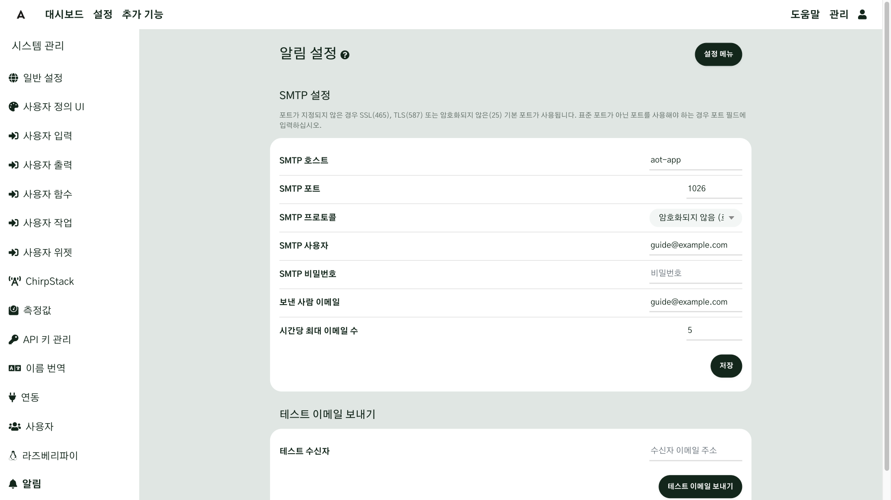
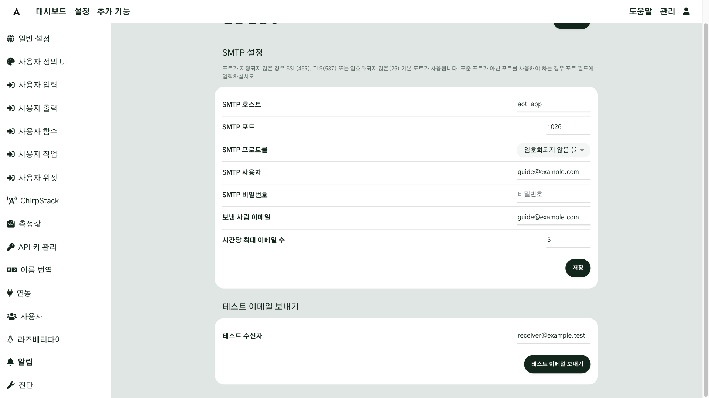
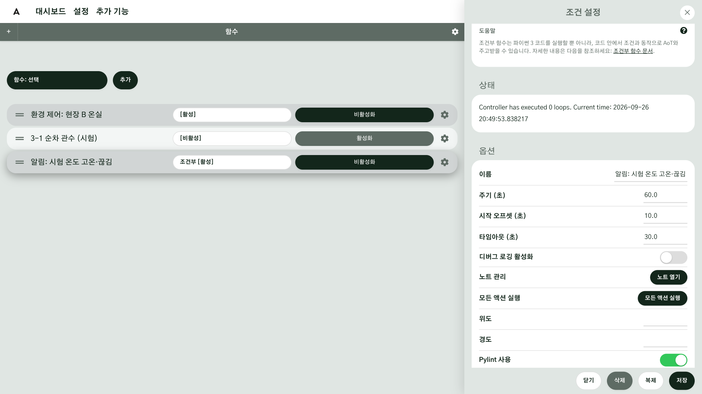
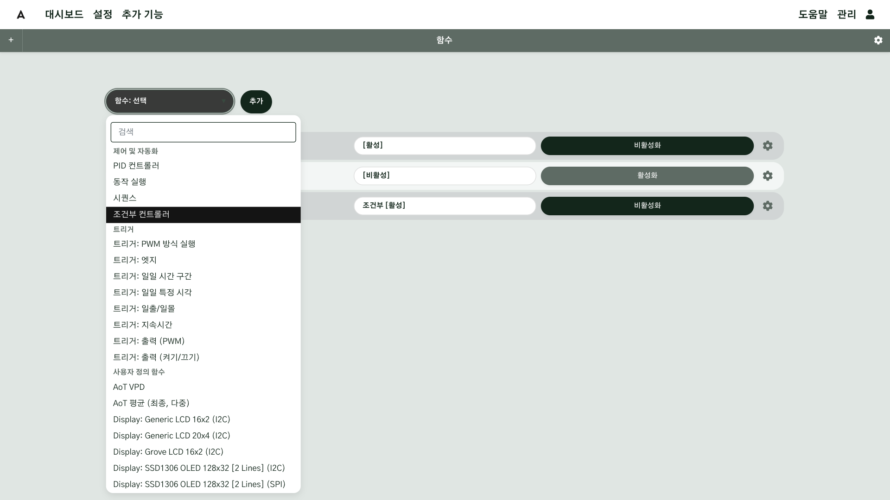
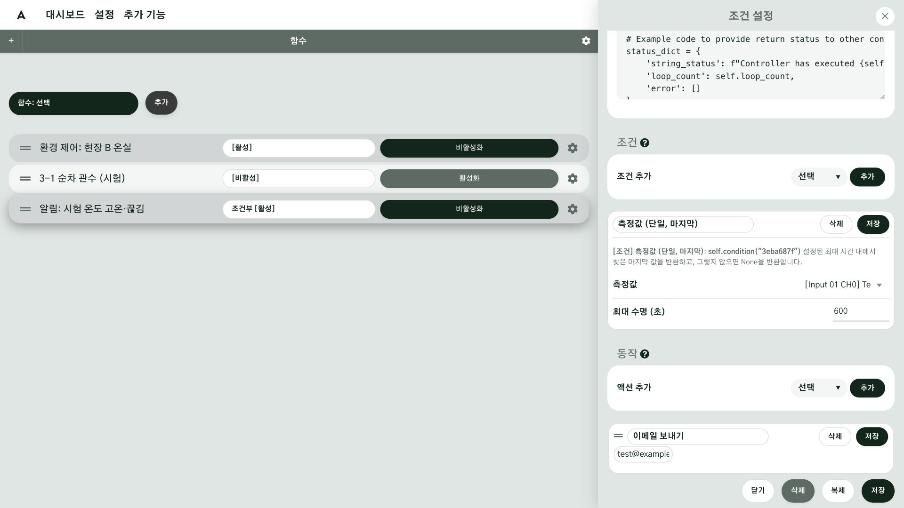
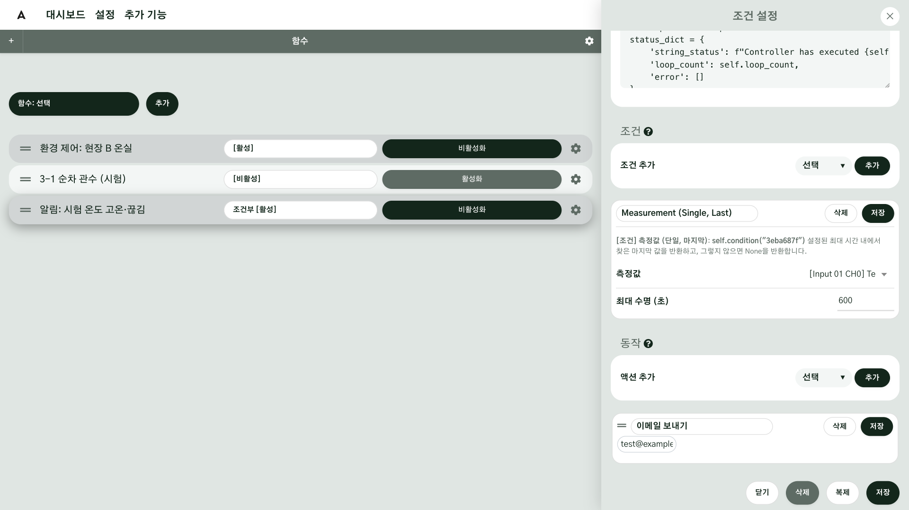
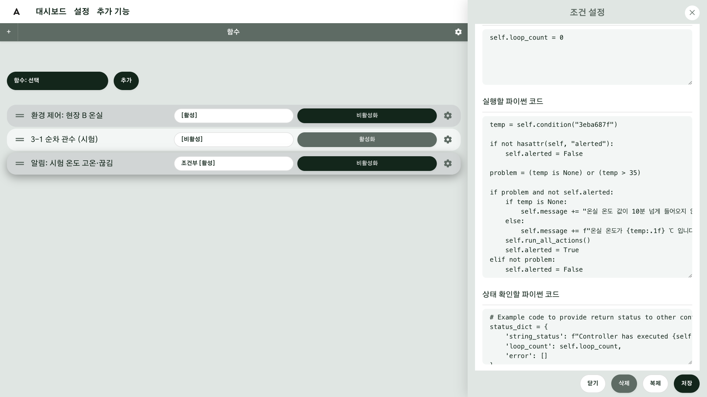

# 이메일 알림

사람이 화면을 계속 보고 있을 수는 없습니다. 이 장에서는 "온실이 너무 덥다", "센서 값이 끊겼다" 같은
일이 생기면 메일이 오게 만듭니다. AoT 의 알림은 **함수**로 만듭니다. 조건부 함수가 조건을 확인하다가, 조건이
맞으면 **메일 보내기 액션**을 실행하는 구조입니다. 입력이나 출력 화면에는 따로 알림 설정이 없습니다.

## 이 장을 마치면 { #goal }

- 메일 발송 설정을 하고 시험 메일을 받는다
- 조건이 맞을 때 메일이 오게 하고, 같은 알림이 계속 오지 않게 만든다

## 준비 { #prepare }

- 함수를 만들 수 있는 AoT ([함수](g07-functions.md#check))
- 메일을 보낼 계정. Gmail 이면 **Google 계정의 2단계 인증을 켜고 "앱 비밀번호"를 하나 만들어 둡니다.**
  평소 로그인 비밀번호로는 보낼 수 없습니다
- 알림을 받을 메일 주소

## 절차 { #steps }

### 1. 메일 서버 설정하기 { #step-1 }

관리 → 시스템 관리 → **알림**을 엽니다(화면 제목: 알림 설정).

| 칸 | Gmail 예 | 설명 |
|---|---|---|
| SMTP 호스트 | `smtp.gmail.com` | 메일을 보내는 서버 |
| SMTP 포트 | (비움) | 비우면 프로토콜의 기본 포트(SSL 465, TLS 587) |
| SMTP 프로토콜 | TLS | 회사 메일 서버라면 담당자에게 확인합니다 |
| SMTP 사용자 | 보내는 Gmail 주소 | |
| SMTP 비밀번호 | 앱 비밀번호 16자리 | 비워 두면 저장된 값을 그대로 씁니다 |
| 보낸 사람 이메일 | SMTP 사용자와 같은 주소 | Gmail 은 둘이 다르면 거부할 수 있습니다 |
| 시간당 최대 이메일 수 | 5 | 한 시간에 보낼 수 있는 최대 개수. 넘으면 그 메일은 **버려집니다** |

**저장**을 누릅니다.



### 2. 시험 메일 보내기 { #step-2 }

같은 화면의 **테스트 이메일 보내기**에 받을 주소를 입력하고 버튼을 누릅니다. 받은편지함(스팸함 포함)에
"AoT Notification (컴퓨터 이름)" 제목의 메일이 오면 설정이 끝난 것입니다.

시험 메일은 **저장된 설정**으로 보냅니다. 칸을 고쳤다면 반드시 먼저 **저장**하고 시험하십시오.
실패하면 관리 → 시스템 로그의 **데몬** 기록에 실제 오류가 남습니다.



### 3. 알림 함수 만들기 { #step-3 }

예: 온실 안 온도가 35 ℃ 를 넘거나, 10분 동안 값이 오지 않으면 메일을 보낸다.

1. 설정 → **함수**에서 **조건부 컨트롤러**를 추가합니다. 톱니바퀴로 **조건 설정** 창을 열고 이름을 정합니다(예: "알림: 현장 B 온실 고온·끊김").
2. **주기 (초)** 를 60 으로 설정합니다. 1분마다 조건을 확인합니다.
3. **조건 추가** 목록에서 **측정값 (단일, 마지막)**을 고르고 **추가**를 누릅니다. 새 조건에서
   **측정값**으로 온실 안 온도 센서를 고르고 **최대 수명 (초)** 을 600 으로 설정한 뒤, 그 조건의 **저장**을 누릅니다.
   10분보다 오래된 값은 "값 없음"으로 처리합니다. 조건 줄 아래 설명 글에 `self.condition("a1b2c3d4")` 처럼 코드에 넣을 줄이 나옵니다.
4. **액션 추가** 목록에서 **이메일 보내기**를 고르고 **추가**를 누릅니다. 받을 주소를 입력하고(여럿이면 쉼표로 구분)
   그 액션의 **저장**을 누릅니다.
5. **실행할 파이썬 코드**의 예제를 지우고 아래 코드를 붙여 넣습니다. 첫 줄의 `self.condition("…")` 은 3번에서 본 줄로 바꿉니다.

```python
temp = self.condition("a1b2c3d4")

if not hasattr(self, "alerted"):
    self.alerted = False

problem = (temp is None) or (temp > 35)

if problem and not self.alerted:
    if temp is None:
        self.message += "온실 온도 값이 10분 넘게 들어오지 않습니다.\n"
    else:
        self.message += f"온실 온도가 {temp:.1f} ℃ 입니다.\n"
    self.run_all_actions()
    self.alerted = True
elif not problem:
    self.alerted = False
```

6. 창 아래쪽 **저장**을 누르고 **활성화**합니다. 저장할 때 코드 검사(pylint) 경고가 나올 수 있는데, 오류가 아니면 그대로 둡니다.


!!! note "왜 코드에 `alerted` 를 두나요"
    조건부 함수는 주기마다 조건을 확인합니다. 그냥 두면 문제가 이어지는 동안 1분마다 메일이 옵니다.
    `alerted` 는 "이미 알렸다"는 표시입니다. 문제가 처음 생겼을 때만 보내고, 정상으로 돌아오면 표시를
    지워 다음 문제가 생기면 다시 알립니다.












### 4. 알림을 시험하기 { #step-4 }

실제로 온실을 덥게 만들 수는 없으니, [시험 입력](g05-sensors.md#step-6)을 조건의 센서로 잠시 바꿔 36 을
입력해 봅니다. 1~2분 안에 메일이 오고, 계속 36 이어도 **더 오지 않으면** 성공입니다. 25 를 입력했다가 다시 36 을
입력하면 메일이 한 번 더 옵니다. 시험이 끝나면 조건의 센서를 실제 센서로 되돌립니다.

## 확인 { #check }

조건이 처음 맞았을 때 메일이 **한 통** 오고, 조건이 이어지는 동안에는 더 오지 않으면 알림 설정이 끝난 것입니다.

- 메일 본문에 어떤 센서의 어떤 값 때문인지 적혀 있는지 봅니다.
- 알림 함수가 여러 개면 모두 합쳐 시간당 최대 이메일 수를 넘지 않는지 봅니다. 넘은 메일은 버려집니다.

## 현장 A { #site-a }

현장 A 는 노지와 시설을 나눠 알림 두 개를 만듭니다.

- **알림: 노지 토양 센서 끊김** — 3-1, 3-2 토양 센서의 최대 수명을 센서 간격의 세 배로 설정하고, 값이 없으면 알림.
  LoRaWAN 센서는 배터리가 떨어지면 조용히 끊기므로 이 알림이 가장 유용합니다.
- **알림: 온실 고온** — 단동 온실 안 온도가 35 ℃ 를 넘으면 알림.

## 현장 B { #site-b }

현장 B 는 환경 제어가 멈출 수 있는 상황부터 알림으로 받습니다.

- **알림: 온실 고온·끊김** — [3단계](#step-3)의 예 그대로.
- **알림: 기상대 끊김** — 바깥 풍속 값이 끊기면 환경 제어가 창을 더 열지 않습니다. 끊기면 바로 알 수 있게 합니다.

## 안 될 때 { #trouble }

| 증상 | 확인할 것 |
|---|---|
| 시험 메일이 실패한다 | 앱 비밀번호를 썼는지, 프로토콜과 포트가 맞는지, **저장**한 뒤 시험했는지. 관리 → 시스템 로그 → 데몬 |
| 시험 메일은 오는데 알림은 안 온다 | 함수를 **활성화**했는지, 조건 ID 를 코드에 맞게 바꿨는지, 메일 보내기 액션에 주소를 입력했는지 |
| 알림이 한동안 오다가 멈췄다 | 시간당 최대 이메일 수를 넘었습니다. 설정 → 진단 → **이메일 카운터 재설정**, 그리고 반복 방지 코드를 추가하십시오 |
| 1분마다 메일이 온다 | 반복 방지 코드(`alerted`)가 없습니다 |
| 현장 망에서만 메일이 안 간다 | 망이 메일 포트를 막고 있습니다([네트워크 연결](g03-network.md#step-4)) |

## 더 알아보기 { #more }

- [알림 설정](../Configuration-Settings.md#alert-settings)
- [조건부 함수](../Functions.md#conditional)
- [액션](../Actions.md)
- [경고](../Alerts.md)
