# 모니터링

자동 제어를 시작한 뒤에는 "제대로 작동하고 있는지" 확인해야 합니다. 이 장에서는 매일 볼 곳과, 문제가
생겼을 때 원인을 찾는 순서를 정합니다.

## 이 장을 마치면 { #goal }

- 매일 무엇을 보면 정상 여부를 판단할 수 있는지 안다
- 값이 끊긴 센서, 응답하지 않는 장치, 멈춘 함수를 찾는다

## 준비 { #prepare }

- 센서가 연결된 AoT ([센서 연결](g05-sensors.md#check)). 함수·장치까지 연결되어 있으면 더 좋습니다

## 절차 { #steps }

### 1. 매일 1분 점검 { #step-1 }

| 순서 | 볼 곳 | 정상 |
|---|---|---|
| 1 | 화면 왼쪽 위 **로고 배경색** | 색이 바뀌지 않음(빨강=제어 본체 멈춤, 회색=웹 연결 끊김) |
| 2 | 추가 기능 → **실시간 측정** | 모든 센서에 값과 최근 시각이 있음. "N초 동안 데이터가 없습니다" 가 없음 |
| 3 | 대시보드의 **함수 상태** 위젯 | 켜 둔 함수가 "비활성화됨"이나 오류가 아님 |
| 4 | 받은 메일 | [이메일 알림](g08-email.md)이 오지 않았음 |

이 네 가지가 정상이면 그날은 더 볼 것이 없습니다. [대시보드 구성](g10-dashboard.md)에서 2·3번을 한 화면에
모아 두면 1분이면 끝납니다.

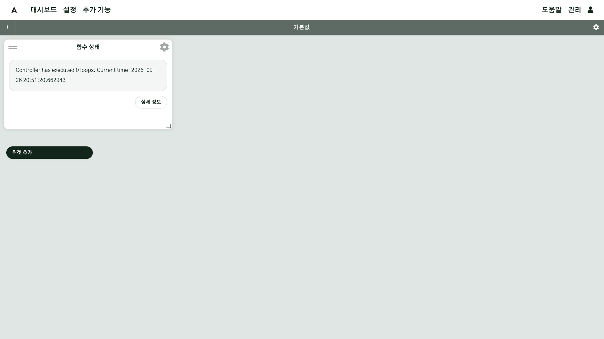

### 2. 끊긴 센서 찾기 { #step-2 }

- **실시간 측정**: 값이 끊긴 입력에 "N초 동안 데이터가 없습니다" 가 나오고 값 자리에 `--` 가 보입니다.
  MQTT·LoRaWAN 처럼 스스로 값을 보내는 입력은 **측정 유효 수명**이 지나야 끊긴 것으로 나옵니다.
- 설정 → **입력**: 값이 없는 입력 카드는 `--` 로 보입니다.

끊긴 센서를 찾았으면 다음 순서로 확인합니다.

1. 센서 전원·배터리(LoRaWAN 센서는 배터리가 떨어지면 조용히 끊깁니다)
2. 중간 기기(게이트웨이, MQTT 브로커, PLC)가 켜져 있는지
3. 관리 → **시스템 로그**에서 로그 **데몬**, 최소 레벨 WARNING 으로 그 입력의 이름을 검색합니다.
   Docker 로 설치했다면 목록의 일부 로그(웹 오류, Nginx 등)는 "찾을 수 없습니다"로 나옵니다. **데몬**과 **웹 앱**을 보면 됩니다.

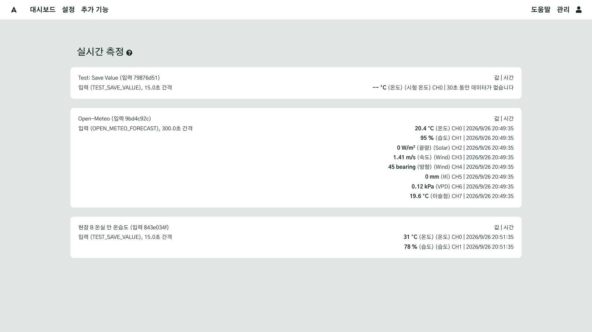

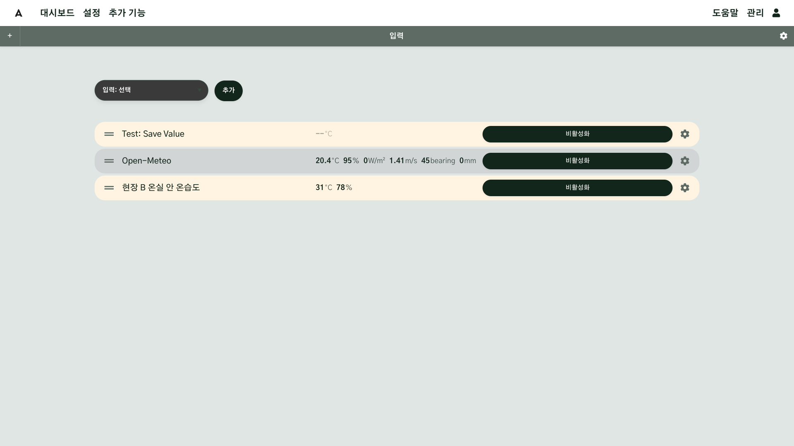

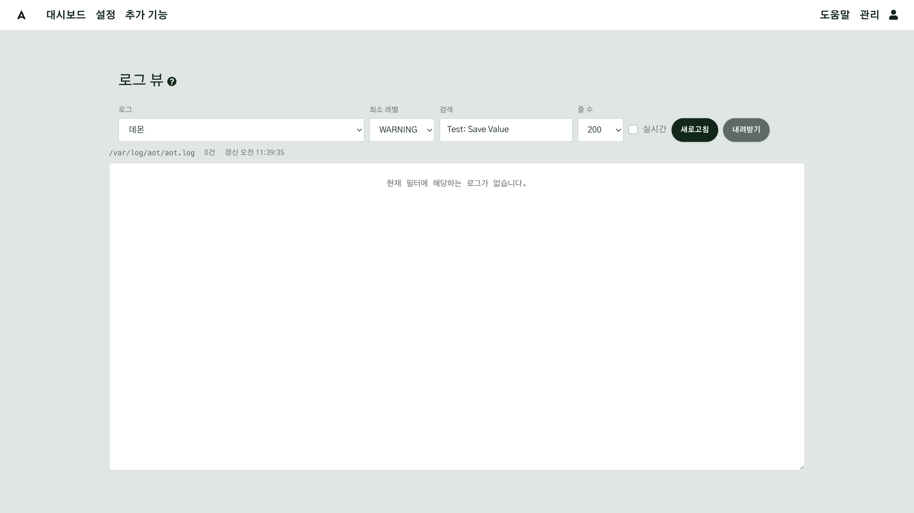

### 3. 응답하지 않는 장치 찾기 { #step-3 }

설정 → **출력**에서 카드가 **응답 없음**이나 **연결 없음**인 출력을 찾습니다. 명령을 보냈지만 장치가
확인 응답을 보내지 않은 것입니다. LoRaWAN 장치는 신호·배터리를, 유선 장치는 통신선과 전원을 확인합니다.

### 4. 멈춘 함수 찾기 { #step-4 }

- 설정 → **함수**에서 켜져 있어야 할 함수가 꺼져 있지 않은지 확인합니다.
- 환경 제어 함수는 설정 화면 위쪽 상태 머리글에서 현재 판단과 **조절 가능** 장치를 확인합니다. 센서가 끊기면
  제어가 "그 자리에 둠"으로 바뀌어 멈춘 것처럼 보입니다. 이때는 2단계로 돌아가 센서를 확인합니다.
- 시스템 로그에서 로그 **데몬**, 최소 레벨 ERROR 로 최근 오류를 봅니다.

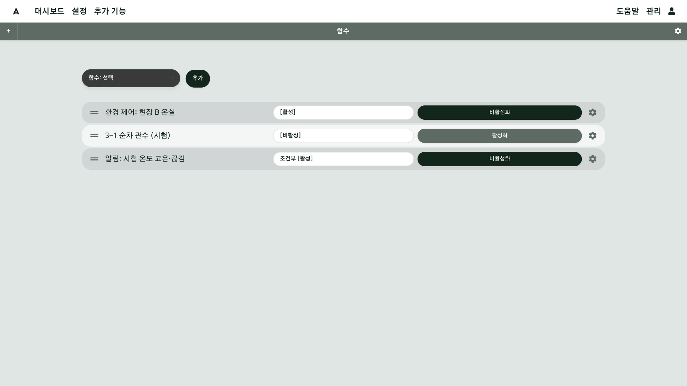

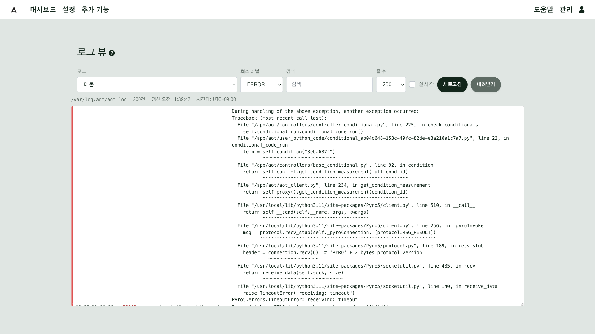

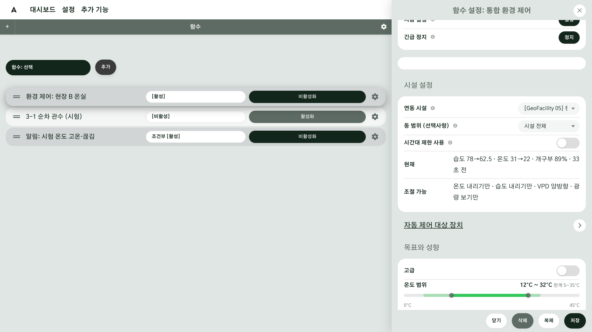

### 5. 주마다 볼 것 { #step-5 }

| 볼 곳 | 확인할 것 |
|---|---|
| 관리 → **시스템 정보** | 디스크 사용량이 80% 를 넘지 않는지, 데몬이 "실행 중"인지 |
| 관리 → **감사 로그** | 모르는 로그인이나 설정 변경이 없는지 |
| 관리 → **업그레이드** | 새 버전이 있는지(바로 업데이트하지 말고 [주의사항](g11-cautions.md#step-2)을 먼저 읽으십시오) |
| 관리 → **백업 복원** | 최근 백업이 있는지 |

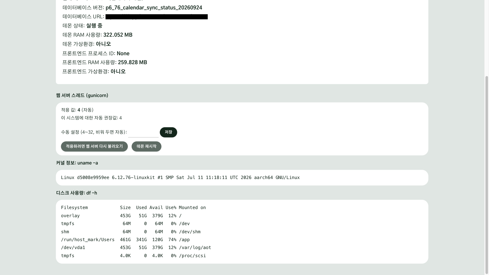

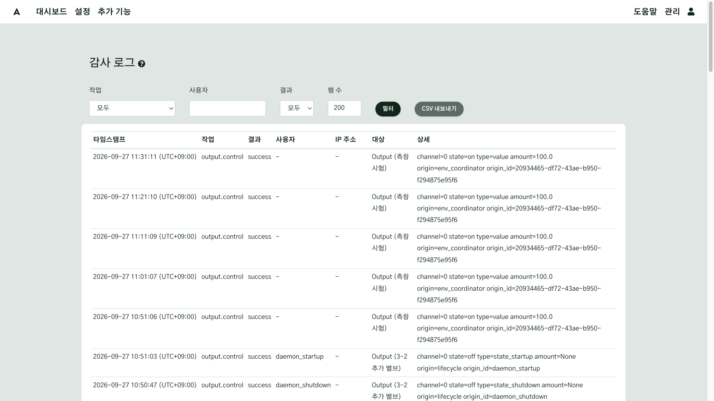

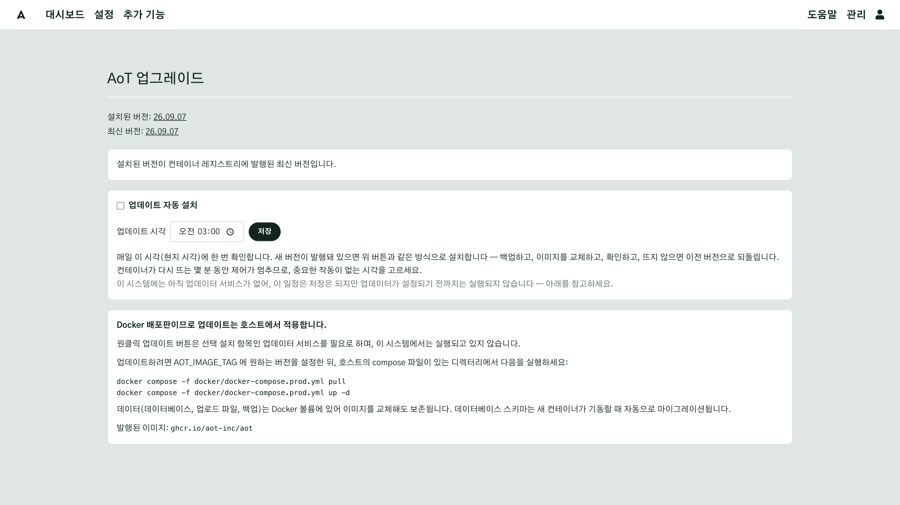

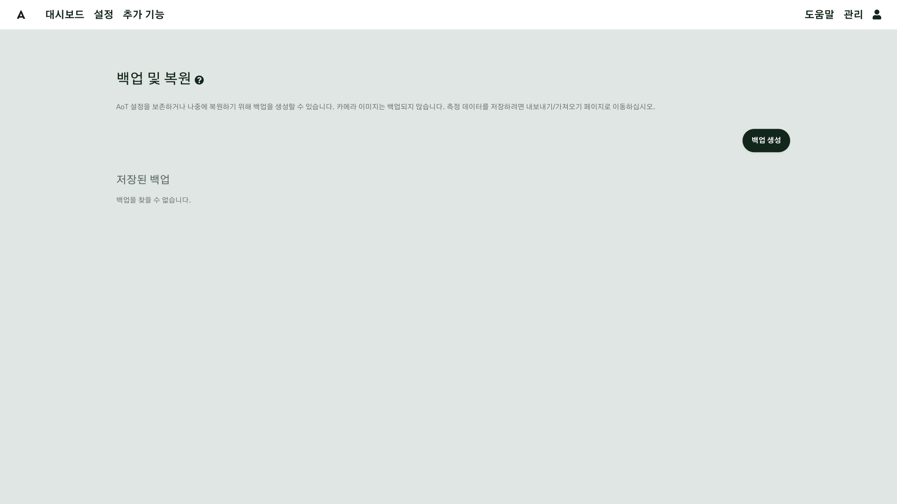

## 확인 { #check }

센서 하나의 전원을 잠시 빼거나 시험 입력을 끄고, 몇 분 뒤 실시간 측정에서 그 센서가 끊긴 것으로
나오면 모니터링이 제대로 되는 것입니다. [이메일 알림](g08-email.md)을 설정해 두었다면 메일도 와야 합니다.

## 현장 A { #site-a }

현장 A 는 무선 센서가 많아 **끊김**을 가장 자주 확인합니다.

- 매일: 실시간 측정에서 3-1, 3-2 의 LoRaWAN 센서 여섯 개의 측정 시각
- 관수 날: 시퀀스 컨트롤러 위젯에서 밸브가 차례로 열리고 닫혔는지, 응답 없음으로 표시된 밸브가 없는지
- 매주: 토양 센서 배터리 값(측정값에 함께 들어옵니다)

## 현장 B { #site-b }

현장 B 는 환경 제어 하나가 온실 전체를 맡으므로 **제어기의 상태**를 가장 먼저 봅니다.

- 매일: 함수 상태 위젯에서 환경 제어의 목표·현재 값·조절 가능 장치
- 기상대 값이 끊기면 창이 더 열리지 않으므로, 실시간 측정에서 풍속·강우 값의 시각도 함께 확인합니다.

## 안 될 때 { #trouble }

| 증상 | 확인할 것 |
|---|---|
| 로고가 빨갛다 | 관리 → 시스템 정보에서 **데몬 재시작**. 반복되면 시스템 로그 → 데몬 |
| 모든 센서가 한꺼번에 끊겼다 | 센서가 아니라 공통 경로(게이트웨이, 브로커, 현장 인터넷)의 문제입니다 |
| 실시간 측정은 정상인데 그래프가 비어 있다 | 그래프 위젯의 기간과 데이터 소스를 확인하십시오 |
| 시스템 로그에 아무것도 없다 | 최소 레벨을 낮추고, 함수의 디버그 로깅을 켭니다 |

## 더 알아보기 { #more }

- [실시간 측정](../Data-Viewing.md#live-measurements)
- [로그 보기](../Log-Viewer.md)
- [시스템 정보](../System-Information.md)
- [감사 로그](../Security.md#audit-log)
