# 대시보드 구성

대시보드는 필요한 것만 골라 한 화면에 모아 두는 곳이고, 사용자가 매일 가장 많이 보는 화면입니다.
대시보드는 **모든 사용자가 함께 씁니다.** 그래서 "누가, 무엇을 하려고 보는가"에 맞춰 탭을 나누는 것이 좋습니다.

위젯 가운데 **AoT 지도** 위젯이 중심입니다. 지도 위에서 현장의 값을 보고, 대지·구역·시설·구획 사이를 이동하고,
출력을 켜고 끄고, 기록을 남기는 일을 한 곳에서 합니다. 이 장의 [4단계](#step-4)·[5단계](#step-5)가 지도 위젯을 다룹니다.

## 이 장을 마치면 { #goal }

- 쓰는 사람에 맞춰 대시보드 탭을 나누고 위젯을 배치한다
- 지도 위젯으로 현장을 둘러보고, 값을 확인하고, 출력을 조작한다

## 준비 { #prepare }

- 센서 값이 들어오는 AoT ([센서 연결](g05-sensors.md#check)). 함수·지도까지 만들어 두었다면 더 많은 위젯을 쓸 수 있습니다
- 대시보드를 편집할 수 있는 계정(관리자 또는 편집자)

## 절차 { #steps }

### 1. 탭 나누기 { #step-1 }

처음에는 탭이 하나만 있습니다. 대시보드 화면 위쪽의 **+** 를 누르면 탭이 하나 더 생깁니다
(이름은 "대시보드 {번호}"). 톱니바퀴를 눌러
**대시보드 설정**에서 이름을 바꿉니다. 탭 이름은 겹칠 수 없습니다. 탭은 끌어서 순서를 바꿀 수 있습니다.

관리자는 **대시보드 설정**의 **그룹 선택**으로 그 탭을 조작할 수 있는 그룹을 정할 수 있습니다. 그룹을 고르지 않으면
누구나 조작할 수 있습니다.

처음에는 이렇게 나누기를 권합니다.

| 탭 | 보는 사람 | 담을 것 |
|---|---|---|
| 현장 한눈에 | 모두 | 지도, 핵심 값 게이지 몇 개, 함수 상태 |
| 점검 | 관리자 | 센서별 그래프, 시퀀스·타이머 위젯 |
| 시설별 | 시설 담당자 | 시설 위젯, 그 시설의 그래프 |

한 탭에 그래프를 너무 많이 두면 느려집니다. 그래프가 여섯 개를 넘으면 탭을 나누십시오.

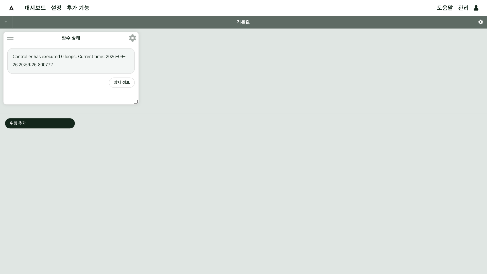

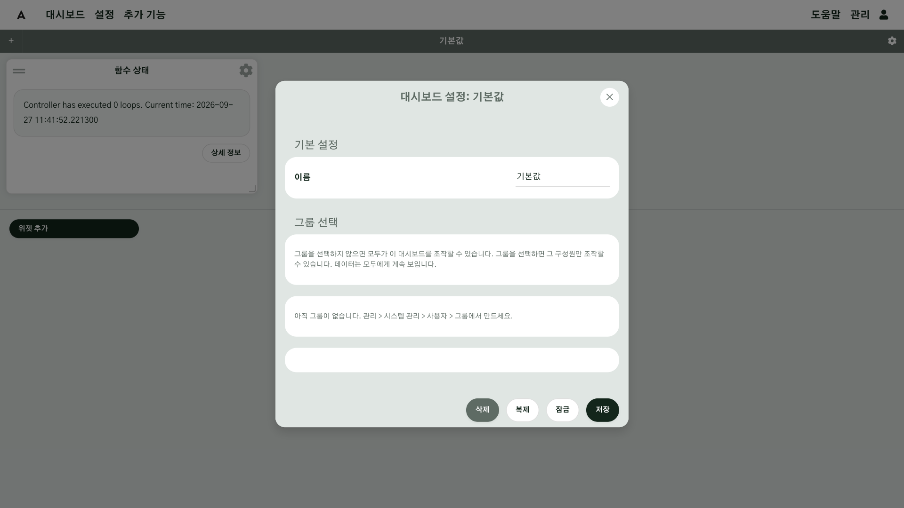

### 2. 위젯 추가하기 { #step-2 }

1. 탭의 톱니바퀴로 **대시보드 설정**을 열어 아래쪽 버튼을 확인합니다. **잠금 해제** 버튼이 보이면 탭이 잠긴 것이므로 눌러서 잠금을 풉니다.
   풀려 있으면 그 자리에 **잠금** 버튼이 보입니다. 잠겨 있으면 위젯을 추가·이동할 수 없습니다.
2. **위젯 추가** 목록에서 위젯을 고르면 설정 칸이 펼쳐집니다.
3. **이름**에는 위젯 종류 이름(예: "함수 상태")이 들어 있습니다. 같은 종류를 여러 개 둔다면 무엇을 보여 주는지 알 수 있게 바꿉니다.
4. **사용자 옵션**의 칸을 채우고 맨 아래 **위젯 추가**를 누릅니다.

그 종류의 위젯을 **처음** 추가할 때는 "10초 동안 기다려주세요" 화면이 나오고 웹 화면이 한 번 다시 시작됩니다.
잠시 기다리면 대시보드로 돌아오고, 추가한 위젯이 놓여 있습니다.

위젯은 머리 부분을 끌어 옮기고, 오른쪽 아래 모서리를 끌어 크기를 바꿉니다. 위치는 자동으로 저장됩니다.
위젯 설정은 바꾸는 즉시 저장되고, 마음에 들지 않으면 **되돌리기**를 눌러 설정 창을 열었을 때의 상태로 되돌립니다.
배치를 마쳤으면 대시보드 설정에서 **잠금**을 눌러 실수로 옮기지 않게 합니다. 잠금은 실수를 막기 위한 기능일 뿐
권한 설정이 아닙니다. 편집 권한이 있는 사람은 누구나 풀 수 있습니다.

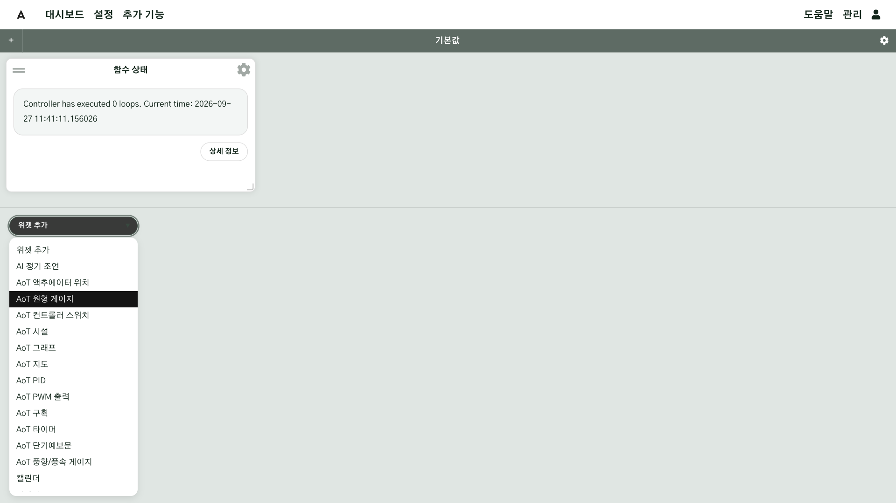

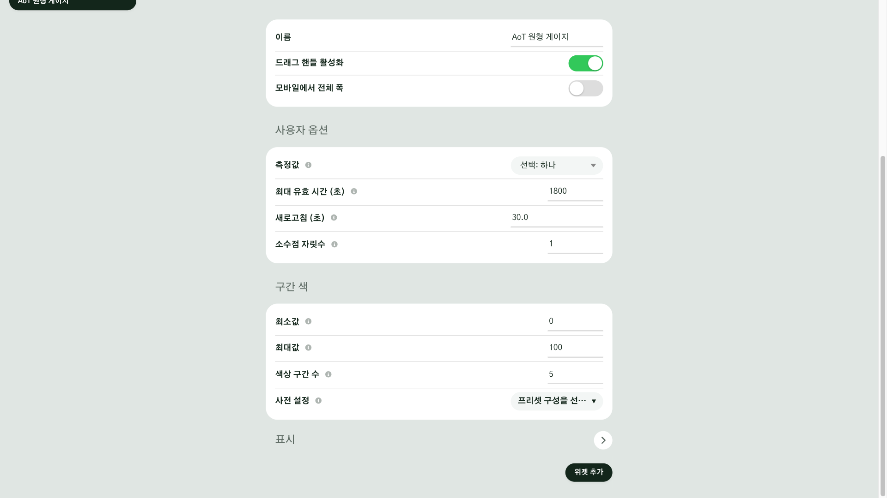

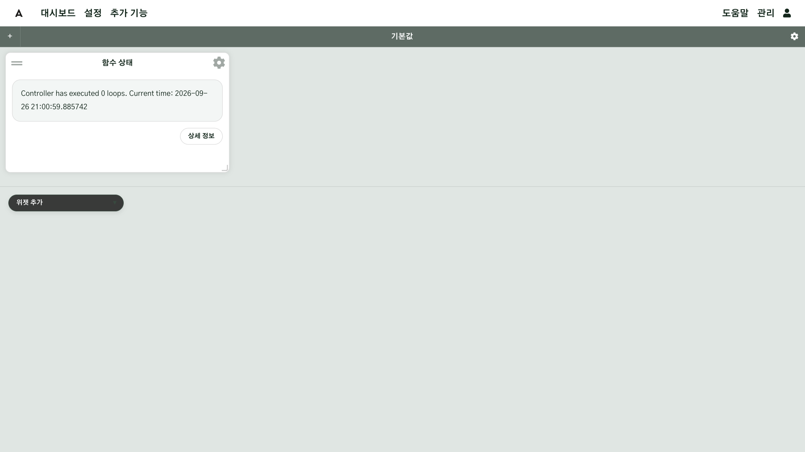

### 3. 자주 쓰는 위젯 { #step-3 }

| 위젯 | 보여 주는 것과 할 수 있는 일 | 꼭 고를 것 |
|---|---|---|
| AoT 지도 | 현장 지도와 그 위의 값·출력. 자세한 내용은 [4단계](#step-4)·[5단계](#step-5) | **지도 선택** |
| AoT 그래프 | 여러 값의 시간 변화. 확대하거나 기간 버튼으로 지난 값을 보고, 다시 현재 시점으로 돌아올 수 있습니다. 밤 시간 음영, 내보내기를 켤 수 있습니다 | **데이터 소스**(입력·함수·출력·노트 태그), 표시 기간 |
| AoT 원형 게이지, 게이지(솔리드) | 값 하나를 바늘·막대와 색 구간으로 | **측정값**, 최소값·최대값, 색 구간 |
| 함수 상태 | 함수 하나의 현재 상태. **상세 정보**로 옵션을 열어 고칠 수 있습니다(켜져 있는 함수는 고칠 수 없는 옵션이 있습니다) | **함수**(조건부·사용자 정의 함수. 시퀀스는 아래 위젯으로) |
| 시퀀스 컨트롤러 | 순차 관수 전체를 켜고 끄고, 실행할 요일과 시간대를 정합니다. 시간대는 공통 또는 요일별 | **시퀀스 함수** |
| AoT 타이머 | 출력 하나를 켜고 끄거나, 작동·휴식을 정한 횟수만큼 반복합니다. 서버에서 실행되므로 화면을 닫아도 계속됩니다 | **출력** |
| AoT 구획 | 구획 목록과 각 구획의 단계·목표 대비 현재 값·적산온도 | **지도 · 대지** |
| AoT 시설 | 시설의 3D 모형, 환경 값, 목표값, 장치 상태 | 시설의 환경 제어 함수 |
| 캘린더 | 예약 일정·노트·공지를 달력으로 | 보기 방식(월·주·목록) |
| 공지 & 노트 게시판 | 공지와 노트를 보고 씁니다 | 보여 줄 장소 |
| MCP 승인 요청 | AI 가 올린 조작 요청을 승인·거절합니다([AI·MCP 연결](g12-ai-mcp.md)) | 없음 |

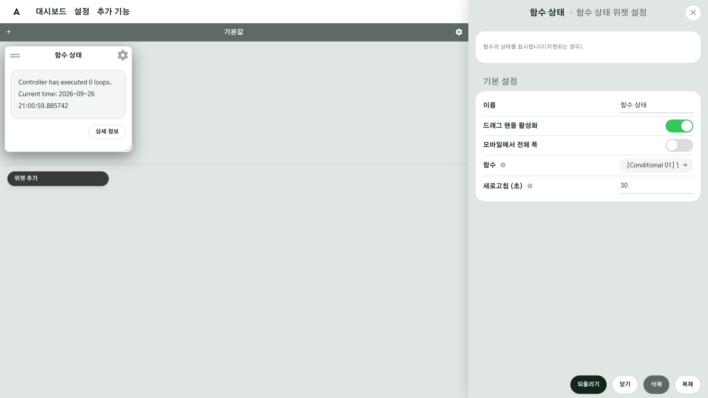

### 4. 지도 위젯 놓기 { #step-4 }

1. **위젯 추가**에서 **AoT 지도**를 고릅니다.
2. **지도 선택**에서 보여 줄 지도를 고릅니다. 비워 두면 가장 최근에 수정한 지도가 나옵니다.
   지도에 놓아 둔 장치는 모두 자동으로 나타나므로, 장치를 따로 고를 필요는 없습니다([지도 구성](g04-map.md)).
3. 필요하면 아래 항목을 설정합니다. 처음에는 그대로 두어도 됩니다.
   - **라벨 표시**: 지도 위 이름·값 글자 전체를 켜고 끕니다
   - **도형**: 지도에 그릴 도형 종류(대지·구역·구획·시설·설비·장치). 처음에는 구획만 켜져 있습니다
   - **장치 필터**: 지도에서 **숨길** 입력·출력·함수. 비워 두면 모두 보입니다
   - **데이터 전송 주기**: 위젯·값·출력 상태를 새로 불러오는 간격
   - **라벨 스타일**: 확대 정도에 따라 보일 라벨, 센서 표시 방식(원형·글자), 창을 열 때 먼저 보일 탭
   - 이 밖에 **데이터값만 표시 (지도 숨김)**, **AI 권고**, **현지 시각 표시**, **측정값 패널**, **3D 지도 (벡터 모드)** 같은 설정도 있습니다. 접힌 절은 눌러서 펼칩니다
4. **위젯 추가**를 누르고, 크기를 넉넉히 키웁니다. 지도 위젯은 다른 위젯보다 크게 두는 것이 좋습니다.

**지도 선택**을 바꾸면 저장된 보기 위치가 초기화됩니다.

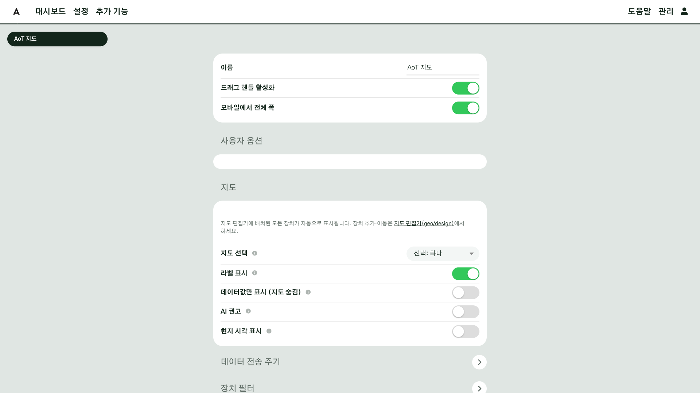

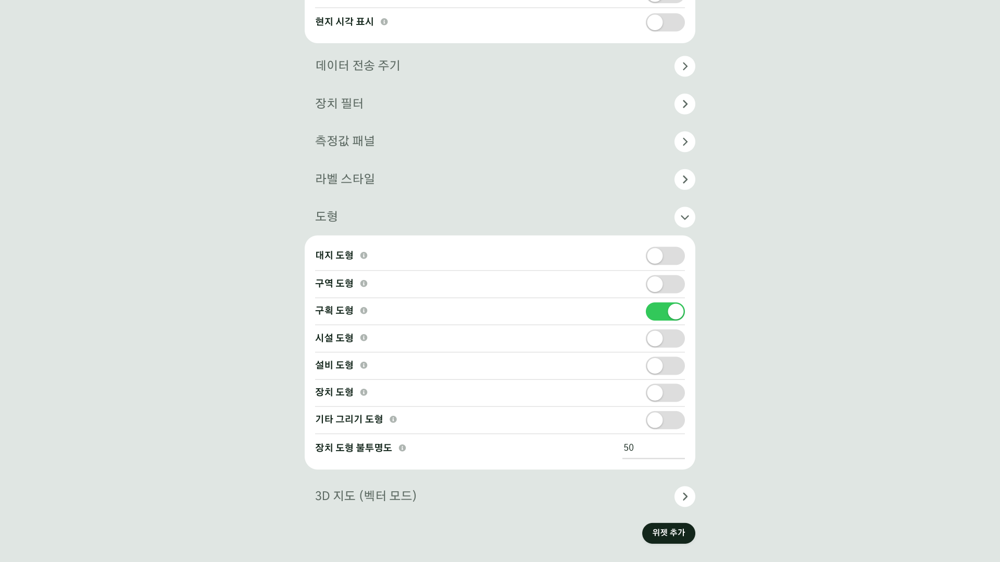

### 5. 지도 위젯 쓰기 { #step-5 }

**둘러보기**

- 왼쪽 도구: 확대·축소, 나침반, **전체화면**, **주소 검색**, **내 위치**, **뷰 초기화**, **대지 목록**.
  **뷰 초기화**를 누르면 지도가 비스듬히 기울어 천천히 한 바퀴 돌고, 다시 누르면 그 자리에서 멈춥니다
- **대지 목록**: 이 지도의 대지가 나옵니다. 대지를 누르면 그 안의 구역이 펼쳐지고, 한 번 더 누르면 지도가
  그 대지로 이동하고 대지 창이 열립니다. 구역을 누르면 구역 창이 열립니다. 제어 권한이 있으면 끌어서 순서를 바꿀 수 있습니다
- 오른쪽 도구: **레이어**(**기본 지도**를 하나 고르고, 등록된 오버레이·도형·라벨을 켜고 끄기), **거리 측정**, **노트 추가**(지도를 눌러 그 자리에 노트),
  입력·출력·구획·시설 라벨 켜고 끄기
- 위젯 제목 줄의 **지도 잠금**은 지도를 끌거나 확대하지 못하게 고정하고, **컨트롤 숨기기**는 도구 막대를 감춥니다.
  대시보드의 잠금과는 따로 동작합니다
- 옮기거나 확대한 보기는 자동으로 저장되어, 다음에 열 때 그 자리에서 시작합니다

**값 보기**

- 센서 표시를 누르면 그 입력의 모든 채널과 24시간 그래프, 통신 상태가 나옵니다
- 구역을 누르면 구역 창이 열리고 **현황 / 환경·제어 / 개요** 탭으로 나뉩니다. 현황에는 구획·환경 값·노트가 나오고,
  위험 요소나 관수 정보는 있을 때만 나옵니다. 환경·제어에는 센서별 그래프와 그 구역의 출력·함수 목록이,
  개요에는 사진과 넓이 같은 정보가 있습니다
- 대지를 누르면 대지 창이 열립니다. 현황에는 대지 안의 구역·시설 목록과 오늘의 조언·무응답 장치 수가 나옵니다
- 지도 위 시설 이름표를 누르면 시설 창이 열립니다. 여러 동이면 동을 골라 봅니다. 환경 제어 함수가 연결된 시설은 **시설 세부** 탭이 더 있습니다
- 구획을 누르면 단계·환경·설정을 볼 수 있습니다
- 창 위쪽의 **상위로**를 누르면 구역 → 대지 → 대지 목록처럼 한 단계 위로 올라갑니다

**출력 다루기**

- 출력 표시는 지도를 어느 정도 확대해야 나타납니다. 누르면 창에 **제어**, **이력**, **노트**가 차례로 나옵니다.
  켜고 끄는 출력은 스위치, 창·커튼은 **닫기 / 정지 / 열기**, 밝기처럼 세기를 정하는 출력은 슬라이더로 조작합니다
- 켜고 끄는 출력의 **설정**을 누르면 **시작 시각**과 **작동 시간**을 정해 예약할 수 있습니다. 작동 시간을 00:00 으로 두면
  직접 끌 때까지 켜져 있습니다. 같은 창에서 현재 예약 상황을 보고 **지금 끄기**로 멈출 수 있습니다
- 지도에서 누른 조작은 **바로 실행됩니다.** 승인 단계는 AI 가 올린 요청에만 있습니다. 누르기 전에 대상 출력을 확인하십시오
- 스위치·슬라이더·예약 버튼은 제어 권한이 있는 사용자에게만 보입니다. 모니터·게스트·키오스크 역할은 보기만 할 수 있습니다

**휴대폰에서**

창을 열면 지도가 전체 화면이 되고, 창은 세로 화면에서 아래에서 올라오고 가로 화면에서 옆에 붙습니다.
컴퓨터·태블릿에서는 창이 옆에 붙고 지도는 그대로 쓸 수 있습니다.

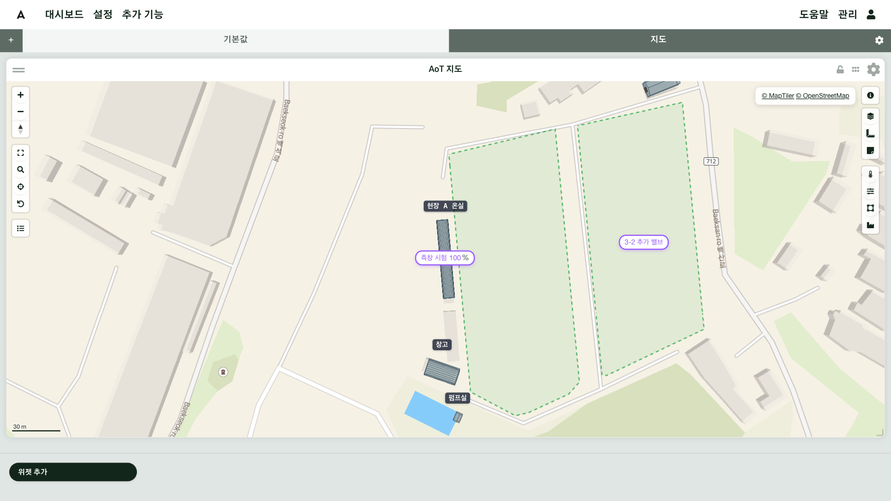

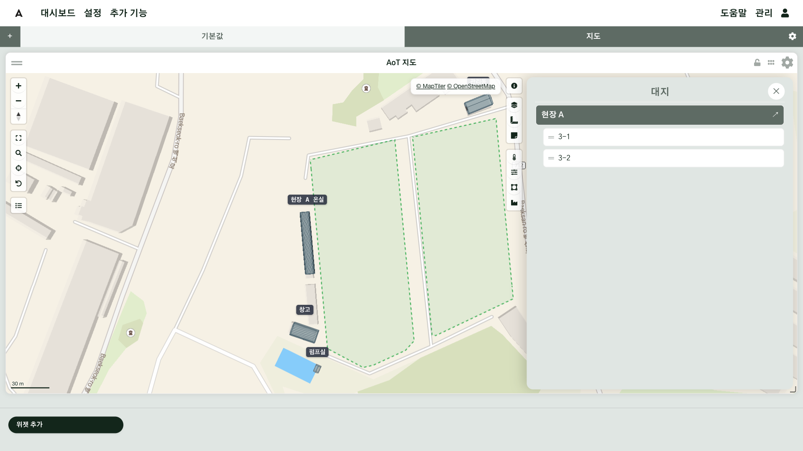

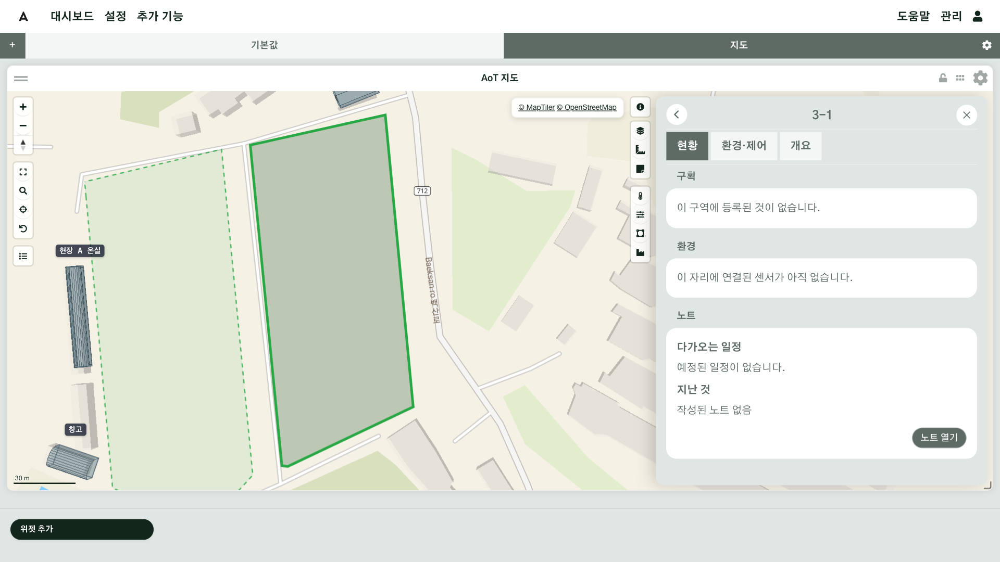

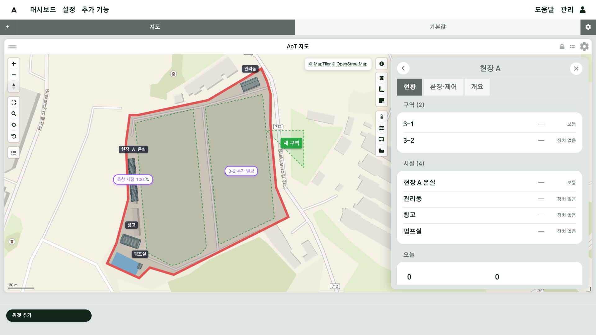

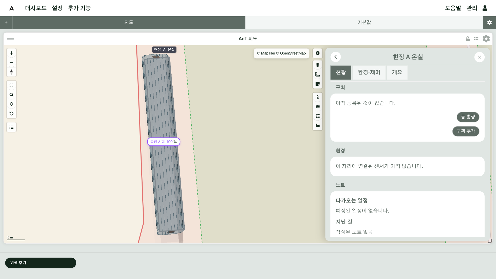

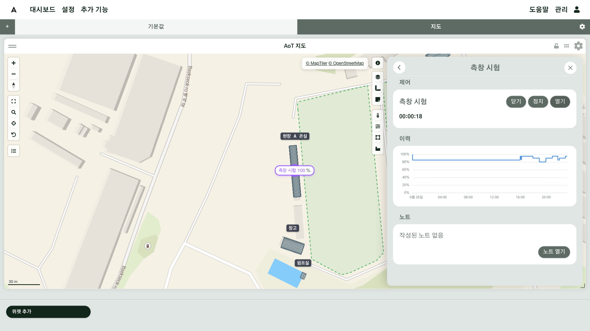

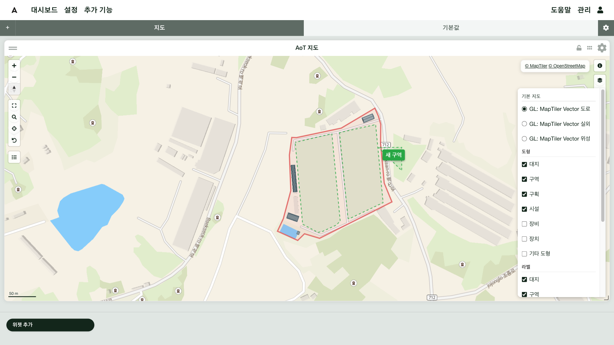

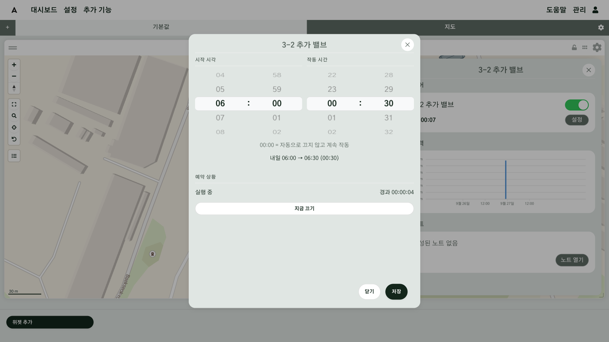

### 6. 휴대폰에서 보기 { #step-6 }

폭이 좁은 화면에서는 위젯이 두 줄로 다시 쌓입니다. 지도·시퀀스·타이머·구획·시설 위젯은 휴대폰에서
화면 폭을 가득 채우고, 다른 위젯도 설정의 **모바일에서 전체 폭**으로 바꿀 수 있습니다. 휴대폰에서 위젯을
옮겨도 컴퓨터 화면의 배치는 바뀌지 않습니다.

## 확인 { #check }

탭을 잠근 상태에서 **처음 보는 사람이 설명 없이** 현장 상태를 파악할 수 있으면 잘 구성된 것입니다.

- 같은 이름의 위젯이 여럿이거나 복제본 이름이 그대로 남은 위젯이 없는지
- 함수 상태 위젯이 "불러오기 실패"나 "비활성화됨"을 보이지 않는지(지운 함수나 꺼 둔 함수를 가리키고 있으면 그렇게 나옵니다)
- 지도 위젯의 **대지 목록**으로 대지와 구역 사이를 이동할 수 있는지
- 휴대폰으로 열어 봐도 읽을 수 있는지

## 현장 A { #site-a }

| 탭 | 위젯 |
|---|---|
| 현장 A 한눈에 | 지도(대지 전체), 게이지(3-1·3-2 토양 수분, 온실 온도·습도), 함수 상태(온실 환경 제어) |
| 현장 A 관수 | 시퀀스 컨트롤러(노지 순차 관수, 3-2 추가 공급), 그래프(토양 수분 3-1·3-2) |
| 현장 A 온실 | 시설 위젯, 그래프(온도·습도·VPD), 함수 상태 |

그래프에는 **실제로 작동 중인 함수와 센서만** 넣습니다. 꺼 둔 함수를 가리키는 그래프는 빈 선만 그립니다.

## 현장 B { #site-b }

| 탭 | 위젯 |
|---|---|
| 현장 B 온실 | 지도, 게이지(VPD·온도·습도·풍속), 그래프(온실 환경), 함수 상태(환경 제어) |

현장 B 는 탭 하나로 충분합니다. 온실 옆 벽걸이 화면에는 이 탭을 랜딩 페이지로 정한 모니터 계정으로 로그인해 표시합니다.

## 안 될 때 { #trouble }

| 증상 | 확인할 것 |
|---|---|
| 위젯 추가 목록이 안 보인다 | 탭이 잠겨 있거나, 편집 권한이 없는 계정입니다 |
| 지도 위젯에 장치가 없다 | 장치를 지도에 놓지 않았거나, **장치 필터**에 넣어 숨겼습니다([센서 연결 7단계](g05-sensors.md#step-7)) |
| 지도 위젯에 대지·구역 도형이 안 보인다 | 위젯 설정의 **도형**에서 대지·구역을 켭니다 |
| 지도에서 출력 스위치가 안 보인다 | 제어 권한이 없는 역할입니다 |
| 지도 위젯이 엉뚱한 곳을 보여 준다 | 끌어 옮긴 보기가 저장된 것입니다. **대지 목록**에서 대지를 눌러 돌아갑니다 |
| 게이지가 비어 있다 | 값이 최대 유효 시간보다 오래되었습니다. 센서가 끊겼는지 봅니다 |
| 화면이 느리다 | 한 탭의 그래프 수를 줄이고 새로고침 주기를 늘리십시오 |
| 어떤 사람만 탭을 조작하지 못하거나 탭이 보이지 않는다 | 탭에 그룹이 지정되어 있습니다([주요 설정 3단계](g02-settings.md#step-3)) |

## 더 알아보기 { #more }

- [대시보드](../Data-Viewing.md#dashboard)
- [주요 위젯](../Data-Viewing.md#key-widgets)
- [지원 위젯 목록](../Supported-Widgets.md)
- [지도 위젯](../geo/map-widget.md)
