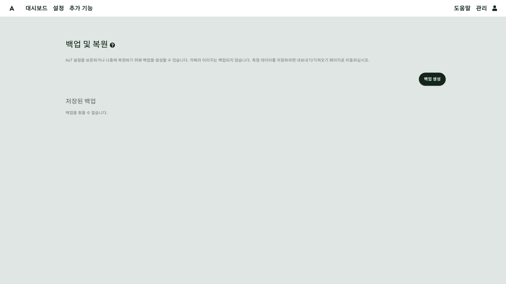
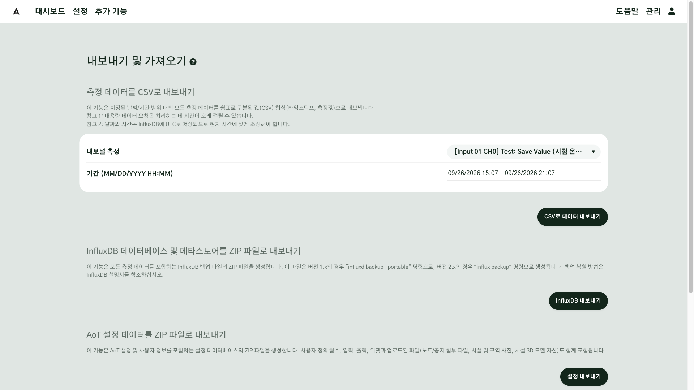
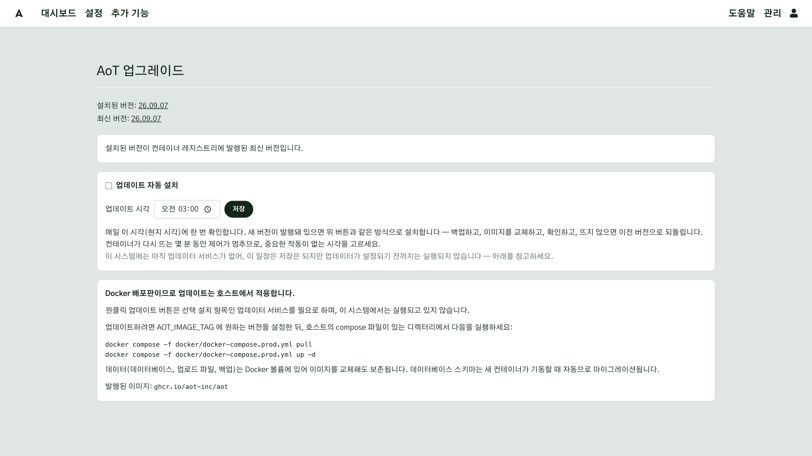

# 주의사항

AoT 로 실제 장비를 움직이기 시작하면, 소프트웨어의 작은 설정 하나도 현장에 그대로 영향을 줍니다. 이 장은
운영하면서 사고로 이어지기 쉬운 부분을 한곳에 모았습니다. 설치 전에 한 번, 운영을 시작한 뒤 한 번 더 읽으십시오.

## 이 장을 마치면 { #goal }

- 운영하면서 사고로 이어지기 쉬운 부분을 미리 안다
- 백업·업데이트·정전에 대비한 습관을 정한다

## 준비 { #prepare }

이 장은 읽기만 합니다. 각 절 끝의 점검 항목을 내 현장에 맞춰 확인하십시오.

## 절차 { #steps }

### 1. 백업 { #step-1 }

- 관리 → **백업 복원**에서 **백업 생성**을 누르면 설정 데이터베이스, 업로드한 파일(노트·공지·시설 사진), 사용자 스크립트가 저장됩니다.
- **측정 기록은 이 백업에 들어가지 않습니다.** 측정값은 추가 기능 → **가져오기 내보내기**를 누르면 열리는 **내보내기 및 가져오기** 화면에서 따로 내보냅니다.
- 복원과 백업 내려받기는 관리자만 할 수 있습니다. 복원하기 전에 AoT 가 현재 상태를 자동으로 한 번 더 백업합니다.
- Docker 로 설치했다면 AoT 컴퓨터 자체가 고장 날 때를 대비해, 백업 파일을 **다른 컴퓨터로** 내려받아 두십시오.

**점검**: 업데이트 전·큰 설정 변경 전에 백업했는가? 내려받은 백업이 AoT 컴퓨터 밖에 있는가?

<!-- 확인 필요: task_78eb959c 결과(측정값·지도 오버레이 포함 여부)에 따라 고친다 -->

### 2. 업데이트 { #step-2 }

- `docker/.env` 의 `AOT_IMAGE_TAG` 에 **정확한 버전**을 적어 둡니다. 문제가 생기면 이전 버전을 적고 다시 실행하면 됩니다.
- 업데이트하는 동안 제어가 멈춥니다. 진행 중이던 관수·시퀀스는 중단됩니다. **장비가 쉬는 시간에** 하십시오.
- 자동 업데이트(업데이터)는 출력이 켜져 있어도 미루지 않습니다. 자동 업데이트를 켜려면 작업이 없는 시각으로 정하십시오.
- 업데이트 전에 [백업](#step-1)하고, 릴리스 노트의 "업그레이드 시 주의"를 읽습니다.

**점검**: 버전을 고정했는가? 업데이트 시각이 장비 작업 시간과 겹치지 않는가?

### 3. 정전과 재시작 { #step-3 }

- 출력의 **시작 상태**는 AoT 가 켜질 때 적용됩니다. 밸브·펌프는 **끔**으로 설정하십시오([출력 연결 5단계](g06-outputs.md#step-5)).
- **종료 상태**는 AoT 를 정상적으로 끌 때만 적용됩니다. 갑자기 전기가 나가면 적용되지 않습니다. 이때 장비가
  어떤 상태로 남는지는 **릴레이·컨트롤러의 특성**에 따라 다르므로 설치할 때 직접 확인하십시오.
- 순차 관수는 재시작 뒤 멈춘 자리부터 이어서 실행됩니다. 타이머도 진행 중이던 주기를 이어 갑니다.
- 환경 제어는 직전 판단을 기억했다가 이어서 제어합니다. 창·커튼의 열림 % 도 기억하지만, 움직이던 중에 꺼졌다면
  실제와 다를 수 있으니 재시작 뒤 **닫기**로 한 번 맞추십시오.

**점검**: 전원을 한 번 내렸다 올려 보고, 모든 장비가 기대한 상태로 돌아오는지 확인했는가?

### 4. 안전은 하드웨어에 { #step-4 }

AoT 는 소프트웨어입니다. 통신이 끊기거나 AoT 컴퓨터가 멈추면 명령을 보낼 수 없습니다. 사람이나 설비를
다치게 할 수 있는 상황은 **소프트웨어가 아니라 하드웨어로** 막으십시오.

- 창·커튼 모터: 끝 스위치(리밋 스위치)와 열기·닫기 전기적 연동
- 펌프: 물 없이 공회전하지 않게 하는 보호 장치, 압력 스위치
- 난방기: 과열 차단기
- 열기/닫기 두 릴레이로 움직이는 설비는 **묶은 출력**으로만 움직입니다([출력 연결 4단계](g06-outputs.md#step-4))

**점검**: AoT 가 꺼져 있어도 위험하지 않은가?

### 5. 센서가 끊겼을 때 { #step-5 }

- 환경 제어는 실내 센서가 끊기면 장치를 **그 자리에 둡니다.** 바깥 비·바람이 끊기면 창을 더 열지 않습니다.
  멈춘 것처럼 보일 수 있으니 [모니터링](g09-monitoring.md#step-2)으로 끊긴 센서를 찾으십시오.
- 끊김을 사람이 알 수 있게 [이메일 알림](g08-email.md)을 설정해 두십시오.
- 센서의 **측정 유효 수명**을 센서가 값을 보내는 간격에 맞게 설정해야 끊김을 제때 알아챌 수 있습니다([센서 연결 2단계](g05-sensors.md#step-2)).

### 6. 시간 { #step-6 }

- 예약·순차 관수·일출/일몰은 **장치 → 구역·대지 → 시스템 시간대** 순서로 찾은 시간대의 시각을 씁니다. 한 현장만 쓴다면
  시스템 시간대만 맞게 설정하면 됩니다([주요 설정 1단계](g02-settings.md#step-1)).
- 일출·일몰은 지도에 그린 현장 위치로 계산합니다. 지도 위치가 틀리면 일출 시각도 틀립니다.
- 그래프 시각은 **보는 사람의 브라우저 시각**으로 나올 수 있습니다. 다른 시간대에서 볼 때 주의하십시오.

### 7. 이름 짓기 { #step-7 }

이름은 화면·알림 메일·AI 의 답에 그대로 나옵니다. 이름이 모호하면 사람도 AI 도 엉뚱한 대상을 가리킬 수 있습니다.

- 기본 이름("New Design Map", "New site", "Widget Name", "Name", "Output 1")을 남기지 마십시오.
- **같은 이름을 두 번 쓰지 마십시오.** 시험하려고 복제한 함수나 제어기는 시험이 끝나면 지웁니다.
- 이름에 **어디의 무엇인지**를 넣습니다: "환경 제어: 현장 B 온실", "3-1 밸브 1".
- 지도·장치 이름에 다른 현장의 이름을 재사용하지 마십시오(예: 두 현장에 모두 "육묘장").

### 8. 권한과 AI { #step-8 }

- 장치를 조작할 수 있는 사람은 관리자와 편집자입니다. 보기만 할 사람은 모니터 역할로 만드십시오.
- AI 가 장치를 움직이거나 일정을 바꾸려 할 때는 사람이 **AI → 요청** 화면에서 승인해야 실행됩니다. 승인
  요청은 15분이 지나면 사라집니다.
- AI 도구에 발급한 API 키는 발급할 때 한 번만 보입니다. "읽기 전용"으로 만들 수 있으면 그렇게 하십시오.
- 외부에서 접속할 수 있게 했다면([네트워크 연결](g03-network.md)) 모든 계정의 비밀번호를 길게 정하십시오.

### 9. LoRaWAN 장비 { #step-9 }

- 명령은 현장 전체에서 하나의 대기열에 모여 1.5초 이상 간격을 두고 차례로 나갑니다. 밸브 여러 개를 한꺼번에 움직이면 마지막 밸브가 늦게 움직입니다.
- 30초 넘게 기다린 명령은 버려지고 실패로 처리됩니다.
- 전력을 아끼는 장치(Class A)는 다음에 스스로 값을 보낼 때까지 명령을 받지 못합니다. 몇 분 늦을 수 있습니다.
- 그래서 **LoRaWAN 밸브로 짧은 간격의 정밀 제어를 하지 마십시오.** 몇 분 단위의 관수에 알맞습니다.

### 10. 시험은 가상 장비로 { #step-10 }

- 새 함수·새 설정은 먼저 **가상 출력**과 **시험 입력**으로 확인한 뒤 실제 장비에 연결합니다([함수 4단계](g07-functions.md#step-4)).
- 실제 장비를 처음 움직일 때는 **사람이 장비 옆에 있을 때** 하십시오.
- 운영 중인 장비에서 이것저것 눌러 보며 시험하지 마십시오.

## 확인 { #check }

아래 질문에 모두 "예"라고 답할 수 있으면 운영을 시작해도 됩니다.

- 최근 백업이 AoT 컴퓨터 밖에 있다
- 버전을 고정했고, 업데이트 시각이 작업 시간과 겹치지 않는다
- 전원을 내렸다 올려 보고 모든 장비가 기대한 상태로 돌아오는 것을 확인했다
- AoT 가 꺼져도 위험하지 않도록 하드웨어 보호 장치가 있다
- 끊긴 센서를 메일로 알 수 있다
- 기본 이름·중복 이름이 없다

## 현장 A { #site-a }

- 노지 밸브는 LoRaWAN 이라 명령이 늦을 수 있습니다. 관수 시퀀스의 밸브 동작 시간은 분 단위로 정합니다.
- 온실 구획(상추)을 수확한 뒤 구획을 끝내지 않으면, 환경 제어가 지난 단계의 목표를 계속 씁니다. 수확하면 구획도 끝냅니다.

## 현장 B { #site-b }

- 기존 제어반 릴레이를 쓰므로, 제어반의 수동 스위치로 창을 움직이면 AoT 가 기억한 열림 % 와 달라집니다.
  수동으로 움직였다면 AoT 에서 **닫기**로 한 번 맞춥니다.
- 설정을 바꿔 보려고 환경 제어기를 복제했다면, 시험이 끝난 뒤 쓰지 않는 제어기를 지웁니다. 같은 이름의 제어기가 둘이면 어느 것이 실행 중인지 헷갈립니다.

## 안 될 때 { #trouble }

이 장의 내용과 실제 동작이 다르면 버전을 확인하고([설치](g01-install.md#step-4)), 관리 → 시스템 로그의
기록과 함께 문의하십시오.

## 더 알아보기 { #more }

- [업그레이드·백업·복원](../Upgrade-Backup-Restore.md)
- [내보내기/가져오기](../Export-Import.md)
- [출력](../Outputs.md)
- [시간과 시간대](../time-handling.md)
- [보안](../Security.md)
- [LoRaWAN 다운링크 간격](../LoRaWAN-ChirpStack.md#pacing)
