# 설정

지금까지는 입력, 출력, 함수처럼 현장에 붙이는 것들을 만들었습니다. 이 장에서는 여러 사람이 함께 쓰고 시스템 전체에 걸리는 규칙을 정합니다. 누가 로그인하고 무엇을 할 수 있는지, 시스템이 어느 시간대로 움직이는지, 센서가 주는 단위를 어떻게 바꿔 볼지, 날씨 같은 외부 서비스의 키를 어디에 모아 둘지, 그리고 시스템이 알림 이메일을 보낼 계정을 무엇으로 할지입니다.

**설정이라는 말은 두 곳에 나옵니다.** 위쪽 메뉴의 **설정**에는 입력·출력·함수처럼 현장에 붙이는 것들이 있고, 이 장에서 다루는 곳은 **관리 → 시스템 관리**입니다. 사용자, 시간대, 알림 같은 시스템 전체의 규칙을 정하는 곳입니다.

## 이 장을 마치면 { #goal }

- 시스템 시간대를 확인하고, 시스템 시간대와 개인 시간대가 다르다는 것을 안다
- 사람마다 계정을 만들고 역할을 준다
- 그룹이 무엇을 제한하는지 알고, 권한이 없을 때 화면이 어떻게 나오는지 안다
- 센서가 주는 단위와 보고 싶은 단위가 다를 때 단위 변환을 쓴다
- 외부 서비스의 키를 API 키 관리에 넣는다
- 알림 이메일을 보낼 계정을 연결하고 테스트 이메일로 확인한다

## 준비 { #prepare }

- 시스템 관리를 열 수 있는 관리자 계정([출력](g08-output.md)까지 만든 시스템)
- 알림 이메일을 보낼 이메일 계정. 지메일이라면 구글 계정에서 **앱 비밀번호**를 만들어 둡니다([11단계](#step-11) 참고)
- 계정을 만들 사람들의 이름과 이메일, 각자 맡을 일

!!! warning "비밀번호와 키는 아무에게도 보여 주지 마세요"
    사용자 비밀번호, 이메일 계정의 비밀번호, 외부 서비스의 키는 화면에 입력하는 용도로만 씁니다. 다른 사람에게도, AI 에게도 보여 주지 마세요. AI 에게 도움을 받을 때는 화면에 오류가 나온 부분의 문구만 알려 주세요.

## 절차 { #steps }

### 1. 시스템 관리 훑어보기 { #step-1 }

위쪽 메뉴의 **관리**에서 **시스템 관리**를 엽니다. 왼쪽에 항목이 늘어서 있습니다. **일반 설정**, **사용자 정의 UI**, **사용자 입력**, **사용자 출력**, **사용자 함수**, **사용자 작업**, **사용자 위젯**, **ChirpStack**, **측정값**, **API 키 관리**, **이름 번역**, **연동**, **사용자**, **라즈베리파이**, **알림**, **진단**의 열여섯 가지이고, 모두 시스템 전체에 걸린 것들입니다. 처음에는 한 번 훑어만 보고, 필요할 때 그 항목으로 돌아오세요. 이 장에서 쓰는 곳은 다섯 곳입니다. **일반 설정**, **사용자**, **측정값**, **API 키 관리**, 그리고 **알림**입니다.

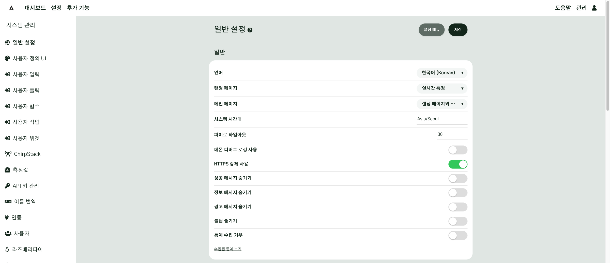

### 2. 시스템 시간대와 언어 { #step-2 }

**일반 설정**에서 먼저 **시스템 시간대**를 확인합니다. 시스템 시간대는 데몬 로그에 찍히는 시각과, 위치가 없는 장치의 시간 기준이 됩니다. 현장의 시간대(예: `Asia/Seoul`)가 맞게 들어 있으면 그대로 두고, 다르면 고친 뒤 화면 위의 **저장**을 누르세요. 위치가 있는 장치는 위치의 시간대를 따릅니다.

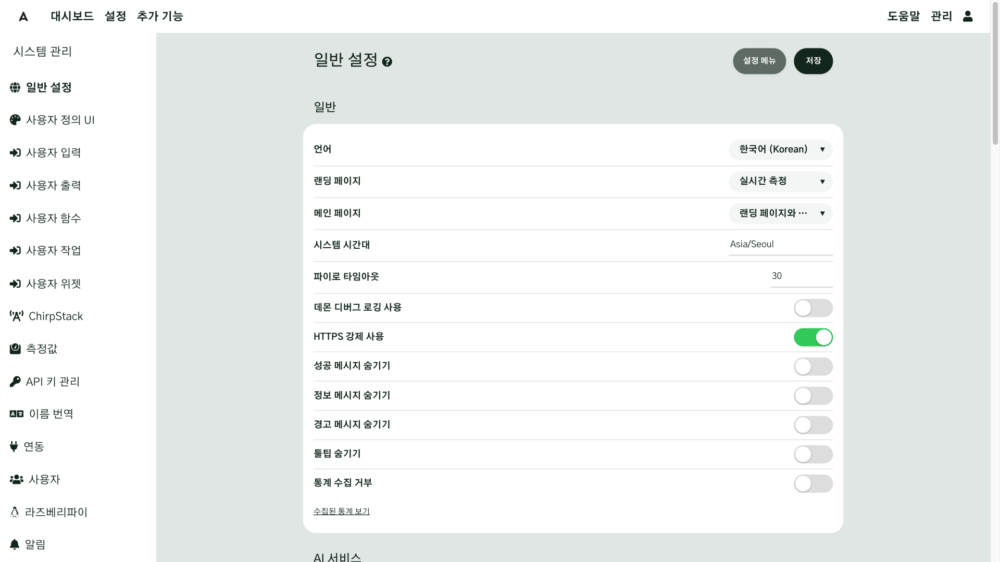

**언어**와 **랜딩 페이지**(로그인한 뒤 처음 나오는 화면)는 로그인한 사람마다 각자 고릅니다.

시간대는 두 가지입니다.

| 종류 | 무엇의 기준인가 | 어디서 정하나 |
|---|---|---|
| 시스템 시간대 | 시스템 전체의 기본 시간. 로그와 위치 없는 장치의 기준 | 시스템 관리 → 일반 설정 |
| 개인 시간대 | 사람이 읽고 쓰는 시각 | 각자 계정의 **사용자 설정** |

### 3. 사용자 계정 만들기 { #step-3 }

사람마다 계정을 만들고, 역할로 할 수 있는 일을 정합니다. 사무실 출입증과 같습니다. 출입증마다 열 수 있는 문이 다르듯, 계정마다 할 수 있는 일이 다릅니다. 시스템 관리의 **사용자**를 열면 화면 제목이 **사용자 설정**이고, **사용자**·**역할**·**그룹**·**일반** 탭이 있습니다. **사용자** 탭에서 **사용자 추가**를 누르면 오른쪽에 창이 열립니다.

1. **로그인 계정**에 영문자와 숫자로 계정 이름을 넣습니다(3자에서 64자, 대소문자는 구분하지 않고 소문자로 바뀝니다).
2. **이름**, **이메일**을 넣습니다.
3. **비밀번호**와 **비밀번호 확인**을 넣습니다(8자 이상).
4. **역할**을 고릅니다. 역할은 [다음 단계](#step-4)에서 설명합니다.
5. 창 아래의 **사용자 추가**를 누릅니다.

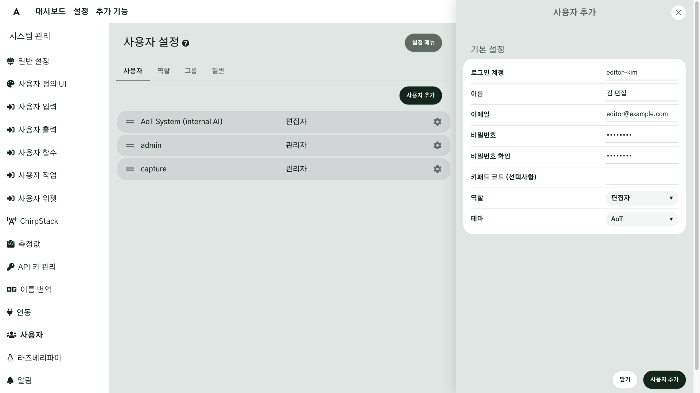

로그인 계정은 만든 뒤에는 바꿀 수 없으니 신중하게 정하세요.

!!! warning "한 계정을 여럿이 같이 쓰지 마세요"
    한 계정을 여럿이 같이 쓰면 감사 로그에서 누가 했는지 구분할 수 없습니다. 사람 수만큼 계정을 나누세요.

!!! note "이름이 같은 화면이 둘 있습니다"
    **관리** 메뉴의 **사용자 설정**은 로그인한 본인의 계정 창이고, 시스템 관리의 **사용자** 화면 제목도 **사용자 설정**입니다. 개인 시간대나 본인 비밀번호는 앞의 것에서, 사람들의 계정을 만들고 역할을 정하는 일은 뒤의 것에서 합니다.

### 4. 역할 고르기 { #step-4 }

역할은 그 계정이 **무엇을** 할 수 있는지를 정합니다. **사용자** 화면의 **역할** 탭에 기본 역할 다섯 가지가 카드로 나옵니다. 관리자 말고는 카드를 눌러서 권한 스위치를 켜고 끌 수 있습니다.

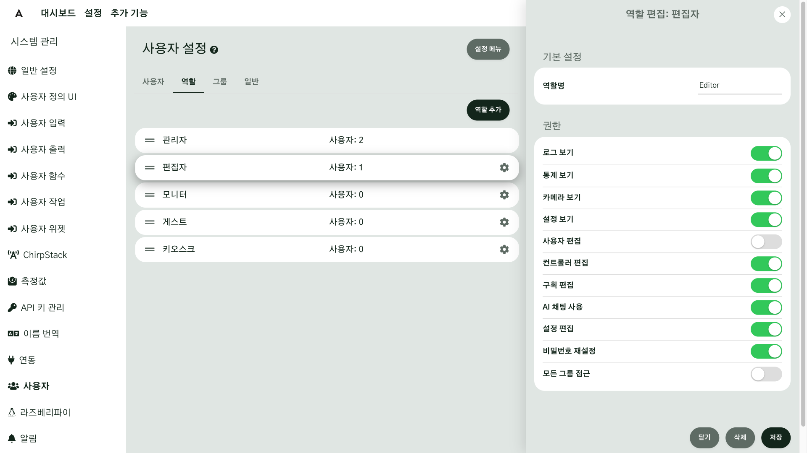

| 역할 | 할 수 있는 일 |
|---|---|
| 관리자 | 모든 것. 사용자와 권한까지 |
| 편집자 | 설정을 편집할 수 있습니다. 사용자 관리는 못 합니다 |
| 모니터 | 볼 수만 있고, 바꾸지는 못합니다 |
| 게스트 | 아무것도 못 합니다 |
| 키오스크 | 카메라와 통계를 보여 주는 용도입니다 |

사람에 맞춰 역할을 나누세요. 현장 A 는 관리자, 편집자, 모니터 계정을 사람마다 나눕니다. 현장 B 는 제어실 벽걸이 모니터에 쓸 계정을 따로 만들고, 설정을 바꿀 수 없는 모니터 역할을 줍니다.

### 5. 권한이 없으면 { #step-5 }

역할에 없는 일은 막힙니다. 권한이 없는 화면을 열면 홈 화면으로 돌아가고, 권한이 없다는 메시지가 뜹니다. 아래는 모니터 역할 계정이 백업 복원 화면을 열었을 때의 모습입니다.

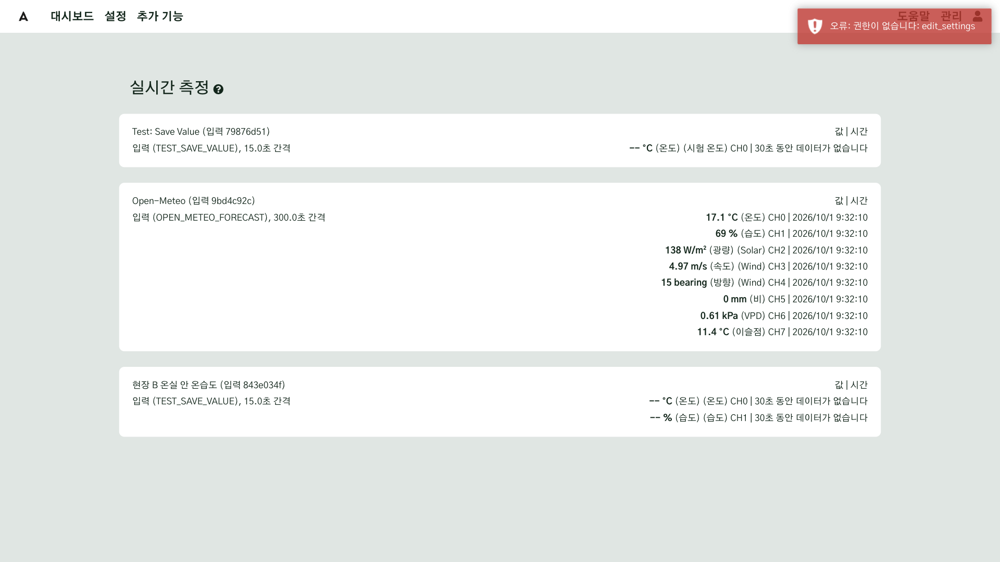

메시지 끝의 영어 이름은 모자란 권한의 이름입니다. 여기서는 역할 창의 **설정 편집** 권한입니다. 위쪽 메뉴는 그대로 보이니, 눌렀는데 막히면 그 계정의 역할에 그 권한이 없다는 뜻입니다. 필요한 계정이라면 관리자가 역할을 바꿔 주세요.

### 6. 그룹 { #step-6 }

그룹은 **어디에 대해** 조작할 수 있는지를 정합니다. 역할이 무엇을 할 수 있는지라면, 그룹은 어디에 대해서인지입니다.

| 정하는 것 | 묻는 것 |
|---|---|
| 역할 | 무엇을 할 수 있나 |
| 그룹 | 어디에 대해서인가 |

**둘 다 맞아야 조작할 수 있습니다.** 그룹은 조작할 수 있는 사람만 제한하고, 모든 사용자는 그대로 전체 데이터를 볼 수 있습니다.

**사용자** 화면의 **그룹** 탭에서 **그룹 추가**를 눌러 **그룹 이름**과 **설명**을 넣고 만듭니다. 구성원과 부여 자원은 그룹을 만든 뒤에 정합니다.

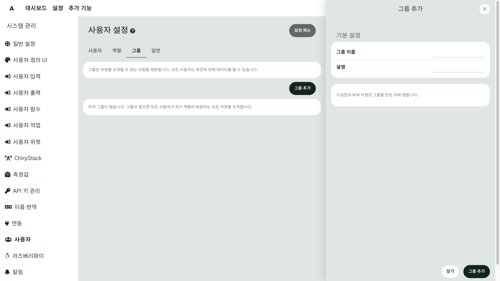

그룹을 자원에 거는 곳은 이 화면이 아니라 그 자원의 설정입니다. [5장](g05-dashboard.md)에서 본 대시보드 탭의 **그룹 선택**이 바로 이 그룹입니다.

!!! warning "그룹을 처음 거는 순간, 그 그룹이 아닌 사용자는 조작 권한을 잃습니다"
    그룹이 없으면 모든 사용자가 자기 역할이 허용하는 모든 것을 조작합니다. 어떤 탭에 그룹을 처음 거는 순간부터는 그 그룹의 구성원만 그 탭을 조작할 수 있습니다. 대시보드 탭 설정에서 그룹을 고를 때는 저장하기 전에 조작을 잃는 사람이 화면에 나오니, 꼭 확인하세요. 역할에서 **모든 그룹 접근**이 켜진 사용자(기본 관리자 역할)는 그룹과 관계없이 조작할 수 있습니다.

### 7. 로그인 보호 { #step-7 }

로그인 보호는 기본으로 켜져 있습니다. 한 계정에서 비밀번호를 5번 틀리면, 그 계정은 10분 동안 잠깁니다. 이 값은 바꿀 수 없습니다. 비밀번호가 기억나지 않으면 잠금이 풀리기를 기다린 뒤 다시 시도하세요.

### 8. 단위 변환 등록하기 { #step-8 }

센서가 주는 단위와 보고 싶은 단위가 다를 때는 단위 변환을 씁니다. 환율처럼, 같은 값을 다른 단위로 바꿔서 봅니다. 시스템 관리의 **측정값**(화면 제목은 **측정값 설정**)에서 새 측정, 단위, 변환식을 등록합니다.

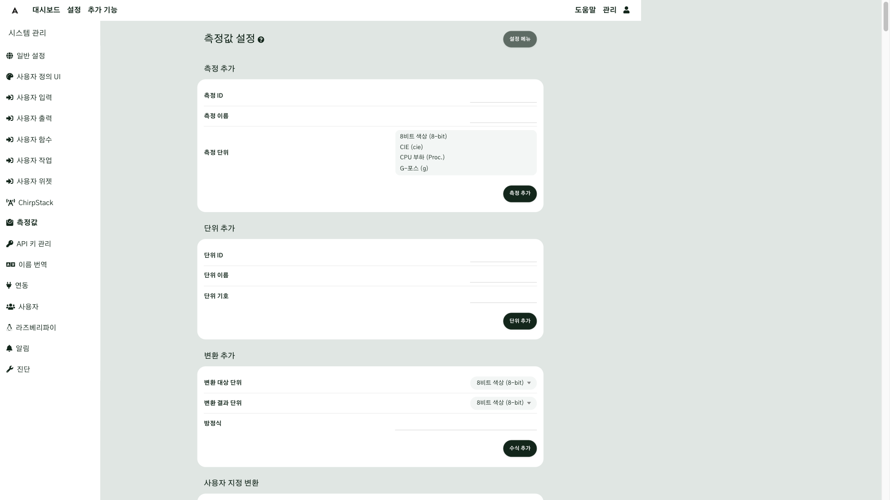

1. **단위 추가**: 새 단위가 필요하면 **단위 ID**, **단위 이름**, **단위 기호**를 넣고 **단위 추가**를 누릅니다. 단위를 먼저 만들어 두어야 측정을 만들 때 고를 수 있습니다.
2. **측정 추가**: 새 종류의 측정이 필요하면 **측정 ID**, **측정 이름**을 넣고 **측정 단위**에서 관련된 단위를 고른 뒤 **측정 추가**를 누릅니다.
3. **변환 추가**: **변환 대상 단위**와 **변환 결과 단위**를 고르고, **방정식**에 변환식을 넣은 뒤 **수식 추가**를 누릅니다. 식에는 소문자 `x`가 들어가야 하고 실제 측정값이 그 자리에 대신 들어갑니다(예: `x/1000+20`).

기본 단위로 충분하다면 등록하지 않아도 됩니다.

### 9. 입력마다 변환 고르기 { #step-9 }

등록한 변환은 그 값을 쓰는 입력의 채널 설정에서 고릅니다. **설정 → 입력**에서 입력의 톱니바퀴를 눌러 설정 창을 열고, 채널마다 있는 **단위 변환** 선택 상자에서 **변환 없음**이나, 그 단위에서 갈 수 있는 단위를 고르세요.

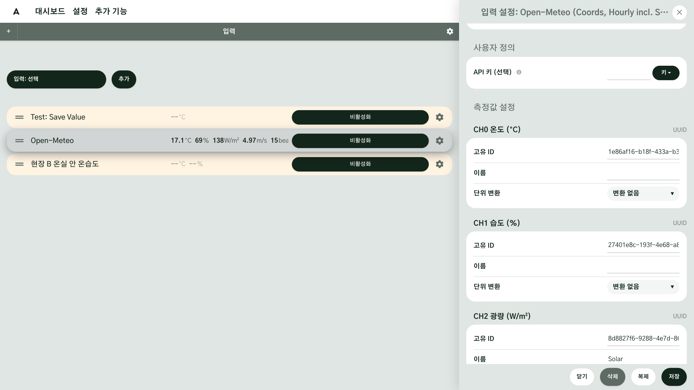

### 10. 외부 서비스 키 모으기 { #step-10 }

날씨 같은 외부 서비스의 키는 **API 키 관리**에 모아 둡니다. [4장](g04-first-value.md)에서 본 기상청 같은 키를 여기에 넣어 두면, 입력을 만들 때 골라서 쓸 수 있습니다. **새 API 키 추가**를 누르고 **이름**, **제공자/제조사**, 필요하면 **태그**와 **관련 URL**, **설명**을 넣은 뒤 **API 키**에 키 본문을 넣고 **추가**를 누릅니다.

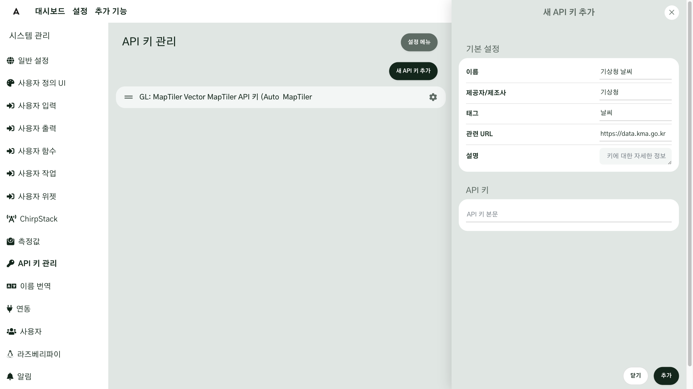

키는 다른 사람에게도 AI 에게도 보여 주지 마세요.

### 11. 알림 이메일을 보낼 계정 연결하기 { #step-11 }

[다음 장](g12-alerts.md)에서 다룰 알림 이메일을 받으려면, 먼저 시스템이 이메일을 보낼 계정을 연결해야 합니다. 알림 이메일은 AoT 에서 이메일 서버를 거쳐 받는 사람에게 갑니다. 시스템이 이메일을 보내려면 그 서버에 로그인할 계정이 연결되어 있어야 하고, 다음 장에서 다룰 알림 이메일은 모두 이 계정을 통해 나갑니다.

**AoT → 이메일 서버 → 받는 사람**

시스템 관리의 **알림**을 열면 **알림 설정**의 **SMTP 설정**이 나옵니다. 이메일 서버의 **SMTP 호스트**와 **SMTP 포트**, **SMTP 프로토콜**을 고르고, **SMTP 사용자**와 **SMTP 비밀번호**, **보낸 사람 이메일**을 넣은 뒤 **저장**을 누릅니다. 포트를 비워 두면 프로토콜에 맞는 기본 포트를 씁니다(SSL 465, TLS 587, 암호화되지 않음 25). 비밀번호는 저장한 뒤에는 화면에 보이지 않고, 비워 두면 저장된 비밀번호가 그대로 유지됩니다.

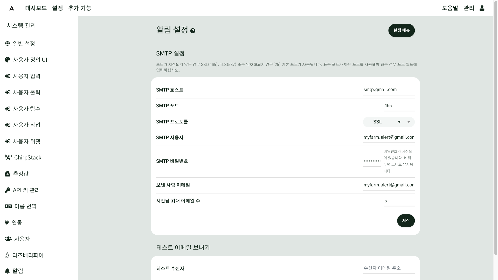

**시간당 최대 이메일 수**는 한 시간에 보낼 수 있는 이메일 수의 상한입니다. 한도를 넘는 이메일은 나중에 다시 보내지지 않고 버려집니다.

예를 들어 지메일로 보낸다면 이렇게 넣습니다.

| 칸 | 넣을 값 |
|---|---|
| SMTP 호스트 | `smtp.gmail.com` |
| SMTP 포트와 프로토콜 | 포트 465 에 **SSL**, 또는 포트 587 에 **TLS** |
| SMTP 사용자 | 지메일 전체 주소 |
| SMTP 비밀번호 | 평소 쓰는 비밀번호가 아니라, 구글 계정에서 만든 **앱 비밀번호** |
| 보낸 사람 이메일 | SMTP 사용자와 같은 주소 |

앱 비밀번호는 구글 계정에서 2단계 인증을 켠 뒤 만듭니다. 만드는 방법은 [구글 도움말: 앱 비밀번호](https://support.google.com/accounts/answer/185833?hl=ko)에 나옵니다.

### 12. 테스트 이메일 보내기 { #step-12 }

계정을 넣었으면 테스트 이메일을 보내 봅니다. 같은 화면 아래의 **테스트 이메일 보내기** 구획에서 **테스트 수신자**에 주소를 넣고 **테스트 이메일 보내기** 버튼을 누르세요. 성공하면 화면 위쪽에 보낸 주소와 함께 성공 메시지가 뜹니다. 받은 편지함에서 메일이 왔는지 확인하세요. 메일이 보이지 않으면 스팸함도 확인하세요.

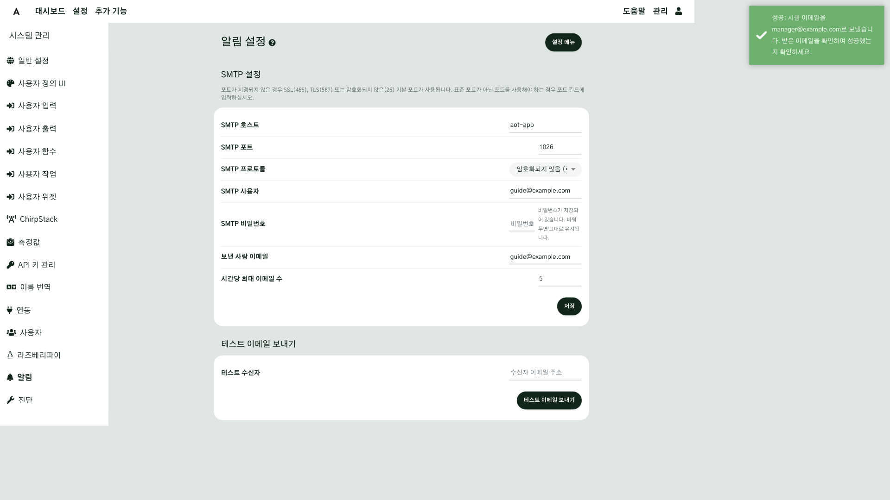

지금 확인해 두지 않으면, 정작 필요한 순간에 이메일이 안 간다는 것을 나중에야 알게 됩니다.

테스트는 화면에 입력한 값으로 보내고, 비워 둔 칸(비밀번호 등)만 저장된 값으로 채웁니다. 하지만 실제 알림은 저장된 설정으로 나가니, 테스트가 되면 꼭 **저장**까지 하세요.

## 확인 { #check }

- **일반 설정**의 시스템 시간대가 현장의 시간대와 같다
- 사람마다 계정이 있고, 역할이 그 사람이 맡을 일에 맞는다
- 모니터 계정으로 로그인해 권한이 없는 화면(예: 백업 복원)을 열면 홈으로 돌아가고 권한이 없다는 메시지가 뜬다(그 계정을 만들었다면)
- 테스트 이메일이 받은 편지함이나 스팸함에 도착했다

지금까지 사용자와 역할, 단위, 그리고 이메일 계정까지 시스템 전체의 규칙을 정했습니다. 다음 장에서는 시스템이 무엇을, 어떻게 알려 주는지 살펴봅니다.

## 현장 A { #site-a }

현장 A 는 관리자, 편집자, 모니터 계정을 사람마다 나눕니다. 현장이 하나라서 그룹은 쓰지 않습니다. 시스템 시간대는 현장의 시간대로 맞춰 두고, 4장에서 쓴 기상청 키는 API 키 관리에 넣어 두었다가 입력을 만들 때 골라 씁니다. 알림 이메일을 보낼 계정은 이 장의 11단계에서 연결합니다.

## 현장 B { #site-b }

현장 B 는 제어실 벽걸이 모니터에 쓸 계정을 따로 만들고, 설정을 바꿀 수 없는 모니터 역할을 줍니다. 그러면 벽걸이 화면에서 누가 눌러도 설정이 바뀌지 않습니다.

## 안 될 때 { #trouble }

| 증상 | 확인할 것 |
|---|---|
| 눌렀더니 홈으로 돌아가고 권한이 없다는 메시지가 뜬다 | 그 계정의 역할에 그 권한이 있는지 보세요. 관리자가 역할 탭에서 권한 스위치를 바꿀 수 있습니다 |
| 어떤 사람만 탭을 조작하지 못한다 | 그 탭에 그룹이 걸려 있는지, 그 사람이 그 그룹의 구성원인지 보세요 |
| 로그인이 안 된다 | 비밀번호를 5번 틀렸다면 그 계정은 10분 동안 잠깁니다. 기다린 뒤 다시 시도하세요 |
| 단위 변환 선택 상자에 원하는 단위가 없다 | 시스템 관리의 측정값에서 그 변환을 등록했는지 확인하세요 |
| 테스트 이메일이 오지 않는다 | 아래 네 가지를 보세요 |
| 이메일이 한동안 오다가 멈췄다 | 시간당 최대 이메일 수를 넘었을 수 있습니다. 한도를 넘은 이메일은 버려집니다 |

테스트 이메일이 오지 않으면 다음을 살펴보세요.

1. **SMTP 호스트**와 **SMTP 포트**가 맞는지
2. **SMTP 사용자**와 **SMTP 비밀번호**가 맞는지(지메일은 앱 비밀번호)
3. **SMTP 프로토콜**이 서버와 맞는지
4. **보낸 사람 이메일**이 SMTP 사용자와 같은 주소인지

그래도 안 되면 **관리 → 시스템 로그**의 데몬 로그에서 이메일 오류를 찾아 AI 에게 보여 주세요.

## 더 알아보기 { #more }

- 다음 장: [알림](g12-alerts.md) — 시스템이 무엇을, 어떻게 알려 주는지 살펴봅니다
- [일반 설정](../Configuration-Settings.md#general-settings)
- [사용자·역할·그룹](../Configuration-Settings.md#users)
- [측정값 설정](../Configuration-Settings.md#measurement-settings)
- [알림 설정](../Configuration-Settings.md#alert-settings)

---

## 도우미 AI 에게 { #for-ai }

- "설정"은 두 곳입니다. 위쪽 메뉴의 설정은 입력·출력·함수, 관리 → 시스템 관리는 사용자·시간대·알림 같은 시스템 전체 규칙입니다.
- 사용자에게 비밀번호·앱 비밀번호·API 키를 말해 달라고 하지 마세요. 사용자가 화면에 직접 넣습니다.
- 권한이 없다는 메시지가 나오면 계정의 역할을 먼저 확인하게 하세요. 그룹이 걸린 탭이라면 그룹 구성원인지도 확인하게 하세요.
- 테스트 이메일이 오지 않으면 호스트·포트, 사용자·비밀번호, 프로토콜, 보낸 사람 이메일 순서로 묻고, 그래도 안 되면 데몬 로그의 이메일 오류 문구만 보여 달라고 하세요.
