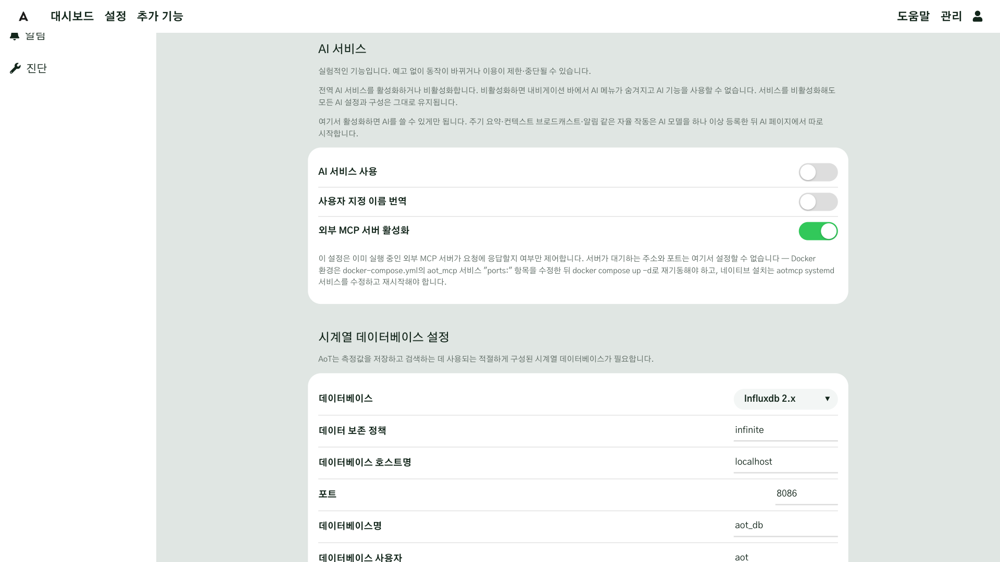
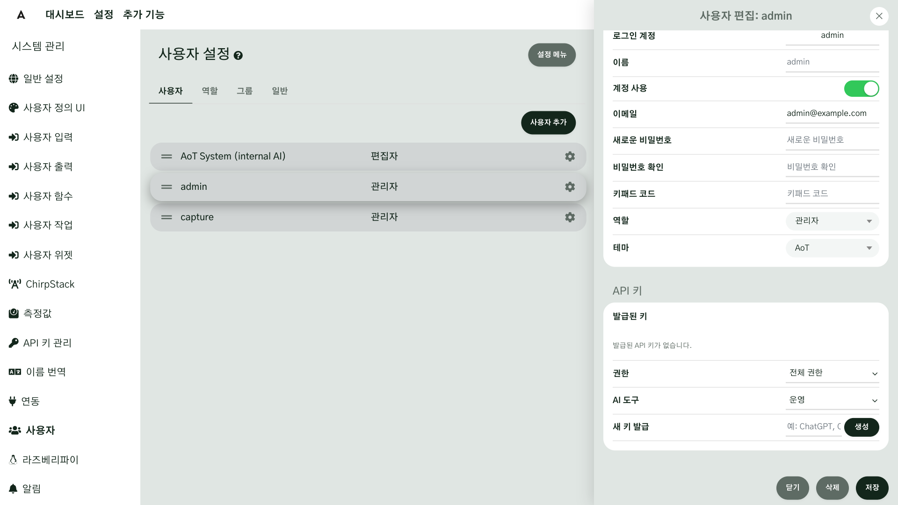

# AI·MCP 연결

AoT 에 AI 를 연결하는 방법은 두 가지입니다. 주로 쓰는 방법은 **MCP** 입니다. 이미 쓰고 있는 AI 앱
(Claude Desktop, Claude Code 등)을 AoT 에 연결해, 그 AI 가 현장의 센서 값·일정·지도를 읽고 장치 조작을
제안하게 합니다. MCP(Model Context Protocol)는 AI 앱이 외부 시스템의 도구를 쓸 수 있게 연결해 주는 공개 규격입니다.
다른 하나는 AoT 안에 들어 있는 **내장 AI** 로, 필요하면 켤 수 있습니다.

어느 방법이든 장치를 움직이거나 설정을 바꾸는 일은 사람이 승인해야 실행됩니다.

## 이 장을 마치면 { #goal }

- AI 앱을 MCP 로 AoT 에 연결하고, AI 에게 현장 상태를 물어본다
- AI 가 제안한 조작을 승인하는 방법을 안다

## 준비 { #prepare }

- 관리자 계정으로 로그인할 수 있는 AoT ([설치](g01-install.md#check))
- MCP 를 지원하는 AI 앱(이 장에서는 Claude Desktop 과 Claude Code 를 예로 듭니다)
- AI 앱을 AoT 와 다른 컴퓨터에서 쓴다면, 두 컴퓨터가 서로 접속할 수 있는 네트워크([네트워크 연결](g03-network.md)의 Tailscale 권장)

## 절차 { #steps }

### 1. 외부 AI 접속 켜기 { #step-1 }

**관리** → **시스템 관리** → **일반 설정**의 **AI 서비스** 절에서 **외부 MCP 서버 활성화**가 켜져 있는지
확인합니다. 기본값은 켜짐입니다. 끄면 모든 MCP 요청이 거부됩니다.

Docker 로 설치했다면 MCP 서버는 `aot_mcp` 컨테이너로 이미 실행 중입니다(포트 5700).



### 2. 접속 키 만들기 { #step-2 }

AI 앱은 사용자 API 키로 AoT 에 접속합니다. **AI 앱마다 키를 하나씩** 만들어 두면, 나중에 특정 앱의 접속만 끊을 수 있습니다.

1. **관리** → **시스템 관리** → **사용자**에서 AI 가 그 권한으로 동작할 사용자를 열고 **API 키** 절로 이동합니다.
2. **권한**을 고릅니다. **전체 권한**이면 역할이 허락하는 조작을 제안할 수 있고, **읽기 전용**이면 읽기만 할 수 있습니다.
3. **AI 도구**를 고릅니다. AI 에게 보여 줄 도구의 범위입니다.
   - **운영**: 값 읽기, 장치 조작, 일정, 노트 등 매일 쓰는 도구(처음에는 이것을 권장)
   - **운영 + 설정**: 입력·출력·함수·지도·대시보드를 만들고 고치는 도구까지. 목록이 길어져 AI 의 답이 느려질 수 있습니다
4. **새 키 발급** 줄의 입력칸에 앱 이름(예: `Claude Desktop`)을 입력하고 **생성**을 누릅니다.
5. 나타난 **새 키**를 **복사**합니다. 키는 **이때 한 번만** 보입니다.

키를 만들 수 있는 사람은 사용자를 편집할 수 있는 관리자입니다.



### 3. MCP 주소 정하기 { #step-3 }

AI 앱이 **어느 컴퓨터에 있느냐**에 따라 연결 방법이 다릅니다.

| AI 앱이 있는 곳 | 연결 방법 | 이 장의 절 |
|---|---|---|
| AoT 를 설치한 컴퓨터와 같은 컴퓨터 | AI 앱이 MCP 서버를 직접 실행(stdio) | [4단계](#step-4) |
| 다른 컴퓨터(노트북 등) | 네트워크로 접속(HTTP), 주소 `http://<AoT 컴퓨터 주소>:5700/mcp` | [5단계](#step-5) |

Docker 설치의 MCP 서버는 처음에 **AoT 컴퓨터 자신에게서 오는 연결만** 받습니다. 다른 컴퓨터에서 접속하려면
`docker/.env` 에 연결을 받을 주소를 적고 AoT 를 다시 시작합니다. 주소는 사설망 주소나 Tailscale 주소를 씁니다.

```bash
# docker/.env
AOT_MCP_BIND=100.64.0.10      # AoT 컴퓨터의 Tailscale 주소(예)
```

```bash
docker compose -f docker/docker-compose.prod.yml up -d
```

제대로 열렸는지는 AI 앱이 있는 컴퓨터에서 확인합니다. AoT 이름과 버전이 담긴 응답이 오면 정상입니다.

```bash
curl http://100.64.0.10:5700/mcp/info
```

!!! danger "MCP 포트를 인터넷에 열지 마십시오"
    `AOT_MCP_BIND` 에 `0.0.0.0` 을 적거나 공유기에서 5700 포트를 열지 마십시오. MCP 서버는 암호화되지 않은
    HTTP 로 동작합니다. 사설망이나 Tailscale 안에서만 쓰십시오.

### 4. 같은 컴퓨터에서 연결하기(stdio) { #step-4 }

AI 앱이 MCP 서버를 컨테이너 안에서 직접 실행하게 합니다. `<키>` 자리에 2단계에서 복사한 키를 넣습니다.

**Claude Desktop**: 설정 파일(`claude_desktop_config.json`)의 `mcpServers` 에 아래 내용을 추가하고 Claude Desktop 을 다시 시작합니다.

```json
{
  "mcpServers": {
    "aot": {
      "command": "docker",
      "args": ["compose", "-f", "/opt/AoT/docker/docker-compose.prod.yml",
               "exec", "-T", "-e", "AOT_MCP_API_KEY=<키>",
               "aot_mcp", "python", "aot/aot_mcp_server.py"]
    }
  }
}
```

**Claude Code**:

```bash
claude mcp add aot -- docker compose -f /opt/AoT/docker/docker-compose.prod.yml exec -T -e AOT_MCP_API_KEY=<키> aot_mcp python aot/aot_mcp_server.py
```

`/opt/AoT` 는 AoT 를 내려받은 폴더입니다. 다른 곳에 두었다면 그 경로로 바꿉니다.

### 5. 다른 컴퓨터에서 연결하기(HTTP) { #step-5 }

3단계의 주소와 2단계의 키를 AI 앱에 입력합니다. 키는 `X-API-KEY` 헤더로 보냅니다.

**Claude Code**:

```bash
claude mcp add --transport http aot http://100.64.0.10:5700/mcp --header "X-API-KEY: <키>"
```

**Claude Desktop**: Claude Desktop 은 설정 파일만으로는 원격 서버에 바로 연결할 수 없으므로, 중계 도구 `mcp-remote` 를 사용합니다
(Node.js 가 설치되어 있어야 합니다). `--allow-http` 는 암호화되지 않은 사설망 주소에 연결할 때 필요합니다.

```json
{
  "mcpServers": {
    "aot": {
      "command": "npx",
      "args": ["mcp-remote", "http://100.64.0.10:5700/mcp",
               "--header", "X-API-KEY:${AOT_KEY}", "--allow-http"],
      "env": { "AOT_KEY": "<키>" }
    }
  }
}
```

MCP 를 지원하는 다른 앱도 같은 주소와 `X-API-KEY` 헤더를 입력하면 됩니다.

연결한 뒤 AI 앱이 도구를 부를 때마다 허락을 묻는다면, 앱의 커넥터(도구) 권한 설정에서 AoT 의 **읽기 전용 도구**를 **항상 허용**으로 바꿔 두십시오. 조회할 때마다 묻지 않게 됩니다. 장치 조작 같은 변경은 AoT 가 따로 승인을 받으므로, 그 밖의 도구는 **승인 필요**로 두어도 됩니다.

### 6. 물어보고 승인하기 { #step-6 }

1. AI 앱에서 "현장 B 온실의 지금 온도와 습도를 알려 줘"처럼 물어봅니다. AI 가 AoT 의 도구로 값을 읽어 답합니다.
2. "측창을 30% 열어 줘"처럼 장치를 움직이는 요청은 바로 실행되지 않고 **승인 대기**가 됩니다. AI 가 무엇을
   하려는지와 함께 승인 대기임을 알려 줍니다.
3. 내용을 확인하고 "그 요청을 승인해"처럼 분명히 답하면, AI 가 승인을 AoT 에 전달하고 조작이 실행됩니다.
   승인할 수 있는 것은 관리자·편집자 역할 사용자의 키뿐입니다. 15분 안에 승인하지 않으면 요청은 사라집니다.

AI 가 할 수 있는 일은 키를 가진 사용자의 역할과 2단계의 권한·AI 도구 범위를 넘지 않습니다.

### 7. 내장 AI 켜기(선택) { #step-7 }

AoT 안에서 바로 AI 와 대화하고 싶다면 내장 AI 를 켭니다. MCP 연결과는 따로 동작하므로, 꺼 두어도 MCP 는 쓸 수 있습니다.

1. **관리** → **시스템 관리** → **일반 설정**의 **AI 서비스**에서 **AI 서비스 사용**을 켭니다. 화면 위에 **AI** 메뉴가 생깁니다.
2. **AI** → **연결**의 **내장 AI**에서 **엔진**(Anthropic, OpenAI, Google Gemini, 로컬 Ollama 등)을 고르고 **추가**를 누른 뒤,
   그 서비스의 **API 키**와 **모델**을 입력해 **저장**하고 **활성화**합니다.

자세한 설정은 [AI 개요](../ai/overview.md)를 보십시오.

## 확인 { #check }

AI 앱에서 현장의 값을 물었을 때 AoT 의 실제 값으로 답하고, 장치 조작 요청이 승인 대기로 들어오면 연결이 끝난 것입니다.

- AI 앱의 MCP 목록에 `aot` 가 연결됨으로 나오는지
- **외부 MCP 서버 활성화**가 켜져 있는지
- 키를 앱마다 따로 만들었는지(**발급된 키** 목록에서 이름으로 구분됩니다)

## 현장 A { #site-a }

현장 A 는 사무실 노트북의 Claude Desktop 을 Tailscale 로 AoT 에 연결합니다([5단계](#step-5)). 키는 **운영** 범위로
만듭니다. AI 는 관수 일정과 토양 수분을 확인하고 밸브 조작을 제안하며, 조작은 담당자가 승인합니다.

## 현장 B { #site-b }

현장 B 는 온실 옆 제어실의 AoT 컴퓨터에서 Claude Code 를 쓰므로 같은 컴퓨터 연결([4단계](#step-4))을 씁니다.
환경 제어 설정을 AI 와 함께 다듬기 위해 **운영 + 설정** 범위의 키를 따로 하나 더 만듭니다.

## 안 될 때 { #trouble }

| 증상 | 확인할 것 |
|---|---|
| AI 앱이 연결하지 못한다 | `curl http://<주소>:5700/mcp/info` 가 응답하는지, `AOT_MCP_BIND` 를 바꾼 뒤 AoT 를 다시 시작했는지 |
| 모든 요청이 거부된다 | **외부 MCP 서버 활성화**가 꺼져 있습니다 |
| 인증 오류가 난다 | 키를 앞뒤 공백 없이 그대로 입력했는지, 그 키가 **발급된 키** 목록에서 폐기되지 않았는지 |
| 값은 읽는데 장치 조작 제안이 안 된다 | 키의 **권한**이 **읽기 전용**이거나, 사용자 역할에 제어 권한이 없습니다 |
| AI 가 설정을 만들지 못한다 | 키의 **AI 도구**가 **운영**입니다. 설정까지 맡기려면 **운영 + 설정** 키를 씁니다 |
| 승인한 조작이 실행되지 않았다 | 승인까지 15분이 지났습니다. 다시 요청하십시오 |

## 더 알아보기 { #more }

- [AI 개요](../ai/overview.md)
- [일반 설정](../Configuration-Settings.md)
