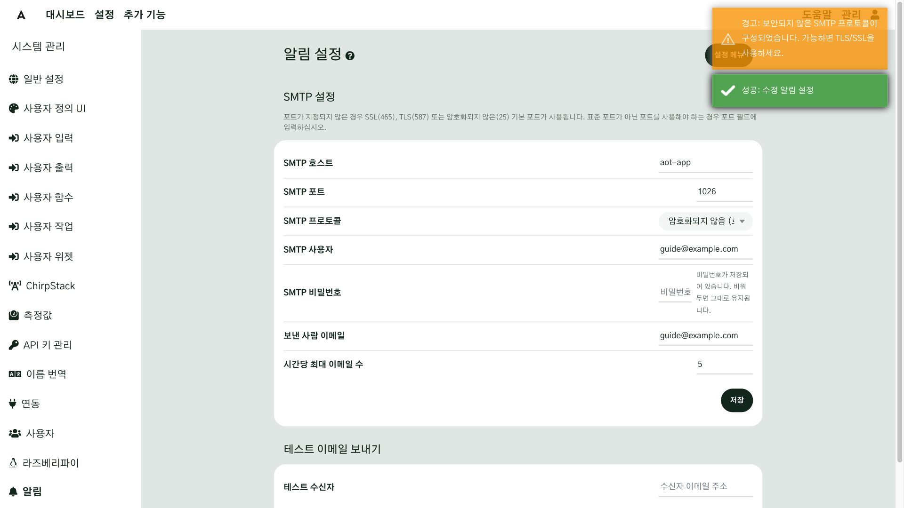
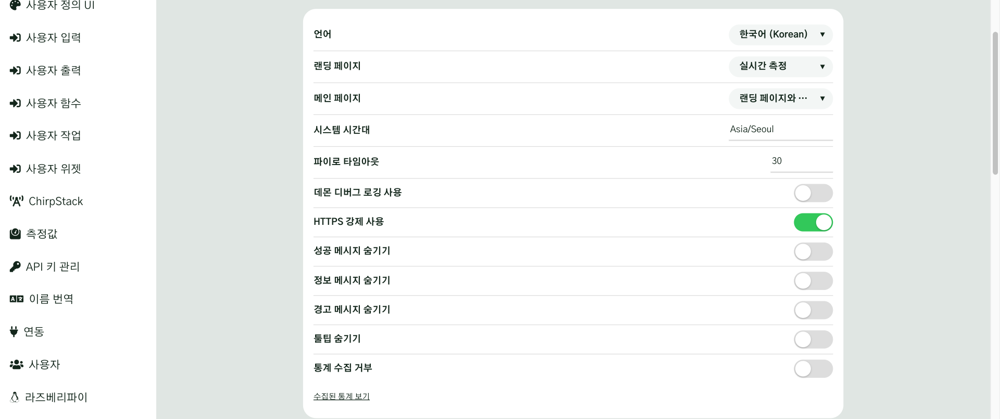
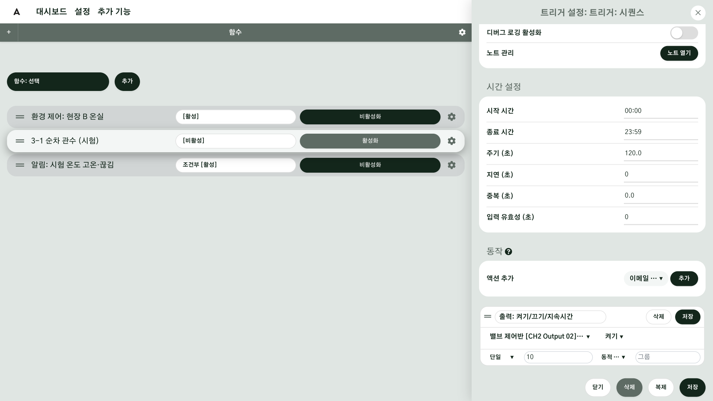
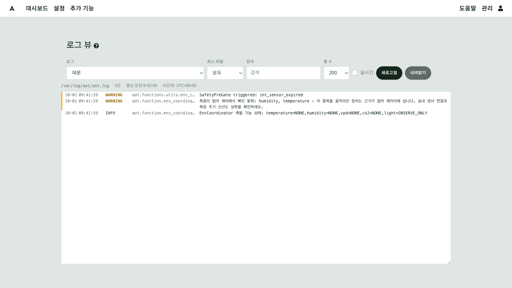
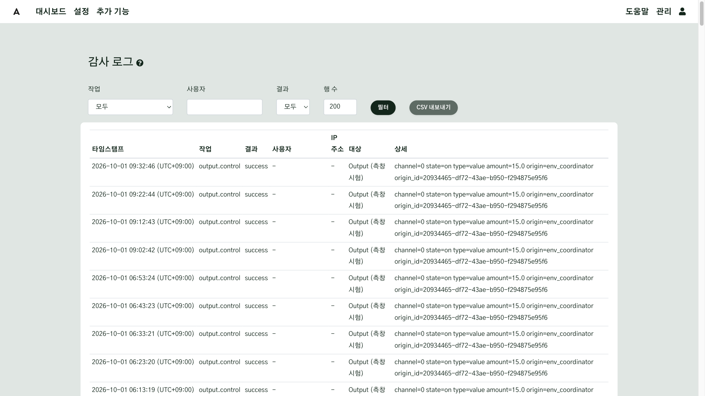
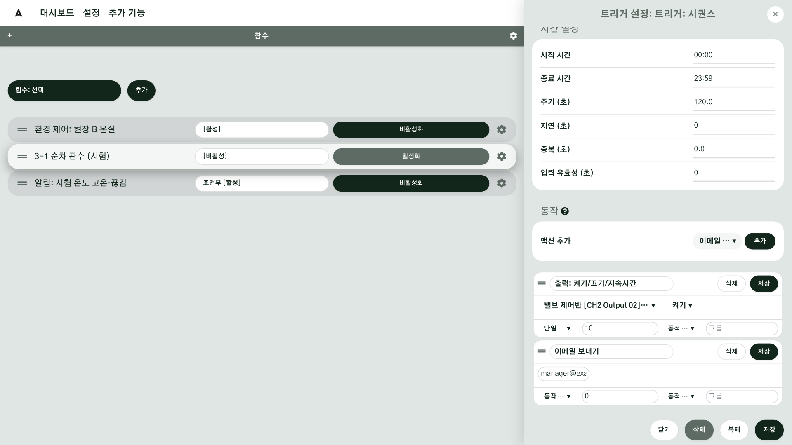
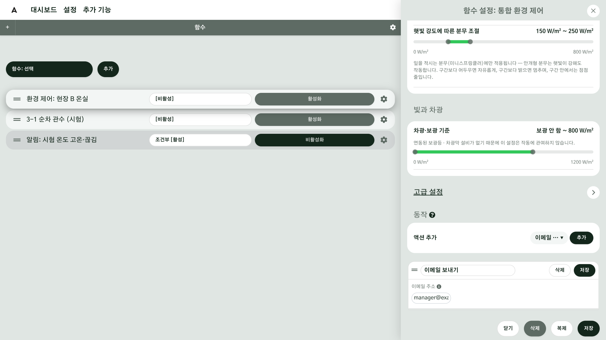

# 알림

AoT 는 처음 설치하면 아무것도 알려 주지 않는 뼈대입니다. 무엇을 알릴지는 사용자가 정합니다. 그래서 평소에는 시스템이 알아서 돌고, 사용자는 **알림이 왔을 때** 무엇을 볼지만 알면 됩니다. 이 장에서는 시스템이 먼저 알려 주는 방법(화면의 토스트와 이메일)과, 알림이 없어도 사용자가 직접 찾아볼 수 있는 기록(시스템 로그와 감사 로그)을 살펴봅니다. 그리고 현장 A 와 현장 B 에 이메일 알림을 하나씩 붙입니다.

## 이 장을 마치면 { #goal }

- 화면에 뜨는 토스트의 종류를 알고, 필요하면 숨긴다
- 이메일을 받으려면 무엇이 필요한지 알고, 함수에 이메일 보내기를 붙인다
- 함수마다 메일이 가는 때가 다르다는 것과, 한 시간에 보내는 메일 수에 한도가 있다는 것을 안다
- 알림이 오지 않을 때 시스템 로그와 감사 로그에서 무슨 일이 있었는지 찾아본다

## 준비 { #prepare }

- 이메일을 보낼 계정이 연결된 시스템([11장 설정](g11-settings.md)에서 연결합니다)
- 이메일을 붙일 함수(시퀀스나 통합 환경 제어 같은 함수는 함수·자동화 장에서 만듭니다)
- 메일을 받을 주소

## 절차 { #steps }

### 1. 알림의 두 길 { #step-1 }

알림에는 두 길이 있습니다.

| 길 | 무엇이 오나 | 누가 먼저 움직이나 |
|---|---|---|
| 시스템이 먼저 알려 줌 | 토스트, 이메일 | 시스템 |
| 사용자가 찾아서 봄 | 시스템 로그, 감사 로그 | 사용자 |

토스트와 이메일은 시스템이 알려 주고, 로그는 사용자가 필요할 때 찾아서 봅니다.

### 2. 화면에 뜨는 토스트 { #step-2 }

화면을 보고 있을 때는 **토스트**로 알려 줍니다. 토스트는 화면 오른쪽 위에 잠깐 떴다가 사라지는 작은 알림입니다. 무엇이 잘 되었는지, 무엇이 안 되었는지를 그 자리에서 알려 줍니다.

토스트는 네 종류입니다. 글 앞에도 종류가 붙어서 "성공: …", "경고: …"처럼 나옵니다.

| 종류 | 뜻 |
|---|---|
| 성공 | 저장이나 동작이 잘 끝남 |
| 정보 | 알아 두면 좋은 안내 |
| 경고 | 주의해서 볼 것 |
| 오류 | 안 된 것 |

경고와 오류는 금방 사라지니, 뜨면 내용을 바로 읽어 두세요.

### 3. 토스트 숨기기 { #step-3 }

토스트가 너무 자주 뜨면 설정에서 숨길 수 있습니다. **관리 → 시스템 관리 → 일반 설정**에 **성공 메시지 숨기기**, **정보 메시지 숨기기**, **경고 메시지 숨기기** 세 칸이 있습니다.

!!! warning "경고 메시지를 숨기면 오류도 함께 숨겨집니다"
    **경고 메시지 숨기기**를 켜면 오류 토스트도 함께 숨겨집니다. 오류를 못 보고 지나치는 일이 없도록, 숨기기 전에 꼭 필요한지 생각해 보세요.

### 4. 화면 앞에 없을 때는 이메일 { #step-4 }

화면 앞에 없을 때는 이메일로 알려 줍니다. 이메일은 **사용자가 미리 만들어 둔 알림에서만** 옵니다. 만들어 두지 않은 것은 오지 않습니다.

이메일이 오면 제목부터 보이는데, 제목은 늘 같은 모양입니다. **AoT Notification** 으로 시작하고, 뒤에 어느 컴퓨터에서 보냈는지 표시가 붙습니다. 무슨 일이 있었는지는 본문에 적혀 있으니, 열어서 읽어 보세요. 휴대폰에서 받은 메일도 같은 모양으로 오니, 제목이 AoT Notification 이면 본문을 먼저 읽으세요.

알림을 받으면 휴대폰으로 시스템을 열고, 그 장치와 값을 확인하면 됩니다. 바깥에서 시스템을 여는 방법은 [13장](g13-crisis.md)에서 살펴봅니다.

### 5. 이메일을 받으려면 { #step-5 }

이메일을 받으려면 세 가지가 필요합니다.

1. **계정 연결**: 이메일을 보낼 계정을 연결합니다. 이 계정은 [11장 설정](g11-settings.md)에서 연결해 두었습니다. 연결한 내용은 **관리 → 시스템 관리 → 알림**에서 볼 수 있습니다.
2. **이메일 붙이기**: 알리고 싶은 함수에 **이메일 보내기**를 붙입니다.
3. **주소 넣기**: 받을 주소를 넣습니다.

### 6. 함수에 이메일 보내기 붙이기 { #step-6 }

함수 설정의 **동작** 구획에 있는 **액션 추가** 목록에서 **이메일 보내기**를 고르고 **추가**를 누릅니다. 추가되면 받을 주소를 넣는 칸이 나타납니다. 받을 주소를 넣고 저장하면 됩니다. 여러 명에게 보내려면 주소를 쉼표로 나누세요. 사진을 붙여서 보내는 **사진 첨부 이메일 보내기**도 목록에 따로 있습니다.

!!! warning "이메일 보내기가 추가되지 않나요? 켜져 있는 함수에는 동작을 추가할 수 없습니다"
    함수를 먼저 **비활성화**한 뒤 추가하고, 다시 **활성화**하세요.

### 7. 어느 함수에 붙이나 { #step-7 }

이메일 보내기는 액션을 쓰는 함수에 붙입니다. 함수마다 메일이 가는 때가 다릅니다.

| 함수 | 메일이 가는 때 |
|---|---|
| 시퀀스 | 그 단계가 시작될 때 |
| 통합 환경 제어 | 시스템이 위험하다고 판단할 때 |
| 조건부 | 값이 정한 조건에 걸릴 때 |

### 8. 통합 환경 제어가 보내는 메일 { #step-8 }

통합 환경 제어가 보내는 메일은 두 종류입니다.

| 메일 | 얼마나 자주 오나 |
|---|---|
| 돌풍·강우·폭염·한파 경보 | 종류마다 하루에 한 번 |
| 목표에 계속 못 미쳐서 장치를 살펴봐야 할 때 | 한 시간에 한 번 |

### 9. 한 시간에 다섯 통까지 { #step-9 }

이메일은 한 시간에 다섯 통까지만 보냅니다. 기본값이 다섯 통이고, **알림 설정**의 **시간당 최대 이메일 수**에서 바꿀 수 있습니다. 한도를 넘으면 그 시간 동안 나머지 메일은 보내지 않으니, 같은 알림이 쏟아지지 않게 하세요.

알림이 너무 많으면 정작 중요한 것을 놓칩니다. **모든 것에 알림을 걸지 말고, 꼭 알아야 할 것에만 거세요.**

### 10. 값이 끊기거나 넘을 때 { #step-10 }

센서 값이 끊겼거나 정한 값을 넘었을 때 알려 주는 것은 **조건부 함수**로 만듭니다. 조건부 함수는 코드로 조건을 적어야 해서 처음에는 어렵습니다. 매뉴얼의 예제를 따라 하거나 AI 에게 도움을 받으세요.

### 11. 알림이 없어도 남는 기록: 시스템 로그 { #step-11 }

알림이 오지 않아도, 시스템에는 기록이 남아 있습니다. 자동차 블랙박스처럼, 무슨 일이 있었는지 나중에 돌려 볼 수 있습니다. 그중 시스템 로그에는 무엇이 언제 어떻게 되었는지가 남아 있습니다. **관리 → 시스템 로그**를 엽니다(화면 제목은 **로그 뷰**).

**로그**에서 종류를 고르고 **최소 레벨**을 정한 다음 **검색** 칸에 찾을 말을 넣으면, 필요한 줄만 볼 수 있습니다. **실시간**을 켜면 새 줄이 계속 올라오고, **내려받기**로 파일을 받을 수도 있습니다. 알림이 온 시각 앞뒤를 보면, 알림 한 줄보다 훨씬 자세한 사정을 알 수 있습니다.

### 12. 누가 무엇을 했는지: 감사 로그 { #step-12 }

기록은 두 가지입니다. 시스템 로그는 시스템 안에서 무엇이 일어났는지를 남기고, 감사 로그는 누가 무엇을 했는지를 남깁니다. 찾는 것에 따라 고르세요.

**관리 → 감사 로그**에는 누가 언제 무엇을 켜고 바꿨는지가 남습니다. **작업**, **사용자**, **결과**로 걸러 볼 수 있고, **CSV 내보내기**로 내려받을 수도 있습니다. 장치를 움직인 기록의 **상세**를 보면, 사람이 누른 것인지 함수가 보낸 것인지 알 수 있습니다.

## 확인 { #check }

- 내가 붙인 이메일 보내기가 있는 함수가 **활성** 상태입니다
- 받을 주소로 알림이 실제로 도착합니다(제목이 AoT Notification 으로 시작합니다)
- 시스템 로그와 감사 로그를 열어 알림이 온 시각 앞뒤를 찾아볼 수 있습니다

지금까지 알림이 어떻게 오는지, 알림이 없을 때는 어디를 보는지 살펴보았습니다. 다음 장에서는 이상을 발견했을 때 어떻게 대응하는지 살펴봅니다.

## 현장 A { #site-a }

현장 A 는 순차 관수 시퀀스의 맨 끝에 **이메일 보내기**를 하나 더합니다. 시퀀스는 단계를 순서대로 이어서 실행하니, 마지막에 두면 관수가 모두 끝난 다음에 메일이 옵니다. 메일이 오지 않으면 관수가 그 자리까지 오지 못했을 수 있으니, 화면을 열어 확인해 보세요.

## 현장 B { #site-b }

현장 B 는 통합 환경 제어에 **이메일 보내기**를 등록해 둡니다. 등록만 해 두면, 시스템이 위험하다고 판단하는 순간에 메일이 옵니다. 무엇에 메일을 걸지 따로 정할 필요는 없습니다.

## 안 될 때 { #trouble }

이메일이 오지 않으면 다음을 살펴보세요.

| 증상 | 확인할 것 |
|---|---|
| 이메일이 전혀 오지 않는다 | 이메일 계정이 연결되어 있는지 확인하세요([11장 설정](g11-settings.md)) |
| 함수를 붙였는데 안 온다 | 함수가 켜져 있는지(활성 상태인지) 확인하세요 |
| 한동안 오다가 오지 않는다 | 한 시간 한도(시간당 최대 이메일 수)를 넘지 않았는지 확인하세요 |
| 엉뚱한 곳으로 가거나 안 온다 | 받는 주소가 맞는지 확인하세요. 여러 명이면 쉼표로 나누었는지도 보세요 |

그래도 알 수 없으면, 시스템 로그의 **데몬** 로그에서 이메일 오류 줄을 찾아 AI 에게 보여 주세요. 방법은 [2장](g02-ask-ai.md)에서 살펴본 것과 같습니다.

## 더 알아보기 { #more }

- [경고(Alerts)](../Alerts.md)
- [로그 뷰](../Log-Viewer.md)
- [함수](../Functions.md)
- [액션](../Actions.md)

---

## 도우미 AI 에게 { #for-ai }

- 이메일은 사용자가 함수에 **이메일 보내기** 액션을 붙여 둔 알림에서만 갑니다. 입력이나 출력은 스스로 이메일을 보내지 않습니다.
- 이메일이 안 온다는 질문에는 계정 연결, 함수 활성 여부, 시간당 한도(기본 다섯 통), 받는 주소 순서로 확인하게 하세요.
- 켜져 있는 함수에는 동작을 추가할 수 없습니다. 비활성화한 뒤 추가하고 다시 활성화하게 하세요.
- 센서 끊김·값 초과 알림은 조건부 함수(코드)입니다. 사용자에게 한 번에 만들게 하지 말고 매뉴얼의 예제부터 따라 하게 하세요.
- 비밀번호·키를 사용자에게 요구하지 마세요.
