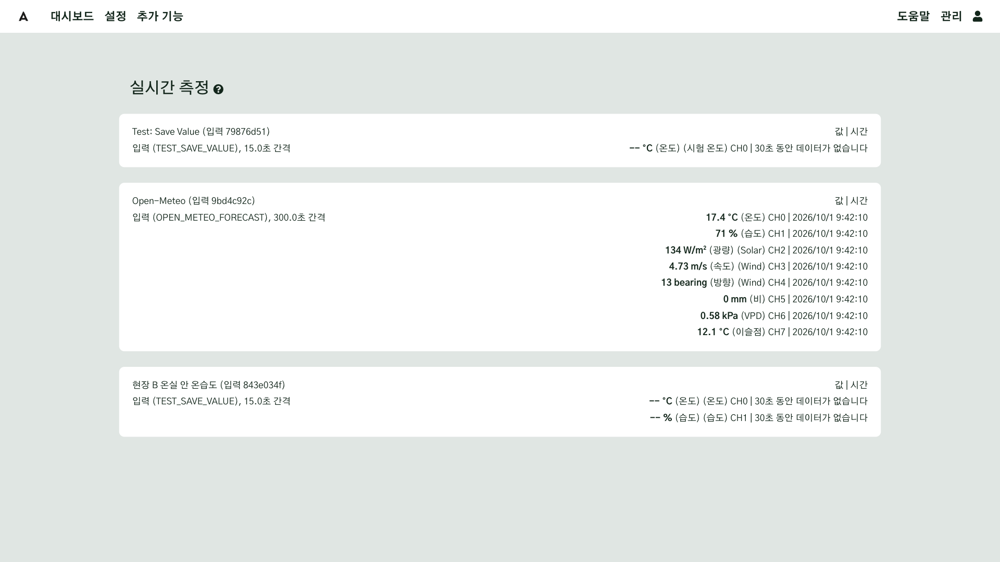
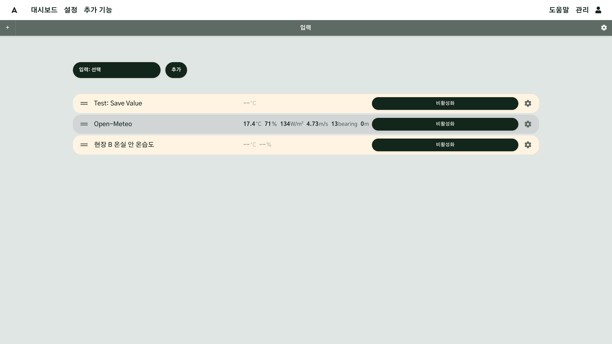
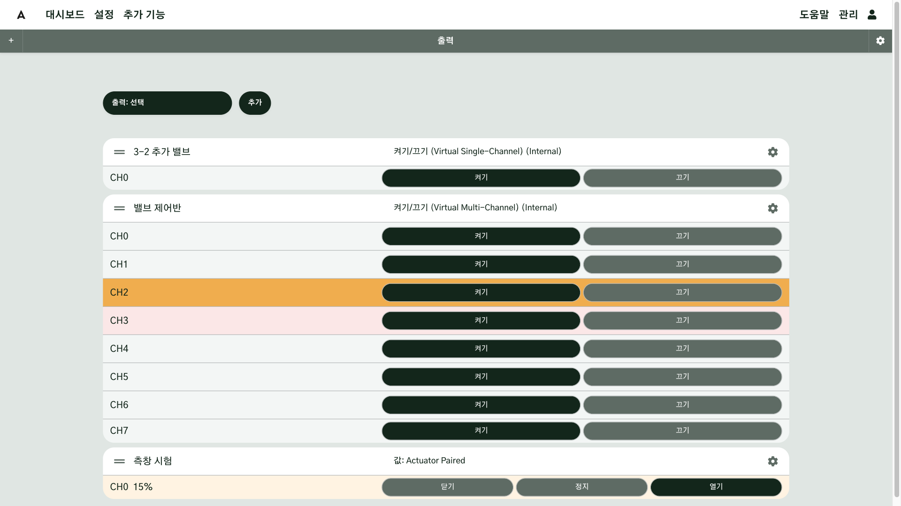
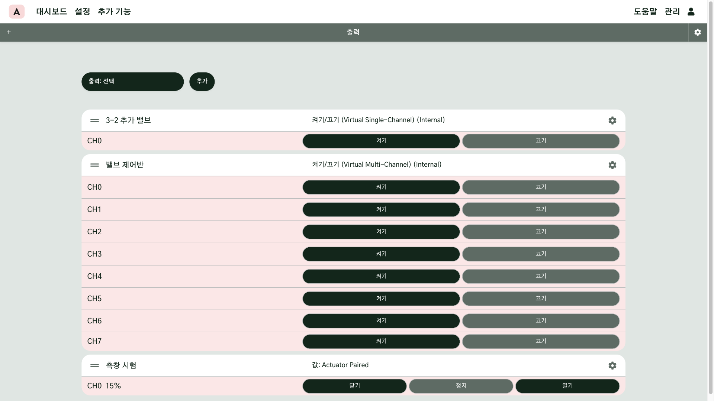
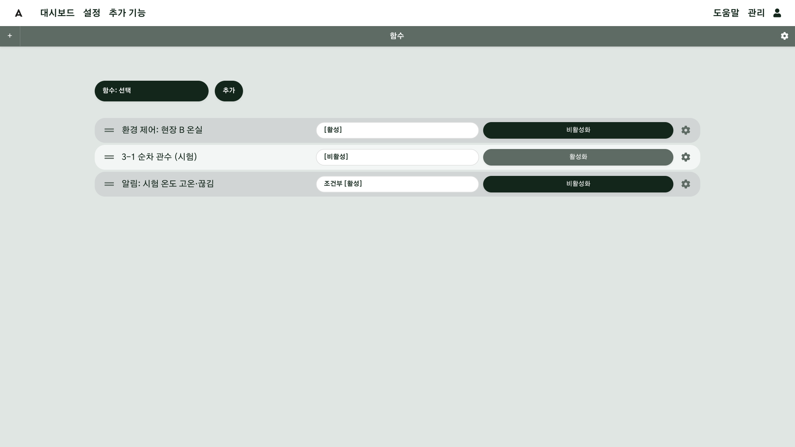
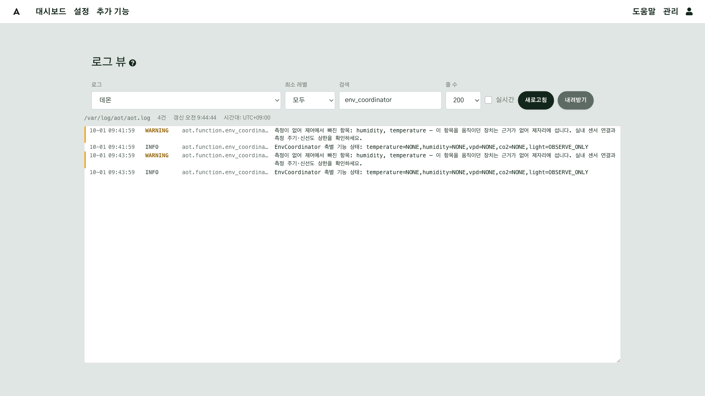
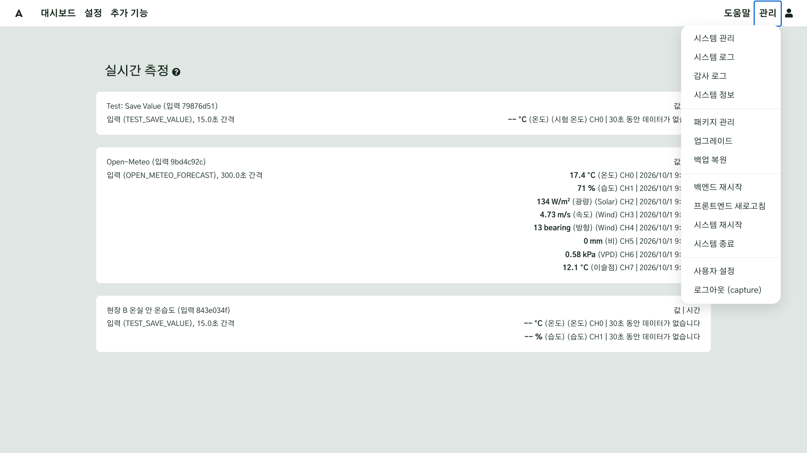
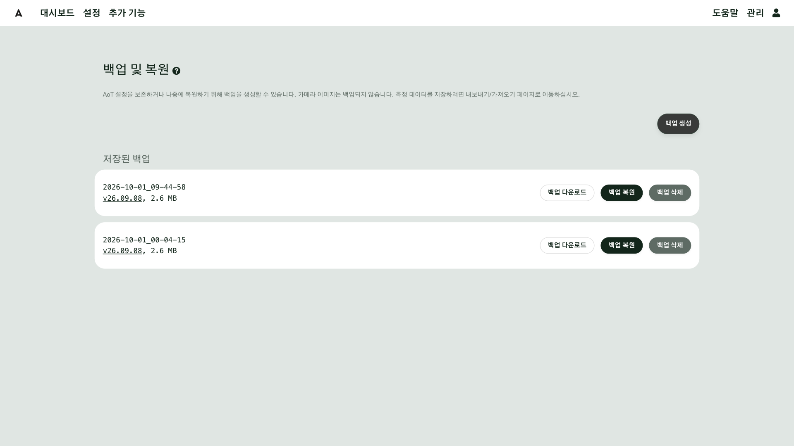
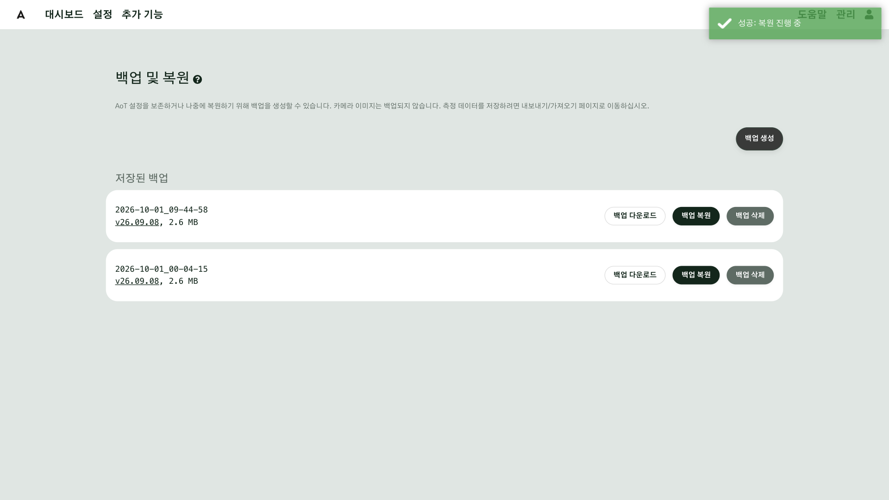

# 위기 대응

센서도, 장치도, 통신도 언젠가는 멈춥니다. 아무 일도 안 생기게 하는 것보다 중요한 것은, 일이 생겼을 때 **어디부터 볼지** 아는 것입니다. 이 장에서는 현장에서 기대하지 않은 일이 생겼을 때 알아채고, 원인을 좁히고, 되돌리는 방법을 살펴봅니다. 평소에는 AoT 가 알아서 돌아갑니다. 이 장의 내용은 알림이 오거나 화면이 이상해 보일 때 펼쳐 보는 순서입니다. AoT 26.09.08 을 기준으로 설명합니다.

## 이 장을 마치면 { #goal }

- 센서·케이블·게이트웨이에서 흔히 생기는 끊김의 모습을 안다
- 화면과 기록에서 이상을 알아채고, 바깥에서부터 원인을 좁힌다
- 현장 밖에서 AoT 를 열 수 있게 미리 준비해 둔다
- 백업을 정상일 때 미리 만들고, 다른 곳에 보관하고, 복원하기 전에 확인할 것을 안다

## 준비 { #prepare }

- 알림을 받는 시스템([알림](g12-alerts.md))
- 관리자 계정. 백업을 내려받고 복원하는 것은 관리자만 할 수 있습니다
- 막혔을 때 물어볼 AI([가이드 사용하는 방법](g02-ask-ai.md))

## 절차 { #steps }

### 1. 끊김은 이렇게 생깁니다 { #step-1 }

현장에서 값이 갑자기 들어오지 않을 때, 원인은 대개 세 가지 중 하나입니다. 센서의 배터리가 다하거나, 케이블이 헐거워져 빠지거나, 센서와 AoT 사이의 중간 기기인 게이트웨이의 전원이 나가는 것입니다.

- **방전된 센서**: 배터리로 움직이는 무선 센서는 배터리가 다하면 값을 더 이상 보내지 않습니다. 아무 소리 없이 멈추기 때문에, 마지막으로 값이 들어온 시각을 봐야 언제부터 끊겼는지 알 수 있습니다.
- **빠진 케이블**: 케이블이 헐거워지거나 빠지면 장치가 갑자기 응답하지 않습니다. 바람이나 진동으로 커넥터가 빠지는 일은 현장에서 흔합니다.
- **꺼진 게이트웨이**: 게이트웨이는 무선 센서와 AoT 사이를 이어 주는 중간 기기입니다. 이 기기의 전원이 나가면 그 아래 센서가 한꺼번에 끊긴 것처럼 보입니다. 여러 센서가 동시에 끊겼다면 게이트웨이부터 의심하세요.

### 2. 이상을 알아채는 곳 { #step-2 }

이상은 세 곳에서 알아챌 수 있습니다.

| 어디서 | 어떻게 보이나 |
|---|---|
| 알림 | 이메일과 화면의 알림 메시지(토스트). [알림](g12-alerts.md)에서 정해 둔 것이 옵니다 |
| 대시보드 위젯 | 값이 오래되면 흐려지고, 출력 위젯은 **연결 없음**으로 바뀝니다 |
| 입력·출력 화면 | 값 자리가 `--` 로 바뀌거나 줄의 색이 달라집니다 |

### 3. 원인은 바깥에서부터 좁힙니다 { #step-3 }

원인을 찾을 때는 현장에 가지 않고도 볼 수 있는 것부터 봅니다.

1. **화면**: 값과 상태를 봅니다.
2. **기록**: 로그를 봅니다.
3. **중간 기기**: 센서와 AoT 사이의 게이트웨이를 봅니다.
4. **현장**: 마지막에 갑니다.

앞의 셋으로 어디까지 좁혀지는지 본 뒤에 가도 늦지 않습니다.

### 4. 끊긴 입력 찾기 { #step-4 }

끊긴 입력은 **추가 기능**의 **실시간 측정** 화면에서 가장 분명하게 보입니다. 정상인 입력에는 값과 함께 마지막으로 값이 들어온 시각이 적힙니다. 끊긴 입력은 값 자리에 줄 두 개(`--`)가 뜨고 "30초 동안 데이터가 없습니다" 같은 안내가 나옵니다. 안내의 시간은 그 입력 설정의 데이터 유효 시간에 따라 달라집니다.

**설정 → 입력** 화면에서는 끊긴 입력의 줄이 연한 주황 바탕이 되고 값 자리가 `--` 로 보입니다.

여기서 먼저 물을 것은 하나입니다. **여러 입력이 같이 끊겼나요?** 여러 입력이 같은 시각부터 끊겼다면 중간 기기(게이트웨이)를 의심하고, 한 입력만 끊겼다면 그 센서를 의심합니다.

### 5. 출력 줄의 색 읽기 { #step-5 }

출력은 **설정 → 출력** 화면에서 줄의 색으로 상태를 알려 줍니다.

- **주황색 줄**은 **확인 중**입니다. 명령을 보냈고, 장치가 받았다는 답을 기다리는 중이라는 뜻입니다. 현장 A 의 밸브처럼 무선으로 움직이는 장치는 답이 10초 넘게 걸리기도 합니다.
- 정해진 시간 안에 답이 없으면 **분홍색 줄**, 곧 **응답 없음**으로 바뀝니다.
- 그 뒤에 답이 늦게 오면 켜짐이나 꺼짐으로 다시 바뀝니다. 그러니 **분홍색은 고장이 아니라 답이 없다는 뜻**입니다.

### 6. 전부 분홍색이면 { #step-6 }

출력 줄이 전부 한꺼번에 분홍색으로 바뀌고 왼쪽 위의 로고까지 분홍색이 되면, 장치 각각의 문제가 아니라 **AoT 쪽에서 답이 오지 않는** 것입니다. 대시보드의 출력 위젯에는 **연결 없음** 이라고 글자로 나옵니다.

이럴 때는 현장의 장치보다, AoT 가 돌아가는 컴퓨터가 켜져 있고 인터넷에 연결되어 있는지를 먼저 봅니다. 컴퓨터가 정전 뒤 다시 켜지도록 하는 방법은 [3장](g03-install.md#step-7)에서 다루었습니다.

### 7. 함수와 로그 보기 { #step-7 }

제어가 멈춘 것처럼 보이면, 먼저 그 **함수**가 켜져 있는지 봅니다. **설정 → 함수**에서 켜져 있는 함수는 **활성** 으로, 꺼진 함수는 **비활성** 으로 표시됩니다.

켜져 있는데도 멈춘 것 같으면, **관리 → 시스템 로그**의 **검색** 칸에 그 함수 이름을 넣고 마지막 줄이 언제인지 봅니다. 로그는 [알림](g12-alerts.md)에서 본 그 화면입니다.

예를 들어 통합 환경 제어는 센서 값이 끊기면 그 항목을 제어에서 빼고, 그 항목을 움직이던 장치는 제자리에 둡니다. 이때 로그에는 "측정이 없어 제어에서 빠진 항목" 이라는 줄이 남습니다. 위 화면의 경고 줄이 그 예입니다. 이해가 안 되는 줄은 골라서 AI 에게 물어볼 수 있습니다.

### 8. 현장 밖에서는 VPN 으로 { #step-8 }

현장 밖에서 AoT 를 볼 때는 **VPN** 을 씁니다. VPN 은 AoT 컴퓨터와 휴대폰을 인터넷 위에서 하나의 사설망으로 묶어 줍니다. 인터넷 위에 둘만 다니는 전용 통로를 놓는 것과 같습니다.

1. AoT 컴퓨터와 휴대폰 두 기기에 같은 VPN 앱을 설치합니다. Tailscale 이 그런 도구의 하나입니다.
2. 두 기기에서 같은 계정으로 로그인합니다.
3. 휴대폰에서 AoT 컴퓨터의 VPN 주소로 AoT 를 엽니다. 이때 주소는 `https` 가 아니라 `http` 로 시작하고, 접속 번호(기본 8084)를 붙입니다. 예: `http://AoT컴퓨터의VPN주소:8084`

이렇게 하면 공유기의 포트를 열지 않고도 휴대폰으로 AoT 를 열 수 있습니다. 공유기 포트를 열어 인터넷에 그대로 드러내는 방법은 권하지 않습니다.

문제가 생긴 뒤에는 AoT 컴퓨터에 설치하기 어려우니, **평소에 미리** 해 두세요.

!!! note "지도 배경이 안 나올 때"
    지도 키에 허용 주소를 제한해 둔 경우, 그 허용 주소에 이 VPN 주소를 더해야 지도 배경이 나올 수 있습니다.

### 9. 그래도 모르겠으면 AI 에게 { #step-9 }

화면과 기록을 봐도 모르겠으면 AI 에게 물어보세요. 방법은 [2장](g02-ask-ai.md)과 같습니다. 무엇이 언제부터 안 되는지, 지금 화면, 그리고 로그의 해당 줄을 함께 보여 주면 됩니다.

### 10. 먼저 다시 시작해 보기 { #step-10 }

AoT 쪽이 이상해 보이면, 복구하기 전에 먼저 다시 시작해 볼 수 있습니다. **관리** 메뉴의 **백엔드 재시작**은 제어를 맡은 프로그램을 다시 시작합니다. 누르면 확인 창이 뜹니다.

!!! warning "밸브가 열려 있는 중에는 피하세요"
    다시 시작하는 동안 제어는 잠깐 멈춥니다. 밸브가 열려 있는 중에는 누르지 마세요.

### 11. 백업은 정상일 때 미리 { #step-11 }

되돌리려면 되돌아갈 곳이 있어야 합니다. 백업은 중요한 서류의 사본과 같습니다. 원본이 멀쩡할 때 만들어 두어야, 원본이 망가졌을 때 쓸 수 있습니다. 문제가 생긴 뒤에 만든 백업은 이미 망가진 상태를 저장할 뿐입니다. 그래서 **정상일 때 미리** 만들어 두어야 합니다.

**관리 → 백업 복원**(화면 제목은 **백업 및 복원**)에서 **백업 생성**을 누르면 백업이 만들어집니다. 만들어진 백업은 아래 **저장된 백업** 목록에 만든 시각과 그때의 버전, 크기와 함께 쌓입니다. 설정을 크게 바꾸기 전과, 잘 돌아가는 것을 확인한 직후에 만들어 두세요.

디스크 여유가 모자라면 백업은 만들어지지 않고 안내가 뜹니다. 오래된 백업을 지워 공간을 확보하세요.

백업에 들어가는 것과 들어가지 않는 것은 다음과 같습니다.

| 항목 | 백업에 | 설명 |
|---|---|---|
| 설정·사용자 | 들어감 | 장치·함수·대시보드까지 |
| 올려 둔 파일 | 들어감 | 노트·공지·시설·구역 사진 |
| 시설 모형·지도 이미지 | 들어감 | 시설 3D, 지도에 올린 이미지 |
| 측정값 | 안 들어감 | 센서 기록은 따로 받아야 합니다 |
| 카메라 이미지 | 안 들어감 | 백업되지 않습니다 |

### 12. 내려받아 다른 곳에 두기 { #step-12 }

백업은 기본으로 AoT 컴퓨터 안에 쌓입니다. 그 컴퓨터가 고장 나면 백업도 함께 잃습니다. 그러니 목록 한 줄 오른쪽의 세 버튼 가운데 **백업 다운로드**로 압축 파일을 받아, 다른 컴퓨터나 클라우드에 따로 보관하세요. 나머지 두 버튼은 **백업 복원**과 **백업 삭제**입니다. 내려받기와 복원은 관리자만 할 수 있습니다.

### 13. 복원할 때 { #step-13 }

측정값은 복원해도 돌아오지 않습니다. 복원은 설정과 올려 둔 파일을 그 시점으로 되돌리고, 센서 기록은 지금 상태 그대로 남습니다. 기록이 중요하면 **추가 기능**의 **가져오기 내보내기** 화면에서 측정값을 따로 내보내 두세요.

되돌릴 때는 목록에서 그 백업 줄의 **백업 복원**을 누릅니다.

**백업 복원**은 누르면 바로 시작됩니다. 삭제와 달리 확인 창이 없습니다. 복원이 시작되면 다음 일이 일어납니다.

- 제어를 맡은 프로그램(데몬)이 멈춥니다.
- 설정 데이터베이스가 그 백업의 것으로 바뀝니다. 올려 둔 파일도 그 백업에 들어 있던 상태로 바뀝니다.
- 끝나면 화면이 새로 불러와집니다.
- 그 백업 이후에 바꾼 설정과, 새로 만든 사용자와 대시보드는 사라집니다.

그래서 누르기 전에 다음을 하세요.

1. 목록에서 어느 백업인지 **시각과 버전**을 확인합니다.
2. **지금 상태로 백업을 하나 더 만들어 둡니다.** 복원을 잘못 눌렀을 때 돌아올 곳이 됩니다.
3. **최근에 무엇을 바꿨는지 적어 둡니다.** 복원한 뒤에 다시 챙길 수 있습니다.
4. 장비 옆에서 하세요. 복원하는 동안 제어가 잠깐 멈추므로, 밸브가 열려 있는 중이거나 물이 나가는 중에는 피하세요.

### 14. 정전과 업데이트 { #step-14 }

정전이 났을 때 컴퓨터가 다시 켜지는 것은 [3장](g03-install.md#step-7)에서, 출력이 어떤 상태로 돌아오는지는 [8장](g08-output.md#step-7)에서 정해 두었습니다. **업데이트 전에는 백업부터** 합니다.

업데이터 서비스를 쓰면 시스템이 이 일을 순서대로 합니다.

1. 업데이트 전에 먼저 백업을 자동으로 만듭니다.
2. 새 버전을 내려받습니다.
3. 컨테이너를 바꿉니다. 이때 제어가 몇 분 멈추고, 진행 중이던 관수는 중단됩니다.
4. 새 버전이 제대로 뜨지 않으면 이전 버전으로 되돌립니다.

자동 업데이트는 기본으로 꺼져 있습니다. 켠다면 중요한 작동이 없는 시각으로 정하세요.

## 확인 { #check }

- 실시간 측정과 입력 화면에서 끊긴 입력을 찾아, 마지막으로 값이 들어온 시각을 확인할 수 있다
- 출력 줄의 주황색·분홍색이 무슨 뜻인지 말할 수 있다
- 휴대폰에서 VPN 으로 AoT 가 열린다
- 백업 목록에 정상일 때 만든 백업이 있고, 내려받은 압축 파일이 AoT 컴퓨터가 아닌 곳에 있다

지금까지 이상을 알아채고, 원인을 좁히고, 백업으로 되돌리는 방법을 살펴보았습니다. 다음 장은 마지막 장으로, AI 와 함께 일하는 방법을 살펴봅니다.

## 현장 A { #site-a }

현장 A 의 노지 밸브는 무선 LoRaWAN 으로 움직여서 명령의 답이 10초 넘게 걸리기도 합니다. 밸브 줄이 잠깐 주황색이었다가 켜짐으로 바뀌는 것은 정상입니다. 여러 센서가 동시에 끊기면 게이트웨이를, 한 센서만 끊기면 그 센서의 배터리를 먼저 의심하세요.

## 현장 B { #site-b }

현장 B 의 온실은 통합 환경 제어가 창과 커튼을 움직입니다. 온습도 센서가 끊기면 통합 환경 제어는 그 항목을 제어에서 빼고, 그 항목을 움직이던 장치는 제자리에 둡니다. 창이 움직이지 않는다면 로그에서 "측정이 없어 제어에서 빠진 항목" 줄을 먼저 찾아보세요.

## 안 될 때 { #trouble }

| 증상 | 확인할 것 |
|---|---|
| 값이 `--` 로 나온다 | 실시간 측정에서 마지막 값이 들어온 시각을 보고, 여러 입력이 같은 시각부터 끊겼는지 확인하세요. 같으면 게이트웨이를, 하나면 그 센서(배터리·케이블)를 확인하세요 |
| 출력 줄이 분홍색이다 | 곧 켜짐이나 꺼짐으로 바뀌는지 잠시 지켜보세요. 계속 분홍색이면 장치 전원과 통신을 확인하세요 |
| 출력이 전부 분홍색이고 로고도 분홍색이다 | AoT 컴퓨터가 켜져 있고 인터넷에 연결되어 있는지 보세요. 그래도 같으면 시스템 로그의 데몬 기록을 보세요 |
| 제어가 멈춘 것 같다 | 그 함수가 활성인지 보고, 시스템 로그에서 함수 이름으로 검색해 마지막 줄의 시각을 보세요 |
| 휴대폰으로 AoT 가 열리지 않는다 | 두 기기의 VPN 앱이 같은 계정으로 켜져 있는지, 주소가 `http` 로 시작하는지 확인하세요 |
| 백업이 만들어지지 않는다 | 디스크 여유가 모자랄 수 있습니다. 오래된 백업을 지우세요 |
| 백업 다운로드·복원 버튼이 안 보인다 | 이 두 버튼은 관리자에게만 보입니다 |

## 더 알아보기 { #more }

- [백업과 복원, 업그레이드](../Upgrade-Backup-Restore.md#backup-restore)
- [시스템 로그](../Log-Viewer.md)
- [내보내기와 가져오기](../Export-Import.md)

## 도우미 AI 에게 { #for-ai }

- 값이 끊긴 것은 센서 배터리, 케이블, 게이트웨이 순서로 좁히게 하세요. 여러 입력이 같은 시각부터 끊겼으면 게이트웨이입니다.
- 출력 줄이 분홍색(응답 없음)이어도 고장으로 단정하지 마세요. 답이 늦게 오면 켜짐이나 꺼짐으로 바뀝니다.
- 백업 복원은 확인 창 없이 바로 시작되고, 제어가 멈추고 설정이 백업 시점으로 바뀝니다. 사용자에게 "지금 상태 백업을 먼저 만들었는지, 장비 옆에 있는지"를 물어본 뒤에만 안내하세요.
- 측정값과 카메라 이미지는 백업에 들어가지 않습니다. 복원하면 측정값이 돌아온다고 말하지 마세요.
- 공유기 포트를 열어 인터넷에 드러내라고 권하지 마세요. 현장 밖에서는 VPN 을 쓰게 하세요.
