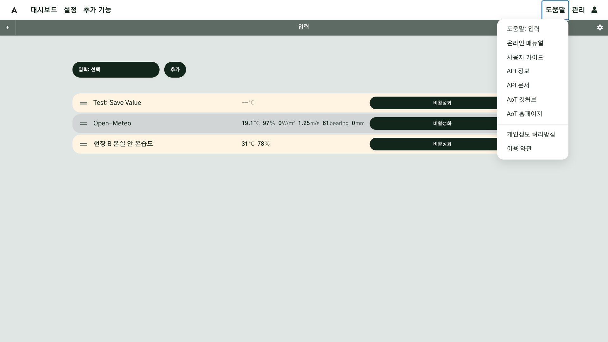
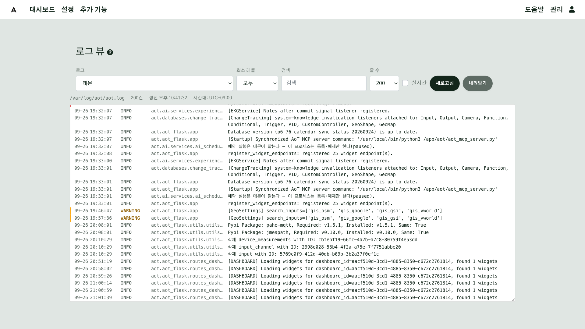
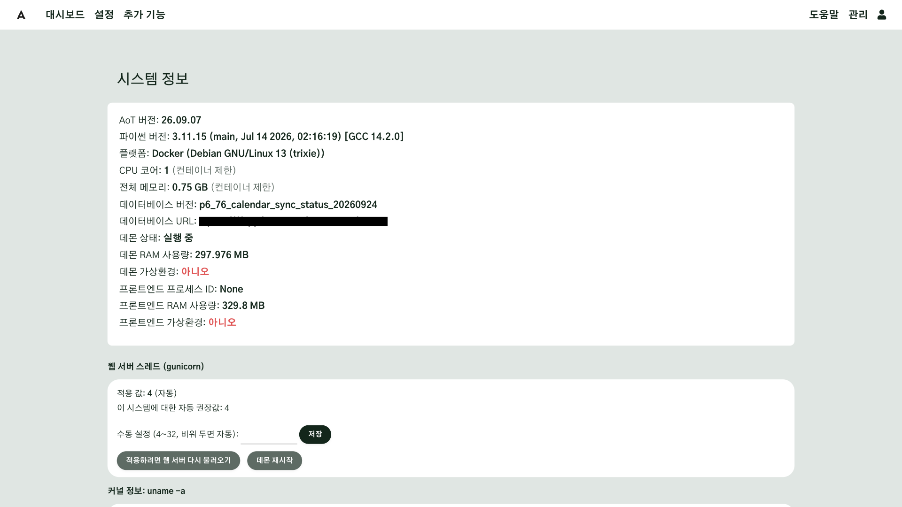
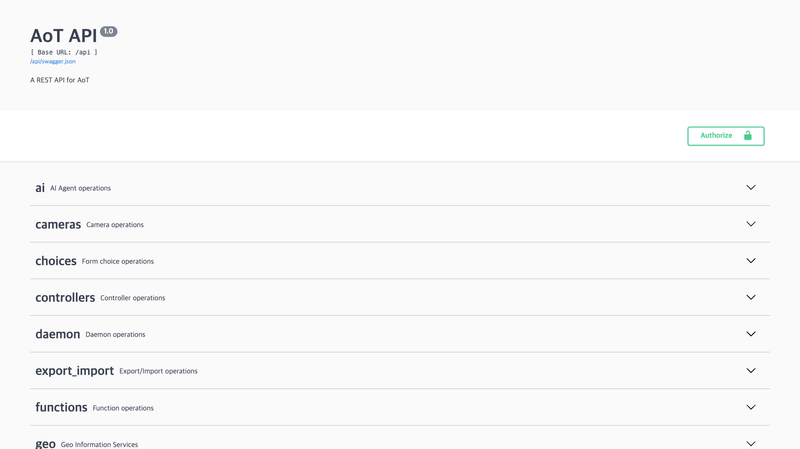
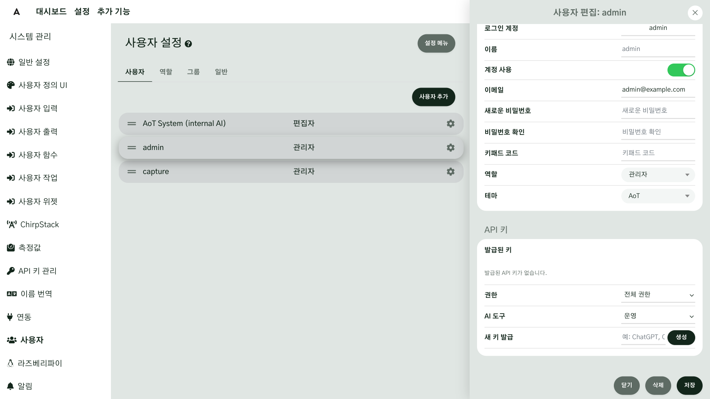

# 도움말과 문제 보고

AoT 를 쓰다가 막히면 먼저 화면 오른쪽 위의 **도움말** 메뉴를 엽니다. 지금 보고 있는 화면의 매뉴얼,
온라인 매뉴얼 전체, API 문서, AoT 깃허브로 바로 이동할 수 있습니다. 오류가 나면 오류 화면과 시스템 로그에서
정보를 모아 AoT 깃허브에 이슈로 알립니다. 이 방법은 AoT 에 처음부터 있었고, 지금도 가장 기본적인 문제 보고 방법입니다.

## 이 장을 마치면 { #goal }

- 지금 보는 화면의 설명과 API 문서를 직접 찾는다
- 오류가 났을 때 필요한 정보를 모아 깃허브에 알린다

## 준비 { #prepare }

- 로그인할 수 있는 AoT ([설치](g01-install.md#check))
- 문제를 알리려면 GitHub 계정

## 절차 { #steps }

### 1. 도움말 메뉴 { #step-1 }

화면 오른쪽 위 **도움말**을 누르면 아래 항목이 나옵니다. 모두 새 탭에서 열립니다.

| 항목 | 여는 곳 |
|---|---|
| **도움말: <화면 이름>** | 지금 보고 있는 화면을 설명하는 매뉴얼 절. 설명이 있는 화면에서만 나옵니다 |
| **온라인 매뉴얼** | 매뉴얼 첫 화면 |
| **사용자 가이드** | 이 가이드의 첫 쪽 |
| **API 정보** | 매뉴얼의 API 설명 문서 |
| **API 문서** | 이 AoT 에 들어 있는 API 목록 화면(`/api`). 요청 형식과 응답을 직접 볼 수 있습니다 |
| **AoT 깃허브** | AoT 의 소스와 이슈 게시판 |
| **AoT 홈페이지** | AoT 소개 사이트 |
| **개인정보 처리방침**, **이용 약관** | 해당 문서 |

매뉴얼은 화면 언어를 따라 한국어·일본어·영어 판이 열립니다.

설정 화면의 항목 이름 옆에 있는 **?** 표시를 누르면 그 항목을 설명하는 매뉴얼 절로 이동합니다.

### 2. 오류 화면에서 정보 모으기 { #step-2 }

화면을 여는 중에 오류가 나면 **오류 500: 내부 서버 오류** 화면이 나타납니다. 이 화면에는 AoT 버전,
데이터베이스 버전, 보드 정보, 오류의 전체 추적 정보(트레이스백)가 나옵니다.

1. 화면에 나온 정보를 모두 복사합니다.
2. **GitHub에 새 이슈를 제출하세요** 링크를 누르면 AoT 깃허브의 이슈 작성 화면이 열립니다.
   이미 같은 문제가 올라와 있는지는 **GitHub 이슈** 링크에서 먼저 찾아봅니다.
3. 복사한 정보를 붙여 넣고, 무엇을 하다가 오류가 났는지 적어 제출합니다.

AoT 는 오류 정보를 자동으로 어디에도 보내지 않습니다. 알리려면 직접 이슈를 올려야 합니다.

!!! warning "올리기 전에 비밀 정보를 지우십시오"
    깃허브 이슈는 누구나 볼 수 있습니다. 붙여 넣을 내용에 API 키, 비밀번호, 이메일 주소, 현장 주소나
    IP 주소가 섞여 있으면 지우고 올리십시오.

### 3. 시스템 로그 내려받기 { #step-3 }

오류 화면 없이 동작이 이상하면 로그를 봅니다.

1. **관리** → **시스템 로그**를 엽니다(화면 제목은 **로그 뷰**).
2. 로그 종류(데몬, 웹 앱 등)와 최소 레벨을 골라 문제가 생긴 시각 전후의 기록을 봅니다.
3. **내려받기**를 누르면 고른 로그가 텍스트 파일(최대 2000줄)로 저장됩니다. 이슈에 이 파일을 첨부합니다.

AI 를 연결해 두었다면 로그 화면의 **설명**, **원인 진단**, **해결 방법은?** 버튼으로 고른 줄의 뜻을
물어볼 수도 있습니다([AI·MCP 연결](g12-ai-mcp.md)).

### 4. 버전과 상태 확인하기 { #step-4 }

**관리** → **시스템 정보**에서 **AoT 버전**, 데몬 상태, 디스크 사용량을 확인합니다. 이슈를 올릴 때는
AoT 버전과 설치 방법(Docker 또는 직접 설치)을 함께 적으십시오. 같은 문제가 이미 고쳐진 버전이 있는지
판단하는 데 필요합니다.

### 5. API 쓰기 { #step-5 }

다른 프로그램에서 AoT 의 값을 읽거나 장치를 제어하려면 API 를 씁니다.

1. **도움말** → **API 문서**에서 쓸 수 있는 요청을 찾습니다. **API 정보**는 사용 예와 규칙을 설명합니다.
2. 요청할 때는 사용자 API 키를 `X-API-KEY` 헤더에 넣습니다(`Authorization: Bearer <키>` 도 됩니다).
3. 사용자 API 키는 **관리** → **시스템 관리** → **사용자** → 사용자 편집 → **API 키**에서 **새 키 발급** 줄에
   이름을 입력하고 **생성**을 누르면 만들어집니다. 키는 **만들 때 한 번만** 보이므로 바로 안전한 곳에 적어 둡니다.

**API 키 관리** 메뉴는 이것과 다릅니다. API 키 관리는 AoT 가 날씨·지도 같은 외부 서비스에 접속할 때 쓰는
키를 보관하는 곳이고, 사용자 API 키는 사용자 편집 화면에서만 만듭니다.

## 확인 { #check }

**도움말** 메뉴에서 온라인 매뉴얼과 API 문서가 열리고, 문제가 났을 때 올릴 정보를 어디서 얻는지 알면 이 장을 마친 것입니다.

- 설정 화면 하나를 열고 **도움말: <화면 이름>** 이 그 화면의 설명으로 이어지는지
- **관리** → **시스템 로그**에서 로그를 내려받을 수 있는지
- **관리** → **시스템 정보**에서 AoT 버전을 찾을 수 있는지

## 현장 A { #site-a }

현장 A 는 관리 담당자 한 명이 문제를 모아 깃허브에 올립니다. 현장 사람들은 이상한 점을 발견하면 화면을
캡처하고 시각을 적어 담당자에게 전달하고, 담당자는 그 시각의 데몬 로그를 내려받아 이슈에 첨부합니다.

## 현장 B { #site-b }

현장 B 는 기존 제어 설비와 연결되어 있어, 문제가 AoT 에 있는지 기존 설비에 있는지부터 가려야 합니다. 출력 명령이
나갔는지는 **관리** → **감사 로그**에서, AoT 가 값을 받았는지는 **실시간 측정**에서 먼저 확인한 뒤 이슈를 올립니다.

## 안 될 때 { #trouble }

| 증상 | 확인할 것 |
|---|---|
| **도움말: <화면 이름>** 항목이 없다 | 그 화면에는 따로 연결된 설명이 없습니다. **온라인 매뉴얼**에서 찾으십시오 |
| 매뉴얼이 열리지 않는다 | 매뉴얼은 인터넷의 `aot-inc.github.io` 에 있습니다. 인터넷에 접속할 수 있는지, 방화벽 허용 목록에 있는지 봅니다([네트워크 연결](g03-network.md#step-4)) |
| API 요청이 거부된다 | `X-API-KEY` 헤더에 사용자 API 키를 넣었는지, 그 키의 권한이 요청에 맞는지 봅니다 |
| 사용자 API 키를 잃어버렸다 | 다시 볼 수 없습니다. 새로 만들고 이전 키는 지우십시오 |

## 더 알아보기 { #more }

- [API](../API.md)
- [로그 뷰어](../Log-Viewer.md)
- [시스템 정보](../System-Information.md)
- [문제 해결](../Troubleshooting.md)
