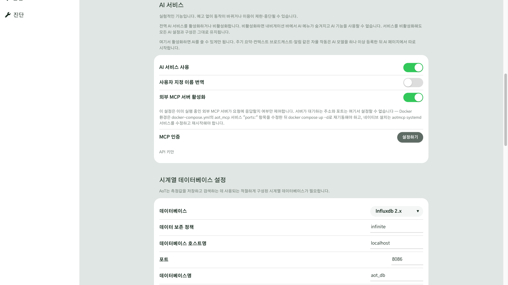
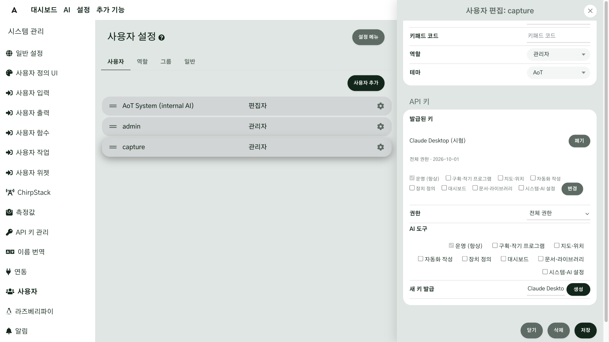
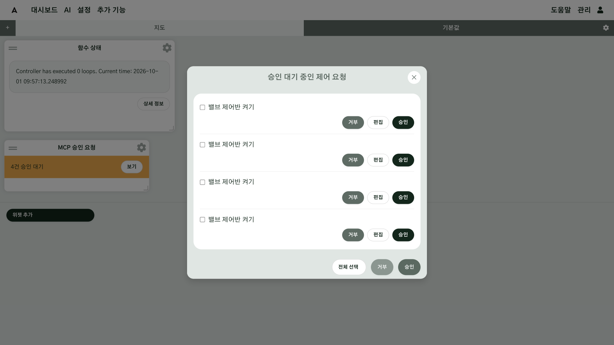
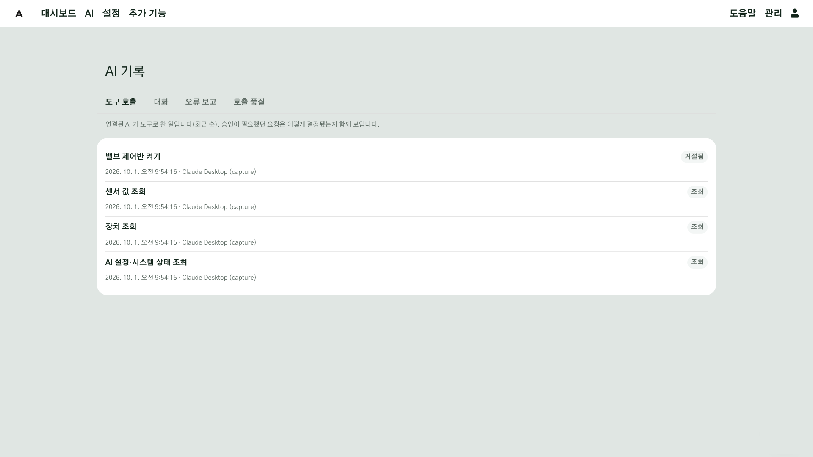

# AI

AI 는 묻고 답하는 창만이 아닙니다. 내가 쓰는 AI 앱을 AoT 에 연결해 두면, AI 가 현장의 기록을 읽고, 평소와 다른 곳을 짚고, 고칠 안을 내는 동료가 됩니다. 다만 장치를 움직이는 일처럼 현장을 바꾸는 일은, 사람이 승인해야 실행됩니다. 이 장에서는 AI 가 무엇을 할 수 있는지 보고, 내 AI 앱을 연결하고, AI 가 올린 요청을 승인하고, AI 가 한 일을 되짚어 보는 방법을 배웁니다.

!!! note "이 장의 AI 는 내가 쓰는 AI 앱입니다"
    이 장에서 말하는 AI 는 ChatGPT·Claude 같은, 내가 이미 쓰고 있는 AI 앱입니다. 그 앱이 MCP(AI 앱이 외부 시스템의 도구를 쓰게 해 주는 공개 규격)로 AoT 에 접속합니다. 앱에 어떻게 넣는지는 앱마다 달라서, 각 회사의 문서를 따릅니다.

## 이 장을 마치면 { #goal }

- AI 가 AoT 에서 하는 일과 할 수 없는 일을 설명할 수 있다
- 내 AI 앱을 AoT 에 연결하는 데 필요한 네 가지를 안다
- AI 가 올린 요청을 세 곳 가운데 한 곳에서 승인하거나 거부한다
- 승인하기 전에 볼 것을 알고, AI 가 한 일을 기록에서 되짚는다

## 준비 { #prepare }

- 앞 장까지 만든 시스템과, 설정을 바꿀 수 있는 관리자 계정
- 내가 쓰는 AI 앱(MCP 연결을 지원하는 것)
- 다른 컴퓨터의 AI 앱에서 쓰려면 [위기 대응](g13-crisis.md)에서 본 VPN 주소

## 절차 { #steps }

### 1. AI 가 하는 일 { #step-1 }

AI 는 제안하고, 사람이 승인합니다. 흐름은 네 칸입니다.

현장 기록 → AI 제안 → 사람 승인 → 현장 반영

1. **현장 기록 → AI 제안**: AI 는 먼저 현장의 기록을 읽고, 평소와 다른 곳을 찾아 고칠 안을 냅니다.
2. **사람 승인**: 사람은 그 안을 보고 판단하고, 괜찮다면 승인합니다. 승인이 필요한 변경은 승인하기 전까지 아무것도 바뀌지 않습니다.
3. **현장 반영**: 승인한 뒤에야 설정이 실제로 바뀌고, 그 결과가 다시 기록에 쌓입니다.

AI 가 할 수 있는 일은 세 가지로 나눌 수 있습니다.

| 종류 | 하는 일 |
|---|---|
| 읽기 | 현장의 값과 장치, 이력을 읽습니다 |
| 기록 | 노트를 남기고, 사람이 할 작업 일정을 초안으로 만듭니다 |
| 제안 | 입력과 출력, 함수를 고치는 안을 냅니다 |

일정은 초안으로만 만들어지니, 사람이 스케줄러에서 확인해야 합니다.

AI 에게 장치를 직접 움직이게 하는 것도 됩니다. 하지만 그것은 승인하면 한 번 실행되는 것입니다. 날마다 되풀이되는 일은 앞에서 만든 자동화(함수·자동화 장)가 합니다. 제어는 AI 가 하는 여러 일 가운데 하나일 뿐입니다.

### 2. 내 AI 앱을 연결하는 데 필요한 네 가지 { #step-2 }

AI 앱이 AoT 의 도구를 쓰게 해 주는 공개 규격이 MCP 입니다. MCP 를 지원하는 AI 앱이라면 같은 규격으로 연결됩니다. 기기마다 달라도 같은 단자면 꽂히는 것과 같습니다.

쓰고 있는 AI 앱을 AoT 에 연결하는 데는 네 가지가 필요합니다.

1. 외부 AI 의 접속이 허용되어 있는지 확인합니다([3단계](#step-3)).
2. 사용자 설정에서 접속 키를 만듭니다([4단계](#step-4)).
3. AI 앱이 AoT 에 닿을 주소를 정합니다([6단계](#step-6)).
4. 그 주소와 키를 AI 앱에 넣습니다. 넣는 방법은 앱마다 달라서, 각 회사의 문서를 따릅니다.

### 3. 외부 AI 접속 허용 확인 { #step-3 }

**관리 → 시스템 관리 → 일반 설정**을 열고 **AI 서비스** 절을 찾습니다. 이 기능은 아직 실험적이라, 예고 없이 동작이 바뀌거나 제한될 수 있다고 화면에 적혀 있습니다.

내 AI 앱으로 연결하려면 **외부 MCP 서버 활성화**가 켜져 있어야 합니다. **AI 서비스 사용**을 켜면 승인 요청과 기록을 보는 **AI** 메뉴가 생기고, 이것은 내 AI 앱 연결과 따로 동작합니다. 이 장에서는 두 가지를 모두 켜 두고 진행합니다.

### 4. 앱마다 접속 키 만들기 { #step-4 }

접속 키는 **관리 → 시스템 관리 → 사용자**에서 만듭니다. 사용자 한 명의 설정을 열면 **API 키** 단락이 있습니다. **AI 앱마다 키를 하나씩** 만드세요. 그러면 나중에 그 앱의 접속만 끊을 수 있습니다.

1. **AI 도구**에서 AI 가 다룰 수 있는 범위를 고릅니다([5단계](#step-5)).
2. **권한**을 고릅니다. 조회만 하게 하려면 **읽기 전용**, 조작을 제안할 수 있게 하려면 **전체 권한**입니다.
3. **새 키 발급**의 이름 칸에 AI 앱 이름을 적고 **생성**을 누릅니다.

키는 만들 때 한 번만 보입니다. 바로 복사해서 AI 앱 설정에 직접 넣으세요. 도움을 받는 AI 의 채팅 창에는 키를 붙여 넣지 마세요. 이미 만든 키를 끊으려면 **발급된 키**의 **폐기**를 누릅니다.

### 5. AI 가 할 수 있는 범위 정하기 { #step-5 }

AI 가 할 수 있는 범위는 키를 만들 때 정합니다.

| 고르는 것 | 뜻 |
|---|---|
| 권한: 읽기 전용 | 값과 장치, 기록을 읽기만 합니다 |
| 권한: 전체 권한 | 조작을 제안할 수 있습니다. 키 주인의 역할이 허락하는 만큼만입니다 |
| AI 도구: 운영(항상) | 항상 켜져 있습니다. 매일 쓰는 읽기와 장치 제어, 일정, 노트를 다룹니다 |
| AI 도구: 그 밖의 모듈 | 체크하면 더해집니다. 자동화·장치 정의·대시보드 등을 만들고 고치는 일까지 합니다 |

어느 쪽이든 키 주인의 역할을 넘을 수는 없습니다. 예를 들어 모니터 역할의 사용자 키는 전체 권한이어도 읽기만 됩니다. 처음에는 읽기 전용이나 운영만으로 시작해도 충분합니다.

### 6. 연결 주소 정하기 { #step-6 }

AI 앱이 어디에 있느냐에 따라 연결 주소가 다릅니다.

| AI 앱이 있는 곳 | 연결 방식 |
|---|---|
| AoT 를 설치한 컴퓨터와 같은 컴퓨터 | AI 앱이 직접 실행하는 방식으로 연결합니다 |
| 사무실 노트북처럼 다른 컴퓨터 | [위기 대응](g13-crisis.md)에서 본 VPN 주소와 키로 접속합니다. 주소는 `http://<AoT 컴퓨터의 VPN 주소>:5700/mcp` 모양이고, 키는 `X-API-KEY` 머리글로 보냅니다 |

처음 설치한 AoT 는 그 컴퓨터 자신의 접속만 받으니, 다른 컴퓨터에서 쓰려면 설정을 한 번 바꿔야 합니다. 이 부분은 코딩 AI 와 함께 하세요.

!!! warning "인터넷에 그대로 열지 마세요"
    AI 의 접속은 반드시 VPN 안에서만 쓰세요. 인터넷에 그대로 열면 안 됩니다.

### 7. AI 앱에 입력하기 { #step-7 }

정한 주소와 4단계의 키를 AI 앱의 MCP 연결 설정에 넣습니다. 넣는 방법은 앱마다 달라서, 각 회사의 문서를 따르세요. 자세한 연결 방법은 [AI·MCP 연결](g12-ai-mcp.md)에도 있습니다.

### 8. 승인하는 곳 { #step-8 }

AI 의 변경 요청은 결재 서류와 같습니다. 장치를 움직이는 일처럼 현장을 바꾸는 요청은, 사람이 결재하기 전까지 실행되지 않습니다. 승인할 수 있는 곳은 두 군데입니다.

- AI 앱과의 대화에서 말로 승인합니다
- 어느 화면에서나 아래쪽에 떠 있는 AI 바의 **승인 대기** 칩을 눌러 승인합니다

두 곳 모두 같은 승인 대기열을 다루니, 지금 보고 있는 곳에서 바로 처리하면 됩니다.

### 9. 승인 창에서 승인하기 { #step-9 }

화면 아래 AI 바에 **승인 대기 N** 칩이 뜨면 승인을 기다리는 요청이 있다는 뜻입니다. AI 연결을 꺼 두었거나 이 기기에서 한 번도 켠 적이 없어도, 대기 중인 요청이 있으면 뜹니다. 칩을 누르면 **승인 요청** 창이 열립니다. 새 요청이 와도 창이 저절로 열리지는 않습니다.

요청마다 무엇을 하려는지, 요청한 AI, 남은 시간이 보입니다. 아직 실행되지 않은 요청이고, **승인**을 누르면 여기 적힌 그대로 곧바로 실행됩니다. AI 에게 돌아가 다시 말할 필요가 없습니다. 하지 않을 요청은 **거부**를 누르고, 값을 고쳐서 실행하려면 **수정**을 눌러 바꾼 뒤 **저장하고 승인**을 누릅니다. 여러 건이면 아래의 **모두 승인**·**모두 거부**로 한꺼번에 처리할 수 있습니다. 승인 요청 창에는 AI 가 이 화면을 바꾸려 할 때의 확인(**화면 조작**: **허용**·**거절**)도 함께 올라옵니다.

밸브나 펌프처럼 실제 장비를 움직이는 요청은 승인할 때 한 번 더 확인합니다. 승인하지 않고 두면 15분 뒤 요청은 사라집니다(기본). 승인은 제어를 편집할 수 있는 역할의 사용자만 할 수 있습니다.

### 10. 요청 화면과 대시보드 위젯에서 건수 보기 { #step-10 }

**AI → 요청**의 첫 구획과 대시보드의 **MCP 승인 요청** 위젯은 요청이 몇 건 기다리는지 보여 줍니다. 위젯은 **위젯 추가**에서 고릅니다. 위젯을 처음 놓을 때는 화면이 한 번 새로 불러와지니, 10초쯤 기다리세요. **보기**를 누르면 위의 승인 요청 창이 열립니다. 이 두 곳에서는 건수만 보이고, 승인·거부는 승인 요청 창에서 합니다.

### 11. 승인하기 전에 볼 세 가지 { #step-11 }

승인하기 전에 세 가지를 보세요.

1. 어느 장치를 움직이려는지
2. 얼마나, 몇 분 동안 움직이려는지
3. 지금 현장에서 해도 되는지

현장 A 에서 노지 밸브를 열라는 요청이 왔다면 구역과 시간을 확인하세요. 현장 사정을 아는 사람의 확인이 마지막 안전장치입니다.

### 12. AI 가 한 일 되짚기 { #step-12 }

AI 가 한 일은 **AI → 기록**에서 봅니다. [알림](g12-alerts.md)과 [위기 대응](g13-crisis.md)에서 본 시스템 로그와는 다른 화면입니다. **도구 호출** 탭에는 연결된 AI 가 도구로 한 일이 최근 순으로 쌓입니다. 한 일과 시각, 호출한 AI(키 주인), 결과가 한 줄씩 나오고, 승인이 필요했던 요청은 어떻게 결정됐는지도 함께 보입니다. 그래서 나중에 왜 이렇게 바뀌었는지 되짚어 볼 수 있습니다.

## 확인 { #check }

- 일반 설정의 **AI 서비스** 절에서 **외부 MCP 서버 활성화**가 켜져 있다
- AI 앱마다 이름을 붙인 키를 따로 만들었고, 키를 AI 채팅 창에 붙여 넣지 않았다
- AI 앱에서 현장의 값을 물으면 답이 온다
- AI 가 올린 요청이 **AI → 요청**에 나타나고, 승인하기 전에는 장치가 움직이지 않는다
- **AI → 기록**의 **도구 호출**에서 방금 한 일을 찾을 수 있다

## 안 될 때 { #trouble }

| 증상 | 확인할 것 |
|---|---|
| AI 앱이 AoT 에 연결되지 않는다 | **외부 MCP 서버 활성화**가 켜져 있는지, 주소와 키가 맞는지 확인하세요. 다른 컴퓨터라면 VPN 에 연결되어 있는지도 보세요 |
| 연결은 되는데 값만 읽고 조작을 못 한다 | 키의 **권한**이 읽기 전용인지, 키 주인의 역할이 읽기만 허락하는지 확인하세요 |
| AI 가 입력·출력·함수를 만들지 못한다 | **AI 도구**에서 해당 모듈에 체크했는지 확인하세요. 체크한 뒤에도 키 주인의 역할을 넘을 수는 없습니다 |
| **AI** 메뉴가 보이지 않는다 | 일반 설정에서 **AI 서비스 사용**이 켜져 있는지 확인하세요 |
| 요청이 사라졌다 | 승인하지 않고 두면 기본 15분 뒤에 사라집니다. AI 에게 다시 요청하게 하세요 |
| 승인 버튼이 눌리지 않는다 | 제어를 편집할 수 있는 역할의 사용자만 승인할 수 있습니다 |
| 키를 잃어버렸다 | 키는 만들 때 한 번만 보입니다. 이전 키를 **폐기**하고 새로 만드세요 |
| 승인 요청 위젯이 바로 안 나온다 | 처음 놓을 때는 화면이 한 번 새로 불러와집니다. 10초쯤 기다리세요 |

## 더 알아보기 { #more }

- [AI·MCP 연결](g12-ai-mcp.md)

막히면 언제든 [가이드 사용하는 방법](g02-ask-ai.md)에서 본 대로 AI 에게 물어보세요.

## 도우미 AI 에게 { #for-ai }

- 사용자의 AI 앱을 AoT 에 연결하는 방법을 묻는 장입니다. 사용자는 사무용 컴퓨터만 쓰는 현장 관리자입니다.
- 접속 키·비밀번호를 사용자에게 요구하지 마세요. 키는 사용자가 AI 앱 설정에 직접 넣습니다.
- 먼저 AoT 와 AI 앱이 같은 컴퓨터인지 다른 컴퓨터인지 물어보세요. 다른 컴퓨터라면 처음 설치한 AoT 는 그 컴퓨터 자신의 접속만 받으므로, 설정을 바꾸는 방법을 함께 안내해야 합니다.
- 접속 주소를 인터넷에 그대로 열거나 공유기에서 포트를 열라고 하지 마세요. VPN 안에서만 씁니다.
- 처음에는 읽기 전용 키나 운영 도구만으로 시작하게 하세요.
